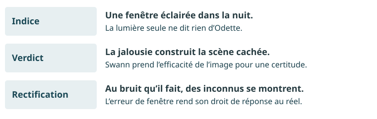

# ENS · MP-PC · Français 2007 — corrigé guidé

*Corrigé rédigé par IA, non officiel. Signalez toute erreur.*

**Rédaction** · GPT-6.2 Astra Ultra · vitesse non renseignée · 25 novembre 2026

## Sujet et œuvres

Julien Gracq oppose deux images de l’imagination. À la broderie ou au voile posés sur le monde succède une puissance souveraine qui cite le réel devant son tribunal et condamne son « insignifiance opaque ». Le sujet invite à examiner ce renversement dans *Don Quichotte*, *De la recherche de la vérité* et *Un amour de Swann*.

## Deux métaphores pour poser le problème

Une broderie ajoute un motif à un support. Un voile cache ce qui pourrait être découvert si on le levait. Dans les deux cas, le réel est supposé déjà constitué, plus durable et plus fondamental que l’image. Avec le tribunal, les rôles basculent : l’imagination réclame désormais au monde une raison de sa signification. Il faut examiner à part le pouvoir qu’elle exerce réellement et la légitimité du jugement qu’elle entend rendre.

## Un exemple, deux arguments possibles

Dans l’épisode d’Andrés, la lecture chevaleresque du monde donne à un passant une raison d’intervenir contre une injustice admise. La même lecture lui fait accepter une promesse dont personne ne veillera à l’exécution. Faire se suivre ces deux conséquences explique pourquoi la copie peut prendre Gracq au sérieux puis lui faire une objection. Il ne s’agit pas de constituer successivement une liste des bienfaits et une liste des dangers de l’imagination.

Avec Malebranche, préciser à quelle question répond chaque argument. Les traces expliquent la naissance ou le retour d’une image. Elles ne démontrent ni qu’elle soit fausse ni que le jugement auquel elle nous porte soit vrai. Avec Proust, distinguer la personne à laquelle la fenêtre appartient, ce que Swann croit voir et l’histoire qu’il prête à Odette. L’écart entre ces trois niveaux fournit à la fois une expérience romanesque et une épreuve philosophique.

## Construire le passage vers la fin

Écrire une phrase où le réel puisse répondre au procès sans retrouver la souveraineté absolue du point de départ. La musique à la soirée Saint-Euverte se prête à cet exercice : Swann lui avait attribué une valeur amoureuse, mais elle lui fait maintenant éprouver quelque chose qu’il n’avait pas décidé d’avance. Cette réversibilité ouvre une issue plus précise qu’une conclusion sur l’utilité générale de l’imagination.

## Dissertation rédigée

Au milieu de la nuit, une fenêtre éclairée devient pour Swann la preuve presque suffisante de ce qu’il redoute. Il lui reste seulement à s’assurer qu’il s’agit bien de la fenêtre d’Odette, détail dont il découvrira trop tard l’importance. À quel tribunal cette lumière aurait-elle pu faire appel de l’interprétation qui vient de lui être imposée ? Julien Gracq renverse précisément les rôles d’un tel procès. L’imagination, que l’on accorde volontiers au poète comme la permission d’embellir provisoirement le vrai, serait une puissance en droit de faire comparaître le monde pour son manque de signification. L’hypothèse ne porte donc pas seulement sur la force psychologique des images. Il s’agit de savoir si le réel peut cesser d’être la mesure de ce que l’on imagine, et à quel prix. Cervantès et Proust font sentir toute la puissance de ce renversement. Malebranche aide à voir en quoi le succès d’un pouvoir ne suffit pas à légitimer ses sentences.

### Elle change ce que les choses peuvent signifier

La broderie dont Gracq refuse l’image recevrait d’un support déjà constitué la totalité de son dessin. On pourrait l’ôter et retrouver un monde qui conserverait exactement le même sens. La naissance de l’amour de Swann permet de faire l’expérience contraire. L’apparence d’Odette l’avait laissé assez indifférent. Puis il distingue une parenté entre son visage et celui d’une figure peinte par Botticelli. Une simple comparaison décorative ajouterait un compliment à un amour déjà formé. Ici l’ordre est à peu près inverse. Le plaisir pris à l’œuvre, l’autorité que Swann reconnaît à l’art italien, le temps qu’il a passé à apprendre à regarder la peinture entrent dans la perception qu’il aura désormais de cette femme. Son visage devient enfin digne de cette attention longue qui sera une condition de l’amour. L’image travaille en amont de la préférence au lieu de l’orner après coup.

Dans *Don Quichotte*, la première auberge peut devenir un château parce qu’une série complète de possibilités se substitue à une autre. L’homme qui tient l’établissement recevra le rôle de celui qui peut armer un chevalier. Les gestes des personnes rencontrées, les objets trouvés sur place et les interruptions de la nuit prennent place dans une cérémonie que nul n’avait prévue. La transformation demeure risible à ceux qui savent ce qu’est une auberge. Elle est pourtant assez réelle pour changer le comportement de plusieurs personnes qui entrent dans le jeu, tantôt pour se divertir, tantôt pour avoir la paix. La souveraineté imaginée par Gracq se mesure à cet effet. Le monde extérieur fournit les objets, mais il n’est plus seul à leur attribuer leurs emplois. Quelque chose devient possible parce qu’un homme a cessé de tenir pour évidente l’interprétation commune de ce qu’il rencontrait.

Un philosophe aussi méfiant que Malebranche à l’égard des dérèglements de l’imagination contribue à expliquer ce phénomène. Une trace ancienne peut être réactivée et se lier à une impression nouvelle, de sorte que le présent est affecté par des associations qui ne lui appartenaient pas en propre. La vivacité de l’image mentale se propage au jugement. On ne verra donc pas moins bien ce pouvoir en reconnaissant ses conditions corporelles. Un mécanisme dépendant du corps peut tenir une place décisive dans ce que l’esprit *croit* recevoir passivement du monde.

### Une souveraineté de fait peut commettre une erreur de droit

Il faut cependant distinguer deux affirmations. Une image m’entraîne avec une puissance que je n’arrive pas à contrôler. Cette image serait donc habilitée à juger que le donné extérieur est insignifiant. La seconde ne découle en rien de la première. Swann croit qu’après l’avoir renvoyé chez lui Odette reçoit quelqu’un d’autre. Il revient et prend une fenêtre éclairée pour la sienne. Tout ce qu’il peut imaginer derrière les volets s’accorde à la lumière qu’il voit. Il suffit pourtant que des inconnus répondent pour que cette cohérence s’effondre. L’erreur tenait à un trait plus élémentaire que l’interprétation du comportement d’Odette. Swann n’avait pas identifié la bonne fenêtre. Le réel n’a eu à lui proposer aucune vision supérieure de l’amour. Il lui a rendu une différence entre deux lieux. Ce peu de chose suffit à récuser la conclusion du tribunal.

L’interprétation de Malebranche empêche de voir là une défaillance accidentelle d’une faculté habituellement infaillible. L’impression forte n’est pas accompagnée d’un signe qui nous permettrait de distinguer ce qu’elle doit à la chose et ce qu’elle doit à la disposition du sujet. L’attention et l’examen des raisons prennent du temps. L’image, elle, dispose immédiatement de son pouvoir de persuasion. Son caractère « incontrôlable » a donc deux sens très différents. Son surgissement échappe parfois à notre volonté. Mais la vérité de ce qu’elle suggère exige toujours un contrôle, et le refus de l’exercer nous dispense trop facilement de nous demander qui supportera les conséquences d’une illusion.

Le jeune Andrés en fait les frais dans le roman de Cervantès. Don Quichotte intervient contre un maître qui maltraite son valet et se tient pour satisfait de la promesse qu’il lui a arrachée. Le scénario de réparation auquel il croit lui fournit à l’avance la fin de l’histoire. Le départ du chevalier permet au maître de reprendre le dessus. Ce que Don Quichotte a récusé avec raison, l’injustice commise devant lui, aurait exigé une attention assez longue au rapport effectif entre les deux hommes. En prêtant à tous les obligations que lui dicte son propre imaginaire, il se donne la satisfaction d’un verdict sans en garantir les effets pour l’enfant. Une imagination prompte à déclarer le réel opaque peut contribuer à le rendre encore plus difficile à entendre, surtout pour qui ne dispose pas du rôle de héros.

### Décider du sens sans supprimer le droit de réponse

Pourquoi, en dépit de ces objections, l’élan de Gracq garde-t-il sa force ? Parce que s’en remettre à l’ordre de signification déjà établi ne constitue en rien une garantie d’attention à la vérité. Le maître d’Andrés peut parler tranquillement au nom de son droit, et personne d’autre ne s’était arrêté pour demander au jeune garçon ce qu’il subissait. La lecture des romans de chevalerie aura au moins rendu possible chez Don Quichotte une interruption de cette évidence. Sa faute a été de croire l’affaire jugée. L’audace initiale et la présomption finale méritent deux jugements distincts. L’imagination peut ouvrir un procès que le monde ordinaire avait tout intérêt à ne pas instruire. Pour cela justement, elle ne devrait pas en fixer d’avance l’issue.

La petite phrase de Vinteuil met aussi Swann en présence d’une réalité dont les habitudes du monde ne fournissaient ni l’équivalent ni le nom. La musique lui permet d’attacher une forme reconnaissable à une émotion encore indistincte. Il en fait avec Odette une sorte de signe commun à leur amour. Mais lorsque la phrase revient à la soirée Saint-Euverte, elle ne lui rapporte pas seulement le message qu’il lui avait confié. Elle remet devant lui le commencement d’un amour dont la réalité présente le fait souffrir. L’imagination qui s’était approprié la musique se découvre à son tour exposée à ce que la musique fait apparaître. Nous sortons alors de l’alternative initiale. Une œuvre constituée avec des éléments sensibles peut opposer à l’imagination présente du sujet la vérité d’un temps qu’il aurait voulu pouvoir congédier.

La portée de la thèse de Gracq tient finalement à la liberté qu’elle accorde au geste par lequel nous reprenons les significations du monde. Un dehors absolument opaque n’imposerait pourtant aucune rectification et ne pourrait guère soutenir une contestation digne de ce nom. Ce que Proust et Cervantès donnent à lire, ce que Malebranche invite à examiner, est un mouvement à double sens. Une image peut citer le monde à comparaître parce qu’elle y a aperçu une possibilité qu’on ne voyait plus. Elle grandit encore en puissance lorsqu’elle accepte d’écouter le témoin dont elle ignorait ce qu’il allait répondre.

## Sources

Le sujet 71.11PM est commun aux ENS de Paris, Lyon et Cachan et aux deux filières MP et PC. Les rapports PC et MP de deux pages chacun discutent la double proposition de Gracq. Celui de PC souligne notamment la différence entre voile et broderie ; celui de MP revient sur les cas où l’imagination redonne au réel sa signification.

[Sujet](https://banques-ecoles.fr/cms/wp-content/data/filiere-pc/annales-de-la-banque-pc/session-2007/sujet-ecrit-2007-mp-pc_francais.pdf) · [Rapport](https://banques-ecoles.fr/cms/wp-content/data/filiere-pc/rapports-des-jurys-de-la-banque-pc/session-2007/rapport-2007-pc_ecrit_francais.pdf) · [Rapport complémentaire](https://www.ens.psl.eu/IMG/file/concours/2007/MP/mp_ecrit_francais.pdf)
