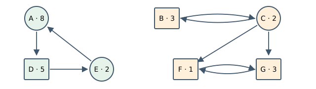

# ENS · MP-PC · Informatique 2007 — corrigé brut

*Corrigé rédigé par IA, non officiel. Signalez toute erreur.*

**Rédaction** · GPT-6.2 Astra Ultra · vitesse non renseignée · 25 novembre 2026

**Révision (tour 1)** · GPT-6.2 Astra Ultra · vitesse non renseignée · 26 novembre 2026

On note n le nombre de sommets, m le nombre d’arcs et l’on utilise la convention du sujet pour l’infini. Dans un jeu, chaque sommet possède au moins un successeur. Une stratégie choisit un seul successeur à chacun des sommets du joueur.

## Partie 1. Chemins optimaux

### Question 1.1 · Existence du minimum

On peut effacer la portion comprise entre deux occurrences d’un même sommet. Son poids est positif ou nul, donc l’effacement donne un chemin de poids inférieur ou égal. On arrive à un chemin simple, éventuellement trivial. Entre deux sommets fixés il existe seulement un nombre fini de tels chemins. Si tous ont poids infini, le minimum vaut lui-même l’infini.

### Question 1.2 · Distances de la figure 1

Dans l’ordre $1,2,3,4$, le résultat est
$$D^w=\begin{pmatrix}0&3&6&5\\-1&0&3&2\\-4&-2&0&-1\\-3&-1&1&0\end{pmatrix}.$$
Par exemple $3,4,1$ pèse $-4$ et $1,2,4,3$ pèse $6$. On vérifie toutes les entrées par la récurrence 1.7 avec pivots successifs $1,2,3,4$.

### Question 1.3 · Produit min-plus

```text
pour i de 1 à n :
    pour j de 1 à n :
        C[i,j] ← infini
        pour k de 1 à n :
            C[i,j] ← min(C[i,j], M[i,k] + N[k,j])
renvoyer C
```

Le minimum après $k$ tours porte sur les $k$ premiers termes. Le temps est $\Theta(n^3)$ et le tableau résultat occupe $\Theta(n^2)$ cases.

### Question 1.4 · Sous-chemin optimal

Pour un optimum de poids fini, si une portion $\tau$ admettait un concurrent strictement moins cher, le substituer à $\tau$ donnerait un chemin strictement meilleur entre les bornes initiales. Si l’on autorise des arcs de poids infini, les conditions (1) et (2) de l’énoncé laissent toutefois une exception. Sur les seuls arcs $a\to b$ de poids infini, $b\to c$ de poids 2, $b\to d$ et $d\to c$ de poids 0, le chemin $a,b,c$ est optimal au sens littéral et $b,c$ ne l’est pas.

### Question 1.5 · Puissances de W

Pour $r\ge1$, $(W^{*r})_{st}$ est le poids minimal parmi les chemins de longueur au plus $r$ ; les attentes diagonales de poids nul complètent une longueur trop courte. L’induction partage une marche en ses $r$ premiers pas et son dernier. Pour l’infini, une entrée inaccessible reste infinie. La réduction aux chemins simples donne $D^w=W^{*(n-1)}$, où $W^{*0}$ est l’identité min-plus (zéros diagonaux, infini ailleurs).

### Question 1.6 · Doublement

```text
M ← W ; r ← 1
tant que r < n-1 :
    M ← produit_min_plus(M,M)
    r ← 2r
renvoyer M
```

L’invariant est la distance avec au plus $r$ arcs ; le carré partage tout trajet d’au plus $2r$ arcs en deux trajets d’au plus $r$. Au premier dépassement on a toutes les distances. Le temps est $O(n^3\log n)$ pour $n\ge2$.

### Question 1.7 · Autoriser un nouveau sommet

Initialement $d_0(s,t)=w(s,t)$. Pour $1\le u\le n$,
$$d_u(s,t)=\min\{d_{u-1}(s,t),\ d_{u-1}(s,u)+d_{u-1}(u,t)\}.$$
Un optimum simple évite $u$ comme intermédiaire ou s’y coupe une seule fois. Réciproquement les deux chemins du second terme se concatènent en chemin admissible. Cela donne les deux inégalités, avec la convention sur l’infini.


### Question 1.8 · Floyd–Warshall

Partir de $D=W$. Pour $u=1,\dots,n$, remplacer chaque $D[s,t]$ par $\min(D[s,t],D[s,u]+D[u,t])$. À pivot fixé la ligne et la colonne du pivot sont invariantes, car $D[u,u]=0$ ; l’écriture en place respecte donc 1.7. L’invariant à la fin du tour $u$ est $D=d_u$. Temps $O(n^3)$, espace $O(n^2)$.

### Question 1.9 · Reconstruire le chemin

Calculer $D$. Si $s=t$, renvoyer $[s]$. Pour $D[s,t]$ fini, parcourir en largeur depuis $s$ les arcs entre sommets distincts satisfaisant $w(x,y)<\infty$ et $D[x,t]=w(x,y)+D[y,t]$ avec $D[x,t]$ fini. Garder les pères et remonter depuis $t$. Un optimum fini fournit une chaîne de tels arcs ; par télescopage tout chemin reconstruit est optimal. Temps $O(n^3)$ en tout. Si $D[s,t]=\infty$, renvoyer la liste vide avec la convention usuelle « arc utilisable = poids fini ». Si de vrais arcs de poids infini sont admis, $W$ seul ne permet pas de distinguer une telle liaison d’une absence d’arc ; avec $A$ fourni, une recherche d’accessibilité résout ce dernier cas.

### Question 1.10 · Cycle strictement négatif

Exécuter la formule de 1.7 sur deux tableaux, même si un cycle négatif est présent, puis tester si une case diagonale est négative. Toute valeur finie est le poids d’une marche réelle après effacement des attentes ; une marche fermée négative contient un cycle négatif. Réciproquement un tel cycle peut être choisi simple. En le coupant au sommet intérieur de numéro maximal, on voit par induction que la formule calcule, pour tout chemin simple autorisé (ou cycle simple), une valeur au plus égale à son poids. Le cycle force donc une case diagonale négative. Temps $O(n^3)$.

## Partie 2. Stratégies sur une arène

### Question 2.1.1 · Éviter le sommet zéro

On a $R_0=\{1,2\}$ et $R_1=\{0\}$. Prendre $f_0(1)=2$ ; le joueur 1 n’a qu’un choix, $f_1(0)=f_1(2)=1$. Depuis 1 ou 2 on alterne entre eux. Depuis 0 l’interdiction est déjà enfreinte.

### Question 2.1.2 · Revenir aux deux extrémités

Le jeu n’est pas positionnel. Depuis 1, tout choix fixe du joueur 0 omet une extrémité à partir du premier coup. Le joueur 1, dont la stratégie est imposée, ne garantit pas non plus sa victoire : la partie $1,0,1,2,1,0,1,2,\ldots$ la respecte et visite les deux extrémités infiniment souvent.

### Question 2.2 · Disjonction

Si $s\in R_0\cap R_1$, jouer les deux stratégies gagnantes l’une contre l’autre depuis $s$. La partie unique ainsi déterminée serait à la fois dans $W$ et dans son complément. Ainsi $R_0\cap R_1=\varnothing$.

### Question 2.3 · Atteindre une cible en solitaire

Avec $S_1=\varnothing$, $X_0$ est l’ensemble des sommets reliés à $T$ par un chemin. Nécessité par la première visite ; réciproque en suivant un chemin simple. Pour chaque sommet de distance en nombre d’arcs $d>0$ à $T$, choisir un successeur de distance $d-1$. Sur $T$ et hors de $X_0$, compléter arbitrairement. Une seule stratégie fait décroître $d$ jusqu’à zéro depuis tout $X_0$.

### Question 2.4 · Stratégie avec matrice d’adjacence

```text
pour s = 1,…,n : F[s] ← premier t tel que V[s,t] = 1
marquer les sommets de T et les enfiler une fois
tant que la file est non vide :
    t ← défiler()
    pour s = 1,…,n :
        si V[s,t] = 1 et s non marqué :
            marquer s ; F[s] ← t ; enfiler(s)
renvoyer F
```

Chaque marquage fournit un successeur déjà marqué et raccourcit la distance à la cible. Chaque colonne est balayée au plus une fois. Initialisation comprise, le coût est $O(n^2)$.

### Question 2.5 · Stratégie avec listes

```text
initialiser Pred[1..n] à des listes vides
pour chaque s :
    F[s] ← premier élément de Succ[s]
    pour t dans Succ[s] : ajouter s à Pred[t]
marquer et enfiler T
tant que la file est non vide :
    défiler t
    pour s dans Pred[t] :
        si s non marqué : marquer s ; F[s] ← t ; enfiler s
renvoyer F
```

La preuve de 2.4 s’applique. Temps et espace $O(n+m)=O(m)$ puisque tout sommet possède un arc sortant.

### Question 2.6.1 · Victoire dans l’attracteur

Définir le rang par le premier étage de construction contenant le sommet. Hors de $T$, tout sommet de rang $r$ appartenant à 0 admet un successeur de rang inférieur, que l’on choisit. Si ce sommet appartient à 1, tous ses successeurs ont un rang inférieur. En au plus $r$ coups, une cible est atteinte.

### Question 2.6.2 · Victoire dans le complément

Au point fixe, un sommet de 0 hors de l’attracteur n’a aucun successeur dedans ; un sommet de 1 hors de l’attracteur possède au moins un successeur dehors. Choisir ce dernier. Le complément, disjoint de $T$, demeure invariant. Avec 2.6.1, cela établit la positionnalité.

### Question 2.7 · Calcul avec adversaire

Construire les prédécesseurs comme en 2.5 et poser $c[s]=|\mathrm{Succ}[s]|$. Marquer et enfiler $T$. À chaque $t$ dépilé, parcourir les prédécesseurs non marqués $s$. Si $s\in S_0$, marquer et enfiler $s$, en fixant $f_0(s)=t$. Si $s\in S_1$, décrémenter $c[s]$ et marquer puis enfiler $s$ lorsque le compteur devient nul. Compléter les choix de 0 arbitrairement aux autres sommets. Les marquages sont justifiés par les règles existentielle et universelle. À terminaison elles ne peuvent plus rien ajouter. Coût $O(m)$.

### Question 2.8.1 · Jouer vers la bande centrale

Échanger $x,y$ si besoin et poser $r=x/y\ge1$, $\varphi=(1+\sqrt5)/2$. L’énoncé pose $\gamma(x,y)=\lfloor |r-1/r|\rfloor$. Pour $r\ge1$, ce plancher est nul exactement lorsque $r^2-r-1<0$, soit $r<\varphi$. Échanger les coordonnées remplace $r$ par $1/r$ et donne, pour tout $r>0$, la condition $1/\varphi<r<\varphi$. L’égalité aux seuils est impossible pour un rapport rationnel. Si $r>\varphi$, il existe exactement un entier $k$ tel que $1/\varphi<r-k<\varphi$ : l’intervalle des $k$ a pour longueur $\varphi-1/\varphi=1$ et des bornes irrationnelles. Il est positif et $x-ky>0$. Le coup est légal et atteint $\gamma=0$. Pour $x\ne y$ soustraire une fois le plus petit du plus grand est toujours légal ; sur la diagonale la boucle assure la totalité. Les deux coordonnées restent dans leurs bornes.


### Question 2.8.2 · Sortir de la bande

Si $x>y$ et $\gamma=0$, alors $1<r<\varphi<2$. Le seul coup qui change de joueur soustrait une fois $y$ à $x$. Le rapport devient $r-1<\varphi-1=1/\varphi$, donc $\gamma\ne0$. Pour $y>x$, échanger les rôles. Si $x=y$, il n’existe aucun coup changeant de joueur.

### Question 2.8.3 · Régions du jeu arithmétique

Chaque coup hors diagonale diminue strictement $x+y$. Une partie finit donc sur une boucle $(d,d,z)$, gagnée par 0 exactement si $z=1$. À une position de $\gamma\ne0$, le joueur au trait choisit un successeur de $\gamma=0$ ; depuis une position inégale de $\gamma=0$, tout coup donne $\gamma\ne0$ à l’autre joueur. Par induction sur $x+y$, le joueur au trait gagne exactement lorsque $\gamma\ne0$. Les positions gagnantes de 0 sont ainsi $z=0,\gamma\ne0$ ou $z=1,\gamma=0$.

## Partie 2 (suite). Accessibilité répétée

### Question 2.9 · Répétition avec la matrice des distances

Marquer chaque $t\in T$ tel qu’il existe $v$ avec $V_G[t,v]=1$ et $D[v,t]<\infty$. Ce test demande un vrai premier arc et inclut les boucles. Pour chaque $s$, le retenir si $D[s,t]<\infty$ pour au moins une cible marquée $t$. Le coût est $O(n|T|)$ pour une cible non vide ; si $T=\varnothing$, renvoyer l’ensemble vide directement. Une partie gagnante revisite une même cible, donc fournit un cycle accessible. Inversement atteindre un cycle simple passant par une cible puis le répéter est réalisable par une stratégie positionnelle : prendre un chemin simple arrêté à sa première entrée dans le cycle.

### Question 2.10 · Répétition avec les listes

Construire les listes inverses. Pour chaque $t\in T$, calculer $P_t$, les sommets pouvant l’atteindre, par parcours inverse depuis $t$. Si $\mathrm{Succ}(t)\cap P_t\ne\varnothing$, ajouter $P_t$ au résultat. La découverte d’un successeur dans $P_t$ caractérise un retour de longueur positive. Coût $O(m|T|)$ pour $T$ non vide ; traiter d’emblée le cas vide.

### Question 2.11.1 · Prédécesseur contrôlé par zéro

Poser $\mathrm{Pre}(Y)=\{s\in S_0:\exists t\in Y,\ s\to t\}\cup\{s\in S_1:\forall t,\ s\to t\Rightarrow t\in Y\}$. Les constructions par étages donnent $X\cup\mathrm{Attr}^+(X)=\mathrm{Attr}(X)$, puis $\mathrm{Attr}^+(X)=\mathrm{Pre}(\mathrm{Attr}(X))$ : tout témoin apparaît à un rang fini, et un maximum fini suffit dans le cas universel. Ainsi tout sommet de 0 dans $\mathrm{Attr}^+(X)$ admet une sortie vers $\mathrm{Attr}(X)$.

### Question 2.11.2 · Prédécesseur contrôlé par un

Si $s\in S_1\cap\mathrm{Attr}^+(X)$, la définition de $\mathrm{Pre}$ en 2.11.1 impose que chaque successeur appartienne à $\mathrm{Attr}(X)$.

### Question 2.12 · Stratégie de retours successifs

Par monotonie, les $W_i$ décroissent à partir de $W_0=T$. La suite finie stationne en $W=T\cap\mathrm{Attr}^+(W)$. Dans $\mathrm{Attr}(W)\setminus W$, employer les rangs de 2.6. Depuis $W\cap S_0$, choisir un successeur dans $\mathrm{Attr}(W)$ selon 2.11 ; depuis $W\cap S_1$, tous y conduisent. Après chaque visite on effectue un vrai pas puis on revient en rang décroissant, éventuellement immédiatement. On visite donc $W\subseteq T$ infiniment souvent.

### Question 2.13 · Stratégie contre les retours

Écrire $A_i=\mathrm{Attr}(W_i)$. Hors de $\mathrm{Attr}(W)$, donner à $s$ le rang $h(s)=\min\{i:s\notin A_i\}$. Au rang $i$, 1 peut maintenir la partie hors de $A_i$ par 2.6.2 ; le rang suivant est ainsi au plus $i$. Si $s\in T$, alors $i>0$ et $s\notin W_i=T\cap\mathrm{Pre}(A_{i-1})$. En ce point, 1 peut imposer une sortie hors de $A_{i-1}$ (toutes les sorties si le sommet appartient à 0). Prescrire ce coup en priorité. Le rang baisse strictement à chaque visite de $T$, donc les visites sont en nombre fini. Cette prescription est positionnelle.

## Partie 2 (fin). Jeux de parité

### Question 2.14 · Lecture de l’arène coloriée

Nommer $A,B,C$ la rangée supérieure de gauche à droite et $D,E,F,G$ la rangée inférieure. On obtient $R_0=\{A,D,E\}$ et $R_1=\{B,C,F,G\}$. Aux cercles $A,E$, choisir respectivement $D,A$. Le carré $D$ impose $E$, d’où le cycle de maximum 8. Aux carrés $B,G$, choisir respectivement $C,F$ ; $F$ impose $G$. Le cercle $C$ ne peut aller qu’en $B,F,G$. Dans cette région close, tout cycle rencontre un carré de couleur 3 et toutes les couleurs sont au plus 3. Compléter chaque stratégie arbitrairement sur les sommets de son propriétaire hors de sa région.



### Question 2.15 · Réunir des stratégies locales

Pour $s\in\bigcup_iF_i$, poser $g(s)=f_j(s)$ avec $j=\min\{i:s\in F_i\}$ ; compléter ailleurs. Depuis $s_i$, suivre mentalement l’indice $i$ tant qu’aucun choix de plus petit indice n’est rencontré. Un sommet atteint sous $f_j$ depuis $s_j$ a toutes ses continuations compatibles encore gagnantes sous $f_j$ : on peut préfixer par le chemin témoin, et la parité ignore les préfixes finis. À chaque changement l’indice diminue strictement. Après le dernier, la partie suit définitivement une stratégie gagnante depuis une position accessible à celle-ci. Ainsi $g$ gagne depuis tout $X_0$.

### Question 2.16 · Couleur maximale nulle

Toute partie voit uniquement 0, donc $R_0=S$ et $R_1=\varnothing$. Des choix de successeurs quelconques conviennent.

### Question 2.17 · Sous-arène des sommets restants

Par 2.15 appliquée à 1, une même stratégie gagne sur $U_1$. En $U_1\cap S_0$, tout successeur est dans $U_1$ ; en $U_1\cap S_1$, le successeur prescrit y reste, par invariance du gain par ajout d’un préfixe. En $U_0\cap S_1$, aucun successeur ne peut appartenir à $U_1$, sinon 1 le choisit puis gagne. En $U_0\cap S_0$, au moins un successeur est dans $U_0$, sinon tout coup mènerait à la stratégie gagnante uniforme de 1. Ainsi tout sommet de $H$ a un successeur dans $H$. Les deux classes restreintes en forment une partition.

### Question 2.18 · Cas du maximum pair

Travailler dans $H$. Si ses couleurs sont toutes inférieures à $k$, l’induction donne une partition positionnelle dans $H$. Tout gagnant de 1 dans $H$ serait gagnant dans le jeu complet : 0 peut sortir vers $U_1$, où l’on prend la stratégie gagnante de 1 qui y reste. Ceci contredit la définition de $U_0$. Donc tout $H$ gagne pour 0, et 1 ne peut sortir de $H$.

Sinon, soit $M=\{s\in U_0:c(s)=k\}$, $A=\mathrm{Attr}_0^H(M)$ et $B=U_0\setminus A$. Si $B$ est non vide, c’est une sous-arène : les sommets de 0 dans $B$ n’ont pas de sortie vers $A$ dans $H$, ceux de 1 peuvent rester dans $B$. Ses couleurs sont inférieures à $k$. Une stratégie gagnante de 1 depuis un sommet de $B$ s’étendrait au jeu complet : elle reste dans $B$ sauf si 0 sort vers $U_1$, où 1 gagne aussi. L’induction attribue donc tout $B$ à 0. Combiner cette stratégie sur $B$, la stratégie d’attraction sur $A\setminus M$ et un choix dans $H$ sur $M$. Si $M$ est visité infiniment, le maximum récurrent est $k$, pair. Sinon la partie finit dans $B$, car toute entrée dans $A$ impose une visite de $M$ en temps fini. Elle y est gagnante.

### Question 2.19 · Positionnalité générale

Pour $k$ pair, 2.15 et 2.18 donnent les deux stratégies sur $U_1$ et $U_0$. Pour $k$ impair, échanger les rôles dans l’argument : isoler d’abord la région où 0 sait gagner, puis attirer pour 1 vers la couleur $k$ dans le reste. Les retours infinis à $k$ y gagnent pour 1. La récurrence sur $k$ est close, avec 2.16 comme base.

### Question 2.20 · Calcul en temps exponentiel demandé

Énumérer les stratégies de chaque joueur ($\le n^n$ possibilités chacun). Pour une stratégie $f$ du joueur $j$, garder sa seule sortie prescrite à ses sommets et toutes les sorties adverses. Pour chaque couleur présente $a$ de parité perdante pour $j$, restreindre aux sommets de couleur $\le a$ et repérer les composantes fortement connexes contenant un sommet de couleur $a$ et un cycle (taille $>1$ ou boucle). Marquer dans le graphe de $f$ tout sommet pouvant atteindre une telle composante, par parcours inverse **sans** restriction de couleur sur le préfixe. Les sommets non marqués sont exactement les départs gagnants de $f$ : un contre-exemple infini possède un sommet de couleur maximale récurrente sur un cycle de la composante correspondante, et réciproquement on peut répéter un circuit passant par ce sommet.

Par joueur, réunir les régions ainsi obtenues. La question 2.15 assure qu’une stratégie énumérée gagne sur toute la réunion : on peut aussi prendre celle de région de cardinal maximal. La disjonction et la couverture découlent de 2.19. Le test par stratégie coûte $O(n(n+m))$ avec un parcours des composantes et un parcours inverse par couleur. Le temps total est $2^{O(n\log n)}$.
