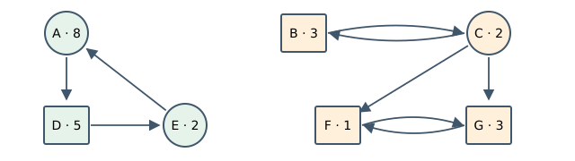

# ENS · MP-PC · Informatique 2007 — corrigé guidé

*Corrigé rédigé par IA, non officiel. Signalez toute erreur.*

**Rédaction** · GPT-6.2 Astra Ultra · vitesse non renseignée · 25 novembre 2026

**Révision (tour 1)** · GPT-6.2 Astra Ultra · vitesse non renseignée · 26 novembre 2026

Comment calculer un chemin optimal, puis choisir un coup qui réussit quelle que soit la réponse adverse ? La première partie traite des chemins finis. La seconde s’intéresse aux parties infinies et donne des stratégies qui dépendent uniquement du sommet occupé.

## Partie 1. Chemins optimaux

### Question 1.1 · Existence du minimum

Un chemin peut comporter un nombre arbitraire de tours. Dès qu’un sommet revient, découper le tour et le jeter. Le coût ne monte pas, et la longueur baisse strictement. Le meilleur des chemins restants s’obtient donc parmi ceux de longueur au plus $n-1$. Depuis un sommet vers lui-même, le chemin sans arc donne le minimum zéro.

### Question 1.2 · Distances de la figure 1

Lire les flèches avant leurs poids. Les arcs sortants de 1 sont limités à $1\to2$ de poids 3. Depuis 2 on peut aller à 1 (0) ou 4 (2), depuis 3 à 1 ($-1$), 2 ($-2$) ou 4 ($-1$), depuis 4 à 1 ($-3$) ou 3 (1). Ajouter les zéros diagonaux, puis essayer les quatre pivots de 1.7. Les lignes obtenues sont $(0,3,6,5)$, $(-1,0,3,2)$, $(-4,-2,0,-1)$ et $(-3,-1,1,0)$.

### Question 1.3 · Produit min-plus

Pour aller de $i$ à $j$, essayer chaque point de raccordement $k$. Un coût infini élimine automatiquement un raccordement inaccessible.
```text
pour chaque ligne i, puis chaque colonne j :
    meilleur ← infini
    pour k = 1,…,n :
        si M[i,k] + N[k,j] < meilleur :
            meilleur ← M[i,k] + N[k,j]
    C[i,j] ← meilleur
renvoyer C
```

Il y a $n^2$ couples de bornes et $n$ essais par couple.

### Question 1.4 · Sous-chemin optimal

À mêmes extrémités, remplacer un morceau préserve le raccordement. La comparaison stricte se transmet à la somme quand les deux morceaux extérieurs ont un coût fini, ce qui établit la propriété attendue pour les chemins de poids fini. La garde de définition ne stipule pas explicitement que tout arc a poids fini. Avec un passage obligatoire de poids infini en tête, tous les trajets suivants ont le même poids total infini, même si certains détours sont plus coûteux.

### Question 1.5 · Puissances de W

Une case de $W$ traite au plus un arc. Dans $W*W$, le minimum choisit le milieu d’un trajet d’au plus deux arcs. Le même raisonnement ajoute une étape à chaque produit. Les zéros sur la diagonale font office de pauses, même en l’absence de boucle. Il suffit d’autoriser $n-1$ arcs après suppression des cycles, et pour $n=1$ la réponse est la matrice $(0)$.

### Question 1.6 · Doublement

On peut dépasser la longueur seuil sans modifier l’optimum. Conserver la matrice de portée initiale 1, la remplacer par son produit avec elle-même et doubler la portée, tant qu’elle est inférieure à $n-1$. Le nombre de multiplications est au plus $\lceil\log_2(\max(1,n-1))\rceil$, chacune cubique. Pour un seul sommet, renvoyer directement $W$.

```text
DistancesParDoublement(W,n)
M ← W ; r ← 1
tant que r < n-1 :
    M ← produit_min_plus(M,M)
    r ← 2r
renvoyer M
```

### Question 1.7 · Autoriser un nouveau sommet

Le paramètre $u$ borne le numéro des sommets intérieurs, indépendamment des extrémités. Sans sommet intérieur, seuls le chemin trivial et les arcs directs comptent, d’où $d_0=w$. Lorsqu’on autorise $u$, on garde l’ancien coût ou on paie le trajet jusqu’à $u$ puis celui de $u$ à l’arrivée, tous deux calculés à l’étape précédente. Tout chemin optimal peut être débarrassé des répétitions, si bien que cette alternative est exhaustive.


### Question 1.8 · Floyd–Warshall

Placer la boucle sur le pivot à l’extérieur. Une manière directe de préserver le sens des indices consiste à lire la matrice précédente en entier et à écrire une nouvelle matrice avec la formule 1.7. Échanger les tableaux après chaque pivot. Après $n$ tours tous les intermédiaires sont permis. Deux tableaux suffisent, et chacun des $n^3$ calculs a un coût borné.

### Question 1.9 · Reconstruire le chemin

Suivre sans précaution un arc réalisant l’égalité de distance pourrait faire tourner autour d’un cycle nul. Un parcours qui marque chaque sommet une seule fois évite ce piège. Une fois les distances obtenues, conserver les arcs de poids fini dont le coût plus la distance restante égale la distance actuelle, et chercher $t$ dans ce sous-graphe. Les parents donnent la liste dans l’ordre après inversion. Le parcours coûte $O(n^2)$ après le calcul cubique. Pour $s=t$ le chemin trivial suffit. Lorsque la distance est infinie, la matrice autorise le retour d’une liste vide si tous les arcs ont poids fini ; voir la réserve de 1.4 si l’on interprète littéralement (2).

### Question 1.10 · Cycle strictement négatif

Le calcul ne requiert pas de définir un minimum sur une famille de trajets de poids non minorés. Les valeurs restent celles de trajets construits, ce qui certifie toute diagonale négative. Pour vérifier qu’on détecte bien chaque cycle négatif, en prendre un simple et le parcourir depuis l’un de ses sommets. À chaque pivot, la récurrence permet au moins le découpage de ce trajet au plus grand numéro intermédiaire. Sa valeur finale sur la diagonale est donc au plus son poids négatif. Trois boucles suffisent.

## Partie 2. Stratégies sur une arène

### Question 2.1.1 · Éviter le sommet zéro

À qui appartient la décision ? Au milieu, le cercle appartient à 0. Les deux carrés n’ont chacun qu’une flèche sortante. En choisissant le carré de droite depuis le milieu, 0 reste dans $\{1,2\}$. Partir du carré de gauche suffit au contraire à faire gagner 1. Le jeu est positionnel.

### Question 2.1.2 · Revenir aux deux extrémités

Il faudrait alterner gauche et droite aux visites successives du sommet 1. Une stratégie dépendant seulement du sommet y répète son choix. Cela exclut 1 de toute région gagnante positionnelle de 0. Pour 1, toutes les parties respectent l’unique stratégie et l’alternance des deux extrémités lui fait perdre. Le sommet 1 ne peut donc appartenir à aucune des deux régions requises.

### Question 2.2 · Disjonction

Fixer les deux fonctions supprime toute liberté dans la suite des coups. Sur cette même suite, les deux garanties de victoire seraient incompatibles. La partition en régions est donc disjointe.

### Question 2.3 · Atteindre une cible en solitaire

Une route vers une cible témoigne qu’elle est atteignable. Pour assembler toutes les routes sans prescriptions contradictoires, retenir à chaque sommet un premier pas d’une route la plus courte. Le nombre de pas encore nécessaires diminue à chaque coup. Les sommets cibles sont déjà gagnés au départ.

### Question 2.4 · Stratégie avec matrice d’adjacence

Partir de toutes les cibles, puis explorer les flèches à rebours. Lorsqu’on découvre un prédécesseur, sa flèche en sens direct désigne le prochain coup.
```text
F ← un successeur quelconque de chaque sommet (lecture des lignes)
file ← T sans répétition ; vus ← ensemble des sommets de la file
tant que file non vide :
    retirer t en tête
    pour chaque indice s de la colonne t :
        si V[s,t] vaut 1 et s est nouveau :
            ajouter s aux vus et en queue ; F[s] ← t
renvoyer F
```

Le parcours retrouve exactement les sommets qui peuvent rejoindre une cible et traite au plus $n$ colonnes de longueur $n$.

### Question 2.5 · Stratégie avec listes

Où perdait-on du temps ? À lire les zéros de la matrice. Construire les listes de prédécesseurs en un passage sur les arcs, puis ne considérer que ces prédécesseurs.
```text
pour s : choix[s] ← Succ[s][premier]
pour s et pour t dans Succ[s] : ranger s dans Pred[t]
mettre les cibles dans une file et les marquer
pour chaque t retiré de la file :
    pour chaque s de Pred[t] encore non marqué :
        choix[s] ← t ; marquer et enfiler s
renvoyer choix
```

Chaque arc est lu au plus deux fois. Les choix initiaux garantissent une stratégie définie partout. Comme $m\ge n$, le coût est $O(m)$.

### Question 2.6.1 · Victoire dans l’attracteur

Inscrire 0 sur les cibles, 1 sur les nouveaux sommets du premier tour, puis 2 et ainsi de suite. Au tour du joueur 0, une sortie vers une étiquette plus petite suffit. Au tour du joueur 1, la définition impose que chaque sortie aille vers une telle étiquette. Le jeton atteint nécessairement une étiquette nulle.

### Question 2.6.2 · Victoire dans le complément

Si toutes les sorties d’un sommet de 1 conduisaient dans l’attracteur, ce sommet y entrerait lui-même (prendre le maximum des rangs finis de ses successeurs). Il reste donc un coup qui évite l’attracteur. Aux sommets de 0, tous les coups l’évitent déjà. La cible ne sera jamais visitée.

### Question 2.7 · Calcul avec adversaire

Pour 0, un bon coup suffit. Pour 1, attendre le dernier arc non traité de sa liste avant de conclure que tous les coups sont bons pour 0. Un compteur initialisé au degré sortant fait ce test sans relire la liste. Chaque fois qu’une destination marquée sort de la file, elle valide un arc entrant. Le premier arc validé d’un sommet de 0 donne son choix gagnant. Chaque arc coûte un travail constant.

### Question 2.8.1 · Jouer vers la bande centrale

Poser $r=x/y$ et $\varphi=(1+\sqrt5)/2$. Le plancher $\gamma=\lfloor |r-1/r|\rfloor$ s’annule lorsque $|r-1/r|<1$. Pour $r\ge1$, cela donne $r^2-r-1<0$, donc $r<\varphi$. Pour $r\le1$, appliquer le même calcul à $1/r$, d’où $r>1/\varphi$. Un coup portant sur la plus grande coordonnée retranche un entier au rapport $r$ avant de réordonner les coordonnées. La zone $]1/\varphi,\varphi[$ a largeur exactement 1 ; au départ à droite, une unique soustraction entière positive y conduit. Les deux seuils sont irrationnels, donc le coup ne tombe pas sur une borne. Chaque position inégale possède une soustraction licite et chaque position égale une boucle ; les listes de propriétaires couvrent bien l’arène.


### Question 2.8.2 · Sortir de la bande

Entre 1 et le nombre d’or, le quotient entier vaut 1. Le nouveau petit nombre, rapporté à l’ancien petit nombre, est donc inférieur à $1/\varphi$. Il est déjà hors de la bande centrale. La boucle sur la diagonale garde le même propriétaire et n’intervient pas dans l’assertion.

### Question 2.8.3 · Régions du jeu arithmétique

La diagonale donne la règle de fin : le joueur qui y reçoit le trait perd, puisqu’il l’y conserve indéfiniment. Celui qui peut envoyer l’autre dans la bande centrale le fait, et celui qui y reçoit le trait doit en sortir ou y rester bloqué sur la diagonale. Le total des coordonnées baisse à chaque soustraction, donc cette alternance se termine. La règle de coup de 2.8.1, complétée arbitrairement ailleurs, est positionnelle pour chacun des deux joueurs et donne exactement les deux cas annoncés.

## Partie 2 (suite). Accessibilité répétée

### Question 2.9 · Répétition avec la matrice des distances

Le zéro diagonal de $D$ ne garantit pas qu’on puisse revenir après un mouvement. Depuis chaque cible, essayer chaque premier arc et vérifier le retour par une distance finie. Conserver alors toute la colonne d’accessibilité de cette cible : ses sommets peuvent rejoindre le cycle, puis y rester. Les chemins infinis gagnants doivent revisiter au moins une cible, car $T$ est fini. Les deux balayages nécessitent au plus $2n$ tests par cible.

### Question 2.10 · Répétition avec les listes

Un parcours à rebours donne en même temps les départs capables de rejoindre $t$ et la réponse à la question de retour après un premier arc depuis $t$. Il suffit que l’un de ses successeurs soit marqué. Dans ce cas, tous les sommets marqués au parcours sont gagnants. Réunir les résultats en marquant les sommets dans un tableau booléen. Un parcours et un examen des sorties coûtent $O(m)$ par cible.

### Question 2.11.1 · Prédécesseur contrôlé par zéro

L’attracteur positif exige un premier coup, même depuis $X$. Ajouter $X$ après chaque étape de sa construction redonne les étages de l’attracteur ordinaire. Au moment où un sommet de 0 est ajouté à l’attracteur positif, une flèche mène déjà à $X$ ou à un étage positif précédent. Sa destination est bien dans l’attracteur ordinaire.

### Question 2.11.2 · Prédécesseur contrôlé par un

La règle d’entrée aux sommets de 1 quantifie sur toutes les flèches. Chacune a sa destination dans $X$ ou dans un étage positif déjà construit, donc dans $\mathrm{Attr}(X)$. L’adversaire ne peut sortir de cet ensemble au prochain coup.

### Question 2.12 · Stratégie de retours successifs

Une seule arrivée sur une cible ne suffit plus. Éliminer de $T$ les cibles depuis lesquelles un retour n’est pas garanti, répéter, et conserver le point fixe $W$. La construction y garantit un coup de relance. Entre deux visites, la stratégie de l’attracteur ordinaire fait décroître le rang jusqu’au prochain retour. Les deux prescriptions portent sur des ensembles disjoints et définissent une stratégie positionnelle unique.

### Question 2.13 · Stratégie contre les retours

Mesurer combien de tours d’élimination sont nécessaires avant que la position ne puisse plus atteindre la cible restante de façon garantie. Le premier indice d’échec est un entier fini hors de la région gagnante de 0. Le joueur 1 sait empêcher cet indice d’augmenter en évitant l’attracteur dont on est sorti. Sur une cible éliminée, il peut même sortir de l’attracteur de l’étape précédente, puisque la condition de retour positif y a échoué. Chaque visite consomme donc au moins une unité de cet entier ; au rang zéro, on évite déjà toutes les cibles.

## Partie 2 (fin). Jeux de parité

### Question 2.14 · Lecture de l’arène coloriée

Il y a deux sommets de couleur 2 et deux de couleur 3 ; repérer les sommets par leur place. En haut $A,B,C$, en bas $D,E,F,G$. Depuis le cercle 8, descendre sur le carré 5, qui envoie au cercle 2 du bas ; ce cercle remonte au 8. Inversement, le carré 3 du haut choisit le cercle 2 du haut et le carré 3 du bas le carré 1 voisin. Depuis le cercle 2 du haut, les trois sorties restent à droite ou reviennent au carré 3 du haut. On rencontre alors infiniment souvent un 3 et aucune couleur plus grande. Ces deux stratégies gagnent simultanément sur les trois sommets de gauche et les quatre autres respectivement.



### Question 2.15 · Réunir des stratégies locales

L’ordre $1,\ldots,p$ départage deux consignes contradictoires. Si un sommet contrôlé figurait déjà dans $F_2$ et $F_5$, lui attribuer la consigne de $f_2$. Après cette bascule, toute nouvelle position contrôlée atteinte en suivant $f_2$ est dans $F_2$, car on peut prolonger le chemin témoin depuis $s_2$. On ne basculera donc que vers un numéro encore plus petit. Une queue infinie suit finalement une stratégie locale gagnante, et les couleurs de son préfixe ne déterminent pas le maximum récurrent. Le raisonnement vaut aussi pour le joueur 1.

### Question 2.16 · Couleur maximale nulle

Dès que le maximum de toutes les couleurs vaut zéro, la couleur maximale vue infiniment souvent est toujours paire. La totalité de l’arène garantit l’existence des deux fonctions de choix.

### Question 2.17 · Sous-arène des sommets restants

Supposons qu’un sommet encore dans $U_0$ appartienne à 1. Une seule flèche vers sa région gagnante lui donnerait une victoire immédiate suivie de la stratégie de 2.15, contradiction. S’il appartient à 0, celui-ci doit disposer d’au moins une flèche qui évite cette région, sans quoi 1 gagnerait quelle que soit la décision. Après restriction à $U_0$, il reste donc toujours un mouvement légal.

### Question 2.18 · Cas du maximum pair

Dans la sous-arène $H$, personne ne peut gagner pour 1 : toute victoire qu’il y obtiendrait s’étendrait au jeu initial, grâce à sa stratégie sur $U_1$ lorsque 0 décide de sortir. Si le plus grand numéro a disparu, l’hypothèse de récurrence suffit.

S’il reste des sommets de couleur $k$, les prendre pour cibles et tracer leur attracteur pour 0 dans $H$. Son complément a des couleurs plus petites ; 0 n’y dispose d’aucun coup interne à $H$ qui entrerait dans l’attracteur. Une victoire de 1 dans ce complément s’étendrait donc elle aussi à l’arène entière. Par récurrence, 0 y possède une stratégie gagnante uniforme. L’appliquer dans le complément, se diriger vers la couleur $k$ dans l’attracteur, puis prendre un coup quelconque qui reste dans $H$ sur cette couleur. Une infinité de passages au $k$ gagne pour 0 ; un nombre fini laisse, à terme, la stratégie gagnante du complément s’appliquer sans interruption.

### Question 2.19 · Positionnalité générale

La preuve précédente utilise la parité du maximum seulement pour savoir à qui profitent des visites infinies à ce maximum. Lorsque ce joueur est 1, construire son attracteur après avoir ôté la région déjà gagnante de 0. Les sous-arènes résiduelles ont toujours des couleurs strictement plus petites. Dans tous les cas on obtient une stratégie fixe pour chacun sur sa région.

### Question 2.20 · Calcul en temps exponentiel demandé

Une autre énumération évite le calcul de composantes. Énumérer toutes les paires de stratégies fixes. Pour chaque paire et chaque départ, suivre le jeton jusqu’au premier sommet répété ; la plus grande couleur du cycle donne le gagnant. Pour chaque stratégie de chaque joueur, intersecter les ensembles qu’elle gagne contre toutes les stratégies fixes adverses. Cette vérification suffit : si une partie compatible perd, sa queue visite un sommet de couleur perdante maximale $a$, revient à lui et n’utilise plus de couleur supérieure. Le graphe des choix compatibles contient alors un cycle simple passant par ce sommet et de maximum $a$. Un chemin simple arrêté à sa première entrée sur le cycle suivi de ce cycle se réalise par une stratégie adverse fixe. Enfin retenir pour chaque joueur la stratégie qui gagne depuis le plus de sommets ; 2.15 montre qu’elle couvre toute sa région et 2.19 que les deux régions couvrent $S$. Il y a au plus $n^n$ paires (un choix par sommet) et $O(n^2)$ opérations de simulation par paire, soit $2^{O(n\log n)}$.
