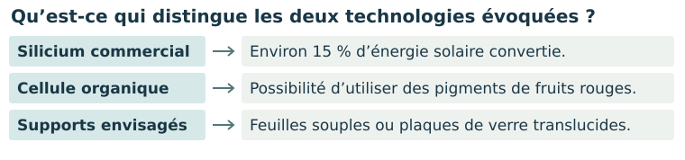
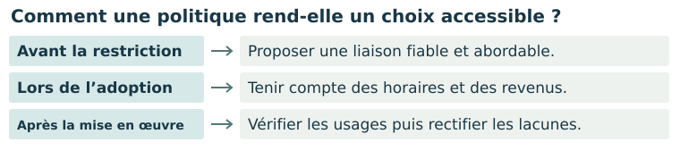

# ENS · MP-PC · Italien (LE2) 2007 — Corrigé guidé

*Corrigé rédigé par IA, non officiel. Signalez toute erreur.*

**Rédaction** · GPT-6.2 Astra Ultra · vitesse non renseignée

Le cahier commun aux ENS de Paris et de Cachan dure deux heures. Dictionnaire et calculatrice interdits pour l’italien. La version vaut 15 points, la question 5 points. La réponse doit compter au moins 100 mots.

## V. Version française

*Peccato che non profumino* joue sur le parfum de la myrtille, opposé à l’odeur du smog. *Un domani* marque une possibilité future. *Cristalli di una vettura* désigne ses vitres. Les 15 % concernent les panneaux en silicium du commerce à l’époque du texte.

**Des cellules photovoltaïques organiques mises au point […] à l’université de Rome**

Dommage seulement qu’elles ne sentent pas la myrtille. Sinon, en plus de révolutionner les panneaux solaires, les cellules photovoltaïques organiques aideraient à couvrir la puanteur du smog dans nos villes. Elles peuvent en effet utiliser comme élément actif des pigments extraits de fruits des bois et, à la différence des panneaux solaires classiques actuellement sur le marché, elles se passent entièrement de silicium. Les produire et les installer coûtera donc moins cher, mais surtout elles prendront la forme de feuilles souples ou de plaques de verre semi-transparentes. On pourra donc un jour les « étendre » sur des immeubles, les utiliser pour couvrir les tentes de la protection civile, ou les intégrer aux fenêtres d’un bâtiment ou aux vitres d’une voiture.

« Les panneaux solaires sur le marché sont presque tous des panneaux en silicium qui convertissent environ 15 % de l’énergie solaire qu’ils reçoivent », explique Thomas Brown, scientifique anglo-italien qui […] dirige le pôle du Latium consacré au photovoltaïque organique au sein du département d’ingénierie électronique de l’université de Rome Tor Vergata. « Aussi, pour satisfaire les besoins d’un usager moyen, faut-il installer des panneaux sur de très grandes surfaces. Mais la véritable difficulté tient aux coûts de fabrication et de production, qui freinent leur diffusion en l’absence d’aides de l’État. Sans compter que le prix du silicium de haute pureté ne devrait pas baisser, étant donné la rareté de l’offre. »

Or il existe précisément une autre voie, que la communauté scientifique explore depuis le début des années quatre-vingt-dix pour réduire aussi bien les coûts de production que les frais d’installation.

## 1. Cosa si può fare per incentivare la gente ad inquinare di meno?

*Incentivare* invite à expliquer le mécanisme d’une mesure. Comparer une interdiction isolée à une politique qui offre une solution praticable. L’exemple peut s’éloigner du panneau solaire tout en revenant au coût initial et à la répartition des bénéfices.

Per incoraggiare le persone a inquinare meno bisogna rendere praticabile l’alternativa. Una tariffa più alta per entrare in automobile in centro può ridurre il traffico, ma per chi inizia il turno prima del primo autobus rappresenta soltanto una spesa in più. Un comune potrebbe usare una parte degli introiti per aumentare la frequenza dei mezzi pubblici e collegare i quartieri periferici negli orari in cui il servizio manca. In seguito dovrebbe misurare sia la riduzione delle emissioni sia il tempo di viaggio di chi lavora. Lo stesso principio vale per i pannelli solari: un incentivo funziona meglio se anche una famiglia senza grandi risparmi può affrontare la spesa iniziale. Informazioni comprensibili, servizi affidabili e costi distribuiti con equità rendono più durevole un cambiamento di abitudini.

*125 mots.*

L’extrait de Jaime D’Alessandro a été publié par La Repubblica.it le 11 décembre 2006. Les rendements, prix et perspectives sont ceux du reportage. Le rapport d’italien LE2 2007 n’a pas été retrouvé.

[Version et consignes](https://banques-ecoles.fr/cms/wp-content/data/filiere-pc/annales-de-la-banque-pc/session-2007/sujet-ecrit-2007-mp-pc_langue_etrangere_2.pdf#page=7)
