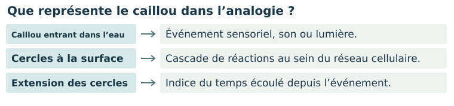
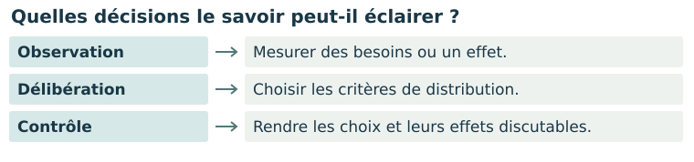

# ENS · MP-PC · Italien (LV1) 2007 — Corrigé guidé

*Corrigé rédigé par IA, non officiel. Signalez toute erreur.*

**Rédaction** · GPT-6.2 Astra Ultra · vitesse non renseignée

Le cahier commun aux ENS de Paris, de Lyon et de Cachan dure deux heures. Dictionnaire et calculatrice interdits pour l’italien. La page d’italien attribue 8 points à la version et 12 aux deux questions, avec un minimum de 100 mots pour chacune.

## V. Version française

*Scandire il tempo* signifie « marquer le temps », *tenere traccia* en suivre le cours. *Come ci riesca* est une interrogation indirecte avec subjonctif. La construction *più… più…* se rend par « plus… plus… ». L’article présente l’interprétation des chercheurs comme une théorie, et non comme une démonstration de la disparition de toute autre horloge biologique.

**Les cellules se souviennent des changements. C’est ainsi que le cerveau marque le temps.**

Horloges, réveils, alarmes sonores, téléphones portables. À tout moment de la journée, il suffit d’un coup d’œil autour de soi pour savoir l’heure qu’il est. Pourtant, même sans ces instruments, le cerveau perçoit parfaitement le temps qui passe. La façon dont il y parvient reste mystérieuse. Jusqu’ici, l’hypothèse d’une horloge interne aidant notre esprit à marquer le passage des heures et des jours en fournissait une explication partielle. Or une nouvelle étude de l’université […], publiée dans Neuron, propose une autre théorie. Une série de modifications physiques dans les cellules cérébrales aiderait l’organe à suivre l’écoulement du temps.

Tous les événements qui se succèdent dans la journée, expliquent les chercheurs dans la revue scientifique américaine, aident à garder la trace des heures. « Qu’il s’agisse de comprendre une phrase, de jouer au ballon ou de faire de la musique, tous les comportements complexes reposent sur la capacité du cerveau à mesurer le temps », explique Dean Buonomano, professeur associé de neurobiologie et de psychiatrie à la faculté de médecine de l’UCLA et l’un des auteurs de l’étude.

Ce mécanisme est bien différent de celui que suppose l’hypothèse d’un système centralisé qui compterait dans le cerveau des mouvements fixes et réguliers, marquant ainsi le passage des minutes. Pour employer une analogie, […], c’est comme lorsqu’on jette un caillou dans l’eau. Les cercles concentriques qui se forment à la surface sont comme une signature indiquant que le caillou a pénétré dans l’eau. Plus les cercles s’étendent loin, plus il s’est écoulé de temps depuis l’événement.

Pour les chercheurs américains, il se passe la même chose dans le cerveau. Chaque fois que l’esprit « traite » un événement sensoriel, par exemple un son ou un éclair de lumière, il déclenche une série de réactions en cascade au sein des cellules cérébrales et de leurs connexions. Chaque réaction laisse une signature qui permet au réseau des cellules du cerveau de coder le temps.

## 1. In quale misura il sapere scientifico ci può aiutare a vivere meglio?

Partir d’un effet concret, puis examiner ce qui rend son application possible. Le texte de la version offre un exemple de connaissance fondamentale dont les bénéfices indirects ne peuvent se mesurer immédiatement.

Il sapere scientifico ci aiuta a vivere meglio quando rende comprensibile un fenomeno sul quale dobbiamo agire. Conoscere la qualità dell’acqua di un paese, per esempio, permette di individuare un problema prima che ogni famiglia debba affrontarlo da sola. Occorrono però anche tecnici competenti, risorse e istituzioni disposte a comunicare i risultati. Una misura rimasta in un archivio modifica ben poco la vita quotidiana. Inoltre non tutte le ricerche nascono per risolvere un problema immediato. Studiare come il cervello distingue due intervalli musicali amplia la nostra comprensione dell’esperienza, anche se non ne deriva subito una cura. Considererei dunque sia i benefici concreti sia la possibilità di porre domande migliori, senza promettere che ogni scoperta si trasformi automaticamente in benessere per tutti.

*121 mots.*

## 2. Quale può essere la relazione tra sapere scientifico e consapevolezza morale?

Utiliser *permette di* pour ce que la connaissance rend possible et *spetta a* pour la décision. Un exemple de répartition de ressources fait apparaître le passage des faits aux valeurs.

Una conoscenza più precisa delle conseguenze può rendere più esigente la nostra responsabilità morale. Se sappiamo che una misura apparentemente neutra penalizza sempre lo stesso quartiere, diventa difficile difenderla dicendo che tutti sono stati trattati allo stesso modo. Una ricerca può mostrare, per esempio, quanto tempo occorra agli abitanti di zone diverse per raggiungere un ospedale. Quei dati non stabiliscono da soli dove costruire una nuova struttura. Bisogna discutere se dare priorità al numero complessivo dei pazienti oppure a chi oggi affronta il viaggio più lungo. In senso inverso, la consapevolezza morale orienta la ricerca quando induce a raccogliere dati su persone fino ad allora trascurate. I due saperi collaborano meglio se ciascuno rende esplicite le proprie domande e i propri limiti.

*122 mots.*

L’article anonyme publié par La Repubblica.it le 30 janvier 2007 figure en page 5. Les coupes visibles dans le texte sont conservées. Aucun rapport spécifique à l’option italienne LV1 n’a été retrouvé.

[Version et consignes](https://banques-ecoles.fr/cms/wp-content/data/filiere-pc/annales-de-la-banque-pc/session-2007/sujet-ecrit-2007-mp-pc_langue_vivante_1.pdf#page=5)
