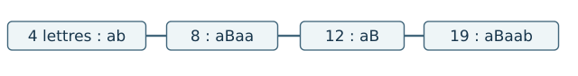
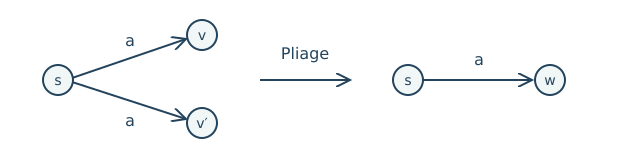
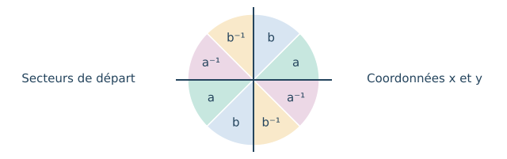

# ENS · MP-PC · Mathématiques-informatique 2007 — corrigé brut

*Corrigé rédigé par IA, non officiel. Signalez toute erreur.*

**Rédaction** · GPT-6.2 Astra Ultra · vitesse non renseignée · 25 novembre 2026

**Révision** · GPT-6.2 Astra Ultra · vitesse non renseignée

Les lettres majuscules A et B utilisées dans les traces désignent les inverses formels de a et b. Ailleurs, une barre inverse une lettre, et inverse aussi l’ordre des lettres d’un mot. Le produit dans le groupe consiste à concaténer puis réduire.

Les 38 items se répartissent entre 31 questions numérotées. Les exemples utilisent les mots réduits comme représentants des éléments du groupe libre. Lors du pliage des graphes, une même lettre doit désigner la même transition sortante depuis un sommet donné. [Fac-similé du sujet](https://banques-ecoles.fr/cms/wp-content/data/filiere-mp/annales-de-la-banque-i/session-2007/sujet-ecrit-2007-i-mathematiques_informatique.pdf) · [Rapport du jury](https://banques-ecoles.fr/cms/wp-content/data/filiere-mp/rapports-des-jurys-de-la-banque-i/session-2007/rapport-2007-i_ecrit_mathematiques_informatique.pdf) · [Sommaire](https://banques-ecoles.fr/cms/filiere-mp/les-annales-et-rapports-des-jurys/)

## Partie 1 · Morphismes et engendrement

### Question 1.1 · Réciproque et inverse

Si $u=\varphi(x)$ et $v=\varphi(y)$, alors $uv=\varphi(xy)$, donc $\varphi^{-1}(uv)=\varphi^{-1}(u)\varphi^{-1}(v)$. L’antécédent du neutre est le neutre. Pour un morphisme de groupes, $\varphi(x^{-1})\varphi(x)=\varphi(x)\varphi(x^{-1})=1$, donc $\varphi(x^{-1})=\varphi(x)^{-1}$.

### Question 1.2 · Plus petite structure contenant une partie

Le produit vide appartient à $R^*$. Concaténer deux produits finis d’éléments de $R$ donne encore un tel produit. Tout sous-monoïde contenant $R$ contient tous ces produits par récurrence sur le nombre de facteurs. Pour un groupe, appliquer le même argument à $S=R\cup R^{-1}$. Comme $S^{-1}=S$, inverser un produit en renversant les facteurs donne un élément de $S^*$. Tout sous-groupe contenant $R$ contient $S$ puis $S^*$.

## Partie 2 · Réduction des mots

### Question 2.1 · Existence et exemple imprimé

Une suppression de lettres inverses adjacentes diminue la longueur de deux. Une suite maximale s’arrête donc sur un mot réduit. Avec les capitales pour les inverses, le mot donné est `abAaBBaabBAAaabBAab`. Aux coupures après 4, 8, 12 et 19 lettres, les préfixes se réduisent respectivement en `ab`, `aBaa`, `aB`, `aBaab`. Le résultat est $a\bar b a^2b$.

### Question 2.2 · Deux suppressions concurrentes

Si les deux occurrences se confondent, les résultats sont identiques. Si elles sont disjointes, effacer l’autre occurrence dans chaque résultat donne le même mot. En cas de chevauchement, le facteur est $c\bar c c$ et les deux suppressions laissent $c$. Les branches se rejoignent en au plus une étape de chaque côté.

### Question 2.3 · Unicité de la forme normale

Récurrence forte sur la longueur. Un mot déjà réduit ne conduit qu’à lui-même. Sinon, soient $x,y$ les premières réductions de deux branches menant à des mots réduits. Par 2.2 un $z$ est accessible aux deux. Choisir un descendant réduit de $z$ par 2.1. Comme $|x|,|y|<|u|$, l’unicité appliquée à chacun les oblige à avoir ce même descendant réduit. L’initialisation inclut le mot vide.

### Question 2.4 · Une pile en temps linéaire

Lire le mot de gauche à droite. Si le sommet de pile est l’inverse de la lettre lue, dépiler, sinon empiler cette lettre. Invariant après $k$ lectures, la pile contient la forme réduite du préfixe de longueur $k$. Seule la jonction avec la nouvelle lettre peut engendrer une suppression. Le reste après dépilement est déjà réduit. Donc la pile finale est correcte, en $O(n)$ temps et $O(n)$ espace. Le temps est optimal dans le pire cas, par exemple pour produire un mot réduit de longueur $n$.

## Partie 3 · Le groupe libre

### Question 3.1 · Produit réduit et inverse

Une réduction interne d’un facteur reste permise dans toute concaténation. Par unicité, $\rho(u\rho(vw))=\rho(uvw)=\rho(\rho(uv)w)$. Cela prouve l’associativité sur les mots réduits et vaut aussi en interprétant un facteur quelconque par sa réduction. Le mot vide est neutre. Si $u=c_1\cdots c_k$, la concaténation avec $\bar u=\bar c_k\cdots\bar c_1$ s’annule depuis le centre dans les deux ordres. L’inverse est donc $\bar u$.

### Question 3.2 · Quand le groupe commute

Pour $A=\{a\}$, tout mot réduit est une puissance signée $a^k$ et le produit additionne les exposants. Le groupe est isomorphe à $(\mathbb Z,+)$. Dès que $a\ne b$ sont deux lettres de $A$, $ab$ et $ba$ sont réduits et distincts. L’alphabet étant non vide, la condition est $|A|=1$.

### Question 3.3 · Prolongement universel

À $\bar a$ associer $\varphi(a)^{-1}$, puis à un mot le produit ordonné des images de ses lettres. Toute suppression $c\bar c$ préserve ce produit, donc il descend aux formes réduites. La concaténation devient la multiplication dans le groupe cible, même après réduction. Le vide a pour image le neutre. L’image de tout mot est imposée par les images des lettres, d’où l’unicité.

### Question 3.4 · Changement d’alphabet

Une bijection $A\to B$ et son inverse induisent deux morphismes. Leurs composés fixent les lettres, donc sont les identités par 3.3. Ce sont les isomorphismes cherchés.

## Partie 4 · Bases et rang

### Question 4.1 · Indépendance du nom des lettres

L’application identique sur $A$ induit l’identité du groupe, donc $A$ est une base. Deux numérotations de $X$ diffèrent par une bijection de leurs alphabets sources. Leurs morphismes diffèrent par composition avec l’isomorphisme de 3.4. L’un est donc bijectif si et seulement si l’autre l’est.

### Question 4.2 · Deux familles de deux mots

Pour $x=ab\bar a$, $y=ab$, on obtient $a=x^{-1}y$ et $b=y^{-1}xy$. Vérifions la liberté. Sur deux lettres formelles $c,d$, poser $a\mapsto c^{-1}d$, $b\mapsto d^{-1}cd$. Alors $ab\mapsto d$ et $ab\bar a\mapsto c$. Ce morphisme et $c\mapsto x$, $d\mapsto y$ sont inverses sur les générateurs. Pour la deuxième famille, chacune des images imprimées $ab\bar a\bar b$ et $b\bar a\bar b a$ a somme signée nulle en $a$. Tous les produits et inverses gardent cette propriété. Le générateur $a$ n’est pas atteint.

### Question 4.3 · Linéarisation et cardinal d’une base

Définir $T$ sur la base de $V(A)$ par $T(\theta(a))=\rho_F(\varphi(a))$, où $\rho_F$ est le morphisme vers $V(B)$ du sujet. Le prolongement linéaire existe et est unique. Les morphismes $T\theta_F$ et $\rho_F\varphi$ coïncident sur $A$, donc partout. Si $\varphi$ est surjectif, pour chaque lettre $b$ choisir un antécédent $u$. Alors $T\theta_F(u)=\rho(b)$, donc l’image de $T$ contient une base de $V(B)$. Ainsi $|B|\le|A|$. Pour un isomorphisme, appliquer la même inégalité à son inverse. Toute base $X$ donnant $F(B)\simeq F(A)$ vérifie alors $|X|=|B|=|A|$.

### Question 4.4 · Sous-groupes de rang arbitraire

La conjugaison respecte les puissances, donc $c_i^k\mapsto a^ib^ka^{-i}$ pour tout $k\ne0$. Écrire un mot réduit non vide par blocs $c_{i_1}^{k_1}\cdots c_{i_t}^{k_t}$, avec $k_j\ne0$ et indices voisins distincts. Son image est
$$
a^{i_1}b^{k_1}a^{i_2-i_1}b^{k_2}\cdots a^{i_t-i_{t-1}}b^{k_t}a^{-i_t}.
$$
Les exposants intermédiaires de $a$ sont non nuls. Les blocs de $b$ survivent, donc l’image n’est pas neutre. Le morphisme est injectif et son image est un sous-groupe libre de rang $n$. Le rang zéro correspond au sous-groupe trivial.

## Partie 5 · Noyau cyclique et conjugaison

### Question 5.1 · Élaguer les deux extrémités

Tant que les extrémités sont inverses l’une de l’autre, les enlever et ranger la première dans $w$. L’arrêt livre la factorisation de mots $u=wv\bar w$ avec $v$ cycliquement réduit. Chaque paire enlevée est forcée, puis l’arrêt aussi, d’où unicité. Si $u\ne1$, $v$ n’est pas vide car un mot réduit non vide ne peut être littéralement $w\bar w$. La forme réduite de $u^n$ est $wv^n\bar w$ pour $n>0$. Les jonctions entre copies de $v$ sont réduites, donc $u^n\ne1$.

### Question 5.2 · Relation d’équivalence

Écrire $v=w^{-1}uw$ dans le groupe. Le conjugateur $1$ prouve la réflexivité. Le conjugateur $w^{-1}$ ramène $v$ à $u$. Si $z=t^{-1}vt$, alors $z=(wt)^{-1}u(wt)$, ce qui prouve la transitivité.

### Question 5.3 · Conjugaison et rotations

Si $u=rs$ et $v=sr$, alors $v=r^{-1}ur$. Réciproquement soient $u,v$ cycliquement réduits non vides et $v=w^{-1}uw$. Récurrence sur la longueur du conjugateur réduit $w$. Pour $w=1$ c’est immédiat. Sinon $w=ct$ avec $c$ une lettre signée. Si $u$ ne commence pas par $c$ et ne finit pas par $\bar c$, le mot $\bar wuw$ est réduit et possède des extrémités inverses, contradiction avec $v$. Si $u=cu'$, alors $c^{-1}uc=u'c$. Si $u=u'\bar c$, alors $c^{-1}uc=\bar c u'$. Dans chaque cas le mot obtenu est une rotation cycliquement réduite de $u$, conjuguée à $v$ par le mot plus court $t$. Les rotations se composent.

### Question 5.4 · Décider la conjugaison

Ôter les bordures de 5.1 des deux mots, obtenant $v,v'$. Si l’un est vide, les deux doivent l’être. Sinon exiger $|v|=|v'|$, puis chercher $v'$ comme facteur de $vv$. Ces facteurs de longueur $|v|$ sont les rotations. Une recherche naïve coûte $O(n^2)$ et un automate de préfixes de type Knuth–Morris–Pratt donne $O(n)$, avec $n$ la somme des longueurs d’entrée.

Par exemple, considérons les mots $aab\bar a$ et $ba$. Le premier a pour noyau cyclique $ab$, le second $ba$. Chercher $ba$ dans $abab$ réussit à partir de la deuxième lettre. En revanche $a\bar b$ n’est aucune des rotations de $ab$. Le test distingue donc ces deux cas sans énumérer les conjugateurs.

## Partie 6 · Groupe d’un graphe étiqueté

### Question 6.1 · Chemins et étiquettes

Deux arêtes inverses consécutives donnent des lettres inverses. Réciproquement, dans un graphe réduit, depuis le sommet intermédiaire il y a au plus une arête du graphe symétrisé d’étiquette inverse de la lettre qui vient d’être lue. L’arête de retour est une possibilité, donc la seule. Ainsi un chemin est réduit si et seulement si son étiquette l’est.

### Question 6.2 · Simplifier sans déplacer les extrémités

À chaque suppression de lettres inverses dans l’étiquette correspond, par 6.1, un aller-retour sur la même arête. Le supprimer garde les deux extrémités du chemin. Après toutes les suppressions, le chemin obtenu lit $\rho(x)$ et est réduit.

### Question 6.3 · Les boucles forment un sous-groupe

Le chemin vide donne le neutre. Renvoyer une boucle réduite en sens opposé donne une boucle d’étiquette inverse. Concaténer deux boucles basées en $s_0$, puis simplifier par 6.2, donne une boucle réduite en $s_0$ qui lit leur produit. Cela prouve les trois propriétés.

### Question 6.4 · Cas d’une forêt

Le chemin vide de $s_0$ à lui-même est réduit. L’unicité des chemins réduits dans une forêt exclut toute autre boucle réduite. Ainsi $G(\Gamma,s_0)=\{1\}$.

### Question 6.5 · Arbre couvrant

À partir de $s_0$, effectuer un parcours en largeur ou en profondeur sur les arêtes utilisables dans les deux sens. Garder uniquement l’arête de première découverte de chaque sommet, avec son orientation d’origine. La connexité garantit que tout sommet est visité. Chaque ajout relie un sommet neuf à la partie antérieure, donc conserve la connexité sans créer de cycle. Avec listes d’adjacence la complexité est $O(|V|+|E|)$.

### Question 6.6 · Générateurs donnés par les cordes

Pour une arête orientée parcourue de $s$ à $t$ avec étiquette $c$, introduire le lacet d’étiquette $x_s c x_t^{-1}$. Si l’arête est dans l’arbre, ce mot réduit au vide par unicité du chemin dans l’arbre. Hors arbre, il vaut $b_e$ ou $b_e^{-1}$ selon le sens. Multiplier ces expressions le long d’une boucle télescope les facteurs $x_t^{-1}x_t$. Comme $x_{s_0}=1$, le résultat est l’étiquette initiale. Elle est donc un produit des générateurs indiqués.

### Question 6.7 · Liberté des générateurs

À tout chemin associer son mot de cordes en ignorant les arêtes de l’arbre et en signant chaque corde suivant le sens. Un effacement d’aller-retour laisse la forme réduite de ce mot inchangée. L’étiquette d’un chemin depuis $s_0$ le détermine par 6.1 et l’unicité des transitions dans le graphe réduit. Cette lecture définit donc un morphisme de $G(\Gamma,s_0)$ vers le groupe libre sur les cordes. Il envoie $b_e$ sur la lettre $e$. Il est inverse au morphisme surjectif de 6.6. Le rang est $r=|E|-|V|+1$, y compris $r=0$.

## Partie 7 · Sous-groupes de type fini

### Question 7.1 · Invariance par pliage

Le quotient envoie toute boucle sur une boucle de même étiquette, d’où $L(\mathcal A)\subset L(\mathcal B)$. Pour relever une boucle du quotient, choisir une préimage pour chacune de ses arêtes. À une jonction incohérente, il faut passer entre les deux sommets identifiés. Pour deux arcs sortants de même étiquette $a$, le détour par leur source lit $\bar a a$, et pour deux arcs entrants il lit $a\bar a$. Insérer ces détours, aussi au départ et à l’arrivée si le point de base est fusionné. La boucle relevée a la même étiquette réduite, d’où $\rho(L(\mathcal A))=\rho(L(\mathcal B))$.

### Question 7.2 · Construire le graphe d’un sous-groupe

Former un bouquet de circuits à base commune, un circuit subdivisé par mot non vide $h_i$. Choisir l’orientation de chaque arête pour lire la lettre voulue. Les arêtes peuvent initialement être prises avec identités distinctes, puis leurs triplets identiques confondus sans changer les lectures possibles. Hors de la racine, un parcours sans retour immédiat doit poursuivre son circuit jusqu’à la racine. Après retrait des allers-retours, les étiquettes de boucles du bouquet engendrent donc exactement $\langle h_1,\ldots,h_n\rangle$. Plier tant que le graphe n’est pas réduit. Chaque pliage de sommets distincts diminue leur nombre et conserve le groupe par 7.1. Le graphe réduit connexe final a un groupe libre par 6.7, égal au sous-groupe initial.

### Question 7.3 · Extraire une base et chiffrer le calcul

Soit $N=1+\sum_i|h_i|$, après lecture des éventuels mots vides. Le bouquet contient $O(N)$ arêtes et sommets. À chaque tour, ranger les arcs par couples (origine, lettre signée) dans l’arête symétrisée, détecter une collision, fusionner ses extrémités et dédoublonner. Avec un tri comparatif, un tour coûte $O(N\log(2N))$ et il y en a $O(N)$. Le parcours d’arbre puis l’écriture des mots $x_s a x_t^{-1}$ pour chaque corde ajoutent $O(N^2)$, car chaque chemin a longueur $O(N)$. Total déterministe $O(n+N^2\log(2N))$ pour $n$ générateurs. L’espace de travail est $O(N)$ si l’on écrit les mots au fil du calcul.

Pour $h_1=ab,\ h_2=a\bar b$, le bouquet a deux arêtes de lettre $a$ quittant la racine. Après leur pliage, il reste deux sommets $s,v$, une arête $a:s\to v$, une arête $b:v\to s$ et une arête $b:s\to v$. Le graphe symétrisé est déterministe. L’arête $a$ peut servir d’arbre couvrant. Les deux cordes de lettre $b$ donnent alors les lacets $ab$ et $b\bar a=(a\bar b)^{-1}$. On obtient une base de deux éléments, en accord avec $3-2+1=2$.

## Partie 8 · Deux représentations fidèles

### Question 8.1 · Une action par matrices

L’application des générateurs $a,b$ sur $\alpha,\beta$ se prolonge par 3.3. Utilisons les intérieurs des quatre secteurs du sujet, disjoints et non vides. Pour $\alpha(x,y)=(x+2y,y)$, tout secteur autre que celui de $\bar a$ vérifie soit $xy>0$, soit $|x|<|y|$. Dans ces deux cas $x+2y$ a le signe de $y$ et $|x+2y|>|y|$, donc l’image est dans le secteur de $a$. Pour $\alpha^{-1}$, remplacer $2$ par $-2$ et échanger les signes. Pour $\beta^{\pm1}$, intervertir les coordonnées. Chaque lettre $c$ envoie donc les trois secteurs autres que celui de $\bar c$ dans son propre secteur.

Pour un mot réduit non vide $c_1\cdots c_k$, choisir un secteur distinct de ceux de $\bar c_k$ et de $c_1$. En appliquant les matrices de droite à gauche, les lettres voisines ne sont jamais inverses, donc un point de ce secteur termine dans celui de $c_1$. Il a bougé, et la matrice du mot n’est pas l’identité. Le noyau est trivial.

### Question 8.2 · Inverse d’une série formelle

Dans l’anneau non commutatif, $S=\sum_{k\ge0}(-1)^k a^k$ satisfait $(1+a)S=S(1+a)=1$. Le coefficient constant vaut un, ceux des puissances non constantes s’annulent par paires et tous les autres sont nuls. Ces opérations ont un sens coefficient par coefficient, donc $1+a\in U(A)$.

### Question 8.3 · Représentation par séries

La propriété universelle donne le morphisme $a\mapsto1+a$. Soit $w=c_1^{n_1}\cdots c_r^{n_r}$ réduit par blocs, $c_i\ne c_{i+1}$, $n_i\ne0$. Dans $(1+c_i)^{n_i}$, les termes sont des puissances de $c_i$, avec terme constant $1$ et coefficient linéaire $n_i$, y compris pour $n_i<0$ par 8.2. Pour produire le monôme $c_1\cdots c_r$ dans le produit, aucun facteur ne peut fournir deux lettres ou plus, puisqu’alors deux lettres adjacentes seraient identiques. La longueur $r$ impose donc une lettre de chaque facteur. Le coefficient est $\prod_i n_i\ne0$. L’image d’un mot non vide diffère de la série $1$, donc le morphisme est injectif.

Pour $w=a^2b^{-1}a$, le monôme témoin est $aba$. Son coefficient dans $(1+a)^2(1+b)^{-1}(1+a)$ vaut $2\cdot(-1)\cdot1=-2$. Cette lecture reste valable malgré les deux blocs de lettre $a$, car ils sont séparés par une contribution obligatoire en $b$.
