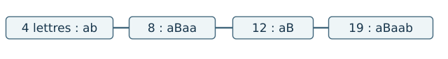
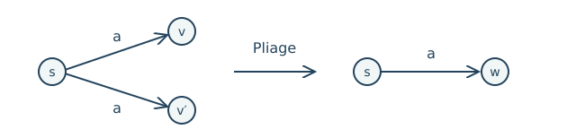
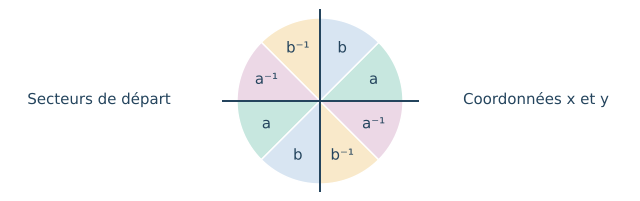

# ENS · MP-PC · Mathématiques-informatique 2007 — corrigé guidé

*Corrigé rédigé par IA, non officiel. Signalez toute erreur.*

**Rédaction** · GPT-6.2 Astra Ultra · vitesse non renseignée · 25 novembre 2026

**Révision** · GPT-6.2 Astra Ultra · vitesse non renseignée

Un mot et son inverse se lisent dans les deux sens le long d’un chemin. La pile donne une forme normale, la lecture sur un arbre fournit des bases et le pliage d’un graphe rend calculables les sous-groupes.

Les 38 items se répartissent entre 31 questions numérotées. Les exemples utilisent les mots réduits comme représentants des éléments du groupe libre. Lors du pliage des graphes, une même lettre doit désigner la même transition sortante depuis un sommet donné. [Fac-similé du sujet](https://banques-ecoles.fr/cms/wp-content/data/filiere-mp/annales-de-la-banque-i/session-2007/sujet-ecrit-2007-i-mathematiques_informatique.pdf) · [Rapport du jury](https://banques-ecoles.fr/cms/wp-content/data/filiere-mp/rapports-des-jurys-de-la-banque-i/session-2007/rapport-2007-i_ecrit_mathematiques_informatique.pdf) · [Sommaire](https://banques-ecoles.fr/cms/filiere-mp/les-annales-et-rapports-des-jurys/)

## Partie 1 · Morphismes et engendrement

### Question 1.1 · Réciproque et inverse

Pour vérifier que la réciproque préserve un produit, choisir les antécédents de ses deux facteurs et calculer l’image de leur produit. Traiter le neutre avec la bijectivité. Pour les inverses, appliquer le morphisme aux deux égalités $xx^{-1}=x^{-1}x=1$, puis utiliser l’unicité de l’inverse.

### Question 1.2 · Plus petite structure contenant une partie

Construire d’abord les produits possibles sans limite de longueur, y compris celui de longueur zéro. Leur ensemble est stable puisque deux listes de facteurs s’accolent. Une partie stable contenant les générateurs doit déjà contenir toutes ces listes évaluées. Pour un sous-groupe, permettre aussi les facteurs inverses. Renvoyer chaque facteur à son inverse et lire la liste à l’envers garde alors le produit dans l’ensemble.

## Partie 2 · Réduction des mots

### Question 2.1 · Existence et exemple imprimé

Effacer une paire inverse chaque fois que c’est possible. Après au plus la moitié de la longueur initiale en suppressions, aucune paire ne reste. Pour suivre les barres de la page 2, découper l’entrée en `abAa | BBaa | bBAA | aabBAab`. Les restes successifs sont `ab | aBaa | aB | aBaab`. Les deux lettres centrales identiques du dernier reste se conservent.

### Question 2.2 · Deux suppressions concurrentes

Comparer les positions des deux paires. Des paires distantes peuvent être rayées dans n’importe quel ordre. Des paires voisines ayant une lettre commune forment nécessairement une alternance de trois lettres dont la première égale la dernière. On obtient alors immédiatement la même lettre restante. Cela couvre aussi le choix d’une seule et même paire.

### Question 2.3 · Unicité de la forme normale

Un losange local ne prouve pas encore l’unicité à toute profondeur. Supposer le résultat vrai pour toutes les longueurs inférieures. Deux premiers choix conduisent à des mots plus courts. Rejoindre leurs branches par 2.2 et achever la réduction à partir de leur rencontre. Par hypothèse de récurrence, chacun des deux mots plus courts n’a que cette issue, y compris si une branche était déjà terminée.

### Question 2.4 · Une pile en temps linéaire

Garder le préfixe déjà simplifié dans une pile. Une nouvelle lettre peut seulement contrarier la dernière lettre gardée. En cas d’annulation, les deux disparaissent et la pile précédente privée de son sommet est encore réduite. Sinon le nouveau dernier couple est autorisé. Chaque lettre coûte une comparaison et une opération de pile, d’où le temps linéaire, avec une pile de taille au plus $n$. Une sortie explicite de $n$ lettres coûte déjà $n$ écritures.

## Partie 3 · Le groupe libre

### Question 3.1 · Produit réduit et inverse

Réduire deux facteurs voisins avant le reste ne change pas la forme normale de la concaténation des trois. Les deux parenthésages du produit ont donc la même issue. La concaténation par le mot vide laisse le mot en place. Pour revenir au vide, lire les lettres dans le sens opposé en retournant chaque signe, ce qui produit l’inverse de chaque côté.

### Question 3.2 · Quand le groupe commute

Un seul générateur ne permet pas de changer de signe dans un mot réduit. Il suffit donc de retenir un entier, son exposant, et l’addition commute. Deux générateurs distincts suffisent déjà à fournir deux produits d’ordre opposé qui ne se réduisent pas l’un à l’autre.

### Question 3.3 · Prolongement universel

Les images des inverses sont forcées. Évaluer ensuite chaque suite de lettres dans le groupe cible. Une suppression efface deux facteurs dont le produit est le neutre. L’évaluation ne dépend donc pas d’une simplification préalable et respecte le produit réduit. Un autre morphisme coïncidant sur l’alphabet effectuerait exactement la même évaluation.

### Question 3.4 · Changement d’alphabet

Renommer chaque lettre et, de la même façon, chaque lettre signée préserve les annulations. Renommer en sens inverse récupère le mot initial, d’où une bijection compatible avec le produit.

## Partie 4 · Bases et rang

### Question 4.1 · Indépendance du nom des lettres

Pour la base canonique, le changement de coordonnées ne change aucune lettre. Pour une partie $X$ quelconque, donner d’autres noms à ses éléments revient à renommer l’alphabet auxiliaire. Ce renommage est réversible et ne change donc pas la propriété d’être une base.

### Question 4.2 · Deux familles de deux mots

Partir de $x=y a^{-1}$. Isoler $a$, puis utiliser $b=a^{-1}y$. Cela fournit les expressions $x^{-1}y$ et $y^{-1}xy$. Remplacer ensuite $x,y$ par deux lettres indépendantes et vérifier que ces expressions envoient en retour $ab$ sur la seconde et $ab\bar a$ sur la première. Cette vérification donne bien l’inversibilité du changement de base. Dans le deuxième exemple, le compteur du nombre de $a$ moins celui des $\bar a$ reste nul sur l’image du morphisme. Il vaut un sur $a$, ce qui exclut la surjectivité.

### Question 4.3 · Linéarisation et cardinal d’une base

Tracer le carré sur une lettre $a$. Le chemin de droite donne un vecteur connu de $V(B)$, qui impose l’image de $\theta(a)$. Ces vecteurs de départ formant une base, l’application linéaire existe. Les deux chemins sont des morphismes de groupes égaux sur les lettres et coïncident donc partout. Pour obtenir une surjection linéaire, il suffit d’atteindre chacun des vecteurs de la base d’arrivée. La surjectivité du morphisme de groupes permet de relever chaque lettre correspondante. Le théorème sur les dimensions donne l’inégalité, et deux applications inverses donnent les deux sens pour une base libre.

### Question 4.4 · Sous-groupes de rang arbitraire

Dans une puissance d’un conjugué, les $a^{-i}a^i$ internes s’effacent, y compris pour les puissances négatives. Regrouper ensuite les occurrences successives d’un même générateur source. Deux blocs voisins ont des indices différents, si bien qu’une puissance non nulle de $a$ sépare leurs puissances non nulles de $b$ dans l’image. Une image non vide reste donc réduite après cette simplification, et le noyau est trivial. Faire varier le nombre de générateurs donne tous les rangs finis.

## Partie 5 · Noyau cyclique et conjugaison

### Question 5.1 · Élaguer les deux extrémités

Comparer la première lettre à l’inverse de la dernière. Si elles se correspondent, la factorisation oblige à les placer dans les deux bordures. Sinon, le mot restant est déjà son noyau cyclique. Cette lecture des extrémités détermine toutes les lettres de la décomposition. Dans une puissance, seules les bordures entre deux copies se compensent. Un noyau non vide peut être répété sans annulation et donne donc toujours un mot non vide.

### Question 5.2 · Relation d’équivalence

Le mot vide ne change rien. Pour défaire une conjugaison, inverser le conjugateur. Pour en enchaîner deux, multiplier les conjugateurs dans l’ordre de leur application. Ces trois vérifications donnent respectivement réflexivité, symétrie et transitivité.

### Question 5.3 · Conjugaison et rotations

Pousser le préfixe $r$ d’un mot $rs$ à sa fin est exactement le conjuguer par $r$. Pour l’autre sens, regarder la première lettre du conjugateur, celle qui touche le mot central. Si elle ne s’annule à aucune jonction, l’expression entière est réduite avec des bouts inverses, ce qui est impossible pour la cible. Une annulation à gauche transfère la première lettre à la fin. Une annulation à droite transfère la dernière au début. Poursuivre avec le conjugateur amputé de cette lettre. Chaque étape garde un mot cycliquement réduit et le résultat est une rotation du mot initial.

### Question 5.4 · Décider la conjugaison

Les bordures ne changent que le conjugateur. Comparer donc les noyaux, en traitant le vide à part. Deux noyaux de même longueur se conjuguent si la lecture circulaire du premier peut donner le second. Doubler le premier mot réalise toutes les lectures circulaires en une seule recherche de facteur. La méthode des décalages successifs est quadratique au pire. Une recherche linéaire de motif conserve le temps linéaire de l’élagage.

Par exemple, considérons les mots $aab\bar a$ et $ba$. Le premier a pour noyau cyclique $ab$, le second $ba$. Chercher $ba$ dans $abab$ réussit à partir de la deuxième lettre. En revanche $a\bar b$ n’est aucune des rotations de $ab$. Le test distingue donc ces deux cas sans énumérer les conjugateurs.

## Partie 6 · Groupe d’un graphe étiqueté

### Question 6.1 · Chemins et étiquettes

Une lettre positive désigne un départ, une lettre inverse désigne l’usage à rebours d’une arrivée. L’hypothèse de réduction du graphe assure l’unicité dans les deux cas. Relire immédiatement la lettre inverse force donc à repartir par l’arête qu’on vient de parcourir. C’est exactement le critère voulu.

### Question 6.2 · Simplifier sans déplacer les extrémités

Effacer une paire de lettres autorisée consiste à enlever un détour qui revient au sommet de départ de ce détour. Le reste du parcours reste raccordé. Répéter jusqu’à la forme normale préserve le départ et l’arrivée du chemin complet.

### Question 6.3 · Les boucles forment un sous-groupe

Vérifier successivement le parcours sans arête, le trajet de retour d’une boucle, puis l’enchaînement de deux boucles au point de base. Le dernier trajet peut contenir des retours immédiats. Les enlever conserve le point de base et donne précisément le produit dans le groupe libre.

### Question 6.4 · Cas d’une forêt

Dans une forêt il y a au plus une façon réduite de joindre un sommet à lui-même. Le chemin de longueur zéro occupe déjà cette possibilité. Seule son étiquette appartient au groupe.

### Question 6.5 · Arbre couvrant

Commencer avec le seul point de base. Dès qu’un voisin encore absent est atteint, mémoriser l’arête qui l’a amené et continuer le parcours. Les orientations donnent l’étiquette à conserver, mais ne restreignent pas le sens de la recherche. Les arêtes gardées raccordent tous les sommets sans fermer de circuit. On parcourt chaque liste une fois.

### Question 6.6 · Générateurs donnés par les cordes

Insérer à chacun des sommets du parcours un retour au point de base par l’arbre, immédiatement suivi du trajet opposé. Cela découpe la boucle en petites boucles associées à une seule arête. Celles qui ne sortent pas de l’arbre se réduisent au vide. Les autres traversent une corde et donnent le générateur correspondant, avec le signe du sens de parcours.

### Question 6.7 · Liberté des générateurs

Pour vérifier l’absence de relations entre les générateurs, enregistrer seulement les passages sur les arêtes hors arbre. Un détour supprimé efface soit deux symboles inverses, soit aucun symbole. La réduction d’une boucle respecte donc le mot de cordes dans le groupe libre. Le parcours est déterminé par son étiquette depuis le point de base. Une boucle fondamentale n’inscrit qu’une corde, une seule fois. Ainsi une relation entre ces boucles donnerait la même relation entre les lettres libres, ce qui fournit l’inverse cherché.

## Partie 7 · Sous-groupes de type fini

### Question 7.1 · Invariance par pliage

Descendre un chemin dans le quotient est immédiat. Remonter est plus délicat car la fin du représentant d’une arête peut différer du début du représentant suivant. La seule ambiguïté vient des deux sommets confondus. Le petit chemin qui retourne à l’origine commune des arcs puis repart, ou passe par leur but commun, résout cette ambiguïté avec une paire de lettres inverses. Corriger aussi les extrémités pour que la boucle reparte du véritable sommet marqué et y revienne. Sa valeur dans le groupe libre est inchangée.

### Question 7.2 · Construire le graphe d’un sous-groupe

Dessiner une boucle privée par générateur et ne partager au départ que le point de base. Une lecture de boucle se décompose, après les retours inutiles, en tours complets de ces circuits dans l’un ou l’autre sens. Elle représente donc exactement un produit des générateurs et de leurs inverses. Plier les transitions de même lettre qui se disputent un départ ou une arrivée. Le nombre de sommets diminue et les valeurs des boucles sont préservées. Une fois les transitions devenues uniques, l’arbre couvrant de la partie 6 donne une base libre.

### Question 7.3 · Extraire une base et chiffrer le calcul

Le nombre initial de lettres majore la taille du graphe à chaque étape. Rechercher les conflits en triant la liste des transitions signées, puis effectuer une fusion. Il y a moins de fusions que de sommets initiaux. Avec un tri en $O(N\log(2N))$ par tour, l’ensemble des pliages coûte $O(N^2\log(2N))$. Construire ensuite un arbre et, pour chaque arête restante, écrire le trajet de la racine à l’arête et le retour par l’arbre. Leur longueur totale est au plus quadratique. Ajouter le coût de lecture de la liste, même si beaucoup de ses mots sont vides.

Pour $h_1=ab,\ h_2=a\bar b$, le bouquet a deux arêtes de lettre $a$ quittant la racine. Après leur pliage, il reste deux sommets $s,v$, une arête $a:s\to v$, une arête $b:v\to s$ et une arête $b:s\to v$. Le graphe symétrisé est déterministe. L’arête $a$ peut servir d’arbre couvrant. Les deux cordes de lettre $b$ donnent alors les lacets $ab$ et $b\bar a=(a\bar b)^{-1}$. On obtient une base de deux éléments, en accord avec $3-2+1=2$.

## Partie 8 · Deux représentations fidèles

### Question 8.1 · Une action par matrices

Éviter les frontières des secteurs pour suivre des inégalités strictes. Le cisaillement $x\mapsto x+2y$ fait dominer la première coordonnée, de même signe que la seconde, si elles ont déjà le même signe ou si la seconde domine en valeur absolue. C’est précisément l’action requise sur les trois secteurs autorisés pour $a$. Changer le signe du cisaillement donne l’action de $\bar a$. Échanger les rôles de $x,y$ donne celles de $b,\bar b$. Pour distinguer un produit réduit de l’identité, partir d’un secteur autorisé pour sa dernière lettre et différent du secteur de sa première. Il existe au moins deux choix. De droite à gauche, chaque lettre envoie le point dans son secteur et prépare la suivante. Le point change finalement de secteur, ce qui prouve l’injectivité.

### Question 8.2 · Inverse d’une série formelle

Chercher un inverse dont le coefficient constant vaut un. Le coefficient en $a$ doit alors être $-1$, celui en $a^2$ doit être $1$, et ainsi de suite. Les coefficients alternés donnent l’inverse à gauche et à droite puisque seuls les mots composés de $a$ interviennent.

### Question 8.3 · Représentation par séries

Dans l’image d’un bloc de puissance signée $n$, regarder seulement le coefficient de degré un. Chacun des $|n|$ facteurs fournit $+1$ ou $-1$ selon son signe et les autres fournissent leur terme constant, d’où le coefficient $n$. Considérer ensuite le mot qui prend une seule lettre dans chacun des blocs successifs. Il n’a jamais deux lettres voisines identiques. Aucun bloc ne pourrait donc contribuer deux lettres au coefficient recherché. Il faut une contribution linéaire de chaque bloc, ce qui donne un produit d’entiers non nuls. Ce monôme témoigne de la non-trivialité de l’image.

Pour $w=a^2b^{-1}a$, le monôme témoin est $aba$. Son coefficient dans $(1+a)^2(1+b)^{-1}(1+a)$ vaut $2\cdot(-1)\cdot1=-2$. Cette lecture reste valable malgré les deux blocs de lettre $a$, car ils sont séparés par une contribution obligatoire en $b$.
