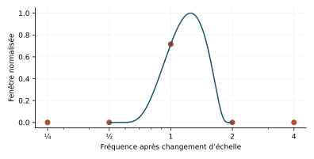
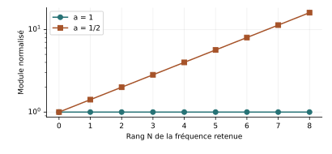

# ENS — Mathématiques MPI 2, 2007 · Corrigé brut

*Corrigé rédigé par IA, non officiel. Signalez toute erreur.*

**Rédaction** · GPT-6.2 Astra Ultra · vitesse non renseignée

**Révision** · GPT-6.2 Astra Ultra · vitesse non renseignée

La garde 70.03M porte une durée de quatre heures. L’épreuve est commune aux ENS de Paris, Lyon et Cachan pour les groupes MP/MPI et I de la filière MP. Pour le groupe I des filières MP et PC, elle est aussi proposée en option commune à Paris et Lyon. Une calculatrice de poche autonome, non imprimante et sans document d’accompagnement est autorisée. [Sujet officiel](https://www.ens.psl.eu/IMG/file/concours/2007/MP/mp_math_mpi2.pdf) · [Rapport du jury](https://www.ens.psl.eu/IMG/file/concours/2007/MP/mp_ecrit_maths_2.pdf).

La série de Weierstrass superpose les fréquences $b^n$. Pour tester sa dérivabilité, on construit une ondelette dont la transformée de Fourier ne retient qu’une seule de ces fréquences à la fois.

## I. Équation fonctionnelle et régularité

### Question I.1

La fonction $g$ est continue et périodique, donc bornée. Le terme de rang $n$ a pour norme uniforme au plus $\|g\|_\infty b^{-an}$, de somme finie car $a>0$ et $b>1$. La série converge normalement, sa somme est continue et $\|W\|_\infty\le\|g\|_\infty/(1-b^{-a})$.

### Question I.2

Lorsque $b$ est entier, $b^n$ est entier et $g(b^n(x+1))=g(b^nx+b^n)=g(b^nx)$. En sommant, on trouve $W(x+1)=W(x)$.

### Question I.3.a

Le premier terme est $g(x)$. La somme à partir de $n=1$ est $b^{-a}W(bx)$ par changement d’indice, d’où $W=g+TW$.

### Question I.3.b

Si $f$ est une autre solution bornée, $d=f-W$ satisfait $d(x)=b^{-a}d(bx)$, donc $\|d\|_\infty=b^{-a}\|d\|_\infty$. La norme est finie et $b^{-a}<1$, donc $d=0$. L’unicité vaut même parmi toutes les solutions bornées.

### Question I.4.a

Pour $n<N$, l’accroissement du terme $n$ est au plus $\|g\|_{\rm Lip}b^{(1-a)n}|x-y|$. Pour $n\ge N$ il est au plus $2\|g\|_\infty b^{-an}$. Les sommes géométriques donnent pour tout entier $N\ge0$
$$|W(x)-W(y)|\le\frac{\|g\|_{\rm Lip}b^{(1-a)N}}{b^{1-a}-1}|x-y|+\frac{2\|g\|_\infty b^{-aN}}{1-b^{-a}}.$$
Pour $N<0$, le second terme seul majore $2\|W\|_\infty$.

### Question I.4.b

Pour $0<d=|x-y|\le1$, prendre $N$ tel que $b^{-N-1}<d\le b^{-N}$. Alors $b^{(1-a)N}d\le d^a$ et $b^{-aN}\le b^ad^a$. Par I.4.a, le quotient par $d^a$ est uniformément borné. Pour $d>1$, il est au plus $2\|W\|_\infty$. Cela prouve $W\in\mathcal H^a$.

### Question I.5.a

La dérivée seconde continue périodique est bornée. Pour $h\ge0$, la différence seconde vaut $\int_0^h(h-s)[g''(x+s)+g''(x-s)]\,ds$, de module au plus $\|g''\|_\infty h^2$. L’expression étant paire en $h$, la majoration vaut sur tout l’intervalle voulu, y compris pour $g$ complexe.

### Question I.5.b

Pour $0<d=|h|\le1$, choisir $N$ tel que $b^{-N-1}<d\le b^{-N}$. Pour $n<N$, I.5.a majore le terme de différence seconde, avec $a=1$, par $\|g''\|_\infty d^2b^n$. Leur somme est au plus $\|g''\|_\infty d/(b-1)$. La queue est au plus $4\|g\|_\infty b^{-N}/(1-b^{-1})\le4b\|g\|_\infty d/(1-b^{-1})$. En ajoutant les deux bornes on obtient un $C'$ uniforme. Pour $h=0$, la différence est nulle.

Le terme d’indice $n<N$ est évalué au pas $b^n d\le1$ ; c’est ce qui autorise l’utilisation de I.5.a telle qu’énoncée. Les termes de la queue ne demandent aucune hypothèse de régularité supplémentaire. Cette estimation de différence seconde n’affirme pas que $W$ est lipschitzienne.

## II. Inversion de Fourier par périodisation

### Question II.1.a

Il existe $C$ tel que $|f(x)|\le C/(1+x^2)$, par continuité sur les compacts et par l’hypothèse à l’infini. Pour tout $h>0$ fixé, $\sum_{n\ge0}|f(nh)|\le C\sum_{n\ge0}(1+n^2h^2)^{-1}<\infty$.

### Question II.1.b

Pour $0<h\le1$, posons $F_h(x)=f(h\lfloor x/h\rfloor)$ sur $\mathbb R_+$. Son intégrale est $h\sum_{n\ge0}f(nh)$ et $F_h(x)\to f(x)$ par continuité. Pour $x\ge2$, $h\lfloor x/h\rfloor\ge x-1\ge x/2$, donc $|F_h(x)|\le C/(1+x^2/4)$. Sur $[0,2]$, une constante suffit. La convergence dominée donne la limite $\int_0^\infty f$.

La domination s’applique à la fonction complexe grâce à son module. Elle porte simultanément sur tous les $0<h\le1$, y compris sur la queue infinie de la somme. La simple convergence des sommes de Riemann sur chaque segment, sans ce contrôle de queue, ne suffirait pas sur la demi-droite.

### Question II.1.c

La série bilatère est absolument convergente par II.1.a appliquée à $f(x)$ et $f(-x)$. On additionne les deux limites de II.1.b et on retranche $hf(0)$, terme compté deux fois qui tend vers zéro. On obtient $h\sum_{n\in\mathbb Z}f(nh)\to\int_{\mathbb R}f$.

### Question II.2

Sur $|x|\le R$ et pour $|k|T\ge2R$, on a $|x+kT|\ge |k|T/2$, donc $|f(x+kT)|\le C/(1+k^2T^2/4)$. La série des translatés converge normalement sur tout compact, d’où la continuité de $f_T$. Le changement d’indice $k\mapsto k+1$ autorisé par l’absolue convergence montre que $f_T$ est $T$-périodique.

### Question II.3

Sur $[0,T]$, la convergence uniforme permet d’intégrer terme à terme. Avec $u=x+kT$, le facteur $e^{-2\pi inx/T}$ est inchangé puisque $n,k$ sont entiers. Les intervalles $[kT,(k+1)T]$ recouvrent la droite et $f$ est intégrable. Ainsi
$$c_n(f_T)=T^{-1}\int_{\mathbb R}f(u)e^{-2\pi inu/T}\,du=\frac{\sqrt{2\pi}}{T}\mathcal F f(2\pi n/T).$$

### Question II.4.a

La nouvelle hypothèse donne $|\mathcal F f(y)|\le C'/(1+y^2)$. Pour $T$ fixé, II.3 donne alors $\sum_n |c_n(f_T)|<\infty$. Les sommes trigonométriques convergent normalement, donc uniformément sur $\mathbb R$, vers une fonction continue $S_T$.

### Question II.4.b

Le système des exponentielles est complet dans $L^2([0,T])$ et $f_T$ y appartient. Donc ses projections de Fourier $S_{N,T}$ convergent vers $f_T$ en norme quadratique. Par Parseval, l’intégrale demandée est précisément $T\sum_{|n|>N}|c_n(f_T)|^2\to0$.

### Question II.4.c

La convergence uniforme de II.4.a implique la convergence quadratique vers $S_T$ sur $[0,T]$. Par unicité de la limite en norme, $S_T=f_T$ presque partout. Les deux fonctions sont continues, donc égales partout sur $[0,T]$, puis sur $\mathbb R$ par périodicité. Cela justifie la somme ponctuelle demandée.

### Question II.5

Pour $T>2|x|$ et $k\ne0$, on a $|x+kT|\ge |k|T/2$ et $|f(x+kT)|\le4C/(k^2T^2)$. Ainsi $|f_T(x)-f(x)|\le4CT^{-2}\sum_{k\ne0}k^{-2}\to0$.

### Question II.6

Avec $h=2\pi/T$, les questions précédentes donnent
$$f_T(x)=\frac1{\sqrt{2\pi}}h\sum_{n\in\mathbb Z}(\mathcal F f)(nh)e^{inxh}.$$
Pour $x$ fixé, $y\mapsto(\mathcal F f)(y)e^{ixy}$ est continue et son produit par $y^2$ tend vers zéro en module. Par II.1.c, la somme de Riemann converge vers son intégrale quand $T\to\infty$. Le membre de gauche tend vers $f(x)$ par II.5. Cela prouve $f=\overline{\mathcal F}\mathcal F f$, la barre désignant la transformée à phase positive du sujet.

## III. Construction de l’ondelette

### Question III.1.a

Pour chaque entier $m$, $x^mf(x)$ est intégrable, car il est continu et $O((1+x^2)^{-1})$. La dérivée d’ordre $m$ de l’intégrande en $y$ est dominée uniformément par $|x^mf(x)|$. Le théorème de dérivation sous le signe intégral donne $\mathcal F f\in C^\infty$ et $(\mathcal F f)^{(m)}(y)=(2\pi)^{-1/2}\int(-ix)^mf(x)e^{-iyx}\,dx$.

### Question III.1.b

Posons $v(x)=(-ix)^mf(x)$. Tous ses dérivés décroissent plus vite que toute puissance, par Leibniz. En intégrant $n+1$ fois par parties, les bords sont nuls et $(iy)^{n+1}(\mathcal F f)^{(m)}(y)=\mathcal F(v^{(n+1)})(y)$ reste borné par $\|v^{(n+1)}\|_1/\sqrt{2\pi}$. Ainsi $y^n(\mathcal F f)^{(m)}(y)\to0$ à l’infini pour tous $m,n$. C’est l’appartenance à $\mathcal S$.

### Question III.2.a

Sur les demi-droites ouvertes, la continuité est immédiate. En $0^+$, $e^{-1/x}\to0$, qui est la valeur de $\psi_0(0)$ et sa limite à gauche.

### Question III.2.b

Sur $x>0$, partant de $R_0=1$, la dérivation donne $R_{n+1}=R_n'+R_n/x^2$. Par récurrence les $R_n$ sont des polynômes en $1/x$, donc des fractions rationnelles, et $\psi_0^{(n)}=R_n e^{-1/x}$.

### Question III.2.c

Pour tout entier $k$, $x^{-k}e^{-1/x}\to0$ en $0^+$ par domination exponentielle. Chaque expression $R_n(x)e^{-1/x}$ se prolonge continûment par zéro. De plus son quotient par $x$ tend vers zéro, donc ce prolongement est dérivable en zéro et sa dérivée y vaut zéro. Par récurrence toutes les dérivées existent, coïncident avec les formules précédentes et sont continues.

### Question III.2.d

La fonction $B(s)=\psi_0(s-a)\psi_0(b-s)$ est réelle et $C^\infty$. Ses deux facteurs sont strictement positifs ensemble exactement pour $a<s<b$. Ailleurs l’un d’eux est nul.

### Question III.3

Pour $b>1$, prenons pour $B$ la fonction précédente avec extrémités $1/b,b$. Elle est lisse à support compact, donc dans $\mathcal S$. Posons $\Psi_b=\overline{\mathcal F}B$. Par III.1.b et réflexion, elle est dans $\mathcal S$, donc $\Psi_b$ et $x\Psi_b$ sont intégrables. Par II.6 appliquée à $B$, en utilisant que réflexion et transformée commutent, $\mathcal F\Psi_b=B$. La valeur et la dérivée de $B$ à zéro sont nulles, d’où $\int\Psi_b=0$ et $\int x\Psi_b(x)\,dx=0$ par III.1.a. Si l’on prend littéralement $0<b\le1$ dans cette seule question, l’intervalle ouvert est vide et la fonction nulle convient.

Avec la convention unitaire choisie, $B(0)=(2\pi)^{-1/2}\int\Psi_b$ et $B'(0)=-i(2\pi)^{-1/2}\int x\Psi_b(x)\,dx$. Les deux membres de gauche sont nuls puisque $B$ s’annule sur un voisinage de zéro. Les intégrales existent absolument par décroissance rapide, y compris celle qui comporte le facteur $x$.

## IV. La série de cosinus est partout non dérivable

### Question IV.1

Pour $h\ne0$, posons $\varepsilon_x(h)=[f(x+h)-f(x)]/h-f'(x)$, et posons $\varepsilon_x(0)=0$. La dérivabilité en $x$ assure la continuité en zéro ; ailleurs elle découle de celle de $f$. À l’infini le quotient de différences tend vers zéro puisque $f$ est bornée. La fonction $\varepsilon_x$ est donc bornée sur tout $\mathbb R$ et l’identité est vérifiée.

### Question IV.2.a

Avec $y=x+\alpha u$, on a $c(\alpha,x)=\alpha^{-1}\int f(x+\alpha u)\Psi_b(u)\,du$. Son module est au plus $\alpha^{-1}\|f\|_\infty\|\Psi_b\|_1$, fini pour chaque $\alpha>0$.

### Question IV.2.b

Insérons IV.1 dans l’expression précédente. Les intégrales des termes en $f(x)$ et $\alpha u f'(x)$ sont nulles par III.3. Ainsi $c(\alpha,x)=\int u\varepsilon_x(\alpha u)\Psi_b(u)\,du$. L’intégrande tend vers zéro pour chaque $u$ et son module est majoré par $\|\varepsilon_x\|_\infty|u\Psi_b(u)|\in L^1$. La convergence dominée donne $c(\alpha,x)\to0$.

### Question IV.3.a

La fonction $W$ est paire et, si elle était dérivable en zéro, sa dérivée y serait nulle. Posons $h_n=1/(2b^n)$. Dans $W(0)-W(h_n)$ tous les termes sont positifs ou nuls car $1-\cos v\ge0$, et celui de rang $n$ vaut $2b^{-an}$. Le quotient par $h_n$ est donc au moins $4b^{(1-a)n}$, qui ne tend pas vers zéro, même pour $a=1$. La dérivabilité est impossible.

### Question IV.3.b

Posons $\alpha_N=(2\pi b^N)^{-1}$. Dans IV.2.a, la convergence normale de la série et l’intégrabilité de $\Psi_b$ autorisent l’intégration terme à terme pour chaque $N$. Développons chaque cosinus en demi-somme de deux exponentielles. Le terme de phase positive en $u$ voit la transformée de $\Psi_b$ à la fréquence négative $-b^{n-N}$, donc s’annule. Celui de phase négative en $u$ donne $\sqrt{2\pi}B(b^{n-N})e^{-2\pi i b^n x}$. La fenêtre $B$ est nulle aux deux bords et hors de $(1/b,b)$ ; il reste uniquement $n=N$. Ainsi
$$|c(\alpha_N,x)|=\frac{\sqrt{2\pi}}{2\alpha_N}b^{-aN} B(1)=\pi\sqrt{2\pi} B(1)b^{(1-a)N}.$$
Cette quantité ne tend vers zéro pour aucun $x$, en contradiction avec la condition nécessaire de IV.2.b. La série est donc nulle part dérivable.

Plus précisément, avec la fenêtre complexe $\Psi_b$ on obtient
$$
 c(\alpha_N,x)=\pi\sqrt{2\pi}\,B(1)b^{(1-a)N}e^{-2\pi i b^N x}.
$$
Le facteur de phase a toujours un module égal à un. Au seuil $a=1$ le module reste donc strictement positif, même lorsqu’il y a oscillation de phase. L’argument ne suppose à aucun moment que l’intégrale contre un cosinus soit une partie réelle de transformée.

## V. Alternative entre accroissements bornés et non-dérivabilité

### Question V.1

Posons $B=b^{1-a}>1$, $L=\|g\|_{\rm Lip}$, $K=L/(B-1)$ et $D(x,h)=|W(x+h)-W(x)|/h$. Par I.3.a et l’inégalité triangulaire inverse, $D(x/b,h/b)\ge B D(x,h)-L$. Ainsi $D(x,h)\ge K(1+u)$ entraîne $D(x/b,h/b)\ge BK(1+u)-L=K(1+Bu)$.

### Question V.2.a

Sous l’hypothèse $\|W\|_{\rm Lip}>K$, on a $L>0$, car $g$ constante donnerait $W$ constante. Par définition du supremum, un segment a un quotient $>K$. En le subdivisant en segments égaux de longueur $<1$, l’inégalité triangulaire montre qu’un des petits segments a un quotient au moins aussi grand. Notons-le $[x_0,x_0+h]$. Comme $K>0$, on peut choisir $u>0$ tel que $D(x_0,h)\ge K(1+u)$.

### Question V.2.b

Par périodicité de $W$, chaque paire $x_0+k,x_0+k+h$ convient. Prenons par exemple $l=2+h$. Dans tout intervalle de longueur au moins $l$, après retrait d’une marge de longueur $h$ à droite, il reste une longueur au moins deux et donc un translaté entier de $x_0$ strictement intérieur. On obtient $x_I$ et $x_I+h$ dans $I$ avec le quotient voulu, y compris au cas d’égalité de longueur utile ensuite.

### Question V.2.c

Le choix de $N$ donne $l\le b^N\ell(J)<bl$. Dans $I=b^NJ$, V.2.b fournit $z,z+h$ de quotient au moins $K(1+u)$. V.1 appliquée $N$ fois donne pour $x_J=z/b^N$, $y_J=(z+h)/b^N$ dans $J$ un quotient au moins $K(1+uB^N)\ge Ku b^{N(1-a)}$. Leur distance est exactement $hb^{-N}$.

Le facteur multiplicatif des excès au-dessus du seuil est $B=b^{1-a}$ à chaque étape. C’est pourquoi le produit du quotient par la distance donne à l’étape suivante la puissance $B^N b^{-N}=b^{-aN}$, qui gouverne la minoration de l’oscillation.

### Question V.2.d

On trouve $|W(x_J)-W(y_J)|\ge Kuh b^{-aN}$. Or $\ell(J)<lb^{1-N}$ implique $b^{-aN}>(\ell(J)/(lb))^a$. En prenant $C=Kuh/(lb)^a>0$, on obtient $\operatorname{osc}_J W\ge C\ell(J)^a$. Pour $W$ réelle l’oscillation est $\sup_J W-\inf_J W$, comme sur le feuillet. Pour les fonctions à valeurs complexes autorisées dans le préambule, la même preuve donne le diamètre $\sup_{s,t\in J}|W(s)-W(t)|$ ; les bornes ordonnées ne sont définies que dans le cas réel.

### Question V.3

Si $\|W\|_{\rm Lip}\le K$, on est dans le premier cas. Sinon V.2.d s’applique. Supposons $W$ dérivable en $x$. Il existe $M,r_0>0$ tels que $|W(x+h)-W(x)|\le M|h|$ pour $|h|<r_0$. Par inégalité triangulaire, l’oscillation sur $(x-r,x+r)$ est au plus $2Mr$. Elle est au moins $C(2r)^a$ pour $2r<1$. Comme $a<1$, ces deux bornes sont incompatibles quand $r\downarrow0$. L’argument fonctionne aussi avec l’oscillation complexe de V.2.d.

### Question V.4

Prenons $F(x)=\cos(2\pi x)$ et $g(x)=F(x)-b^{-a}F(bx)$. Comme $b\ge2$ est entier, $g$ est lipschitzienne, de période un, et non constante puisque sa composante de fréquence un est non nulle. La série télescope : la somme de $n=0$ à $N$ vaut $F(x)-b^{-a(N+1)}F(b^{N+1}x)$ et tend uniformément vers $F$. Ainsi $W=F$ est lipschitzienne. De plus $\|g\|_{\rm Lip}\ge\|b^{-a}F(b\cdot)\|_{\rm Lip}-\|F\|_{\rm Lip}=(b^{1-a}-1)\|F\|_{\rm Lip}$, ce qui donne exactement la borne du premier cas.
