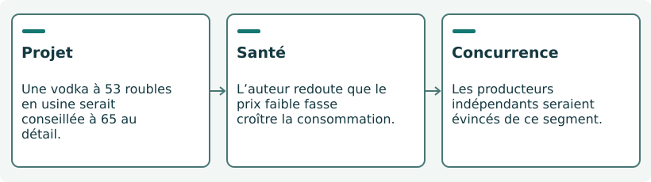

# ENS · MP-PC · Russe (LE2) 2007 — Corrigé brut

*Corrigé rédigé par IA, non officiel. Signalez toute erreur.*

**Rédaction** · GPT-6.2 Astra Ultra · vitesse non renseignée

La question de LE2 demande ici une réponse de 200 mots sur la lutte contre l’alcoolisme. Le texte et ses chiffres décrivent le projet commercial commenté en décembre 2006. Le registre fournit le cahier. La réponse russe compte 200 mots.

## I. Version française

**Rosspirtprom veut devenir un monopole**

Rosspirtprom lance la production de ce qu’on appelle une « vodka du peuple », de qualité supérieure et au prix le plus bas. Son prix de sortie d’usine sera de 53 roubles le demi-litre, son prix de vente conseillé au détail de 65 roubles. La « vodka du peuple » doit, pense-t-on, fournir un moyen de lutter contre la vague d’intoxications qui a frappé les régions russes.

Ce raisonnement a pourtant de quoi surprendre, c’est le moins qu’on puisse dire. De toute évidence, le prix élevé des alcools forts n’est pas la cause des intoxications à l’alcool. Le problème est structurel en Russie. La population y vit au seuil de la misère, d’où une demande pour des produits bon marché et de mauvaise qualité.

Bien plus, le projet de Rosspirtprom de mettre sur le marché une vodka vendue pratiquement à prix coûtant ne peut qu’aggraver la situation sur le marché russe de l’alcool. Tout d’abord, une vodka à bas prix entraîne automatiquement une hausse de la consommation de boissons alcoolisées, ce qui se traduira par une hausse de la mortalité liée à l’alcool. Sont en cause aussi bien les intoxications que l’ensemble des problèmes de santé auxquels conduit sa consommation. Ensuite, la commercialisation d’un tel produit portera un rude coup aux producteurs d’alcool indépendants. Mettre sur le marché un alcool de qualité à bas prix, c’est lui donner un avantage qui défiera toute concurrence et qui, de fait, éliminera ses concurrents sur le segment de la vodka bon marché.

Alexandre Saïapine, *Kommersant Vlast*, 11 décembre 2006.

## II. Question en russe

Прежде всего я разделил бы две задачи, которые в статье оказываются рядом. Надо предупреждать отравления опасной продукцией, но даже полное устранение подделок не избавит людей от алкогольной зависимости. Поэтому успех политики нельзя измерять лишь тем, сколько бутылок проверили или сколько подпольных продавцов обнаружили. Важно знать, стало ли меньше тяжёлых заболеваний, несчастных случаев и семей, оставшихся без поддержки.

Начинать следует с доступной помощи. Человек охотнее обратится к врачу, если знает, что его выслушают без осуждения и предложат длительное сопровождение. Родственникам тоже бывает нужна консультация: стыд и молчание часто оставляют их наедине с проблемой. В небольшом городе консультация должна быть доступна, а не существовать только в отчёте областного центра. Одновременно нужны ограничения рекламы и контроль продажи алкоголя несовершеннолетним. Школа может обсуждать с подростками, как отказаться от навязанного предложения, не высмеивая никого и не превращая беседу в соревнование.

Наконец, статья напоминает о бедности. Достойная работа, доступные места для встреч и занятия спортом сами по себе никого не вылечат. Они, однако, помогают человеку сохранить связи после лечения и не остаться одному. Чтобы понять, какие меры работают, стоит слушать семьи, врачей и самих пациентов. Снижение вреда от алкоголя требует последовательных решений, результаты которых видны в жизни людей, а не только в цифрах продаж за квартал.

[Sujet](https://banques-ecoles.fr/cms/wp-content/data/filiere-pc/annales-de-la-banque-pc/session-2007/sujet-ecrit-2007-mp-pc_langue_etrangere_2.pdf#page=10)
