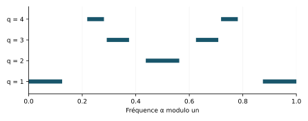

# ENS Paris, Lyon et Cachan — Mathématiques MPI 1, 2007 · Corrigé brut

*Corrigé rédigé par IA, non officiel. Signalez toute erreur.*

**Rédaction** · GPT-6.2 Astra Ultra · vitesse non renseignée

**Révision** · GPT-6.2 Astra Ultra · vitesse non renseignée

On compte les représentations des entiers comme sommes de puissances. Les notations $g(d)$ et $G(d)$ concernent respectivement tous les entiers et les entiers assez grands. La dernière partie établit pas à pas les estimations de la méthode du cercle.

## I. Compositions et obstruction modulo huit

### Question I.1.a

Chaque coordonnée entière positive ou nulle est au plus $t$, puisque leur somme est $t$. L’ensemble des solutions est inclus dans $\{0,\ldots,t\}^m$, qui est fini.

### Question I.1.b

Si les $m-1$ premières coordonnées ont pour somme $k$, la dernière est imposée et vaut $t-k$. Les valeurs possibles de $k$ sont $0,\ldots,t$, et les classes ainsi obtenues sont disjointes. Donc $N_1^m(t)=\sum_{k=0}^tN_1^{m-1}(k)$.

### Question I.1.c

Écrivons $t$ étoiles sur une ligne et séparons les $m$ groupes consécutifs par $m-1$ barres. Les groupes vides sont permis. La lecture des effectifs des groupes est une bijection entre les mots ainsi formés et les solutions ordonnées. Choisir les positions des barres donne $N_1^m(t)=\binom{t+m-1}{m-1}$, y compris lorsque $m=1$ ou $t=0$.

### Question I.1.d

Pour $m$ fixé, $\binom{t+m-1}{m-1}=(m-1)!^{-1}\prod_{j=1}^{m-1}(t+j)\sim t^{m-1}/(m-1)!$. Pour $m=1$ le produit vide vaut un.

### Question I.2.a

Le carré de tout impair est $1$ modulo $8$. Les classes paires divisibles par quatre donnent $0$, et celles congrues à $2$ modulo quatre donnent $4$. Les images demandées sont donc respectivement $\{1\}$ et $\{0,1,4\}$.

### Question I.2.b

Une somme nulle modulo quatre doit contenir un multiple de quatre carrés impairs, puisque chacun contribue $1$ modulo quatre et les autres $0$. Comme $X$ est inversible, il y en a au moins un, donc exactement quatre. Mais quatre carrés impairs donnent $4$ modulo huit. L’ensemble demandé est vide.

### Question I.2.c

Une solution rationnelle donnerait $A^2+B^2+C^2=(8b-1)D^2$ avec $A,B,C,D$ entiers sans diviseur commun, $D>0$. Modulo huit leur somme de carrés serait nulle. L’un au moins est impair, faute de quoi le quadruplet ne serait pas primitif. En le plaçant au premier rang, on contredit I.2.b.

### Question I.2.d

Une représentation de $4^a(8b-1)$ par trois carrés entiers donnerait après division des inconnues par $2^a$ une représentation rationnelle de $8b-1$, exclue en I.2.c.

## II. Le théorème des quatre carrés

### Question II.1.a

Dans $\mathbb F_p$, $x^2=1$ équivaut à $(x-1)(x+1)=0$. Le noyau vaut $\{1,-1\}$ de cardinal deux car $p$ est impair.

### Question II.1.b

Chaque fibre non vide a la taille du noyau, donc il y a $(p-1)/2$ carrés non nuls. L’ensemble de tous les carrés a $(p+1)/2$ éléments.

### Question II.1.c

Les carrés et leurs opposés translatés par $-1$ ont le même cardinal $(p+1)/2$. S’ils étaient disjoints, ils occuperaient $p+1$ classes dans un corps qui n’en a que $p$. Leur intersection est non vide.

### Question II.1.d

L’intersection fournit $1+x^2+y^2\equiv0\pmod p$. En changeant les signes des racines, choisissons $0\le x,y\le(p-1)/2$. Alors $1\le1+x^2+y^2\le1+(p-1)^2/2<p^2$. Ce multiple de $p$ est donc $mp$ avec $0<m<p$.

### Question II.2.a

Les combinaisons réelles ont pour matrice $\left(\begin{smallmatrix}a+ib&-c-id\\c-id&a-ib\end{smallmatrix}\right)$, dont la nullité impose $a=b=c=d=0$. La famille génératrice est donc libre. Le produit matriciel donne $I^2=J^2=-1$, $IJ=K=-JI$. Par associativité, $K^2=-1$, $JK=I=-KJ$, $KI=J=-IK$. Tous les produits de base appartiennent à $H$, donc $H$ est stable par produit.

### Question II.2.b

L’application $\tau$ est réelle-linéaire par sa formule. Les matrices $I,J,K$ sont antihermitiennes et $1$ est hermitienne, donc $\tau(x)=x^*$ sur $H$. Comme $(xy)^*=y^*x^*$, c’est bien l’anti-involution demandée.

### Question II.2.c

Écrivons $v=bI+cJ+dK$. L’anticommutation donne $v^2=-(b^2+c^2+d^2)1$. Donc $(a+v)(a-v)=(a-v)(a+v)=(a^2+b^2+c^2+d^2)1$. Ainsi $N(x)=a^2+b^2+c^2+d^2$ convient.

### Question II.2.d

On a $(xy)\tau(xy)=xy\tau(y)\tau(x)=xN(y)\tau(x)=N(y)N(x)$ car $N(y)$ est un scalaire réel.

### Question II.3

Si $a=N(x)$ et $b=N(y)$ avec coordonnées entières, celles de $xy$ sont entières par la table de II.2.a. Ainsi $ab=N(xy)$ est somme de quatre carrés entiers. Remplacer chaque coordonnée par sa valeur absolue donne bien des entiers naturels.

### Question II.4.a

II.1.d donne $mp=1^2+x^2+y^2+0^2$ pour un entier $m\in\{1,\ldots,p-1\}$. En particulier le minimum $m_0$ existe et vérifie $1\le m_0<p$.

### Question II.4.b.i

Puisque $mp$ est pair, le nombre de coordonnées impaires est pair. On peut donc regrouper les quatre coordonnées en deux paires de même parité. Dans chacune, mettre la plus grande avant la plus petite. Les sommes et différences ainsi obtenues sont paires et positives ou nulles. Elles peuvent être nulles en cas d’égalité.

### Question II.4.b.ii

L’identité $((u+v)/2)^2+((u-v)/2)^2=(u^2+v^2)/2$ donne, sur les deux paires, une représentation de $mp/2$ par quatre carrés naturels.

### Question II.4.c

Si $m_0$ était pair, $(m_0/2)p$ serait représentable par II.4.b.ii avec $0<m_0/2<m_0$. Cela contredit sa minimalité. Il est donc impair.

### Question II.4.d.i

Soit $m_0>1$ impair. Choisissons $y_i=x_i-b_i m_0$ dans $[-(m_0-1)/2,(m_0-1)/2]$. Alors $|y_i|<m_0/2$ et $\sum y_i^2\equiv\sum x_i^2\equiv0\pmod{m_0}$. Si tous étaient nuls, $m_0^2$ diviserait $m_0p$, d’où $m_0\mid p$ contrairement à $1<m_0<p$. Donc $0<\sum y_i^2<m_0^2$, soit $\sum y_i^2=m_0m_1$ avec $0<m_1<m_0$.

### Question II.4.d.ii

Soient $X,Y$ les quaternions de coordonnées $x_i,y_i$. Les coordonnées du produit $Z=X\tau(Y)$ sont entières et $Z\equiv X\tau(X)=m_0p\equiv0\pmod{m_0}$ coordonnée par coordonnée. Sa norme vaut $(m_0p)(m_0m_1)=m_0^2m_1p$. Les valeurs absolues $z_i$ des quatre coordonnées satisfont les deux conditions demandées.

Par exemple, pour $p=13$, le quadruplet $(5,3,2,1)$ représente $3p=39$. Les résidus centrés modulo $3$ sont $(-1,0,-1,1)$, de norme carrée $3$. Le produit de $(5+3I+2J+K)$ par le conjugué de $-1-J+K$ se calcule avec $IJ=K$. La partie scalaire vaut $-5-2+1=-6$ et la partie vectorielle est $(-3,-2,-1)+(0,5,-5)+( -3,3,3)=(-6,6,-3)$. Le produit a donc pour coordonnées $(-6,-6,6,-3)$. Après division par $3$, les quatre carrés donnent $4+4+4+1=13$.

### Question II.4.e

Les $z_i/m_0$ sont des entiers naturels dont les carrés somment à $m_1p$. Comme $0<m_1<m_0$, c’est impossible. L’hypothèse $m_0>1$ est exclue, donc $m_0=1$.

### Question II.5

Zéro et un ont des représentations immédiates avec compléments nuls. Deux est $1^2+1^2+0^2+0^2$. Chaque premier impair est représentable par II.4.e. En décomposant tout entier $\ge2$ en facteurs premiers et en utilisant II.3, on obtient $\mathcal N_2^4=\mathbb N$.

## III. Les nombres de Waring

### Question III.1.a

Posons $r=\lfloor(3/2)^d\rfloor$. Alors $t=2^dr-1<3^d$. Un terme $x_i^d$ avec $x_i\ge3$ dépasserait $t$, alors que tous les termes sont positifs ou nuls. Donc $x_i\in\{0,1,2\}$.

### Question III.1.b

Si une représentation comporte $j$ termes égaux à $2^d$, elle comporte exactement $t-j2^d$ termes égaux à un et $0\le j\le r-1$. Le nombre de termes non nuls, $t-j(2^d-1)$, est minimal pour $j=r-1$ et vaut $r+2^d-2$. Ainsi $g(d)\ge2^d+\lfloor(3/2)^d\rfloor-2$.

### Question III.2

D’une propriété valable pour tout entier on déduit celle valable à partir d’un seuil, donc $G(d)\le g(d)$. Si $G(d)=m$ est fini et fonctionne pour $t\ge t_0$, les entiers $t<t_0$ sont sommes de $t$ unités. Le nombre $\max(m,t_0)$ suffit pour toute cible en ajoutant des zéros. Les deux conditions de finitude sont donc équivalentes.

### Question III.3

La partie II donne $g(2)\le4$, et III.1.b donne $g(2)\ge4+\lfloor9/4\rfloor-2=4$. Donc $g(2)=4$. Les nombres $8b-1$ ne sont pas sommes de trois carrés par I.2.c et sont arbitrairement grands. Ainsi $G(2)\ge4$, puis $G(2)=4$.

## IV. Un compteur par orthogonalité

### Question IV.1

Écrivons $e(u)=e^{2\pi iu}$. Pour $n=0$, $\int_0^1e(n\alpha)d\alpha=1$. Pour $n\ne0$, l’intégrale est $(e(n)-1)/(2\pi in)=0$.

### Question IV.2

Pour chaque $\mathbf x$ dans la boîte entière $[0,B]^m$, l’intégrale de $e(\alpha(f_d^m(\mathbf x)-t))$ vaut un si la somme de puissances est $t$, zéro sinon, par IV.1. En sommant et en permutant cette somme finie avec l’intégrale, on obtient exactement $N_d^m(t,B)$.

### Question IV.3

Chaque solution naturelle vérifie $x_i^d\le t$, donc $x_i\le t^{1/d}$. Dès que $B\ge t^{1/d}$ la boîte contient toutes les solutions et $N_d^m(t,B)=N_d^m(t)$.

## V. Différences finies et sommes de Weyl

### Question V.1.a

La définition donne $\phi_2(u,v)=\phi(0)-\phi(u)-\phi(v)+\phi(u+v)$. Plus généralement, si $T_u f(x)=f(x+u)$, alors $\phi_k(g_1,\ldots,g_k)=[(1-T_{g_1})\cdots(1-T_{g_k})\phi](0)$ par développement du produit.

### Question V.1.b

Si le dernier argument est zéro, $1-T_0=0$. Dans la somme, cela revient à associer deux termes identiques de signes opposés. Donc $\phi_k(g_1,\ldots,g_{k-1},0)=0$.

### Question V.1.c

Comme $T_uT_v=T_{u+v}$, on a $(1-T_u)(1-T_v)=(1-T_u)+(1-T_v)-(1-T_{u+v})$. Après les $k-1$ autres facteurs et évaluation en zéro, c’est $\phi_{k+1}(\mathbf g,u,v)=\phi_k(\mathbf g,u)+\phi_k(\mathbf g,v)-\phi_k(\mathbf g,u+v)$.

### Question V.1.d

Les translations commutent dans le groupe abélien $G$. Le produit des $k$ différences est donc invariant par toute permutation de ses facteurs. Ainsi $\phi_k$ est symétrique.

### Question V.2.a

Pour $\phi(x)=x^n$, $n\ge1$, $\phi_2(u,v)=(u+v)^n-u^n-v^n=\sum_{j=1}^{n-1}\binom nj u^jv^{n-j}$. La somme est nulle pour $n=1$.

### Question V.2.b

Dans la somme alternée des puissances $(\sum_{i\in A}a_i)^n$, tout monôme dont le support omet un indice $j$ est annulé en associant $A$ et $A\cup\{j\}$. Le seul monôme de degré $n$ faisant intervenir les $n$ indices est $a_1\cdots a_n$. Il provient de la partie pleine avec signe $(-1)^n$ et coefficient multinomial $n!$. La formule vaut dans tout anneau commutatif, quelle que soit sa caractéristique.

### Question V.3

Les sommets ayant dernière coordonnée zéro imposent $x\in U(g_1,\ldots,g_{k-1})$. Ceux ayant dernière coordonnée un imposent $x+g_k$ dans ce même ensemble. Leur intersection est donc $U(g_1,\ldots,g_{k-1})\cap(U(g_1,\ldots,g_{k-1})-g_k)$.

### Question V.4.a

Comme $\overline{e(v)}=e(-v)$, on obtient $|S|^2=\sum_{g\in U}\sum_{h\in U}e(\phi(g)-\phi(h))$.

### Question V.4.b

Posons $g_1=g-h$ et $g_2=h$. Alors $g_1\in U^D$, et $h,h+g_1\in U$ équivaut à $g_2\in U(g_1)$. Réciproquement ces données redonnent une unique paire. La nouvelle phase est $\phi(g_1+g_2)-\phi(g_2)$, ce qui donne l’égalité demandée.

### Question V.4.c

On a $\phi(g_1+g_2)-\phi(g_2)=\phi_2(g_1,g_2)+\phi(g_1)-\phi(0)$. Pour $g_1$ fixé, le facteur de phase supplémentaire a module un. En appliquant l’inégalité triangulaire à la somme extérieure de V.4.b on obtient $|S|^2\le\sum_{g_1\in U^D}|\sum_{g_2\in U(g_1)}e(\phi_2(g_1,g_2))|$.

### Question V.5.a

Par Cauchy–Schwarz dans $\mathbb R^n$, $(\sum_i x_i)^2\le (\sum_i1^2)(\sum_i x_i^2)=n\sum_i x_i^2$.

### Question V.5.b

Écrivons $D=|U^D|$ et $H_k(\mathbf h)=|\sum_{x\in U(\mathbf h)}e(\phi_k(\mathbf h,x))|$ pour une liste $\mathbf h$ de $k-1$ déplacements. Le cas initial $k=2$ est V.4.c. Supposons $|S|^{2^{k-1}}\le D^{2^{k-1}-k}\sum_{\mathbf h}H_k(\mathbf h)$. En élevant au carré puis appliquant V.5.a sur au plus $D^{k-1}$ listes, le facteur extérieur devient $D^{2^k-k-1}$. Pour chaque liste, la procédure de V.4.b sur $U(\mathbf h)$ et la phase $x\mapsto\phi_k(\mathbf h,x)$ introduit un déplacement $v\in U^D$ et le domaine $U(\mathbf h,v)$ par V.3. La phase résultante est
$$\phi_k(\mathbf h,x+v)-\phi_k(\mathbf h,x)=\phi_k(\mathbf h,v)-\phi_{k+1}(\mathbf h,v,x).$$
Le premier terme est indépendant de $x$ et le signe du second conjugue la somme. Ainsi $H_k(\mathbf h)^2\le\sum_{v\in U^D}H_{k+1}(\mathbf h,v)$. Le facteur extérieur est exactement $D^{2^k-(k+1)}$, ce qui ferme la récurrence. Pour $U$ vide le résultat est trivial.

### Question V.6.a

La somme de $b-a+1$ termes de module un a module au plus $b-a+1$. Si $z=e(\alpha n)\ne1$, elle vaut $z^a(1-z^{b-a+1})/(1-z)$ et son module est au plus $2/|1-z|$. Si $z=1$, la somme vaut exactement $b-a+1$.

### Question V.6.b

Pour des entiers $j,k$ réalisant les distances de $a,b$ à $\mathbb Z$, on a $\|a+b\|\le|a+b-(j+k)|\le\|a\|+\|b\|$.

### Question V.6.c

Avec $u=\|x\|\in[0,1/2]$, $|1-e(x)|=2\sin(\pi u)\ge4u$ par concavité du sinus et comparaison avec la corde sur $[0,\pi/2]$. Cela implique la borne demandée.

### Question V.6.d

Appliquons V.5.b pour $k=d$ à $U=[0,B]\cap\mathbb Z$ et $\phi(x)=\alpha x^d$. On a $|U^D|\le2B+1$. Chaque $U(n_1,\ldots,n_{d-1})$ est une intersection de translatés d’intervalles entiers, donc vide ou un intervalle de longueur en nombre de points au plus $B+1$. V.2.b donne la phase $(-1)^d d!\alpha n_1\cdots n_{d-1}x$. Appliquons V.6.a et V.6.c dans la variable $x$. Avec $L=2^{d-1}$, on obtient
$$|S_B^1(\alpha)|^L\le(2B+1)^{L-d}\sum_{\mathbf n\in([-B,B]\cap\mathbb Z)^{d-1}}\min\!\left(\frac2{\|d!\alpha n_1\cdots n_{d-1}\|},B+1\right),$$
en lisant $B+1$ si la distance est nulle.

### Question V.6.e.i

Par partition en fibres, $N_B^\alpha=\sum_{(n_1,\ldots,n_{d-2})}M_B^\alpha(n_1,\ldots,n_{d-2})$, avec les indices de la boîte indiquée. Pour $d=2$ la liste fixée est vide et il n’y a qu’un terme.

### Question V.6.e.ii

Fixons les $d-2$ premiers indices et écrivons $c=d!\alpha n_1\cdots n_{d-2}$. Dans chacun des deux demi-intervalles de $[-B,B]$ (attribuer zéro à un seul), choisissons un représentant $v$ de la case fréquentielle demandée s’il en existe un. Pour tout autre entier $u$ de la même case et du même demi-intervalle, $|u-v|\le B$ et $\|c(u-v)\|<1/B$ car les parties fractionnaires appartiennent au même intervalle semi-ouvert de longueur $1/B$. L’application $u\mapsto u-v$ est injective, donc chaque demi-intervalle fournit au plus $M_B^\alpha$ entiers, soit $2M_B^\alpha$ en tout.

### Question V.6.e.iii

Prenons $H=\lfloor B\rfloor\ge1$ : $S_B^1=S_H^1$. Pour $H$ entier, dans la case $[j/H,(j+1)/H)$, posons $k=\min(j,H-1-j)$. Pour $k\ge1$, le minimum de V.6.d est au plus $2H/k$. Pour $k=0$ il est au plus $H+1$. Chaque $k$ donne au plus deux cases et V.6.e.ii majore l’effectif de chacune par $2M_H^\alpha$. Ainsi la somme sur le dernier indice est au plus
$$4M_H^\alpha\left(H+1+2H\sum_{1\le k\le H/2}k^{-1}\right)\le8(2H+1)(1+\log H)M_H^\alpha.$$
Ici la somme harmonique est au plus $1+\log H$ et la dernière majoration vaut aussi pour $H=1$. En sommant sur les autres indices et utilisant V.6.e.i, on obtient $|S_B^1|^L\le8(2B+1)^{L-d+1}(1+\log B)N_{\lfloor B\rfloor}^\alpha$.

### Question V.7.a

Comme $|y-y'|\le q-1$, la question V.6.b donne
$$\|(a/q)(y-y')\|\le\|\alpha(x_0+y)\|+\|\alpha(x_0+y')\|+|\alpha-a/q|\,|y-y'|<2/B+1/q.$$
Cette preuve reste valable pour $|\alpha-a/q|\le q^{-2}$.

### Question V.7.b

La multiplication par $a$ permute les classes modulo $q$. Avec $R=2q/B+1$, la condition impose un représentant entier $r$ de valeur absolue $<R$. Il y en a au plus $2R+1\le 2q(2/B+2/q)$. Le comptage avec représentants est encore un majorant si les deux intervalles se recouvrent modulo $q$.

### Question V.7.c

Si la classe recherchée n’est pas vide, fixons une solution $y'$. Les différences $y-y'$ sont distinctes modulo $q$ puisque $1\le y\le q$. Par V.7.a, leurs images sont parmi celles comptées en V.7.b. Le cardinal est au plus $2q(2/B+2/q)=4q(1/B+1/q)$.

### Question V.7.d

L’intervalle $1\le x\le d! B^{d-1}$ est couvert par au plus $d! B^{d-1}/q+1$ blocs consécutifs de $q$ entiers. Chacun compte au plus $4q(1/B+1/q)$ solutions par V.7.c. Leur produit est au plus $4d!q(1/B+1/q)(B^{d-1}/q+1)$.

### Question V.8.a

Si $a,b$ sont premiers entre eux, chaque diviseur de $ab$ est un produit unique $uv$ avec $u\mid a$ et $v\mid b$, en répartissant ses facteurs premiers. Donc $\tau(ab)=\tau(a)\tau(b)$ et $\tau(1)=1$.

### Question V.8.b

Fixons $\varepsilon>0$. Si $p^\varepsilon\ge2$, alors $\tau(p^k)=k+1\le 2^k\le p^{k\varepsilon}$. Pour chacun des premiers restants, en nombre fini, $C_p=\sup_{k\ge0}(k+1)/p^{k\varepsilon}$ est fini par domination exponentielle. Par multiplicativité, $\tau(n)\le(\prod C_p)n^\varepsilon$.

### Question V.9

Traitons d’abord $B$ entier. Les listes à produit nul sont en nombre $O_d(B^{d-2})$. Pour les autres, posons $z=d!|n_1\cdots n_{d-1}|\le d! B^{d-1}$. Pour $z$ fixé, les signes donnent au plus $2^{d-1}$ choix, les $d-2$ premiers modules sont des diviseurs de $z$ et le dernier est imposé. Par V.8.b, la multiplicité est $O_{d,\eta}(B^\eta)$ pour tout $\eta>0$ (choisir un exposant suffisamment petit ; pour $d=2$ il n’y a aucun diviseur à choisir). La condition est $\|\alpha z\|<1/B$. V.7.d donne alors
$$N_B^\alpha\ll_{d,\eta} B^\eta\big(B^{d-2}+B^{d-1}/q+q/B+1\big).$$
Le terme $1$ est absorbé par $B^{d-2}$. Insérons cette borne dans V.6.e.iii avec $L=2^{d-1}$ et absorbons $1+\log B$ dans une puissance arbitrairement petite de $B$. Après division par $B^L$ puis extraction de la racine $L$-ième, il vient
$$|S_B^1(\alpha)|\le C_{d,\varepsilon}B^{1+\varepsilon}(B^{-1}+q^{-1}+qB^{-d})^{1/L}.$$
Le cas réel suit de $S_B^1=S_{\lfloor B\rfloor}^1$ et $B/2\le\lfloor B\rfloor\le B$ pour $B\ge1$. Le cas d’égalité dans l’hypothèse d’approximation est permis par V.7.a.

### Question V.10.a

Pour $N\ge1$, les $N$ intervalles semi-ouverts $[i/N,(i+1)/N)$ partitionnent $[0,1)$. Parmi les $N+1$ nombres $\{j\alpha\}$, $0\le j\le N$, deux se trouvent dans la même case. Ordonnons leurs indices $j<k$.

### Question V.10.b

En posant $q'=k-j$ et $a'=\lfloor k\alpha\rfloor-\lfloor j\alpha\rfloor$, on a $1\le q'\le N$ et $|q'\alpha-a'|<1/N$. En réduisant $a'/q'$ en $a/q$, on conserve la valeur de la fraction et $q\le q'\le N$. Donc $|\alpha-a/q|<1/(Nq')\le1/(Nq)$.

### Question V.11.a

Avec $r=B^{\Delta-d}$, la condition sur $[0,1)$ est $\min(\alpha,1-\alpha)<r$. Ainsi l’arc est $([0,r)\cup(1-r,1))\cap[0,1)$. Lorsque $r>1/2$ il couvre tout le domaine ; pour $r=1/2$ seul $1/2$ manque.

### Question V.11.b

Les dénominateurs $1\le q\le B^\Delta$ et les numérateurs $1\le a\le q$ forment une liste finie. Pour chaque fraction, le voisinage de rayon $B^{\Delta-d}/q$ sur le cercle donne au plus deux intervalles sur $[0,1)$ (ou tout l’intervalle). La réunion finie de ces intervalles en est encore une ; leur complémentaire relatif aussi, en découpant aux extrémités. Des singletons peuvent subsister dans le complément.

Dans la figure, le rayon autour de $a/q$ est $1/(8q)$. Pour $q=2$ l’unique numérateur réduit donne l’intervalle $(7/16,9/16)$. Pour $q=3$ les bornes autour de $1/3$ sont $7/24$ et $3/8$. Ces arcs peuvent être dessinés séparément même lorsque leurs unions, pour plusieurs dénominateurs, se recouvrent.

### Question V.12.a

Si $q\le B^\Delta$, réduisons $a/q$ et représentons sa classe par $a'/q'$ avec $1\le a'\le q'\le q$ et $\gcd(a',q')=1$ (la classe zéro par $1/1$). Alors $\|\alpha-a'/q'\|\le|\alpha-a/q|< B^{\Delta-d}/q\le B^{\Delta-d}/q'$, ce qui placerait $\alpha$ sur un arc majeur. Donc $q>B^\Delta$.

### Question V.12.b

Prenons $N=\lceil B^{d-\Delta}\rceil$. Par V.10.b il existe $q\le N$ et $|\alpha-a/q|<1/(qN)\le B^{\Delta-d}/q$. Par V.12.a, $q>B^\Delta$. Aussi $1/(qN)\le q^{-2}$, ce qui permet V.9. Les trois termes $1/B$, $1/q$, $q/B^d$ sont respectivement au plus $B^{-\Delta}$, $B^{-\Delta}$ et $2B^{-\Delta}$. Ainsi $|S_B^1|\le C B^{1-\Delta/L+\varepsilon}$, $L=2^{d-1}$, avec constante indépendante de $\Delta$.

### Question V.13

La phase est additive dans les $m$ coordonnées et la boîte est un produit cartésien, donc $S_B^m(\alpha)=(S_B^1(\alpha))^m$. Appliquer V.12.b avec $\varepsilon/m$ et élever à la puissance $m$ donne $|S_B^m(\alpha)|\le C_{d,m,\varepsilon}B^{m-m\Delta/L+\varepsilon}$.

### Question V.14.a

Pour $q$ fixé il y a au plus $q$ numérateurs et chaque arc a mesure au plus $2B^{\Delta-d}/q$. En sommant, la mesure de l’union est au plus $2\lfloor B^\Delta\rfloor B^{\Delta-d}\le2B^{2\Delta-d}$, même si les arcs se recouvrent.

### Question V.14.b

Par V.13 avec $\Delta=1$, $|S_B^m|\le C B^{m-m/L+\varepsilon}$ sur $\mathfrak m_1(B)$. Cet ensemble a mesure au plus un, donc son intégrale satisfait la même borne.

### Question V.14.c

La différence $\mathfrak M_{\Delta_2}\setminus\mathfrak M_{\Delta_1}$ est contenue dans $\mathfrak m_{\Delta_1}$ et a mesure au plus $2B^{2\Delta_2-d}$. V.13 donne sur elle l’amplitude $CB^{m-m\Delta_1/L+\varepsilon}$. Le produit est
$$O\!\left(B^{m-d-(m/L-2)\Delta_1+2(\Delta_2-\Delta_1)+\varepsilon}\right),$$
ce qui donne l’exposant annoncé.

### Question V.15

Posons $c=m/L-2>0$ et $h=m/L-d>0$, car $m>dL$ et $d\ge2$. Fixons $\Delta>0$ et choisissons une subdivision finie de $[\Delta,1]$ de pas vérifiant $2(\Delta_{j+1}-\Delta_j)\le c\Delta/2$. Les arcs majeurs sont croissants avec leur paramètre car le nombre de rationnels et les rayons croissent. On décompose donc $\mathfrak m_\Delta$ en $\mathfrak m_1$ et les bandes successives. V.14.c majore chacune par $CB^{m-d-c\Delta/2+\varepsilon}$ et V.14.b majore $\mathfrak m_1$ par $CB^{m-d-h+\varepsilon}$. Choisir $0<\varepsilon<\min(c\Delta/2,h)/2$ laisse un gain $\delta>0$ commun. La somme finie est $O(B^{m-d-\delta})$. Si $\Delta=1$, V.14.b suffit directement.

### Question V.16

Prenons $B=t^{1/d}$ pour $t$ grand. IV.2–3 expriment $N_d^m(t)$ comme l’intégrale totale de $S_B^m(\alpha)e(-\alpha t)$. La contribution mineure a module $O(B^{m-d-\delta})=O(t^{m/d-1-\delta/d})$ par V.15. La contribution majeure a par hypothèse module au moins $ct^{m/d-1}$. L’inégalité triangulaire inverse donne donc $N_d^m(t)=|N_d^m(t)|>0$ pour tout $t$ assez grand. Par définition $G(d)\le m$, donc $G(d)$ est fini sous les hypothèses de la question.
