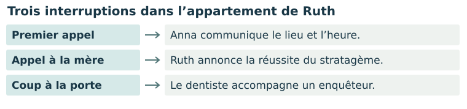
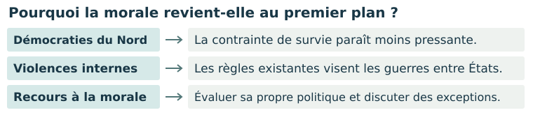

# X · MP-PC · Anglais 2007 — Corrigé brut

*Corrigé rédigé par IA, non officiel. Signalez toute erreur.*

**Rédaction** · GPT-6.2 Astra Ultra · vitesse non renseignée

Les deux cahiers durent chacun une heure trente, sans dictionnaire. La version se rédige en français. Les deux réponses au texte français se rédigent en anglais. Le sujet donne à titre indicatif 120 à 150 mots pour la première et 180 à 200 pour la seconde.

## V. Version française

**À la rencontre de Lucas**

À l’appartement, je m’apprêtais à préparer le dîner de Jochen quand le téléphone sonna.

« Madame Gilmartin ?

— Elle-même.

— Anna Orloggi à l’appareil. » C’était la même femme. Elle prononçait son nom sans la moindre trace d’accent italien, comme si elle appartenait à l’une des plus anciennes familles d’Angleterre.

« Oui, dis-je sans trop savoir pourquoi. Bonjour.

— Lord Mansfield vous recevra à son club vendredi soir à dix-huit heures. Avez-vous du papier et un stylo ? »

Je pris note des renseignements. Son club s’appelait Brydges’, simplement Brydges’, sans le mot « club ». Je notai une adresse près de St James’s.

« Dix-huit heures, ce vendredi », répéta Anna Orloggi.

« J’y serai. »

Je raccrochai et, sur le coup, j’éprouvai une vive exaltation à la pensée que notre ruse avait réussi. J’éprouvais aussi une nervosité troublante, sachant que ce serait moi, finalement, qui rencontrerais Lucas Romer. Tout était soudain devenu réel et je sentis mon exaltation céder la place à un léger haut-le-cœur. Rien qu’à penser à cette rencontre, j’eus brusquement la bouche toute sèche. Je savais que j’éprouvais une émotion à laquelle je me prétendais insensible. J’avais un tout petit peu peur.

« Ça va, maman ? demanda Jochen.

— Oui, très bien, mon chéri. Juste un élancement à une dent. »

J’appelai ma mère pour lui annoncer la nouvelle.

« Ça a marché, lui dis-je, exactement comme tu l’avais dit.

— Bien, répondit-elle d’une voix tout à fait calme. Je savais que ça marcherait. Je te dirai exactement quoi dire et quoi faire. »

Comme je raccrochais, on frappa à la porte donnant sur l’escalier qui descendait de l’appartement au cabinet du dessous. J’ouvris. M. Scott se tenait là, tout sourire, comme s’il m’avait entendue dire « un élancement à une dent » à travers le plancher et avait monté l’escalier quatre à quatre pour venir me soigner. Mais derrière lui se trouvait un jeune homme aux cheveux courts qui avait manifestement très chaud dans son costume sombre bon marché.

« Oh, bonjour, bonjour, Ruth Gilmartin, dit M. Scott. Que d’émotions ! Ce jeune homme est policier, dans la police judiciaire, rien que ça, et il voudrait vous dire deux mots. À tout à l’heure… peut-être. »

J’introduisis le policier au salon. Il s’assit, demanda s’il pouvait retirer sa veste, vu la chaleur accablante dehors, et se présenta comme l’agent Frobisher, de la police judiciaire. Ce nom me rassurait, pour une raison assez saugrenue, me dis-je tandis que l’agent Frobisher déposait soigneusement sa veste sur l’accoudoir d’un fauteuil avant de se rasseoir.

« Juste quelques questions », dit-il en sortant son carnet, qu’il se mit à feuilleter.

## 1. Why has morality acquired a new place in international affairs since the Cold War?

Andréani and Hassner identify two changes. During the Cold War, democratic states could defend a sharp distinction between limited government at home and the pursuit of power abroad by invoking the need to survive. As democracy spread and immediate threats diminished for prosperous northern countries, that distinction became harder to justify. Citizens could expect their own governments and allies to meet standards once invoked chiefly against an enemy. Meanwhile, much violence arose from the breakdown of states themselves. International law had been designed to prevent wars between states by protecting sovereignty and restricting intervention. Abandoning those principles would be dangerous, yet applying them rigidly could leave victims without assistance. Moral arguments have consequently offered a way to debate exceptions and judge national policies, even where actual conduct has improved little.

*130 mots.*

## 2. Where does the duty of non-interference give way to the risk of failing to assist?

I agree with Mitterrand that respect for borders cannot relieve a government of every obligation towards people suffering across them. If officials know that families are being driven from their homes, it seems absurd to claim that the only morally respectable response is silence. Admission of refugees, support for relief agencies and negotiations over access can save lives without requiring outsiders to govern another country.

My difficulty lies in the word precise. Evidence may be disputed, the people concerned may disagree about what would help, and an outside government may dress an interest of its own in the language of rescue. A claim to act for others should therefore be tested against independent accounts and the likely consequences for civilians. Those promising assistance should also explain how they will remain answerable if conditions deteriorate once international attention turns elsewhere.

The failure to help can be culpable, as Mitterrand insists. So can an intervention undertaken chiefly to display moral determination. I would treat his formula as an obligation to look for effective, proportionate assistance and to justify inaction publicly. It cannot supply an automatic permission slip for whatever the strongest state proposes.

*191 mots.*

Version de Restless (2006). L’expression porte sur l’extrait de Justifier la guerre ? De l’humanitaire au contre-terrorisme (2005). Les deux cahiers et les rapports distincts sur la version et l’expression sont conservés.

[Cahier de version](https://web.archive.org/web/20090424050957id_/http://www.imprimerie.polytechnique.fr:80/EnLignes/Files/07_Version.pdf#page=2) · [Cahier d’expression](https://web.archive.org/web/20090424045418id_/http://www.imprimerie.polytechnique.fr:80/EnLignes/Files/07_ExprEcrit.pdf) · [Rapport du jury](https://web.archive.org/web/20090424045355id_/http://www.imprimerie.polytechnique.fr:80/EnLignes/Files/07_Compos_Anglais_MP_PC_rap.pdf) · [Rapport complémentaire](https://web.archive.org/web/20090424045349id_/http://www.imprimerie.polytechnique.fr:80/EnLignes/Files/07_Compos_Anglais_Exp_MP_PC_Rap.pdf)
