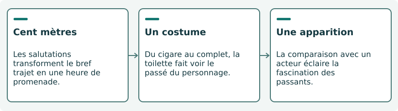

# X · MP-PC · Arabe 2007 — Corrigé guidé

*Corrigé rédigé par IA, non officiel. Signalez toute erreur.*

**Rédaction** · GPT-6.2 Astra Ultra · vitesse non renseignée

La version d’Alaa El Aswany et les deux questions sur le texte de Gilles Andréani et Pierre Hassner appartiennent à la même composition. Le rapport de Jean Tardy précise les difficultés de traduction et d’expression. Les réponses arabes comptent 133 et 185 mots séparés par des espaces.

## I. Version française

Les cent mètres donnent la mesure du temps que les salutations prennent à Zaki. Suivre ensuite le regard, du complet au crâne, sans couper le rapport entre l’ancien havane et son remplaçant. La pochette, le cigare, la boutique de torréfaction et les histoires salaces correspondent aux quatre mises en garde lexicales du correcteur Jean Tardy.

### Proposition rédigée

**Un personnage haut en couleur**

Du passage Behler, où réside Zaki bey Dessouki, à son bureau, dans l’immeuble Yacoubian, il n’y a pas plus de cent mètres. Pourtant, chaque matin, il met une heure à les parcourir. Il lui faut saluer ses amis dans la rue, les patrons des magasins de vêtements et de chaussures et leurs employés des deux sexes, les garçons de café, le personnel du cinéma, les habitués de la boutique où l’on torréfie le café brésilien, jusqu’aux concierges, aux cireurs de chaussures, aux mendiants et aux agents de la circulation. Zaki bey les connaît par leur nom et échange avec eux saluts et nouvelles.

Zaki bey est l’un des plus anciens habitants de la rue Soliman-Pacha. Il s’y est installé à la fin des années quarante, au retour de son séjour d’études en France, et ne l’a plus jamais quittée... Pour les habitants de la rue, c’est une figure pittoresque et aimée. Il apparaît devant eux, été comme hiver, en complet, dont l’ampleur dissimule son corps menu et décharné. De sa poche de poitrine dépasse toujours une pochette soigneusement repassée, assortie à sa cravate. Et ce fameux cigare, qui aux jours de sa splendeur était un havane de luxe, est à présent un mauvais cigare du pays, mal tiré, à l’odeur de champignon. Ajoutez à cela son vieux visage tout ridé, ses lunettes de vue aux verres épais, ses fausses dents étincelantes, ses cheveux teints en noir dont il ramène les rares mèches de la gauche jusqu’à l’extrémité droite du crâne dans l’espoir de couvrir sa vaste calvitie dénudée...

Bref, Zaki Dessouki a quelque chose d’un personnage de légende. Sa présence a de ce fait quelque chose de fascinant et de tout à fait irréel. On dirait qu’il pourrait disparaître à tout instant, ou que c’est un acteur qui joue un rôle et qui, une fois la représentation terminée, enlèvera, bien entendu, son costume de scène pour remettre ses vrais vêtements. Si l’on y ajoute sa gaieté, la pluie d’histoires salaces qu’il raconte et son don extraordinaire de parler à quiconque croise son chemin comme à un vieil ami, on comprend le secret de l’accueil que lui réserve chacun dans la rue. De fait, Zaki bey n’a pas plus tôt paru à l’entrée de la rue, vers dix heures du matin, que de toutes parts fusent les bonjours. Souvent, quelques-uns de ses admirateurs parmi les jeunes employés des boutiques se précipitent vers lui pour l’interroger, en plaisantant, sur des questions de sexe qui leur paraissent obscures...

Alaa El Aswany, *L’Immeuble Yacoubian*, 2005.

## II.1. Analyse du texte commun

Distinguer les signes du phénomène (repentance, justice internationale) des deux explications demandées. La première rapproche politique intérieure et diplomatie. La seconde analyse le décalage entre le droit conçu pour les conflits entre États et les crises internes. Au duel arabe, « les deux auteurs » est sujet dans la dernière phrase.

### Proposition rédigée

يرد الكاتبان المكانة الجديدة للأخلاق إلى عاملين. أولهما أن المواطن في الدول الديمقراطية يقبل بصعوبة أن يخضع حكامه للرقابة في الداخل ثم يتصرفوا في الخارج بمنطق القوة وحدها. أثناء الحرب الباردة كان الخوف على بقاء الدولة يسوغ هذا التناقض، وكانت التهمة الأخلاقية توجه أساسا إلى الخصم. وبعد زوال المواجهة تراجع الخطر على دول الشمال المزدهرة واتسع انتشار القيم الديمقراطية، فأمكن الاحتكام إلى هذه القيم عند تقويم أعمال الحلفاء بل أعمال الحكومة نفسها. أما العامل الثاني فيتعلق بطبيعة العنف. فقد أنشئت القواعد الدولية لمنع الحرب بين الدول، بينما تحدث مآس كثيرة الآن داخل دول تتفكك مؤسساتها. ويصعب إلغاء مبادئ السيادة وعدم التدخل من دون زعزعة السلم بين الدول. لذلك يحتج دعاة نجدة السكان بواجب أخلاقي يجيز في نظرهم ما لا يجيزه القانون بوضوح. ولا يستنتج الكاتبان من ذلك أن سلوك الحكومات تحسن بالقدر نفسه.

## II.2. Réflexion personnelle

Interroger le mot « précis » par un cas où l’aide commence sans qu’une frontière soit franchie. La difficulté pertinente devient celle du choix, de l’autorité et du contrôle des moyens employés. L’exemple de l’accueil des blessés permet de distinguer la certitude d’un besoin de la légitimité d’une réponse donnée.

### Proposition rédigée

أفهم عبارة ميتران على أنها سؤال يوجه أولا إلى من يستطيع أن يساعد ويختار الصمت. ففي وسع حكومة أن تتمسك بسيادة دولة أخرى فيما هي تغلق حدودها أمام أناس يطلبون المأوى. يصعب في هذه الحالة أن تسمي موقفها حيادا، لأنها تستطيع أن تحمي أولئك الناس في أرضها من غير أن تملي على جيرانها كيف يحكمون بلادهم. ومع ذلك أتحفظ على فكرة وجود نقطة دقيقة يدركها الجميع في اللحظة نفسها. فمن يقدر الخطر، ومن يتحمل تبعة الخطأ في تقديره؟

قد تنبهنا شهادة طبيب يعمل في مدينة منكوبة إلى مأساة حقيقية قبل أن تصل لجنة للتحقيق. ولا يقتضي احترام السيادة أن ننتظر التقرير الأخير حتى نعرض استقبال الجرحى أو تمويل فرق الإغاثة المحلية. ولكن الدولة التي تعلن وحدها أنها تتكلم باسم الضحايا قد تستبعد آراءهم، أو تخص بمساعدتها شعبا وتنسى آخر لاعتبارات تتصل بمصالحها. ولهذا أرى أن الواجب يبدأ بالإصغاء إلى المتضررين وإتاحة معلومات مستقلة ومقارنة النتائج المحتملة لكل وسيلة متاحة. ومن حق السكان أيضا أن يسألوا من جاء لنجدتهم عما سيتركه وراءه حين تنصرف الأنظار عن قضيتهم. فالقول إن الامتناع قد يلحق ضررا يحملنا على تحمل المسؤولية، ولا يعفينا من تبرير ما نفعله باسم الآخرين أمامهم.

[Sujet](https://web.archive.org/web/20090424050957id_/http://www.imprimerie.polytechnique.fr:80/EnLignes/Files/07_Version.pdf#page=3) · [Sujet complémentaire](https://web.archive.org/web/20090424045418id_/http://www.imprimerie.polytechnique.fr:80/EnLignes/Files/07_ExprEcrit.pdf) · [Rapport](https://web.archive.org/web/20090424084421id_/http://www.imprimerie.polytechnique.fr:80/EnLignes/Files/07_Compos_Arabe_MP_PC_Rap2.pdf)
