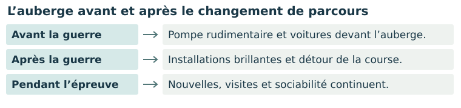
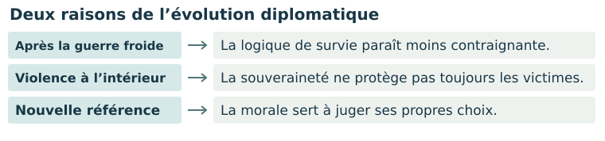
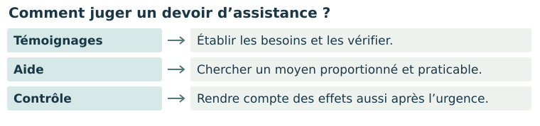

# X · MP-PC · Italien 2007 — Corrigé brut

*Corrigé rédigé par IA, non officiel. Signalez toute erreur.*

**Rédaction** · GPT-6.2 Astra Ultra · vitesse non renseignée

Les deux cahiers durent chacun une heure trente, sans dictionnaire. La version se rédige en français. Les deux réponses au texte français se rédigent en italien. Le sujet donne à titre indicatif 120 à 150 mots pour la première et 180 à 200 pour la seconde.

## V. Version française

**La Grande Course**

C’était une auberge sur la route nationale, à l’entrée du village. On pouvait y manger et y dormir. Il y avait aussi un garage et une pompe à essence. Tout appartenait au même propriétaire. Au début, la pompe à essence était un engin rudimentaire qui fuyait de partout. Mais après la guerre, ils avaient tout modernisé, tout fait briller. Il y avait deux pompes, rouges. Il y avait la marque d’essence et les chiffres qui défilaient tout seuls. Ils avaient tout éclairé et c’était maintenant le lieu le plus étincelant du village. L’auberge aussi, ils l’avaient retapée. Ils avaient mis des tables recouvertes de plastique. Et il y avait des sièges rembourrés. C’était un bel endroit.

Avant la guerre, la Grande Course passait par là tous les ans. Certains concurrents s’arrêtaient pour manger un morceau et beaucoup faisaient le plein ou effectuaient de petites réparations. Il y avait toujours une foule de gens qui épiaient les voitures et les pilotes. Beaucoup s’étaient liés d’amitié. Après la guerre, pourtant, on décida que la Grande Course éviterait les villages quand ce serait possible, pour des raisons de sécurité. Désormais, un kilomètre avant l’auberge, le tracé bifurquait sur une route secondaire et contournait l’agglomération. À l’auberge, on l’avait mal pris. Mais ils avaient maintenant la Grande Course dans le sang et, au fond, les choses n’avaient pas tellement changé. Ces jours-là, on ne fermait jamais et, si on voulait savoir où en était la course, là-bas ils savaient tout. Il y avait même des pilotes qui faisaient ce kilomètre de plus pour passer dire bonjour. Ou pour boire un coup.

La Grande Course était une affaire exténuante que les plus rapides réglaient en douze ou treize heures. Mais n’importe qui pouvait prendre le départ. Certains finissaient par y mettre jusqu’à deux jours. C’était mille six cents kilomètres, sans arrêt. Deux ou trois contrôles et ça repartait. Des centaines de voitures, l’une derrière l’autre, sillonnant les routes d’Italie. Les gens en raffolaient. Tout s’arrêtait là où passait la Grande Course et les automobiles captaient les regards et les cœurs de tous. Souvent il y avait un mort. Parfois un pilote, mais plus souvent quelqu’un qui avait couru se poster au bord de la route pour regarder. Des gens ordinaires. Mais personne n’était ordinaire pendant ces heures-là.

*Alessandro Baricco, Cette histoire, 2005.*

## 1. Per quali ragioni la morale occupa un posto nuovo nella vita internazionale dopo la guerra fredda?

Andréani e Hassner indicano due ragioni. Durante la guerra fredda una democrazia poteva limitare il potere al proprio interno e seguire all’estero la logica dei rapporti di forza, sostenendo che ne andava della sua sopravvivenza. Con la diffusione dei valori democratici e la diminuzione delle minacce immediate per i paesi prosperi del Nord, questa differenza è diventata meno necessaria e meno accettabile. Inoltre molte violenze derivano ormai dalla disgregazione degli Stati, mentre le norme internazionali erano state concepite soprattutto per impedire guerre fra Stati. Sovranità e non ingerenza restano garanzie preziose, ma possono lasciare senza protezione una popolazione minacciata dall’interno. Il richiamo alla morale permette di discutere casi che quelle norme affrontano con difficoltà e di giudicare anche il comportamento del proprio governo e dei suoi alleati.

*127 mots.*

## 2. Che cosa pensare del confine tracciato da Mitterrand fra non ingerenza e mancata assistenza?

Condivido l’idea che la sovranità non esaurisca le nostre responsabilità verso chi soffre al di là di un confine. Un governo che riceve richieste credibili di aiuto deve almeno verificarle, offrire accoglienza a chi fugge e domandarsi quali mezzi concreti possano ridurre il pericolo. Definire ogni gesto di solidarietà un’ingerenza servirebbe soltanto a rendere più comoda l’indifferenza.

Mi convince meno la promessa di individuare un punto preciso in cui termina un obbligo e comincia l’altro. Le testimonianze possono essere incomplete, i destinatari dell’aiuto possono avere priorità diverse e chi interviene può scambiare il proprio interesse per il bene della popolazione. Perciò ascolterei le organizzazioni locali, cercherei riscontri indipendenti e confronterei gli effetti prevedibili di più risposte, comprese quelle diplomatiche. Anche una decisione presa in fretta deve poter essere spiegata pubblicamente e riesaminata se la situazione cambia.

La formula di Mitterrand mi sembra quindi preziosa come domanda rivolta a chi preferirebbe restare spettatore. Diventa pericolosa se viene presentata come una risposta che dispensa dall’ascoltare, dal motivare le scelte e dall’assumersi la responsabilità dei danni. Lo scopo dell’assistenza è dare maggiore sicurezza alle persone coinvolte, non dimostrare la generosità di chi la promette.

*191 mots.*

Version de Questa storia (2005), dont le titre est également traduit, conformément à la remarque du jury. Les deux réponses en italien s’appuient sur le texte d’Andréani et Hassner. Les deux cahiers et le rapport de Laura Fournier Finocchiaro ont été consultés.

[Cahier de version](https://web.archive.org/web/20090424050957id_/http://www.imprimerie.polytechnique.fr:80/EnLignes/Files/07_Version.pdf#page=5) · [Cahier d’expression](https://web.archive.org/web/20090424045418id_/http://www.imprimerie.polytechnique.fr:80/EnLignes/Files/07_ExprEcrit.pdf) · [Rapport du jury](https://web.archive.org/web/20090424084426id_/http://www.imprimerie.polytechnique.fr:80/EnLignes/Files/07_Compos_Italien_MP_PC_Rap.pdf)
