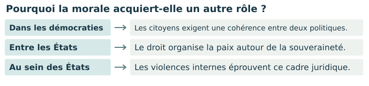

# X · MP-PC · Portugais 2007 — Corrigé guidé

*Corrigé rédigé par IA, non officiel. Signalez toute erreur.*

**Rédaction** · GPT-6.2 Astra Ultra · vitesse non renseignée

Les deux cahiers durent chacun une heure trente, sans dictionnaire. La version se rédige en français. Les deux réponses au texte français se rédigent en portugais. Le sujet donne à titre indicatif 120 à 150 mots pour la première et 180 à 200 pour la seconde.

## V. Version française

*Seria… haveria* accompagne une estimation du temps qui reste, d’où « sans doute », « il ne resterait ». *Belos* nomme une confédération de royaumes, et *régulo* le chef d’un territoire. La note donne le juge d’appel pour *desembargador*. Le texte distingue ce juge de l’*ouvidor* qui prononce le réquisitoire. *Só depois… é que* marque la restriction. Rendre l’adresse plurielle cérémonieuse *Vossas Senhorias*.

**Une accusation injuste**

Le sable s’écoulait lentement du sablier posé sur la Grande Table. Le réservoir se vidait, tandis qu’en bas la poudre s’amoncelait peu à peu, s’éboulant doucement sur les côtés, toute dorée.

Ce devait être la quatrième fois que l’huissier allait retourner le sablier, et il ne resterait plus qu’une heure d’audience. La dernière pour prouver son innocence. Dom Manuel Álvares se sentait las. Il régnait une chaleur intense dans la salle du tribunal de la Casa da Suplicação, à Goa, où il était jugé. On l’accusait d’avoir livré aux Hollandais le fort de Solor, dans les Indes orientales. Lui ?! Lui qui avait tout fait pour soutenir un siège de trois mois avec trente soldats seulement. Et avec l’aide des guerriers belos de Timor, bien sûr ! Sans eux, rien n’aurait été possible. Sans les frères dominicains non plus. Ils venaient à nouveau de lui témoigner leur soutien, puisqu’ils étaient de l’autre côté du tribunal en conversation avec le juge d’appel… Et surtout avec l’aide de Nenu, son amour interdit, la nièce du chef des Démonaras, le peuple de l’île de Solor. La princesse avait disparu pendant la bataille et il avait perdu l’espoir de la revoir. Il ne savait même pas si elle vivait encore. Il regarda l’*ouvidor*, le magistrat qui, en ce moment même, une fois de plus, l’accusait.

« Un témoin digne de foi l’a vu, un soldat qui, à maintes reprises déjà, a montré sa vaillance et sa valeur, tant au siège d’Ormuz que dans les campagnes du Nord. Comme Vos Seigneuries ont pu l’entendre de sa propre bouche, il a accusé Dom Manuel Álvares d’avoir perdu le fort, d’avoir mené des pourparlers amicaux avec l’ennemi et même d’avoir reçu des présents ! C’est seulement après que ce soldat, quoique blessé, a réussi à s’échapper que la vérité a pu être connue. Je réclame donc la peine maximale prévue pour cette sorte de trahison ! »

La fatigue avait eu raison de l’indignation et Dom Manuel ne réagissait même plus aux accusations. Il ne comprenait pas pourquoi ce soldat s’acharnait à ce point contre lui… Il se souvenait vaguement de ce visage, mais il ne parvenait à se rappeler quoi que ce fût qui pût expliquer son attitude.

*Pedro Vasconcelos, 1613, 2005. Le sujet précise que les Belos formaient une confédération de royaumes dans la partie orientale de Timor et que les Démonaras habitent le nord de Solor.*

## 1. A que razões atribuem os autores o novo lugar da moral na vida internacional desde o fim da Guerra Fria?

Restituer les deux explications, dont la première vaut spécialement pour les démocraties prospères du Nord. Distinguer l’emploi polémique de la morale pendant la guerre froide et le jugement désormais porté sur sa propre politique. En portugais, *ao passo que* permet d’opposer domaines intérieur et extérieur.

Durante a Guerra Fria, já se invocava a moral para condenar o adversário, sem que isso impedisse a negociação. Depois, tornou-se mais difícil justificar que as democracias limitassem o poder dentro das suas fronteiras e aceitassem a pura razão de Estado fora delas. A difusão dos valores democráticos e a diminuição das ameaças, pelo menos para os países prósperos do Norte, aproximaram as exigências feitas às duas políticas. Há ainda um desajuste entre as instituições e a violência contemporânea. A soberania e a não ingerência destinavam-se a prevenir guerras entre Estados, ao passo que muitos conflitos nascem agora da desagregação de um Estado. Contestar directamente aqueles princípios poria em causa a ordem jurídica internacional. O argumento moral permite defender a legitimidade de uma intervenção mesmo quando a sua legalidade continua em discussão.

*132 mots.*

## 2. Que pensa da afirmação de François Mitterrand segundo a qual o dever de não ingerência cessa precisamente onde começa o risco de não prestar assistência?

Interroger *precisamente* en imaginant une situation où les témoignages restent incomplets. Une réponse peut reconnaître un devoir d’assistance et exiger un contrôle indépendant des moyens employés. *Ouvir quem…* évite de confondre gouvernement local et habitants.

A frase de Mitterrand tem o mérito de perguntar quem paga o preço de uma decisão aparentemente prudente. Um governo pode invocar o respeito pelas fronteiras e assistir de braços cruzados à expulsão de uma população. Para as famílias que procuram abrigo, essa neutralidade tem consequências bem concretas. Teria, contudo, dificuldade em marcar o ponto «preciso» de que fala a fórmula. Os testemunhos podem chegar tarde e os governos que se oferecem para ajudar têm interesses próprios.

Começaria por ouvir quem pede socorro. Uma associação local pode querer observadores independentes, acolhimento para os refugiados ou a passagem de equipas médicas. Cada pedido exige meios e garantias diferentes. Se um Estado vizinho se apresentar como único intérprete da vontade dessas pessoas, o risco de substituir uma tutela por outra merece ser discutido publicamente. Importa igualmente saber a quem poderão recorrer os habitantes se a assistência prometida lhes causar novos prejuízos.

O dever de não abandonar os outros começa, a meu ver, antes de dispormos de uma certeza absoluta. Mas esse dever obriga também a justificar a escolha dos meios, a verificar os seus efeitos e a prestar contas às pessoas em cujo nome se decidiu agir.

*195 mots.*

Le roman historique 1613 de Pedro Vasconcelos a paru en 2005. L’essai de Gilles Andréani et Pierre Hassner est également daté de 2005. Les réponses suivent l’usage du Portugal. Aucun rapport propre à la composition portugaise n’a été retrouvé.

[Cahier de version](https://web.archive.org/web/20090424050957id_/http://www.imprimerie.polytechnique.fr:80/EnLignes/Files/07_Version.pdf#page=6) · [Cahier d’expression](https://web.archive.org/web/20090424045418id_/http://www.imprimerie.polytechnique.fr:80/EnLignes/Files/07_ExprEcrit.pdf)
