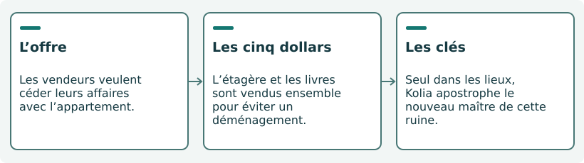

# X · MP-PC · Russe 2007 — Corrigé brut

*Corrigé rédigé par IA, non officiel. Signalez toute erreur.*

**Rédaction** · GPT-6.2 Astra Ultra · vitesse non renseignée

La version d’Andreï Kourkov et les questions sur Gilles Andréani et Pierre Hassner sont corrigées avec le rapport écrit d’Anastasia Forquenot. La première réponse explique la place nouvelle du jugement moral, la seconde discute la formule de François Mitterrand. Les deux réponses russes comptent 132 et 189 mots.

## I. Version française

**Le nouvel appartement**

Au début du printemps de mille neuf cent quatre-vingt-dix-sept, après avoir vendu mon deux-pièces en périphérie, j’étais en train de m’acheter un studio en plein centre de Kiev, près de la cathédrale Sainte-Sophie. Les petits vieux qui le vendaient partaient pour Israël et essayaient de me vendre avec l’appartement des dizaines de babioles inutiles, comme ce portemanteau bricolé en fil de fer dans l’entrée. Grigori Markovitch, le chef de famille, répétait avec insistance : « Je connais le prix de chaque chose ! Je ne vous demanderai pas un sou de trop. » J’achetai bien deux ou trois objets, mais refusai la plupart des autres. J’achetai aussi une étagère avec ses livres. C’était même ainsi qu’elle se vendait, pour éviter d’avoir à la décrocher du mur et à porter les livres chez le bouquiniste. À quoi bon tant de tracas ? J’ignore quelle part des cinq dollars que j’avais payés revenait aux livres et laquelle à l’étagère. Toujours est-il que je n’examinai pas les livres de bien près, remarquant tout juste au passage une édition savante de *Guerre et Paix*, de Léon Tolstoï. Le livre était de grand format et devait dater des années cinquante. J’aimais les livres de ce genre, sinon pour leur contenu, du moins pour leur allure imposante.

Le douze mars vint le moment de la remise des clés. J’arrivai en fin d’après-midi. Devant la porte de l’immeuble se trouvait un minibus envoyé par l’agence Sokhnout. Les petits vieux chargeaient leurs affaires. Deux représentants de l’agence les aidaient avec courtoisie.

« Eh bien, Kolia Sotnikov, me dis-je quand je me retrouvai seul dans l’appartement que je venais d’acquérir, te voilà propriétaire de cette ruine ! »

D’après Andreï Kourkov, *Le Bon Ange de la mort*, 2000.

## II.1. Analyse du texte commun

Авторы предлагают два объяснения. Первое связано с трудностью проводить внутри страны и за её пределами совершенно разную политику. В демократическом обществе власть обязана уважать права граждан, а во время холодной войны она оправдывала отступление от таких требований за рубежом необходимостью выжить. Когда противостояние ослабло, для благополучных стран Севера эта необходимость стала менее очевидной. Теперь общество судит с нравственной точки зрения и о действиях собственного правительства или его союзников. Второе объяснение касается перемены в характере насилия. Международный порядок создавался для предотвращения войн между государствами. Между тем люди всё чаще страдают от распада государства и от насилия внутри его границ. Чтобы обосновать помощь им, не отвергая целиком принципы суверенитета и невмешательства, политики обращаются к нравственному долгу. При этом, подчёркивают авторы, новая роль морали в спорах ещё не означает, что государства стали вести себя лучше.

## II.2. Réflexion personnelle

Слова Миттерана справедливо напоминают, что бездействие тоже бывает решением, за которое приходится отвечать. Когда власти ссылаются на чужие границы, чтобы отказать в приёме беженцам у своей границы, ссылка на невмешательство прикрывает их собственный выбор. Между тем уже здесь видно, что помощь может принимать разные формы. Дать убежище семье и распоряжаться делами её родной страны означают совсем не одно и то же.

Труднее согласиться со словами о точной границе между обязанностями. Опасность не всегда видна сразу, а государства не всегда одинаково охотно замечают её у своих друзей и у противников. Поэтому решение не должно зависеть исключительно от того, кто первым объявил себя защитником пострадавших. Необходимо выслушать самих людей, сопоставить независимые свидетельства и проверить, не сделает ли выбранный способ помощи их положение ещё тяжелее. Иногда поддержать местную больницу полезнее, чем выступить с громким заявлением от имени целого народа.

Я понимаю эту формулу как обязанность начать обсуждение и искать доступную помощь, даже если власти предпочли бы закрыть глаза. Она не даёт отдельному государству права самому определить чужое благо и снять с себя ответственность за последствия. Серьёзность намерений проверяется также тем, останутся ли помощники рядом, когда газетные заголовки уже переключатся на новое несчастье.

[Sujet](https://web.archive.org/web/20090424050957id_/http://www.imprimerie.polytechnique.fr:80/EnLignes/Files/07_Version.pdf#page=7) · [Sujet complémentaire](https://web.archive.org/web/20090424045418id_/http://www.imprimerie.polytechnique.fr:80/EnLignes/Files/07_ExprEcrit.pdf) · [Rapport](https://web.archive.org/web/20090424084544id_/http://www.imprimerie.polytechnique.fr:80/EnLignes/Files/07_Compos_Russe_MP_PC_Rap.pdf)
