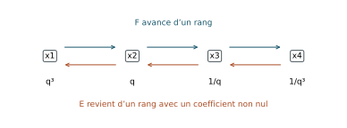

# École polytechnique MP — Deuxième composition de mathématiques 2007 · Corrigé guidé

*Corrigé rédigé par IA, non officiel. Signalez toute erreur.*

**Rédaction** · GPT-6.2 Astra Ultra · vitesse non renseignée

**Révision (tour 1)** · GPT-6.2 Astra Ultra · vitesse non renseignée · 26 novembre 2026

On fixe un complexe non nul $q$ qui n’est pas racine de l’unité. La relation de commutation transporte les espaces propres entre eux. C’est en suivant ces déplacements que l’on retrouve les trois matrices dans une même base.

## Première partie. Commutation et sous-espaces stables

### Question 1

> [!INDICATION]
> Montrer que chaque droite propre est stable par le commutant.

#### Solution

On a $A(Bx_i)=B(Ax_i)=a_iBx_i$. Les $a_i$ étant deux à deux distincts, l’espace propre associé à $a_i$ est la droite $\mathbb C x_i$. Donc $Bx_i$ appartient à cette droite pour tout $i$, et $B$ est diagonal dans cette base.

### Question 2.a

> [!INDICATION]
> Choisir une valeur propre de B et vérifier que son noyau propre est communément stable.

#### Solution

Comme le corps est complexe, $B$ possède une valeur propre $b$. Pour tout $i$, $(B-bI)A_i=A_i(B-bI)$, donc $\ker(B-bI)$ est stable par tous les $A_i$. Il est non nul, l’hypothèse impose donc qu’il soit égal à $X$. D’où $B=bI$.

### Question 2.b

> [!INDICATION]
> Chercher une famille triangulaire dont le commutant soit scalaire.

#### Solution

En dimension deux, prenons $A_1=\operatorname{diag}(1,2)$ et $A_2$ défini par $A_2x_2=x_1$, $A_2x_1=0$. Le premier impose à $B$ d’être diagonal, le second impose l’égalité de ses deux coefficients diagonaux, alors que la droite $\mathbb Cx_1$ est stable par les deux. La réciproque est fausse.

## Deuxième partie. Le modèle à une chaîne

### Question 3

> [!INDICATION]
> Comparer les poids de deux indices successifs et traiter le dernier vecteur.

#### Solution

Posons $k_p=q^{n+1-2p}$. Pour $p<n$, $K_0F_0x_p=k_{p+1}x_{p+1}=q^{-2}k_px_{p+1}=q^{-2}F_0K_0x_p$. Au rang $p=n$, les deux termes sont nuls. La différence est donc l’endomorphisme nul.

### Question 4

> [!INDICATION]
> Prendre le premier indice apparaissant dans un vecteur du sous-espace stable, puis itérer le décalage.

#### Solution

Outre zéro, les espaces stables par $F_0$ sont $W_j=\operatorname{Vect}(x_j,\ldots,x_n)$ pour $1\le j\le n$. En effet, soit $W\ne0$ stable et $j$ le plus petit indice apparaissant avec coefficient non nul dans un de ses vecteurs. Alors $W\subset W_j$. Choisissons $w\in W$ dont le premier coefficient non nul est en $j$. Les $n-j+1$ vecteurs $w,F_0w,\ldots,F_0^{n-j}w$ ont pour premiers indices non nuls $j,j+1,\ldots,n$ : ils sont indépendants, donc engendrent $W_j$. Réciproquement, chaque $W_j$ est stable par le décalage et, étant engendré par des vecteurs propres de $K_0$, il est stable par $K_0$ aussi. Les deux listes coïncident.

### Question 5

> [!INDICATION]
> Le décalage de E se fait dans le sens opposé à celui de F.

#### Solution

Notons $[r]=(q^r-q^{-r})/(q-q^{-1})$ et $c_p=[p-1][n+1-p]$, de sorte que $E_0x_p=c_px_{p-1}$ pour $p>1$. Alors $k_{p-1}=q^2k_p$ donne $K_0E_0x_p=q^2E_0K_0x_p$. Au premier indice $E_0x_1=0$ rend les deux termes nuls.

### Question 6

> [!INDICATION]
> Écrire le commutateur comme une différence de deux coefficients consécutifs.

#### Solution

Posons $c_1=c_{n+1}=0$. Sur $x_p$, le commutateur $E_0F_0-F_0E_0$ agit par $c_{p+1}-c_p$, y compris aux deux extrémités. Or
$$c_{p+1}-c_p=[p][n-p]-[p-1][n+1-p]=[n+1-2p].$$
En effet, avec $D=q-q^{-1}$, les termes en $q^n$ et $q^{-n}$ s’annulent dans $D^2(c_{p+1}-c_p)$ ; il reste $(q-q^{-1})(q^{n+1-2p}-q^{-n-1+2p})$. Puisque $k_p=q^{n+1-2p}$, on reconnaît $(k_p-k_p^{-1})/D$, ce qui prouve l’égalité d’endomorphismes.

En particulier, sur $x_1$ le coefficient obtenu est $c_2=[n-1]$, et sur $x_n$ il est $-c_n=-[n-1]$. Ces deux valeurs correspondent aux poids $q^{n-1}$ et $q^{1-n}$ de $K_0$ et tiennent compte des bouts de chaîne où l’un des deux produits est nul.

### Question 7

> [!INDICATION]
> Tester les espaces précédents sur leur premier vecteur.

#### Solution

Pour $2\le j\le n$, $c_j\ne0$ car $q$ n’est pas racine de l’unité et les deux entiers $j-1,n+1-j$ sont strictement positifs. Ainsi $E_0x_j=c_jx_{j-1}\notin W_j$. Les seuls sous-espaces communément stables sont donc $0$ et $X=W_1$.

## Troisième partie. Poids et nilpotence

### Question 8

> [!INDICATION]
> Appliquer la relation de commutation à des vecteurs propres.

#### Solution

Si $Kx=\lambda x$, alors $KEx=q^2EKx=q^2\lambda Ex$, d’où $E(X_\lambda)\subset X_{q^2\lambda}$. Si $Ex=\lambda x$, alors $EKx=q^{-2}KEx=q^{-2}\lambda Kx$, d’où $K(Y_\lambda)\subset Y_{q^{-2}\lambda}$.

### Question 9

> [!INDICATION]
> Itérer K, qui est inversible, sur un vecteur propre supposé non nul.

#### Solution

Pour $0\ne x\in Y_\lambda$, tous les $K^jx$ sont non nuls et appartiennent respectivement à $Y_{q^{-2j}\lambda}$. Si $\lambda\ne0$, ces valeurs sont toutes distinctes, puisque $q$ n’est pas racine de l’unité. Cela donnerait une infinité de valeurs propres à $E$ en dimension finie. Donc $Y_\lambda=0$ pour $\lambda\ne0$.

### Question 10

> [!INDICATION]
> Écrire le polynôme caractéristique après avoir identifié toutes ses racines.

#### Solution

Le polynôme caractéristique de $E$ est scindé sur $\mathbb C$, de degré $n$, et 9 ne permet que la racine zéro. Il vaut donc $X^n$. Cayley–Hamilton donne $E^n=0$ : on peut choisir $r=n$.

### Question 11

> [!INDICATION]
> Restreindre K au noyau de E.

#### Solution

La nilpotence sur l’espace non nul donne $\ker E\ne0$. La question 8 avec $\lambda=0$ montre que $K$ stabilise ce noyau. La restriction admet sur $\mathbb C$ un vecteur propre non nul, qui répond à la question.

### Question 12.a

> [!INDICATION]
> Spécialiser la construction au cas de la dimension deux.

#### Solution

Par 11 il existe $x'_1\ne0$ dans $\ker E$ tel que $Kx'_1=\lambda x'_1$. Comme $K$ est inversible, $\lambda\ne0$.

### Question 12.b

> [!INDICATION]
> Utiliser simultanément la nilpotence et le rang de E.

#### Solution

En dimension deux, $E^2=0$ et $E\ne0$. Donc $\operatorname{Im}E\subset\ker E$ et ces deux espaces sont de dimension un. Ils coïncident avec $\mathbb C x'_1$. Pour $x'_2$ indépendant de $x'_1$, $x_1=Ex'_2$ est donc un multiple non nul de $x'_1$.

### Question 12.c

> [!INDICATION]
> Calculer E de la décomposition de Kx′₂ dans la base disponible.

#### Solution

Écrivons $Kx'_2=\beta x_1+bx'_2$. En appliquant $E$ on obtient $bx_1=EKx'_2=q^{-2}KEx'_2=q^{-2}\lambda x_1$. Donc $b=q^{-2}\lambda$.

### Question 12.d

> [!INDICATION]
> Ajuster la composante selon x₁ pour éliminer le terme hors diagonale.

#### Solution

Si $x_2=x'_2+\alpha x_1$, alors $Ex_2=x_1$ et $Kx_2=q^{-2}\lambda x_2+[\beta+\alpha\lambda(1-q^{-2})]x_1$. Prenons $\alpha=-\beta/[\lambda(1-q^{-2})]$, le dénominateur étant non nul. Alors $x_1,x_2$ restent indépendants et vérifient les quatre propriétés.

## Quatrième partie. Classification des triplets irréductibles

### Question 13

> [!INDICATION]
> Développer le commutateur avec une puissance, puis pousser K et K⁻¹ à droite.

#### Solution

Avec $D=q-q^{-1}$, on a
$$[E,F^m]=\sum_{j=0}^{m-1}F^j[E,F]F^{m-1-j}
=D^{-1}F^{m-1}\sum_{k=0}^{m-1}(q^{-2k}K-q^{2k}K^{-1}).$$
Les deux progressions ont pour sommes $q^{1-m}[m]$ et $q^{m-1}[m]$. On obtient $D^{-2}(q^m-q^{-m})F^{m-1}(q^{1-m}K-q^{m-1}K^{-1})$ comme demandé. L’hypothèse $K^2\ne I$ et la relation du commutateur imposent par ailleurs $E\ne0$ ; on peut donc appliquer 11 pour choisir $\nu_1$.

Le déplacement de $K^{-1}$ se fait dans le sens opposé à celui de $K$ : $KF^k=q^{-2k}F^kK$, tandis que $K^{-1}F^k=q^{2k}F^kK^{-1}$. Par exemple pour $m=2$, la formule se lit $D[E,F^2]=F[(1+q^{-2})K-(1+q^2)K^{-1}]$. Ce cas vérifie à la fois l’ordre des facteurs et les deux exposants avant la sommation générale.

### Question 14

> [!INDICATION]
> Commuter K à travers m−1 facteurs.

#### Solution

De $KF=q^{-2}FK$, on tire $K\nu_m=q^{-2(m-1)}F^{m-1}K\nu_1=q^{2-2m}\lambda\nu_m$ pour tout $m\ge1$.

### Question 15

> [!INDICATION]
> Appliquer le commutateur de la puissance précédente au premier vecteur.

#### Solution

Comme $E\nu_1=0$, $E\nu_m=[E,F^{m-1}]\nu_1$. Dans 13, remplacer $m$ par $m-1$ et faire agir la parenthèse sur $\nu_1$ donne
$$E\nu_m=D^{-2}(q^{m-1}-q^{1-m})(q^{2-m}\lambda-q^{m-2}\lambda^{-1})\nu_{m-1}.$$

### Question 16.a

> [!INDICATION]
> Comparer les valeurs propres de K correspondant aux vecteurs non nuls.

#### Solution

Les poids $q^{2-2m}\lambda$ de 14 sont deux à deux distincts, car $\lambda\ne0$ et $q$ n’est pas racine de l’unité. Les vecteurs $\nu_m$ non nuls sont donc linéairement indépendants.

### Question 16.b

> [!INDICATION]
> Après un zéro dans la chaîne, toutes les itérations ultérieures s’annulent.

#### Solution

La dimension impose au plus $n$ vecteurs non nuls par 16.a. Comme $\nu_1\ne0$ et $\nu_{m+1}=F\nu_m$, un premier zéro existe et tous les suivants sont nuls. Si son indice est $m_0+1$, les $\nu_1,\ldots,\nu_{m_0}$ sont indépendants.

### Question 16.c

> [!INDICATION]
> Prouver que l’espace engendré par la chaîne est stable sous les trois opérateurs.

#### Solution

Le sous-espace engendré par ces $m_0$ vecteurs est non nul. Il est stable par $K$ d’après 14, par $F$ par définition et par $E$ d’après 15 et $E\nu_1=0$. L’hypothèse d’irréductibilité impose que ce soit $X$. Sa dimension est donc $m_0=n$.

### Question 16.d

> [!INDICATION]
> Utiliser la relation de descente au premier vecteur nul.

#### Solution

En prenant $m=n+1$ dans 15, on a $0=E\nu_{n+1}=D^{-2}(q^n-q^{-n})(q^{1-n}\lambda-q^{n-1}\lambda^{-1})\nu_n$. Or $\nu_n\ne0$ et $q^{2n}\ne1$. Il s’ensuit que $\lambda^2=q^{2n-2}$, soit $\lambda=\varepsilon q^{n-1}$ avec $\varepsilon\in\{-1,1\}$.

### Question 17

> [!INDICATION]
> Lire les trois matrices dans la base des vecteurs de la chaîne, sans perdre le signe initial.

#### Solution

Dans la base $(\nu_1,\ldots,\nu_n)$, l’opérateur $F$ a exactement la matrice de $F_0$. L’égalité de 14 donne pour $K$ celle de $\varepsilon K_0$. Dans 15, en remplaçant $\lambda$ par $\varepsilon q^{n-1}$, le facteur de descente devient $\varepsilon[m-1][n+1-m]$, donc $E$ a la matrice de $\varepsilon E_0$. Les triplets sont donc, à changement de base simultané près, $(K_0,E_0,F_0)$ ou $(-K_0,-E_0,F_0)$. Les deux vérifient les relations par la partie II et sont irréductibles. Leurs spectres de $K$ sont disjoints : $q^{2j}=-1$ impliquerait que $q$ est racine de l’unité (et $j=0$ est impossible).

Pour vérifier l’existence dans les deux cas, le remplacement $(K_0,E_0,F_0)\mapsto(-K_0,-E_0,F_0)$ multiplie par $-1$ les deux membres de la relation du commutateur. Il conserve aussi les deux autres relations et les mêmes sous-espaces stables. Enfin $K_0^2x_1=q^{2(n-1)}x_1\ne x_1$ pour $n\ge2$ ; la dernière vérification vaut également pour $-K_0$.
