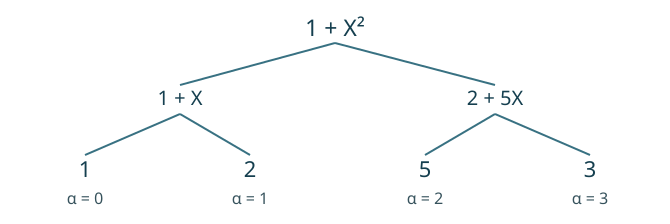

# X · MP · Informatique (option) 2007 — corrigé guidé

*Corrigé rédigé par IA, non officiel. Signalez toute erreur.*

**Rédaction** · GPT-6.2 Astra Ultra · vitesse non renseignée · 25 novembre 2026

Langage choisi : OCaml. Le premier p et l’inversion inv sont les données globales du sujet. Une liste donne les coefficients dans l’ordre des degrés croissants. Les complexités comptent les opérations dans le corps fini.

## I. Encodage direct

### Question 1 · Horner

Dans la liste $(2,3,4)$, le premier coefficient est la constante. Lire la liste dans son ordre permet pourtant le calcul emboîté $2+x(3+x\,4)$, car la multiplication se fait au retour des appels.

```ocaml
type poly = int list
let plus a b = (a + b) mod p
let moins a b = (a - b + p) mod p
let fois a b = (a * b) mod p
let rec valeur u x = match u with
  | [] -> 0
  | a :: t -> plus a (fois x (valeur t x))
```

Le choix $p<2^{15}$ borne les produits de deux représentants.

### Question 2 · Message codé

Le mot transmis est une liste de valeurs du polynôme. La première lettre transmise correspond au premier point, même lorsque ce point vaut zéro.

```ocaml
let codage alpha a = List.map (valeur a) alpha
```

### Question 3 · Coûts

Suivre une seule pile de $k$ appels de Horner. Chaque retour coûte deux opérations dans le corps. Le parcours des $n$ points refait ce travail indépendamment pour chacun, d’où $O(k)$ pour une évaluation et $O(nk)$ pour le codage.

## II. Opérations usuelles

### Question 4 · Somme

Une fois l’une des listes épuisée, ses coefficients suivants valent zéro. On peut rendre directement toute la queue restante, puisque ses valeurs sont déjà réduites. Seules les $\min(\ell_U,\ell_V)$ paires communes demandent une addition.

```ocaml
let rec addition u v = match u, v with
  | [], w | w, [] -> w
  | a :: s, b :: t -> plus a b :: addition s t
```

### Question 5 · Différence

Pour $U=1$ et $V=1+X$, le premier coefficient s’annule et la queue doit représenter $-X$. L’opération membre à membre doit donc distinguer les deux fins de liste. Une soustraction par coefficient de $V$ suffit, soit $O(\ell_V)$.

```ocaml
let rec soustraction u v = match u, v with
  | w, [] -> w
  | [], w -> List.map (moins 0) w
  | a :: s, b :: t -> moins a b :: soustraction s t
```

### Question 6 · Multiplication par un scalaire

La longueur peut être conservée même pour le scalaire zéro. L’énoncé accepte plusieurs listes représentant le polynôme nul. Le parcours coûte $O(\ell_U)$.

```ocaml
let produitParScalaire u s = List.map (fois s) u
```

### Question 7 · Produit ordinaire

Préfixer un zéro à une liste de coefficients multiplie son polynôme par $X$. Lors du dernier retour, multiplier directement la liste $V$ par le dernier coefficient évite un zéro terminal superflu. Il y a $\ell_U$ étages de coût $O(\ell_V)$, soit $O(\ell_U\ell_V)$ au total.

```ocaml
let rec produit u v = match u, v with
  | [], _ | _, [] -> []
  | [a], _ -> produitParScalaire v a
  | a :: t, _ -> addition (produitParScalaire v a) (0 :: produit t v)
```

### Question 8 · Quotient par élimination

Un dividende peut avoir des zéros dans ses dernières cases. On peut les traiter comme des colonnes ordinaires, dont le quotient local vaut zéro. Quand $V$ est constant, la boucle élimine chaque coefficient, y compris la constante.

```ocaml
let divreste u v =
  let a = Array.of_list u and b = Array.of_list v in
  let n = Array.length a and m = Array.length b in
  if m = 0 || b.(m - 1) = 0 then invalid_arg "diviseur non canonique";
  let q = Array.make (max 0 (n - m + 1)) 0 in
  let inverse = inv b.(m - 1) in
  for i = Array.length q - 1 downto 0 do
    let t = fois a.(i + m - 1) inverse in
    q.(i) <- t;
    for j = 0 to m - 1 do
      a.(i+j) <- moins a.(i+j) (fois t b.(j))
    done
  done;
  (Array.to_list q, Array.to_list (Array.sub a 0 (min n (m-1))))
let division u v = fst (divreste u v)
```

L’identité entre dividende, quotient partiel fois diviseur et tampon courant est conservée à chaque soustraction. Les colonnes éliminées restent nulles. Le coût dans le corps est $O(1+\ell_V\max(0,\ell_U-\ell_V+1))$, en plus des parcours linéaires de conversion.

### Question 9 · Reste

La condition de degré exclut la case d’indice $d_V$ du reste. Pour un diviseur constant, l’extraction donne la liste vide. Si le dividende est plus court que le diviseur, tout le dividende est conservé. La fonction emploie le même calcul et la même borne de complexité qu’en question 8.

```ocaml
let modulo u v = snd (divreste u v)
```

## III. Multiplication et division rapides

### Question 10 · Trois produits

Développer le produit des deux sommes de moitiés. Il contient les quatre combinaisons. Deux d’entre elles, le produit bas et le produit haut, doivent déjà être calculées pour les termes extrêmes. Les soustraire laisse exactement les deux termes croisés. On pose donc $W_b=U_bV_b$, $W_h=U_hV_h$, $W_m=(U_b+U_h)(V_b+V_h)-W_b-W_h$, puis $UV=W_b+X^eW_m+X^{2e}W_h$.

### Question 11 · Karatsuba

Deux conventions évitent des erreurs de rang. Pour prolonger une liste sans changer le polynôme, placer les zéros à la fin. Pour multiplier par $X^e$, les placer au début. La coupure à mi-longueur s’effectue ensuite par un parcours linéaire.

```ocaml
let rec ajuste n u =
  if n = 0 then [] else match u with
  | [] -> 0 :: ajuste (n-1) []
  | x :: t -> x :: ajuste (n-1) t
let rec coupe k u =
  if k = 0 then ([], u) else match u with
  | [] -> invalid_arg "coupure"
  | x :: t -> let a,b = coupe (k-1) t in (x :: a, b)
let decale k u = List.init k (fun _ -> 0) @ u
let produitRapide u v =
  let nu = List.length u and nv = List.length v in
  let rec taille n = if n >= max nu nv then n else taille (2*n) in
  let rec mult n u v =
    if n = 1 then [fois (List.hd u) (List.hd v)] else
    let e = n/2 in
    let ub,uh = coupe e u and vb,vh = coupe e v in
    let a = mult e ub vb and b = mult e uh vh in
    let s = mult e (addition ub uh) (addition vb vh) in
    let m = soustraction (soustraction s a) b in
    addition a (addition (decale e m) (decale (2*e) b))
  in
  if nu = 0 || nv = 0 then [] else
  let n = taille 1 in ajuste (nu+nv-1) (mult n (ajuste n u) (ajuste n v))
```

Avec $a=\log_2 3$, la récurrence $M(n)=3M(n/2)+O(n)$ donne $O(n^a)$, par somme des $3^j$ tâches de taille $n/2^j$. Le remplissage initial coûte au plus un facteur deux sur la taille maximale.

### Question 12 · Division récursive

Les deux appels de division doivent avoir des entrées de longueurs compatibles, même lorsque le degré réel chute. Pour $d$ impair, $2e=d+1$ et $t=e-1$. Pour $d$ pair, $2e=d$ et $t=e$. Le tampon du second dividende possède dans les deux cas $2t+1$ cases.

```ocaml
let rec divisionRapide u v =
  let l = List.length v in
  if l = 1 then [fois (List.hd u) (inv (List.hd v))] else
  let e = l/2 in
  let t = l-1-e in
  let ub,uh = coupe (2*e) u and vb,vh = coupe e v in
  let qh = divisionRapide uh vh in
  let rh = ajuste t (soustraction uh (produitRapide qh vh)) in
  let terme = decale (e-1) [List.nth ub (2*e-1)] in
  let s = soustraction (addition (decale e rh) terme) (produitRapide qh vb) in
  let qb = divisionRapide (ajuste (2*t+1) s) vh in
  ajuste e qb @ qh
```

La formule de $S$ utilise le coefficient $u_{2e-1}$ du bas. Les autres termes du haut de $U_b/X^e$ ont degré au plus $e-2<t$ et ne changent pas son quotient par $V_h$. Les $e$ coefficients de $Q_b$ précèdent ceux de $Q_h$. Pour $\ell$ puissance de deux, $D(\ell)=2D(\ell/2)+O(\ell^a)=O(\ell^a)$ puisque $2/2^a=2/3$. Pour une taille quelconque, les sous-appels ont taille $\lceil\ell/2\rceil$, ce qui donne la même borne par majoration par la puissance de deux suivante.

### Question 13 · Reste rapide

Un dividende plus court que le diviseur est déjà son propre reste. Sinon la précondition $\deg U\le2d$ permet de fixer le format de la question 12. Le terme de plus haut degré du reste est au plus $d-1$.

```ocaml
let moduloRapide u v =
  let d = List.length v - 1 in
  if List.length u <= d then u else
  let u = ajuste (2*d+1) u in
  let q = divisionRapide u v in
  ajuste d (soustraction u (produitRapide q v))
```

Le coût est $O((d+1)^a)$. Les diviseurs ont un coefficient dominant non nul et les listes du dividende ne contiennent aucune composante non nulle au-delà de la borne annoncée.

## IV. Évaluation multipoints

### Question 14 · Arbre de sous-produits

Les degrés des produits sont les nombres de feuilles. Une coupure au milieu garantit donc la différence d’au plus un et la hauteur $\lceil\log_2 n\rceil$. À l’indice $i$, le facteur est $X-\alpha_i$, dont la constante est l’opposé réduit de $\alpha_i$.

```ocaml
type arbre = Vide | Noeud of poly * arbre * arbre
let etiquette = function Noeud (m,_,_) -> m | Vide -> invalid_arg "vide"
let arbreAvec multiplier alpha =
  let a = Array.of_list alpha in
  let rec batir i s =
    if s = 0 then Vide
    else if s = 1 then Noeud ([moins 0 a.(i); 1], Vide, Vide)
    else
      let k = (s+1)/2 in
      let g = batir i k and d = batir (i+k) (s-k) in
      Noeud (multiplier (etiquette g) (etiquette d), g, d)
  in batir 0 (Array.length a)
let arbreSousProduits = arbreAvec produitRapide
```

Pour $n=2^h$ et un produit de coût $O(s^b)$, le niveau de blocs de taille $s$ coûte $O((n/s)s^b)$. La somme sur les puissances de deux est $O(n^b)$ dès que $b>1$. D’où $O(n^2)$ avec le produit ordinaire et $O(n^a)$ avec Karatsuba.

### Question 15 · Restes descendants

En divisant successivement, la différence entre le polynôme initial et le reste parent reste un multiple du produit enfant. Quand un parent de degré $s$ donne un fils de degré $r=\lfloor s/2\rfloor$, le reste transmis a degré au plus $s-1\le2r$. La division rapide s’applique donc même à un arbre de taille impaire.

```ocaml
let restesAvec reduire t a =
  let rec descend t u = match t with
    | Vide -> Vide
    | Noeud (m,g,d) ->
        let r = reduire u m in Noeud (r, descend g r, descend d r)
  in descend t a
let arbreRestes = restesAvec moduloRapide
```



Dans la figure, $(X-2)(X-3)=X^2-5X+6$. La réduction de $1+X^2$ donne donc $2+5X$ modulo 7. À chaque niveau, la somme des coûts suit la même série géométrique qu’en question 14. Les tailles diffèrent d’au plus un à profondeur fixée. Les bornes sont $O(n^a)$ avec la partie III et $O(n^2)$ avec le reste ordinaire.

### Question 16 · Lire le codage

Pour lire les feuilles sans recopier des listes de résultats, construire d’abord le suffixe de droite, puis le préfixer avec la gauche. Le facteur linéaire en une feuille garantit qu’un seul coefficient suffit. Ce coefficient est exactement $A(\alpha_i)$ par le théorème du reste. Les deux arbres coûtent $O(n^a)$ avec les fonctions rapides et la lecture finale $O(n)$, donc le total vaut $O(n^a)$, ou $O(n^2)$ avec les opérations ordinaires.

```ocaml
let codageArbre alpha a =
  let rec lire t acc = match t with
    | Vide -> acc
    | Noeud (r,Vide,Vide) -> (match r with [] -> 0 | x :: _ -> x) :: acc
    | Noeud (_,g,d) -> lire g (lire d acc)
  in lire (arbreRestes (arbreSousProduits alpha) a) []
```

[Sujet](https://www.wikiprepa.fr/concours/data/x_option-info_mp_2007.pdf) · [Rapport](https://www.doc-solus.fr/prepa/sci/adc/pdf/rapports.pdf/2007/MP_INFO_X_1_2007.rapport.pdf) · [Autre exemplaire](https://www.doc-solus.fr/prepa/sci/adc/pdf/enonces.pdf/2007/MP_INFO_X_1_2007.enonce.pdf)
