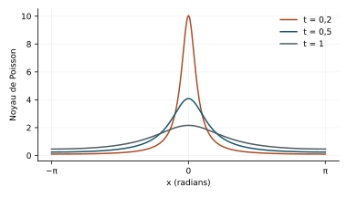

# École polytechnique MP — Première composition de mathématiques 2007 · Corrigé brut

*Corrigé rédigé par IA, non officiel. Signalez toute erreur.*

**Rédaction** · GPT-6.2 Astra Ultra · vitesse non renseignée

**Révision** · GPT-6.2 Astra Ultra · vitesse non renseignée

La série de Fourier du noyau de Poisson fournit une approximation régulière des fonctions périodiques. Le paramètre $t>0$ fixe la largeur du noyau et le poids quadratique des coefficients détermine la vitesse de convergence.

## Première partie. Le noyau de Poisson périodique

### Question 1

Les deux demi-séries doivent converger séparément. Pour $t>0$, les termes ont modules $e^{-|n|t}$ de somme finie. Pour $t=0$, ils ont module un, et pour $t<0$ leur module diverge. La convergence a donc lieu exactement pour $t>0$, quel que soit $x$.

### Question 2

Pour $t>0$, la convergence uniforme absolue en $x$ permet de regrouper les termes : $P(t,x)=1+2\sum_{n\ge1}e^{-nt}\cos(nx)$ est réel. On peut intégrer terme à terme et chaque cosinus a moyenne nulle sur une période, donc $\int_{-\pi}^{\pi}P(t,x)\,dx=2\pi$.

### Question 3.a

Pour $t\ge a>0$, la dérivée d’ordres $p,q$ du terme $n$ est $(-|n|)^p(in)^q e^{-|n|t}e^{inx}$, majorée en module pour $n\ne0$ par $|n|^{p+q}e^{-|n|a}$. Cette majorante est sommable pour tous $p,q$. Le terme $n=0$ vaut un et ses dérivées non constantes sont nulles. Par dérivations successives à convergence normale locale, $P$ est $C^\infty$ et ses dérivées sont les sommes des termes ci-dessus.

### Question 3.b

Chaque terme acquiert les facteurs $|n|^2$ et $(in)^2=-n^2$, dont la somme est nulle. Ainsi $\partial_t^2P+\partial_x^2P=0$.

### Question 4

La série converge uniformément en $x$. En multipliant par $e^{-imx}$ et en intégrant sur une période, seul $n=m$ subsiste. Avec la normalisation de l’énoncé, $\widehat P_t(m)=e^{-|m|t}$ pour tout $m\in\mathbb Z$.

### Question 5

Le dénominateur est $|1-e^{-t}e^{ix}|^2$. Il s’annule exactement quand $e^{-t}e^{ix}=1$, soit $t=0$ et $x\in2\pi\mathbb Z$.

### Question 6

Posons $r=e^{-t}\in(0,1)$. Alors $P=(1-re^{ix})^{-1}+(1-re^{-ix})^{-1}-1$. En mettant au même dénominateur, $P=(1-r^2)/(1-2r\cos x+r^2)$. Le numérateur et le dénominateur sont strictement positifs.

### Question 7

Pour $x=0$, $P_t(0)=(1+r)/(1-r)\to+\infty$. Pour $0<|x|\le\pi$, le dénominateur tend vers $2(1-\cos x)>0$ et le numérateur vers zéro. Si $a\le |x|\le\pi$, on a $1-2r\cos x+r^2=(1-r)^2+2r(1-\cos x)\ge2r(1-\cos a)$. Cette borne indépendante de $x$ donne la convergence uniforme vers zéro sur l’ensemble demandé.

Pour contrôler l’échelle de la figure, au centre $P_t(0)=(1+e^{-t})/(1-e^{-t})\sim2/t$. À distance fixe du centre le noyau tend vers zéro, alors que l’intégrale sur une période reste égale à $2\pi$.

## Deuxième partie. Régularisation par convolution

### Question 8

Comme $f$ est continue par morceaux sur une période, $|\widehat f(n)|\le M=(2\pi)^{-1}\int_{-\pi}^{\pi}|f(y)|\,dy$. La série définissant $\Phi_f$ est donc normalement convergente pour $t$ fixé, par comparaison avec $M\sum_n e^{-|n|t}$.

### Question 9

Sur $t\ge a>0$, la majorante de 3.a se multiplie seulement par $M$. On a donc
$$\partial_t^p\partial_x^q\Phi_f(t,x)=\sum_{n\in\mathbb Z}\widehat f(n)(-|n|)^p(in)^q e^{-|n|t}e^{inx}.$$
Le terme constant est interprété comme en 3.a et les dérivées existent à tous les ordres.

### Question 10

La convergence uniforme de la série du noyau et l’intégrabilité de $f$ permettent de permuter somme et intégrale. Au rang $n$ intervient $(2\pi)^{-1}\int f(y)e^{-iny}\,dy=\widehat f(n)$, avec le facteur $e^{-|n|t}e^{inx}$. Ainsi la différence demandée vaut zéro.

### Question 11

Pour toute continue périodique $g$, la convolution donne
$$\Phi_{g,t}(x)-g(x)=\frac1{2\pi}\int_{-\pi}^{\pi}P_t(h)[g(x-h)-g(x)]\,dh.$$
Par continuité uniforme, la différence entre crochets est au plus $\varepsilon$ si $|h|\le a$ avec $a$ bien choisi. La contribution correspondante ne dépasse pas $\varepsilon$ par positivité et masse $2\pi$. Ailleurs elle est au plus $2\|g\|_\infty\sup_{a\le|h|\le\pi}P_t(h)$, qui tend vers zéro. La convergence est donc uniforme. Pour $0\le p\le k$, les intégrations par parties périodiques donnent $\widehat{f^{(p)}}(n)=(in)^p\widehat f(n)$, donc $\partial_x^p\Phi_{f,t}=\Phi_{f^{(p)},t}$. On applique le résultat à $g=f^{(p)}$.

## Troisième partie. Décroissance de Fourier et vitesse de convergence

### Question 12

Pour $\alpha\ge1$, la convexité de $v\mapsto v^\alpha$ sur $\mathbb R_+$ donne $((1+u)/2)^\alpha\le(1+u^\alpha)/2$. On peut prendre $\mu_\alpha=2^{\alpha-1}$.

### Question 13.a

Pour $k=0$, Parseval donne la finitude de $\sum|\widehat f(n)|^2$. Pour $k\ge1$, $(1+n^2)^k\le2^{k-1}(1+n^{2k})$. Les deux sommes obtenues sont finies par Parseval appliqué à $f$ et à $f^{(k)}$ et par l’identité de la question 11. Ainsi $C_{\mathrm{per}}^k\subset E_k$.

### Question 13.b

Pour $k=0$, la dent de scie $g(x)=x$ sur $(-\pi,\pi)$ prolongée périodiquement appartient à $E_0$ par Parseval mais a un saut. Sa moyenne est nulle et ses coefficients pour $n\ne0$ sont de taille $1/|n|$, par intégration par parties. Pour $k\ge1$, prendre $k$ primitives périodiques successives, à chaque fois de moyenne nulle (soustraire une constante). Le résultat $f_k$ a des coefficients de taille $1/|n|^{k+1}$ : il est dans $E_k$ car la série pondérée se compare à $\sum n^{-2}$. Mais sur les intervalles de continuité sa dérivée d’ordre $k$ est la dent de scie, dont les deux limites diffèrent au raccord. Ainsi $f_k$ ne peut être de classe $C^k$.

La primitive périodique dont on a besoin est explicite. Pour $h$ de moyenne nulle, $H(x)=\int_{-\pi}^x h(u)\,du$ prend la même valeur aux deux extrémités de la période. On soustrait sa moyenne avant de recommencer. L’intégration par parties donne alors $\widehat H(n)=\widehat h(n)/(in)$ pour chaque $n\ne0$.

### Question 13.c

Posons $A^2=\sum_n(1+n^2)^\alpha|\widehat f(n)|^2$. Pour $0\le p\le k$, Cauchy–Schwarz donne, pour les indices non nuls,
$$\sum |n|^p|\widehat f(n)|\le A\left(\sum\frac{|n|^{2p}}{(1+n^2)^\alpha}\right)^{1/2}<\infty$$
car $2p-2\alpha<-1$. La série de Fourier et ses dérivées jusqu’à l’ordre $k$ convergent normalement et définissent une fonction $g\in C_{\mathrm{per}}^k$. Elle a les mêmes coefficients que $f$, donc $f=g$ presque partout par Parseval, et en chaque point de continuité de $f$. C’est le représentant régulier de $f$.

Si « fonction continue par morceaux » autorise une valeur isolée arbitraire et que les fonctions sont prises point par point, l’inclusion imprimée requiert cette précision. La fonction périodique égale à un sur $2\pi\mathbb Z$ et nulle ailleurs a tous ses coefficients nuls et n’est pas continue. L’inclusion vaut pour les classes modulo l’égalité presque partout ou avec le représentant continu.

### Question 14

Avec $u=tx$, $t^{r+1}\int_0^\infty x^r e^{-tx}\,dx=\int_0^\infty u^re^{-u}\,du=\Gamma(r+1)$, qui est fini pour $r\ge0$ et indépendant de $t$.

### Question 15

Pour tout $N$, la somme entière est au moins $\sum_{n=1}^N n^r e^{-tn}$ dont la limite en $0^+$ est $\sum_{n=1}^N n^r\ge N$. Le choix d’un $N$ arbitrairement grand donne la divergence vers $+\infty$.

### Question 16

Si $x\in[n,n+1]$ et $0<t\le\tau$, alors $n^r\le x^r$ et $e^{-tn}\le e^\tau e^{-tx}$. En intégrant sur cet intervalle de longueur un puis en sommant, on obtient $\sum_{n\ge1}n^re^{-tn}\le e^\tau\Gamma(r+1)t^{-r-1}$. Le choix $C'=e^\tau\Gamma(r+1)$ convient.

### Question 17.a

Avec $A$ comme en 13.c, la question 9 et Cauchy–Schwarz donnent
$$|\partial_t\Phi_f(t,x)|\le A\left(2\sum_{n\ge1}n^{2-2\alpha}e^{-2nt}\right)^{1/2}.$$
Posons $r=2-2\alpha\ge0$. En appliquant 16 avec paramètre $2t\le2\tau$, on peut prendre $C''=A[2e^{2\tau}\Gamma(r+1)2^{-r-1}]^{1/2}$. La puissance de $t$ est $-(r+1)/2=\alpha-3/2$.

### Question 17.b

Pour $0<s<t\le\tau$, intégrer 17.a donne $\|\Phi_{f,t}-\Phi_{f,s}\|_\infty\le C''(t^{\alpha-1/2}-s^{\alpha-1/2})/(\alpha-1/2)$. Par 13.c, $f$ possède un représentant continu $g$ qui a les mêmes coefficients. Par 11, $\Phi_{f,s}=\Phi_{g,s}\to g$ uniformément. D’où l’inégalité demandée pour ce représentant avec $C'''=C''/(\alpha-1/2)$. Elle vaut aussi pour la norme essentielle avec $f$. Pour une norme suprême point par point, si l’on garde des valeurs isolées arbitraires de $f$, le contre-exemple de 13.c donne $\Phi=0$ et $\|\Phi-f\|_\infty=1$ pour tout $t$ ; aucun tel $C'''$ ne peut alors convenir.

L’intégrabilité de $t^{\alpha-3/2}$ au voisinage de zéro utilise strictement $\alpha>1/2$. À l’extrémité $\alpha=1$ autorisée, l’exposant de la majoration finale est donc $1/2$. Le supremum du sujet impose de conserver la précision de 13.c sur les valeurs aux points de discontinuité.
