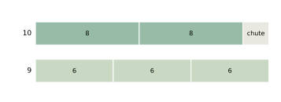
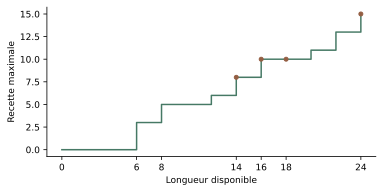
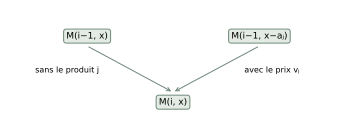

# École polytechnique · PSI et PT · Informatique 2007 · Corrigé brut

*Corrigé rédigé par IA, non officiel. Signalez toute erreur.*

**Rédaction** · GPT-6.2 Astra Ultra · vitesse non renseignée · 25 novembre 2026

**Découpe de tissu.** Le langage choisi est Python. Les longueurs et les prix sont des entiers strictement positifs. Le tissu inutilisé peut rester en chute. Les produits ont les indices de 0 à n − 1.

## I · Coupe d’un ruban avec répétition

### Question 1 · Comparer les découpes aux quatre longueurs

Notons $(x_0,x_1)$ les nombres de produits de longueurs 6 et 8. La recette est $3x_0+5x_1$ sous la contrainte $6x_0+8x_1\leqslant L$.

| Longueur $L$ | Découpe optimale $(x_0,x_1)$ | Chute | Recette $M$ |
|---:|:---:|---:|---:|
| 14 | $(1,1)$ | 0 | 8 |
| 16 | $(0,2)$ | 0 | 10 |
| 18 | $(0,2)$ | 2 | 10 |
| 24 | $(0,3)$ | 0 | 15 |

Pour $L=18$, deux pièces de longueur 8 rapportent 10 malgré la chute de 2. Trois pièces de longueur 6 utiliseraient tout le ruban mais ne rapporteraient que 9. Pour vérifier tous les maxima, il suffit d’essayer $x_1$ de 0 à $\lfloor L/8\rfloor$, en prenant $x_0=\lfloor(L-8x_1)/6\rfloor$ pour chaque essai.



### Question 2 · Modifier le prix du premier produit

La recette devient $4x_0+5x_1$. La même énumération donne

| Longueur $L$ | Découpe optimale $(x_0,x_1)$ | Chute | Recette $M$ |
|---:|:---:|---:|---:|
| 14 | $(1,1)$ | 0 | 9 |
| 16 | $(0,2)$ | 0 | 10 |
| 18 | $(3,0)$ | 0 | 12 |
| 24 | $(4,0)$ | 0 | 16 |

Le produit de longueur 6 rapporte maintenant $4/6$ par unité, contre $5/8$ pour le second. Pour $L=16$, deux exemplaires du second restent toutefois préférables. Le meilleur prix par unité ne suffit donc pas pour choisir la découpe à capacité fixée.

### Question 3 · Énumérer les quantités de deux produits

```python
def coutRuban2Produits(a0, v0, a1, v1, L):
    meilleur = 0
    for x0 in range(L // a0 + 1):
        x1 = (L - x0 * a0) // a1
        meilleur = max(meilleur, x0 * v0 + x1 * v1)
    return meilleur
```

La boucle comprend le choix de zéro exemplaire et celui de $\lfloor L/a_0\rfloor$ exemplaires. L’ordre des coupes n’apporte pas de nouvelle recette. Le temps est $\Theta(1+\lfloor L/a_0\rfloor)$ et l’espace auxiliaire est constant.

### Question 4 · Étendre aux trois produits

```python
def coutRuban3Produits(a0, v0, a1, v1, a2, v2, L):
    meilleur = 0
    for x0 in range(L // a0 + 1):
        reste = L - x0 * a0
        valeur = x0 * v0 + coutRuban2Produits(a1, v1, a2, v2, reste)
        meilleur = max(meilleur, valeur)
    return meilleur
```

Toute solution fixe un effectif $x_0$, et sa meilleure continuation est évaluée lors de l’itération correspondante. Le nombre d’essais est majoré par $(1+\lfloor L/a_0\rfloor)(1+\lfloor L/a_1\rfloor)$, soit $O((L+1)^2)$ puisque les longueurs sont des entiers positifs.

### Question 5 · Calculer l’optimum avec répétition

```python
def coutRuban(a, v, n, L):
    M = [0] * (L + 1)
    for x in range(1, L + 1):
        for i in range(n):
            if a[i] <= x:
                M[x] = max(M[x], M[x - a[i]] + v[i])
    return M[L]
```

La valeur zéro convient pour $x=0$ et lorsqu’aucun produit ne tient dans $x$. Sinon la meilleure recette est le maximum de $M[x-a_i]+v_i$ sur les produits admissibles. Réciproquement, tout terme du maximum est réalisable. Le calcul en ordre croissant est possible car $a_i>0$. Pour $n,L\geqslant1$, le temps est $\Theta(nL)$ et la mémoire $\Theta(L+1)$.



### Question 6 · Imprimer une liste de coupes optimale

```python
def decoupageRuban(a, v, n, L):
    M = [0] * (L + 1)
    D = [-1] * (L + 1)
    for x in range(1, L + 1):
        for i in range(n):
            if a[i] <= x:
                valeur = M[x - a[i]] + v[i]
                if valeur > M[x]:
                    M[x], D[x] = valeur, i
    x = L
    while D[x] != -1:
        i = D[x]
        print(i)
        x -= a[i]
```

Un indice imprimé correspond à une pièce effectivement fabriquée. En cas d’égalité, le premier indice atteignant le maximum est conservé. Chaque étape inverse une transition optimale et réduit strictement la longueur disponible. Si aucune coupe ne tient, la sentinelle arrête la procédure, y compris pour une chute non nulle. L’impression prend au plus $L$ étapes. Le calcul et l’impression prennent ensemble $O((n+1)(L+1))$ en temps et $O(L+1)$ en mémoire.

## II · Coupe d’un ruban sans répétition

### Question 7 · Établir la récurrence sans répétition

Par définition $M(i,x)$ utilise uniquement les produits $0,\ldots,i-1$. On a $M(0,x)=0$ pour toute capacité et $M(i,0)=0$ pour tout $i$. Pour $i\geqslant1$, posons $j=i-1$. Si $a_j>x$, alors $M(i,x)=M(i-1,x)$. Sinon,

$$
M(i,x)=\max\bigl(M(i-1,x),\;v_j+M(i-1,x-a_j)\bigr).
$$

Le premier terme exclut le produit $j$. Le second l’utilise et l’exclut des choix suivants en revenant à l’indice $i-1$. Ces deux cas sont disjoints et couvrent toutes les découpes.



### Question 8 · Construire le tableau à deux dimensions

```python
def coutRubanSansRepetitions(a, v, n, L):
    M = [[0] * (L + 1) for i in range(n + 1)]
    for i in range(1, n + 1):
        j = i - 1
        for x in range(L + 1):
            M[i][x] = M[i - 1][x]
            if a[j] <= x:
                M[i][x] = max(M[i][x], v[j] + M[i - 1][x - a[j]])
    return M[n][L]
```

Les lignes sont des tableaux indépendants. La ligne zéro est initialisée à zéro et la dernière ligne autorise tous les produits. Le temps et la mémoire occupée sont $\Theta((n+1)(L+1))$.

### Question 9 · Calculer avec deux lignes de mémoire

```python
def coutRubanDeuxLignes(a, v, n, L):
    avant = [0] * (L + 1)
    apres = [0] * (L + 1)
    for j in range(n):
        for x in range(L + 1):
            apres[x] = avant[x]
            if a[j] <= x:
                apres[x] = max(apres[x], avant[x - a[j]] + v[j])
        avant, apres = apres, avant
    return avant[L]
```

Au début du traitement du produit $j$, `avant` représente $M(j,\cdot)$. Toutes les cases de `apres` sont réécrites avant l’échange des références. Aucun produit ne peut donc s’utiliser deux fois dans la ligne courante. Les deux vecteurs contiennent $2(L+1)$ cases et le temps reste $O((n+1)(L+1))$. Pour $n=0$, la réponse est directement la ligne initiale.
