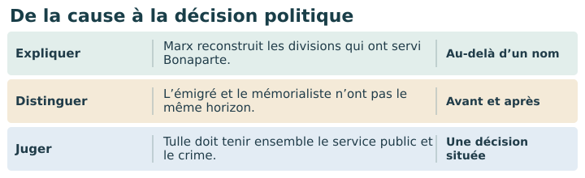

# Banque PT — Français A 2008 · Corrigé guidé

*Corrigé rédigé par IA, non officiel. Signalez toute erreur.*

**Rédaction** · GPT-6.2 Astra Ultra · vitesse non renseignée

**Révision (tour 1)** · GPT-6.2 Astra Ultra · vitesse non renseignée

[Énoncé officiel](https://www.banquept.fr/documents/2008/francais_a_2008.pdf) · [Rapport du jury](https://www.banquept.fr/documents/ecrit/rapport/2008/rapport_fra_a_ecrit_2008.pdf) · [Programme officiel](https://www.education.gouv.fr/bo/2007/18/MENS0700809A.htm) · [Grille de la session](https://www.banquept.fr/documents/livret/2008/Livret_PT_2008.pdf#page=12)

Épreuve de quatre heures sur « Penser l’histoire ». François-René de Chateaubriand, Mémoires d’outre-tombe, livres IX à XII · Karl Marx, Le 18 Brumaire de Louis Bonaparte (traduction de Maximilien Rubel) · Pierre Corneille, Horace.

## Sujet

Polybe, Histoire VI, selon l’indication portée sur le feuillet.

« Ce qui est éducatif et bénéfique pour ceux qui étudient l’histoire est la vue claire des causes des événements et le pouvoir qui en découle de choisir la meilleure politique dans un cas particulier ».

Ce propos de l’auteur grec POLYBE (202-120 av JC) dans Histoire VI vous semble-t-il vérifié par les œuvres et le thème au programme ?

## Préparer la dissertation

**Quels sont les deux bénéfices annoncés ?**

Relevez d’abord une connaissance, puis le pouvoir de faire un choix. L’articulation « qui en découle » vous engage à tester le passage entre les deux.

**Qu’apprend-on d’un premier récit démenti ?**

Le vieil Horace porte un jugement de déshonneur avant de connaître l’issue véritable du combat. L’exemple montre l’intérêt de reconstituer les causes et les limites d’une leçon tirée sous le coup de la nouvelle.

**Comment exploiter « dans un cas particulier » ?**

Comparez les deux Bonaparte à partir de leurs appuis et des usages politiques de leur nom. Une ressemblance peut agir dans l’histoire sans fournir à celui qui l’étudie une recette pour agir.

## Dissertation

Le vieil Horace croit savoir pourquoi son fils a survécu au combat qui a coûté la vie à ses deux frères. Le récit qu’on lui apporte fait de cette survie le signe d’une fuite honteuse. Un second récit inverse ce jugement. Ce qu’on avait pris pour une défaite change de sens dès que l’on connaît mieux la suite des événements. On comprend le prix que Polybe attache à la « vue claire des causes ». Mais le bénéfice attendu dépasse de beaucoup la correction d’une erreur sur le passé. Il s’agirait, dans un cas particulier, de pouvoir choisir la meilleure politique. Entre une explication exacte de ce qui a eu lieu et une décision juste sur ce qui reste ouvert, quelle continuité les œuvres permettent-elles d’établir ?

L’étude critique du passé délivre d’abord du pouvoir des premières apparences. Dans Le 18 Brumaire de Louis Bonaparte, Marx revient sur un avènement dont on pourrait rendre compte par l’ambition ou les talents exceptionnels d’un seul individu. Il suit davantage que la carrière du futur empereur. Il examine comment, depuis février 1848, des groupes qui avaient eu intérêt à collaborer se sont trouvés divisés dès qu’il a fallu organiser la République. Des adversaires de l’exécutif ont eux-mêmes affaibli les appuis politiques dont ils auraient eu besoin pour lui résister. La victoire d’un homme autrement peu prestigieux devient intelligible par l’histoire de ces renoncements successifs. Ce gain de clarté est immédiatement éducatif. Il empêche de confondre un résultat politique et la mesure du mérite personnel de celui qui en profite.

L’historien donne aussi accès à plusieurs échelles de temps. Le mémorialiste qui raconte son passage dans l’armée des princes connaît l’issue de la campagne et le cours pris par la Révolution. Le jeune Chateaubriand qui s’engage ne dispose que de son honneur de gentilhomme, de ses liens et de nouvelles encore incertaines. Le récit rapproche son expérience des privations et des désillusions de ses compagnons d’une entreprise collective dont il peut, après coup, apprécier les chances. La distance du souvenir joint ce que le participant percevait séparément. Un lecteur qui aurait à décider d’une intervention apprend ainsi à se demander ce que des convictions partagées et sincères empêchent parfois un groupe d’examiner, ses ressources, la situation du pays et les raisons de ceux qui ne le soutiennent pas. La leçon porte sur les questions à poser avant la décision, plutôt que sur un choix tout fait.

Le pouvoir promis par Polybe rencontre néanmoins une difficulté de principe. Le passé a eu une issue, tandis que l’homme placé devant un choix en ignore encore les conséquences. Dans Horace, la convention entre Rome et Albe demande à deux familles apparentées de représenter leurs cités. Horace et Curiace saisissent parfaitement le sens de cette désignation. Ils ne l’éprouvent pas pour autant de la même façon. L’un fait valoir l’honneur que procure un devoir exceptionnel. L’autre souffre qu’il faille mériter cet honneur en déchirant des liens qui lui sont chers. La parfaite connaissance des causes de leur situation n’effacerait aucune de ces raisons. Savoir comment s’est noué le conflit permet de donner à la décision son poids. Cela ne garantit nullement que tous nommeront « meilleure » la même politique.

La ressemblance même qui permet d’invoquer un précédent risque par ailleurs d’égarer. Le titre choisi par Marx fait entendre le souvenir du premier Bonaparte. Celui-ci semble proposer une clé aux contemporains de son neveu. Or le nom, les images politiques et le calendrier révolutionnaire peuvent recouvrir des conditions profondément différentes. L’héritage du premier Empire agit sur le présent, notamment sur les espérances des paysans, même lorsqu’il donne de ce présent une intelligence trompeuse. On apprend donc autre chose qu’une règle de répétition. On apprend à examiner qui emploie une analogie, auprès de qui elle porte et ce qui, dans la situation nouvelle, en modifie la portée. Sans cette précaution, les leçons de l’histoire pourraient devenir une des causes des erreurs que l’histoire aurait dû éviter.

Que serait alors une éducation politique à la hauteur d’un cas particulier ? La fin d’Horace offre une expérience de jugement. Tulle doit se prononcer sur l’homme qui a sauvé Rome puis tué sa sœur Camille. Au dernier acte, le père demande que Rome conserve celui auquel elle doit sa victoire. Valère, au contraire, rappelle ce qui arriverait à la loi si le service rendu suffisait à soustraire son auteur à tout jugement. La douleur du père, le discours de Valère, la défense de l’accusé placent la décision au croisement de plusieurs exigences. Le spectateur a, sur chacune de ces paroles, un avantage que n’aurait pas le lecteur d’une simple liste de règnes et de victoires. Il a entendu Camille et sait ce que la cité victorieuse perdrait à ne retenir d’elle que sa malédiction. L’étude d’un événement forme ici à comparer des raisons sans tirer de l’issue du procès la preuve que toute autre décision eût été mauvaise.

Chateaubriand prête en outre attention à ce qui ne vaut pas comme cause principale. La pauvreté de l’exil en Angleterre, les amitiés et les humiliations d’un émigré donnent à la rupture politique un visage qu’une histoire des institutions pourrait laisser hors champ. Ces souvenirs n’indiquent pas directement comment administrer un État. Ils rappellent cependant à qui voudrait décider en connaissance de cause qu’une mesure atteint des hommes dans leurs habitudes et leurs relations les plus ordinaires. Il faut pour cela un témoin qui raconte après coup une expérience dont personne n’aurait fait, sur le moment, un événement décisif. La meilleure politique, si l’expression doit garder un sens, se juge aussi aux effets dont les vainqueurs font rarement le récit.

Polybe nomme donc un bénéfice réel lorsqu’il voit dans la recherche des causes une école de la décision. Les œuvres combattent l’admiration sans examen, l’analogie paresseuse et l’illusion du premier témoin. Mais la clarté qui en résulte est celle d’un jugement mieux informé, exposé à des valeurs concurrentes et aux différences entre deux moments. Elle accroît le pouvoir de choisir en faisant mieux voir de quoi nous aurons à répondre. Elle ne délivre jamais le décideur de la responsabilité de choisir.

