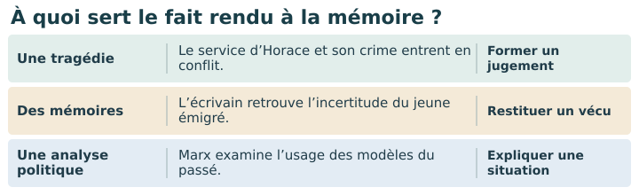

# Banque PT — Français B 2008 · Corrigé guidé

*Corrigé rédigé par IA, non officiel. Signalez toute erreur.*

**Rédaction** · GPT-6.2 Astra Ultra · vitesse non renseignée

**Révision (tour 1)** · GPT-6.2 Astra Ultra · vitesse non renseignée

[Énoncé officiel](https://www.banquept.fr/documents/2008/francais_b_2008.pdf) · [Rapport du jury](https://www.banquept.fr/documents/ecrit/rapport/2008/rapport_fra_b_ecrit_2008.pdf) · [Programme officiel](https://www.education.gouv.fr/bo/2007/18/MENS0700809A.htm) · [Grille de la session](https://www.banquept.fr/documents/livret/2008/Livret_PT_2008.pdf#page=12)

Épreuve de quatre heures sur « Penser l’histoire ». François-René de Chateaubriand, Mémoires d’outre-tombe, livres IX à XII · Karl Marx, Le 18 Brumaire de Louis Bonaparte (traduction de Maximilien Rubel) · Pierre Corneille, Horace.

## Sujet

Alfred de Vigny, Réflexions sur la vérité dans l’art, 1827. Préface du roman historique Cinq-Mars, Œuvres complètes, Gallimard, Bibliothèque de la Pléiade, p. 5–8.

L’extrait commence page 1 par « L’étude du destin général des sociétés » et se termine page 3 par « grands et complets ». Une note identifie la préface, puis la page 4 énonce les deux exercices.

Vous résumerez ce texte en 180 mots (plus ou moins 10%) et vous indiquerez le nombre de mots employés. (8 points)

## Préparer le résumé

Vigny parle en auteur de Cinq-Mars. Conservez le passage du choix de personnages historiques à la distinction entre le vrai et la vérité de l’art. Puis reprenez le double besoin de faits et de fables et le travail de condensation qui donne à voir le caractère d’un temps. Les unités séparées par apostrophe ou trait d’union sont comptées séparément.

## Résumé

Notre époque s’intéresse au destin des sociétés et à celui des individus. En France, les bouleversements politiques ont ranimé le goût des chroniques. Pour peindre les ambitions et le dévouement dans mon roman, j’ai fait agir au premier plan des personnages historiques. Le public a lu ce qu’un traité lui transmettrait mal.

Chaque sujet appelle sa forme. Je revendique pour l’artiste la liberté de subordonner les faits à l’idée que la postérité gardera des hommes. Notre attachement au vrai rejoint notre goût des fables. Nous demandons au passé des exemples moraux, mais ses événements dispersés ne livrent pas le sens de leur ensemble. L’imagination achève ce que les destinées dessinent imparfaitement.

La vérité artistique suppose une connaissance du réel. Elle en choisit les traits caractéristiques et les rassemble autour d’un centre inventé. Quel intérêt aurait une exhibition des médiocrités quotidiennes ? Nous reconnaissons la vie dans des caractères où se concentrent les passions de leur temps. Le peuple même recompose parfois son histoire, fidèle aux grands mouvements et soucieux de grandeur dans le détail.

*180 mots.*

Alfred de Vigny déclare : « Mais à quoi bon la mémoire des faits véritables, si ce n’est à servir d’exemple de bien ou de mal ? ». Pensez-vous que Corneille, Chateaubriand et Marx, dans les œuvres au programme partagent cette conception de la restitution des événements historiques ?

## Préparer la dissertation

**Quelle restriction introduit « si ce n’est » ?**

Une chose est d’affirmer qu’un événement peut instruire moralement, une autre que sa restitution n’aurait aucune autre fin. Faites porter la discussion sur cette restriction.

**Comment construire un exemple sans simple morale ?**

Suivez Horace de sa désignation jusqu’au procès. Les différentes voix implantent plusieurs critères du bien et du mal au sein d’une même action historique.

**Comment faire apparaître la singularité de Marx ?**

Il lui arrive de juger très durement les acteurs de 1851. Mais son explication du résultat repose sur les intérêts sociaux et les conflits de représentation. Le jugement moral et l’intelligence des causes sont deux opérations distinctes.

## Dissertation

Lorsque le roi Tulle doit décider du sort d’Horace, il a devant lui un personnage dont Rome pourrait faire un exemple. Mais quel exemple ? Le vainqueur des Curiaces a sauvé sa patrie, le frère de Camille a tué sa sœur. Le même nom risque d’illustrer deux leçons de sens contraire. Vigny demande ce que vaudrait la mémoire des faits véritables si elle ne fournissait des exemples de bien ou de mal. Il rend ainsi raison du travail d’un écrivain qui regroupe les événements pour faire voir les passions d’une époque. Corneille, Chateaubriand et Marx donnent-ils à la restitution de l’histoire cette même fin morale ? Il faut distinguer le pouvoir qu’a un récit d’éclairer le jugement et le projet plus exigeant qui consisterait à faire de chaque événement le support d’une leçon exemplaire.

Les actes qui frappent la mémoire collective ont souvent besoin d’une forme qui rende la question morale sensible. L’ancienne guerre de Rome et d’Albe pourrait rester une suite de noms, de traités et de circonstances héroïques. Corneille la concentre sur deux familles que l’amitié et les projets de mariage ont rendues solidaires. Curiace ne peut servir Albe sans causer de la douleur à ceux qu’il aime à Rome. Horace rêve d’une vertu assez forte pour ne retenir que son devoir envers la cité. Une même situation fait apparaître deux manières d’être loyal. L’exemple est d’autant plus instructif que nous pouvons en saisir les motifs dans des voix, jusque dans l’effort que coûte à Curiace sa fidélité. Vigny aurait raison de dire qu’il fallait choisir et composer pour ramener l’événement à la portée d’une conscience.

Un mémorialiste peut lui aussi vouloir sauver un geste de l’oubli en faisant entendre ce qu’il valait pour celui qui l’a accompli. Chateaubriand examine rétrospectivement sa décision de rejoindre l’armée des princes. Il ne prétend pas que son choix ait été dicté par une connaissance parfaite des chances de succès de l’émigration. Il fait place au sentiment qu’il avait de ce que son nom et son rang lui imposaient. Un lecteur peut ainsi comprendre la force d’un lien d’honneur, et mesurer ensuite les illusions politiques dont ce lien a pu s’accompagner. La suite du récit ménage une distance entre la résolution du jeune homme et le jugement que peut en porter l’écrivain revenu de l’exil. Un acte conserve un sens moral quand bien même l’entreprise historique dont il fait partie aurait échoué.

Il est pourtant des événements auxquels on ferait violence en distribuant les figures du bien et du mal. Marx refuse d’expliquer l’issue de décembre 1851 par les vices ou les talents de Louis Bonaparte. Un tel récit ne pourrait expliquer pourquoi les oppositions dont il triomphe se sont affaiblies. Il faut considérer les groupes sociaux, leur accès inégal à la représentation et la manière dont leurs intérêts ont changé au lendemain de 1848. Telle fraction de la bourgeoisie parlementaire tenait passionnément à ses garanties politiques, jusqu’au moment où elle a jugé l’ordre social menacé. Elle a pu préférer la conservation de ses intérêts matériels à celle de son influence politique. L’indignation contre la versatilité de tel député laisserait inexpliqué ce paradoxe collectif. Rendre raison de cette conjoncture est une fonction propre de la restitution historique.

Le choix de bons ou de mauvais modèles pourrait même encourager une illusion sur la nouveauté du présent. Les acteurs des révolutions antérieures avaient emprunté des noms et des costumes à l’Antiquité. Les contemporains de Louis Bonaparte retrouvent dans son nom le souvenir du premier Empire. Or l’usage des souvenirs est lui-même un fait historique qu’il faut juger sur ses effets. On peut chercher un modèle pour se donner du courage, mais aussi pour éviter d’examiner ce qui a changé dans les rapports de force. L’ironie de Marx relève ce décalage entre la grandeur réputée d’un précédent et les acteurs qui se l’approprient. Son livre ne demande donc pas seulement quels exemples donne le passé. Il étudie ce que devient une société lorsqu’elle consent à penser son présent dans les images qu’elle en a gardées.

La mémoire personnelle remplit une fonction encore différente. Les livres des Mémoires d’outre-tombe consacrés au séjour anglais restituent la pauvreté, l’isolement et les rencontres d’un émigré. Le jeune homme ne sait pas encore ce qu’il adviendra de la France ni quelle place sa propre écriture y occupera. Préserver cette ignorance, c’est rendre au passé quelque chose de sa vérité. Le réduire à ce que la postérité y reconnaît de bon ou de mauvais ferait disparaître l’incertitude dans laquelle il a été vécu. La voix tardive du mémorialiste sait davantage, mais elle rend justice à une existence ancienne lorsqu’elle lui laisse ses attentes sans les traiter toutes comme des erreurs à corriger.

Corneille en définitive résiste lui aussi à une morale qui prétendrait conclure trop vite. Nous n’entendons pas seulement ceux dont Rome célèbre le dévouement. Le père attend de sa fille qu’elle montre sa joie devant le vainqueur. Nous avons cependant entendu Camille espérer le retour de Curiace. Le triomphe public et le deuil intime ont désormais pour le spectateur la même date, sans avoir le même sens. L’issue du procès ne fera pas rentrer cette parole dans le silence. Une représentation d’Horace éduque alors le spectateur d’une façon plus exigeante que ne le ferait un catalogue d’actions à imiter ou à fuir. Elle l’empêche de prononcer le mot « vertu » comme si l’admiration dispensait de suivre les conséquences d’un acte. Le fait rendu à la mémoire peut rouvrir la question du bien et du mal là où une sentence ou une fête nationale l’avaient close.

Vigny éclaire donc la puissance d’exemple que donne la composition au souvenir historique. Les trois œuvres lui donnent partiellement raison en refusant la chronique indifférente. Mais témoigner du temps perdu ou établir les conditions d’une défaite politique sont aussi des entreprises légitimes. Le résultat moral de la lecture peut même consister à rendre plus difficile le partage entre bons et méchants. La mémoire des faits véritables nous instruit alors parce qu’elle nous contraint à réviser l’exemple que nous étions venus y chercher.

