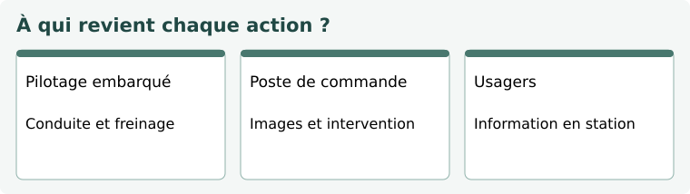
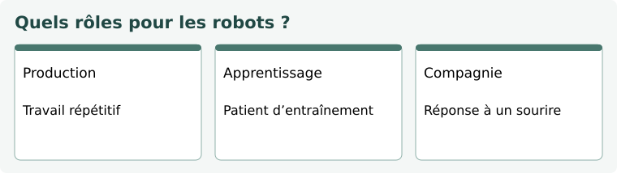
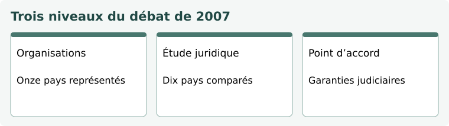
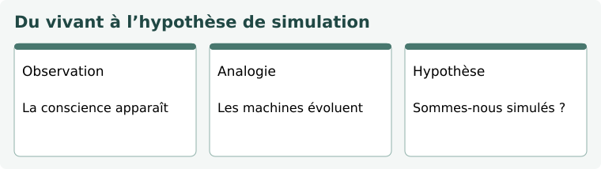
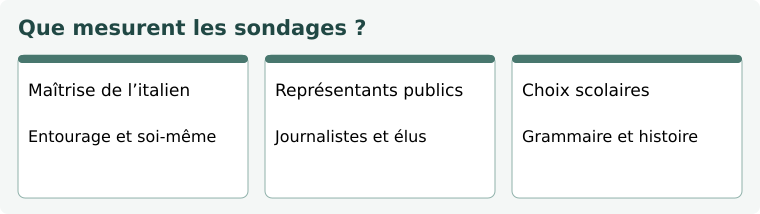

# Banque PT — Langue vivante A 2008 · Corrigé guidé

*Corrigé rédigé par IA, non officiel.*

**Rédaction** · GPT-6.2 Astra Ultra · vitesse non renseignée

L’épreuve dure trois heures. Chaque candidat traite la langue choisie à l’inscription. La version française vaut 10 points. La question a demande 80 à 100 mots pour 4 points. La question b demande 200 à 250 mots pour 6 points.

[Sujet](https://www.banquept.fr/documents/2008/lv_a_2008.pdf) · [Rapport du jury](https://www.banquept.fr/documents/ecrit/rapport/2008/rapport_lv_a_ecrit_2008.pdf) · [Grille du livret](https://www.banquept.fr/documents/livret/2008/Livret_PT_2008.pdf#page=12)

## Allemand

*Fahrerlose U-Bahn in Nürnberg unterwegs*

D’après Stephan Maurer, DPA, Stern. Article page 2, questions page 3. Rapport d’allemand pages 1 et 2. Le calendrier présenté est celui qu’annoncent les responsables au moment des essais.

Dans la version, attribuer les promesses à leurs auteurs. Le futur annoncé de l’U3 diffère du calendrier prévu pour convertir l’U2. Pour a, expliquer le freinage et porter un jugement motivé. Pour b, distinguer deux horizons en montrant comment les responsabilités évolueraient.

### Version française

De « Am Steuer sitzt künftig » à « jederzeit eingreifen können ». Reprendre aussi l’intertitre et la coupure signalée.

Désormais, c’est l’ordinateur qui sera aux commandes. Les spécialistes appellent ce « conducteur virtuel » ATO. Ces initiales signifient Automatic Train Operation, autrement dit pilotage automatique des trains. C’est grâce à lui que la rame accélère, maintient sa vitesse, freine et s’arrête. Et jusqu’ici, ATO ne se débrouille pas mal du tout, comme l’ont montré les premières semaines d’essais sur les dernières circulations de la soirée. Lors d’une visite sur place, dans la nuit de mardi à mercredi, la société des transports de Nuremberg, la VAG, et le groupe Siemens ont annoncé que la phase d’essais avait bien démarré.

Georg Trummer, chef de projet chez Siemens, se dit convaincu qu’au printemps 2008, le métro entrera en service régulier sur la nouvelle ligne U3. À la fin de 2008, la ligne U2 existante, jusqu’alors exploitée de manière conventionnelle, devrait à son tour avoir été convertie. « Nous y arriverons », assure Trummer. Il est sous pression, car il importe beaucoup pour la réputation de la division de Siemens chargée des techniques de transport, Transportation Systems, que cette fois-ci tout marche comme prévu. […]

Freinage d’urgence programmé

Si une personne ou un objet tombe sur les voies, le freinage d’urgence se déclenchera automatiquement en une fraction de seconde, promettent les exploitants. Des images prises dans les rames et dans les stations sont transmises au poste de commande. Là, des agents assis devant de grands murs d’écrans suivent ce qui se passe dans le métro et peuvent intervenir à tout moment.

### Question a

*Erklären Sie wie ATO reagiert, wenn es ein Problem auf den Gleisen gibt. Ist dieses System Ihrer Meinung nach sicher?*

Wenn ein Mensch oder ein Gegenstand auf die Gleise fällt, leitet das System nach Angaben der Betreiber in einem Bruchteil einer Sekunde eine Vollbremsung ein. Gleichzeitig können die Mitarbeiter in der Leitstelle auf ihren Bildschirmen verfolgen, was im Bahnhof und im Zug geschieht. Bei Bedarf können sie eingreifen. Diese Verbindung aus schneller automatischer Reaktion und menschlicher Aufsicht erscheint mir sinnvoll. Absolute Sicherheit würde ich aus den ersten erfolgreichen Testfahrten jedoch nicht ableiten. Entscheidend ist für mich, dass die Anlage regelmäßig überprüft wird und das Personal auch in ungewöhnlichen Situationen handlungsfähig bleibt.

**91 mots**

### Question b

*Die Wissenschaftler machen seit einigen Jahren große Fortschritte im Bereich der Technik. Wie stellen Sie sich in naher und ferner Zukunft das Leben mit den Maschinen vor?*

In naher Zukunft werden wir vielen Maschinen begegnen, ohne sie besonders zu beachten. Wer auf dem Bahnsteig wartet, interessiert sich zunächst dafür, wann der nächste Zug kommt. Wenn eine automatische Bahn zuverlässig fährt, wird die ungewohnte Fahrt ohne Fahrer wohl bald zum Alltag. Wichtig bleibt aber die Person, die einer Reisenden mit schwerem Gepäck hilft oder bei einer Störung erklärt, wie sie doch noch ans Ziel kommt. Solche Aufgaben verschwinden nicht mit dem Führerstand.

Auch zu Hause können Geräte Zeit sparen. Meine Großeltern würden eine Maschine schätzen, die ihnen schwere Arbeit abnimmt. Sie möchten jedoch selbst bestimmen, wann sie Hilfe brauchen. Ein Gerät, das ständig Entscheidungen für sie trifft, könnte ihre Selbstständigkeit sogar einschränken. Schon beim Entwurf sollten deshalb diejenigen mitreden, die es später benutzen.

Auf längere Sicht stelle ich mir Arbeitsplätze vor, an denen Menschen weniger Routineaufgaben übernehmen, dafür aber mehr erklären und entscheiden müssen. Das gelingt nur, wenn auch die Ausbildung mit dieser Entwicklung Schritt hält. Ein Techniker, der eine Empfehlung seines Computers beurteilen soll, braucht Zeit und Kenntnisse, um ihr begründet zu widersprechen. Ich würde den Fortschritt also daran messen, ob wir mehr Handlungsmöglichkeiten gewinnen. Eine Stadt, die ihre Bahnen automatisch fahren lässt und zugleich ansprechbares Personal beschäftigt, käme diesem Ziel in meinen Augen näher.

**208 mots**

## Anglais

*Les robots de service au Japon*

Reportage sur le salon de robotique de Tokyo, pages 4 et 5. Le fascicule passe directement de la fin de l’article à une note de vocabulaire. Rapport d’anglais pages 3 et 4.

La première version s’arrête avant les chiffres sur les emplois industriels. La seconde commence avec Tocco-chan et s’arrête avant l’incident du robot Hitachi. Le jury invite à distinguer les deux noms qui ouvrent la version et à identifier ce que les fabricants donnent pour cause aux pannes. Pour a, classer les usages observés. Pour b, donner un sens précis à « should ».

### Version française

Deux extraits. Du passage « The robot is one of hundreds of cutting-edge devices » à « humans who invented them », puis de « Tocco-chan, for example » à « nothing more sinister than technical glitches ».

Ce robot est l’un des centaines d’appareils de pointe et d’engins ingénieux exposés cette semaine au plus grand salon de robotique du monde. Le complexe Big Sight de Tokyo est devenu un véritable temple dédié à la fascination du Japon pour les machines, dont le pays dessine le rôle à l’heure où la natalité baisse et où la population active se réduit. Des décennies après avoir révolutionné les chaînes de production, les robots pourraient bientôt servir le thé aux employés de bureau ou orienter les clients dans les magasins. Dans une variante aussi inoffensive que rassurante des scénarios chers aux cinéastes de science-fiction, les robots d’aujourd’hui ressemblent aux humains bien intentionnés qui les ont inventés, jusque dans leur manière d’agir.

Tocco-chan, par exemple, a pour unique fonction de faire rire les gens. Ce jouet aux allures de panda, conçu par des étudiants de l’université Waseda, scrute le visage de son compagnon pour y déceler l’esquisse d’un sourire et tente de provoquer un véritable éclat de rire en se mettant lui-même à glousser.

Au lieu de se parler à elles-mêmes, les personnes qui vivent seules peuvent avoir un colocataire qui ne se plaint jamais, en la personne de Chapit. Cet appareil en forme de souris converse en plusieurs langues et dispose d’une télécommande vocale qui permet de mettre en marche bouilloires, téléviseurs et autres appareils ménagers.

Inévitablement, les robots de service ne font pas toujours ce qu’on leur dit. Leurs fabricants n’attribuent cependant leurs dysfonctionnements à rien de plus inquiétant que de simples incidents techniques.

### Question a

*In what ways can robots replace humans?*

Robots already do much of the repetitive work on Japanese production lines. Outside factories, machines can greet visitors, clean floors and help people operate household appliances. Simroid plays the part of a patient so that trainee dentists can practise without causing someone pain. Other devices take on tasks that require an appearance of sociability. One toy looks for a smile and tries to make its companion laugh, while Chapit talks to people who live alone. These examples range from doing a particular physical job to supplying some of the responses a person might normally give.

**95 mots**

### Question b

*To what extent should machines be allowed to take the place of human beings?*

I would allow a machine to replace a person when the task has a clear purpose, its performance can be checked and someone remains responsible if it goes wrong. At a dental school, for instance, a robot can give every student the opportunity to practise the same movement. It can repeat an exercise without discomfort. A teacher can then observe the student and decide whether the technique is ready to be used with a patient.

The decision becomes harder when the service includes a relationship. A talking device might brighten the evening of an older person who has chosen to live alone. It would be quite a different matter if a care provider used the device as a reason to cancel visits. A visitor may notice that someone who usually enjoys a conversation has become unusually quiet. The visitor can ask why and can stay to hear an unexpected answer.

The people affected should therefore have a say in what is automated. A receptionist may welcome help with routine directions and still be the best person to assist a visitor who cannot explain what they need. I would judge each decision by the quality of the service people actually receive, including whether they can reach a person when the usual arrangements fail.

**212 mots**

## Arabe

*إلغاء عقوبة الإعدام.. جدل مستمر*

Akhîr Sâ’a, hebdomadaire égyptien, n° 3813 du 21 novembre 2007. Article page 6, questions page 7. Rapport d’arabe pages 5 et 6. L’énumération des trois pays dans l’introduction restitue les annonces telles que les présente le journaliste en 2007.

Distinguer les onze pays représentés par les organisations et les dix législations comparées dans l’étude. Le jury demande les noms de pays en français et souligne le sens juridique de « réforme ». La dernière partie de l’article nourrit la synthèse. Pour b, examiner ce qui permettrait d’établir un effet préventif.

### Version française

Les deux premiers paragraphes de la page 6, depuis « لا يزال إلغاء عقوبة » dans le corps du texte jusqu’à « إلى تحقق نتيجة معينة ». Le renvoi de la page 7 imprime « لا تزال إلغاء عقوبة » au début.

L’abolition de la peine de mort continue de susciter une vive controverse dans les pays arabes, surtout depuis que plusieurs d’entre eux, la Tunisie, l’Algérie et le Maroc, ont annoncé l’avoir supprimée de leur législation pénale. Récemment, le débat a gagné l’Égypte lorsque le Conseil national des droits de l’homme a examiné la question. Des opinions divergentes se sont fait entendre, les uns souhaitant le maintien de la peine, les autres son abolition. Puis est parue une étude arabe sur la peine capitale dans le monde arabe. Elle a relancé la question de savoir si cette peine pouvait être abolie dans les législations pénales arabes, à un moment où onze organisations arabes représentant onze pays arabes n’avaient pas réussi à dégager une perspective claire en faveur de l’abolition. Nombre de leurs représentants ont affirmé que l’abolition de cette peine se heurtait au caractère même des sociétés arabes, ainsi qu’aux lois en vigueur dans les pays dont le droit interne s’inspire des dispositions de la loi islamique.

Les divergences se sont accentuées entre les délégations arabes réunies pour la première conférence sur la réforme pénale dans le monde arabe. Les unes estimaient possible d’abolir la peine capitale et de lui substituer d’autres sanctions. Les autres refusaient catégoriquement de supprimer une peine que certains jugeaient indispensable à la protection des sociétés arabes. Cette étude, la première à analyser l’application de la peine de mort dans dix pays arabes (la Jordanie, Bahreïn, l’Arabie saoudite, la Syrie, l’Irak, la Palestine, le Liban, l’Égypte, le Maroc et le Yémen), a révélé que certaines législations arabes avaient fait un usage très large de la peine capitale. Elle attirait l’attention sur le fait que certaines des infractions en question relèvent de la catégorie des actes sans résultat dommageable, autrement dit des infractions formelles, pour lesquelles le législateur sanctionne le seul fait d’adopter le comportement incriminé, indépendamment de la réalisation d’un résultat précis.

### Question a

*بينوا الفكرة الأساسية للنص.*

يعرض المقال خلافا بين من يدافع عن إبقاء عقوبة الإعدام ومن يدعو إلى استبدال عقوبات أخرى بها. فقد اتخذ النقاش صورا مختلفة داخل المجالس والمؤتمرات العربية، ولم تتفق المنظمات المشاركة على موقف واحد. وزادت دراسة قارنت بين قوانين عشرة بلدان من أهمية السؤال، إذ كشفت أن بعض التشريعات توسع مجال العقوبة حتى حين لا يشترط القانون وقوع ضرر معين. ومع استمرار الخلاف حول المبدأ، وجد المشاركون مجالا للاتفاق على ضرورة توفير ضمانات قضائية وإتاحة الوقت للنظر في أدلة قد تظهر بعد الحكم.

**82 mots**

### Question b

*هل تطبيق عقوبة الإعدام كاف للحد من جرائم القتل في المجتمع؟*

لا أرى أن تطبيق عقوبة الإعدام يكفي للحد من جرائم القتل. فالقول إن عقوبة شديدة تخيف الناس يبدو معقولا للوهلة الأولى، لكنه لا يخبرنا بعدد الجرائم التي منعتها فعلا. ولكي نحكم على أثرها، ينبغي أن نقارن بين مجتمعات وظروف متقاربة، وأن نسأل عما تغير أيضا في عمل الشرطة والمحاكم والخدمات الاجتماعية. وقد ينخفض عدد الجرائم في بلد ما لأسباب مختلفة، فلا يصح أن ننسب الانخفاض كله إلى قانون واحد.

تبدأ الوقاية في رأيي قبل أن تصل القضية إلى المحكمة. فإذا استطاع شخص يتعرض للتهديد أن يطلب المساعدة وأن يجد جهة تستمع إليه بسرعة، فقد يتغير مسار الأحداث. وإذا وثق الشهود في حماية القانون، زادت فرصة إبلاغ السلطات بالمخاطر في الوقت المناسب. وهذه أعمال تحتاج إلى موظفين مدربين وإلى مؤسسات قريبة من الناس، ولا يعوضها تغيير نص العقوبة وحده.

ثم إن الحكم القضائي قد يخطئ، وقد تظهر بعده شهادة جديدة تغير فهم القضية. لذلك أفهم لماذا اتفق مشاركون في المؤتمر على أهمية الضمانات مع اختلافهم حول العقوبة نفسها. وأرى أن من حق أسر الضحايا أن تعرف الحقيقة وأن تلقى دعما مستمرا، وأن من حق كل متهم أن يحظى بمحاكمة عادلة. وحين نسأل عن نجاح سياسة عامة، فلنسأل قبل كل شيء عن قدرتها على حماية حياة الناس، وعن الأدلة التي تسند هذا التقدير. إن نصا شديدا في قانون العقوبات لا يؤدي هذه المهمة وحده.

**212 mots**

## Espagnol

*¿Hombres o engranajes?*

Lamberto García del Cid, REDcientífica.com. Texte page 8, questions page 9. Rapport d’espagnol page 7. La citation de Samuel Butler ouvre l’article et éclaire le raisonnement en a.

La version fait passer le lecteur du groupe désigné par « ellos » au « nous », puis l’interpelle directement. Conserver ces changements ainsi que les hypothèses, l’ironie et la dernière question implicite. Le jury relève le risque de calquer « a los que no nos importa » et de prendre « entretenerse » pour un verbe de parole.

### Version française

De « Pobres de aquellos que odian los ordenadores » à « que lo descubriéramos ».

Pauvres de ceux qui détestent les ordinateurs et vouent l’informatique aux gémonies ! Les malheureux, ils se croient uniques, êtres en soi et pour soi, ou en soi et pour Dieu, alors qu’ils ne seraient qu’une suite d’algorithmes appartenant à un programme d’une complexité si extrême que, par lâcheté ou par ignorance, ils donnent à son créateur le nom de Dieu ou quelque autre appellation du même ordre. Quant à nous, à qui il importe peu d’être de simples instructions (ou des instructions pas si simples que cela) dans un superprogramme, des simulations à l’intérieur d’un ordinateur, ou des simulations de simulations, nous ne nous soucions guère non plus de donner un nom au superanalyste qui nous a conçus. Qu’il s’appelle Pepito ou Ughtrz, quelle importance ? Profite de ce que le programme est en cours et essaie d’en « vivre » toutes les possibilités avant qu’il ne se lasse de ce jeu ou ne débranche l’appareil.

L’idée effraie-t-elle quelqu’un ? Le scandalise-t-elle ? Ne vous êtes-vous pas aperçus que, dans les avant-gardes scientifiques et artistiques, on prend de plus en plus conscience de ce fait ? Ce n’est pas un hasard si, en peu de temps, deux films importants, Matrix et Le Treizième Étage, ont repris et développé cette idée. On dirait en quelque sorte que le superprogrammeur qui contrôle nos vies s’amuse à nous laisser des indices sur notre fausse réalité, comme s’il voulait que nous le découvrions.

### Question a

*Analice Usted en este texto la relación que establece el autor entre el hombre y la máquina.*

El autor parte de una comparación entre la evolución de los seres vivos y la de las máquinas. Si la conciencia apareció donde antes no había vida, quizá también pueda surgir en un medio que hoy nos parece incapaz de albergarla. El ordenador deja así de ser una simple herramienta. Al llevar la hipótesis al extremo, el autor invierte la relación habitual: en vez de controlar la máquina que hemos creado, podríamos ser nosotros los personajes de su programa. El tono irónico invita al lector a participar en ese juego de perspectivas.

**92 mots**

### Question b

*¿Piensa Usted que las ideas que presenta este texto van ganando credibilidad en nuestra sociedad? Justifique su punto de vista.*

Creo que hoy es más fácil imaginar la hipótesis del autor, aunque eso no significa que haya más razones para considerarla verdadera. Quien recorre una ciudad inventada en un videojuego puede distinguir edificios, recordar caminos y encontrarse con otras personas. La experiencia le permite entender por qué un personaje podría tomar por natural un paisaje que alguien ha diseñado. Hace unas décadas, explicar esa intuición habría exigido más palabras.

También ha cambiado nuestra relación con las máquinas que producen respuestas convincentes. Cuando un programa mantiene una conversación, resulta tentador atribuirle una intención. Sin embargo, descubrir que la respuesta procede de un cálculo no resuelve la cuestión de la conciencia. Para saber si una máquina siente algo harían falta criterios que pudiéramos discutir y poner a prueba. Nuestra sorpresa ante una frase ingeniosa dice mucho sobre nuestras expectativas y bastante menos sobre la experiencia de quien supuestamente la pronuncia.

El éxito de películas como Matrix demuestra, a mi juicio, que una idea ha entrado en el imaginario común. No demuestra que el público crea vivir dentro de un ordenador. Yo le concedería otra clase de importancia: la hipótesis nos obliga a preguntar por qué confiamos en determinadas percepciones y qué indicios nos harían cambiar de opinión. Como invitación a pensar ha ganado fuerza. Como descripción del universo sigue necesitando pruebas.

**219 mots**

## Italien

*Cosa pensano gli italiani della loro lingua? Quanto la conoscono realmente?*

Pasquale Notargiacomo, La Repubblica, septembre 2007. Texte pages 10 et 11, questions page 11. Rapport d’italien page 8. Le jury souligne le rôle des dialectes et des références littéraires.

Comparer les jugements portés sur soi et sur les autres, puis les préférences scolaires. Les 70 % qui jugent les efforts à l’étranger insuffisants apparaissent après la borne. L’accord inhabituel « veridica » est celui du sujet. En a, expliquer pourquoi l’identité commune évolue encore. En b, illustrer le double statut de la langue par des œuvres précises.

### Version française

De « Meglio i giornalisti » à « per sostenere l’uso della lingua nel mondo ». Les deux intertitres compris dans ces bornes appartiennent à la version.

Les journalistes font mieux que les responsables politiques. La langue est le reflet de l’identité d’un peuple. La langue italienne donne à voir une identité collective singulière, à certains égards encore en formation. La question se pose jusque dans des groupes qui jouent un rôle important au sein de la population. D’après l’enquête Eurisko, seuls 51 % des Italiens estiment que leur entourage maîtrise convenablement l’italien. Ils sont plus indulgents envers eux-mêmes. Ils sont 68 % à estimer qu’ils ont de bonnes compétences dans cette langue. Cette conviction est particulièrement répandue chez les plus jeunes et se renforce à mesure que s’élève le niveau de diplôme.

Mais à quoi l’identité italienne est-elle attachée ? Les trois mots que les participants au sondage jugent les plus beaux (amour, maman, paix) font ressortir plusieurs traits communs. Les émotions et les relations comptent beaucoup, de même que la place accordée à la vie privée. Indulgents envers eux-mêmes, les Italiens sont pourtant très exigeants envers ceux qui incarnent leur langue dans les médias. Pour 58 % des personnes interrogées, les meilleurs sont les journalistes. Les responsables politiques, eux, sont recalés. Ils arrivent en tête du classement des plus mauvais pour 34 % de la population.

Davantage de grammaire et d’histoire. Mieux vaut la grammaire et l’histoire que l’anglais, et mieux vaut accorder davantage de place à l’histoire et à la géographie qu’à l’informatique. C’est l’avis de 75 % des personnes interrogées par Ipsos, qui approuvent ainsi la proposition faite en ce sens par le ministre de l’Instruction publique. Une étape nécessaire pour améliorer la maîtrise de l’italien. Il faudrait aussi en faire bien davantage pour soutenir l’usage de la langue dans le monde.

### Question a

*«Un’identità (…) ancora in formazione». Spiegate come un tale pensiero possa essere veridica?*

Un’identità può avere radici antiche senza essere compiuta una volta per tutte. Per secoli gli italiani hanno condiviso opere letterarie pur parlando dialetti diversi nella vita quotidiana. La scuola, i giornali e la televisione hanno poi allargato l’uso di una lingua comune, che ogni generazione continua a cambiare. Nel sondaggio i giovani riconoscono Dante e Manzoni, ma leggono anche autori contemporanei e frequentano la rete. L’affetto per il paese convive quindi con abitudini e riferimenti nuovi. Proprio questa compresenza aiuta a capire che cosa significhi un’identità ancora in formazione.

**89 mots**

### Question b

*Pensate che la propria lingua possa essere un patrimonio individuale e collettivo. In che senso gli scrittori nazionali possano essere gli ambasciatori del proprio paese?*

Una lingua appartiene alla collettività perché nessuno potrebbe costruirne da solo le parole e le regole. Eppure ciascuno ne possiede una versione personale. Una parola della mia famiglia può ricordarmi una voce precisa, mentre per un compagno indica semplicemente un oggetto. Se poi la stessa cosa ha un altro nome nel dialetto dei nonni, scegliere quale nome usare diventa un modo di raccontare la mia storia.

Gli scrittori rendono accessibile questa esperienza anche a chi vive lontano. Nei Promessi sposi, Manzoni porta il lettore accanto a persone comuni che devono misurarsi con il potere. Seguendo Renzo e Lucia, uno straniero incontra un paesaggio e una società attraverso vicende che può comprendere anche senza avere mai visitato la Lombardia. Camilleri compie un viaggio diverso: nella lingua dei suoi romanzi entrano suoni ed espressioni siciliane che costringono persino un lettore italiano ad ascoltare con attenzione. La difficoltà iniziale diventa parte della scoperta.

Li chiamerei ambasciatori proprio perché non presentano un ritratto ufficiale e uniforme del paese. Ogni opera ne mostra un aspetto, a volte scomodo o contraddittorio, e permette ad altre voci di rispondere. Anche il traduttore partecipa a questo incontro quando cerca un ritmo capace di far sentire una differenza senza renderla incomprensibile. Un patrimonio rimane vivo se può essere condiviso in questo modo.

**213 mots**
