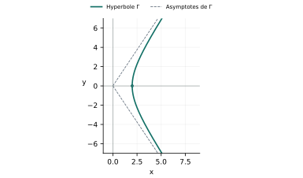
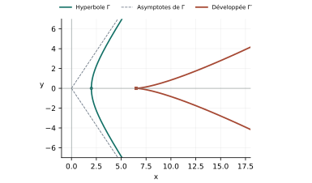
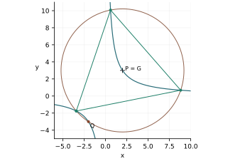

# Banque PT — Mathématiques A 2008 · Corrigé brut

*Corrigé rédigé par IA, non officiel. Signalez toute erreur.*

**Rédaction** · GPT-6.2 Astra Ultra · vitesse non renseignée

Le sujet de quatre heures traite trois problèmes indépendants de géométrie. La feuille de papier millimétré demandée en garde sert aux tracés de la partie B, reproduits ici avec la même échelle sur les deux axes. [Sujet officiel](https://www.banquept.fr/documents/2008/math_a_2008.pdf) · [Rapport du jury](https://www.banquept.fr/documents/ecrit/rapport/2008/rapport_math_a_ecrit_2008.pdf) · [Grille des coefficients](https://www.banquept.fr/documents/livret/2008/Livret_PT_2008.pdf#page=12)

## Partie A

### A.1 · Deux quadriques à axes principaux connus

La première équation est $x^2/36+y^2/16+z^2/9=1$. C’est un ellipsoïde de centre $O$ et de demi-axes $6,4,3$ suivant les axes canoniques. La seconde donne $x^2/36-y^2/16-z^2/9=1$. Ses sections à $x$ fixé sont vides pour $|x|<6$, réduites à un point pour $|x|=6$, puis elliptiques pour $|x|>6$. C’est un hyperboloïde à deux nappes de centre $O$, ouvertes suivant $Ox$.

### A.2 · Matrice symétrique de la troisième forme

Les coefficients de $x^2,y^2,z^2$ sont $3,0,3$. Pour les termes croisés $4xy,-4yz,2xz$, on place la moitié du coefficient dans chacune des deux cases symétriques. L’équation de $Q_3$ est $X^\mathsf TAX=1$ avec
$$A=\begin{pmatrix}3&2&1\\2&0&-2\\1&-2&3\end{pmatrix}.$$

### A.3 · Valeurs propres avec multiplicité

Posons $v=(1,-2,-1)^\mathsf T$. On vérifie $A=4I-vv^\mathsf T$ et $\|v\|^2=6$. Donc $A$ agit par $4$ sur le plan $v^\perp$ et par $4-6=-2$ sur $\mathbb Rv$. Le polynôme caractéristique vaut $(t-4)^2(t+2)$. L’ordre demandé donne $\lambda_1=\lambda_2=4$ et $\lambda_3=-2$.

### A.4 · Espaces propres et base directe

Les deux premiers espaces propres coïncident et valent $E_1=E_2=\{(x,y,z):x-2y-z=0\}$. Le troisième est $E_3=\mathbb R(1,-2,-1)$. Dans le plan, prenons $(1,0,1)$ et $(-1,-1,1)$, orthogonaux. Leur produit vectoriel vaut $(1,-2,-1)$. Une base orthonormée directe de vecteurs propres dans l’ordre requis est donc
$$u_1=\frac{(1,0,1)}{\sqrt2},\qquad u_2=\frac{(-1,-1,1)}{\sqrt3},\qquad u_3=\frac{(1,-2,-1)}{\sqrt6}.$$

### A.5 · Équation réduite et axe de révolution

En coordonnées $(X,Y,Z)$ dans la base précédente, la forme est diagonale. On obtient $4X^2+4Y^2-2Z^2=1$, soit $X^2+Y^2=(1+2Z^2)/4$. Toutes les sections par $Z$ fixé sont des cercles, de rayon minimal $1/2$ en $Z=0$. C’est un hyperboloïde de révolution à une nappe, d’axe passant par $O$ et dirigé par $(1,-2,-1)$.

## Partie B

### B.1 · Branche de conique et excentricité

Posons $c=\cosh t$ et $s=\sinh t$. Puisque $c^2-s^2=1$, les coordonnées $(2c,3s)$ vérifient $x^2/4-y^2/9=1$, avec $x\ge2$. Réciproquement $\sinh$ parcourt $\mathbb R$ et $\cosh t$ est positive. On obtient exactement la branche droite d’une hyperbole de demi-axes $a=2,b=3$, de foyers $(\pm\sqrt{13},0)$ et d’excentricité $e=\sqrt{a^2+b^2}/a=\sqrt{13}/2$.

### B.2 · Asymptotes et premier tracé

Pour $t\to+\infty$, $y-3x/2=3(s-c)=-3e^{-t}\to0$. Pour $t\to-\infty$, $y+3x/2=3(s+c)=3e^t\to0$. Les deux asymptotes passent par $O$ et ont pour équations $y=\pm3x/2$. Le sommet $(2,0)$ a une tangente verticale, et la symétrie en $Ox$ donne la moitié inférieure du tracé.

### B.3 · Repère de Frenet et choix de la normale

Posons $v=\sqrt{4s^2+9c^2}=\sqrt{9+13s^2}>0$. Le vecteur tangent unitaire est $T=(2s,3c)/v$. La normale unitaire du repère direct est $N_d=(-3c,2s)/v$. Or $\det(M',M'')=6s^2-6c^2=-6$, donc la courbe tourne à droite en suivant $t$ croissant. La normale principale, dirigée vers le centre de courbure, vaut $N_p=-N_d=(3c,-2s)/v$. Avec le rayon positif ci-dessous, on utilisera le repère $(M,T,N_p)$. Avec le repère direct $(M,T,N_d)$ on utilisera le rayon algébrique négatif.

### B.4 · Rayon de courbure

La courbure en valeur absolue est $|\det(M',M'')|/\|M'\|^3=6/v^3$, donc le rayon positif est $R=v^3/6$. Avec la normale directe, la courbure algébrique est $-6/v^3$ et le rayon algébrique vaut $-v^3/6$. Au sommet, le rayon positif est $27/6=9/2$.

### B.5 · Centre de courbure

Les deux conventions donnent le même déplacement $RN_p=(-v^3/6)N_d=v^2(3c,-2s)/6$. Ainsi
$$ C(t)=\big(2c+v^2c/2,\ 3s-v^2s/3\big)
=\left(\frac{13}{2}c^3,-\frac{13}{3}s^3\right),$$
car $4+v^2=13c^2$ et $9-v^2=-13s^2$. Pour $t=0$, $C(0)=(13/2,0)$ se trouve à droite du sommet, à distance $9/2$.

### B.6 · Symétrie de la développée

La première coordonnée de $C(t)$ est paire et la seconde impaire. Donc $C(-t)$ est le symétrique de $C(t)$ par rapport à $Ox$. Le domaine $\mathbb R$ étant symétrique, $Ox$ est un axe de $\Gamma'$.

### B.7 · Point de rebroussement

Au voisinage de zéro,
$$x_C(t)=13/2+(39/4)t^2+O(t^4),\qquad y_C(t)=-(13/3)t^3+O(t^5).$$
Ainsi $C'(0)=0$, $C''(0)=(39/2,0)$ et $C'''(0)=(0,-26)$ sont les deux premières dérivées non nulles et sont indépendantes. La tangente est horizontale et les deux demi-branches sont à droite de $C(0)$, l’une au-dessus et l’autre au-dessous de la tangente. C’est un point de rebroussement de première espèce.

### B.8 · Branches paraboliques et directions

Pour $t\to+\infty$, $y_C/x_C=-(2/3)\tanh^3t\to-2/3$, tandis que
$$y_C+(2/3)x_C=(13/3)(c^3-s^3)=(13/3)e^{-t}(c^2+cs+s^2)\sim(13/4)e^t\to+\infty.$$
Il s’agit d’une branche parabolique de pente $-2/3$. Par symétrie, pour $t\to-\infty$, la pente tend vers $2/3$ et $y_C-(2/3)x_C\to-\infty$. Les directions des deux branches sont perpendiculaires aux asymptotes respectives de $\Gamma$ aux mêmes extrémités du paramètre, car leurs pentes ont pour produit $-1$.

### B.9 · Tracé commun des deux courbes

La branche $\Gamma$ part vers le haut pour $t>0$ depuis $(2,0)$. Sur $\Gamma'$, le même sens du paramètre conduit vers le bas à droite du point de rebroussement $(13/2,0)$. Pour $t<0$ on réfléchit ces points par rapport à $Ox$. Les traits de pente $\pm3/2$ représentent les asymptotes de $\Gamma$. Une unité a la même longueur sur les deux axes.

### B.10.a · Formules de duplication

Comme $c=(e^t+e^{-t})/2$ et $s=(e^t-e^{-t})/2$, on a $\cosh(2t)=c^2+s^2=2c^2-1=2s^2+1$. La seconde relation imprimée omet le facteur $2$. La multiplication des deux expressions donne $cs=(e^{2t}-e^{-2t})/4$, donc **$\sinh(2t)=2sc$**. La relation sans ce facteur ne vaut que pour $t=0$.

### B.10.b · Longueur de l’arc de la développée

Sur cet intervalle, $C'=(39c^2s/2,-13s^2c)$ et $\|C'\|=(13/2)sc\sqrt{9c^2+4s^2}=(13/2)sc\sqrt{9+13s^2}$. Posons $u=9+13s^2$, d’où $du=26sc\,dt$. La longueur est donc
$$L=\frac14\int_9^{9+13\sinh^2(1)}\sqrt u\,du
=\frac{(9+13\sinh^2(1))^{3/2}-27}{6}.$$

## Partie C

### C.1 · Relations entre racines et coefficients

L’identité $R=(X-\alpha_1)(X-\alpha_2)(X-\alpha_3)$ donne par identification $\alpha_1+\alpha_2+\alpha_3=-a$, $\alpha_1\alpha_2+\alpha_2\alpha_3+\alpha_3\alpha_1=b$ et $\alpha_1\alpha_2\alpha_3=-c$.

### C.2 · Excentricité de l’hyperbole équilatère

Prenons $X=(x+y)/\sqrt2$ et $Y=(-x+y)/\sqrt2$. Alors $xy=(X^2-Y^2)/2$ et l’équation devient $X^2/12-Y^2/12=1$. Les deux demi-axes ont la même longueur $\sqrt{12}$, donc l’excentricité est $\sqrt{1+b^2/a^2}=\sqrt2$.

### C.3 · Deux points opposés de l’hyperbole

Pour $x=2$, la relation $xy=6$ donne $P=(2,3)$. Le symétrique est $Q=(-2,-3)$, et $(-2)(-3)=6$ vérifie $Q\in\mathcal H$.

### C.4 · Cercle de centre donné

$PQ^2=(-4)^2+(-6)^2=52$. L’équation cherchée est $(x-2)^2+(y-3)^2=52$.

### C.5 · Équation aux abscisses

En substituant $y=6/x$ puis en multipliant par $x^2$, on obtient $(x-2)^2x^2+(6-3x)^2=52x^2$, soit $x^4-4x^3-39x^2-36x+36=0$. L’équation initiale imposait $x\ne0$ et zéro n’est pas racine du polynôme. Chaque racine réelle donne donc exactement une intersection.

### C.6 · Un facteur connu et le cubique restant

La division par $x+2$ donne
$$x^4-4x^3-39x^2-36x+36=(x+2)U(x),\qquad U(x)=x^3-6x^2-27x+18.$$

### C.7 · Trois racines réelles distinctes

On trouve $U(-2)=40>0$ et $U(1)=-14<0$. Comme le coefficient dominant du cubique est positif, ses limites en $-\infty$ et $+\infty$ sont respectivement $-\infty$ et $+\infty$. Par continuité il possède une racine dans chacun des intervalles $]-\infty,-2[$, $]-2,1[$ et $]1,+\infty[$. Elles sont distinctes et épuisent les trois racines comptées avec multiplicité.

### C.8 · Les points d’intersection distincts de Q

Puisque $U(0)=18$, les $r_i$ sont non nuls. Les trois points sont $M_i=(r_i,6/r_i)$. Ils appartiennent au cercle par C.5–6. Leurs abscisses distinctes les séparent, et $U(-2)\ne0$ les distingue tous de $Q$. Il y a donc quatre intersections en comptant $Q$.

### C.9 · Centre de gravité et nature du triangle

Les relations de C.1 appliquées à $U$ donnent $\sum r_i=6$, $\sum_{i<j}r_ir_j=-27$ et $r_1r_2r_3=-18$. Ainsi $\sum 1/r_i=3/2$, puis
$$G=\left(\frac{\sum r_i}{3},\,\frac{6}{3}\sum\frac1{r_i}\right)=(2,3)=P.$$
Le centre de gravité coïncide avec le centre du cercle circonscrit. Pour le vérifier géométriquement, posons $v_i=\overrightarrow{PM_i}$. Les trois normes sont égales à $R=\sqrt{52}$ et $\sum v_i=0$. Élever $v_i+v_j=-v_k$ au carré donne $v_i\cdot v_j=-R^2/2$ pour $i\ne j$. Toutes les distances $M_iM_j$ valent donc $\sqrt3R$, et le triangle est équilatéral.

