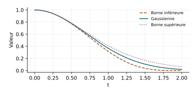
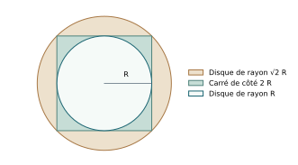

# Banque PT — Mathématiques C 2008 · Corrigé guidé

*Corrigé rédigé par IA, non officiel. Signalez toute erreur.*

**Rédaction** · GPT-6.2 Astra Ultra · vitesse non renseignée · 26 novembre 2026

La Banque PT a programmé cet écrit le mardi 6 mai 2008, de 14 h à 18 h. La garde interdit la calculatrice. Le code imprimé est G78U. Les questions figurent aux pages 1 à 4 du PDF de 4 pages. En admissibilité, le coefficient de Mathématiques C est de 3 pour l’ENS Cachan et de 6 pour l’École polytechnique. [Sujet](https://www.banquept.fr/documents/2008/math_c_2008.pdf) · [Rapport du jury](https://www.banquept.fr/documents/ecrit/rapport/2008/rapport_math_c_ecrit_2008.pdf) · [Livret de la Banque PT, p. 8, 9 et 12](https://www.banquept.fr/documents/livret/2008/Livret_PT_2008.pdf)

## I. Encadrement et intégrales de Wallis

### Question I.1

> [!INDICATION]
> Étudier la différence sur les deux côtés de zéro.

#### Solution

Sur $]-1,\infty[$, $u(x)=x-\ln(1+x)$ vérifie $u'(x)=x/(1+x)$. La différence décroît jusqu’à zéro, puis croît. Son minimum vaut $u(0)=0$. Donc $\ln(1+x)\le x$.

### Question I.2

> [!INDICATION]
> Vérifier le domaine avant les deux substitutions.

#### Solution

Pour $0<t<\sqrt n$, $0<t^2/n<1$. Les deux nombres $-t^2/n$ et $t^2/n$ sont donc supérieurs à $-1$. I.1 donne $\ln(1-t^2/n)\le-t^2/n$ et $\ln(1+t^2/n)\le t^2/n$.

### Question I.3

> [!INDICATION]
> Changer le sens de la deuxième inégalité en multipliant par moins n.

#### Solution

Après multiplication par $n$ de la première inégalité et par $-n$ de la seconde, la croissance de l’exponentielle donne $(1-t^2/n)^n\le e^{-t^2}\le(1+t^2/n)^{-n}$. Par continuité, ces inégalités valent aux extrémités de $[0,\sqrt n]$. On peut intégrer sur le segment. La borne supérieure augmente encore en intégrant le dernier terme positif sur $[0,\infty[$. Cette intégrale est finie car son intégrande est équivalent à $n^nt^{-2n}$ à l’infini, avec $2n>1$.

### Question I.4.a

> [!INDICATION]
> Conserver le signe de la dérivée et le sens des bornes.

#### Solution

Sur $]0,\pi/2[$, $t=\sqrt n\,\cot u$ décroît de l’infini à zéro et $dt=-\sqrt n\,du/\sin^2u$. Comme $1+t^2/n=1/\sin^2u$, le changement de variable sur des segments puis le passage aux extrémités donnent $\int_0^\infty(1+t^2/n)^{-n}\,dt=\sqrt n\int_0^{\pi/2}\sin^{2n-2}u\,du$. La puissance vaut zéro pour $n=1$.

### Question I.4.b

> [!INDICATION]
> Prendre un cosinus pour paramétrer t.

#### Solution

Poser $t=\sqrt n\cos u$ fait parcourir le segment en sens inverse pour $0\le u\le\pi/2$. On a $1-t^2/n=\sin^2u$ et $dt=-\sqrt n\sin u\,du$. Ainsi $\int_0^{\sqrt n}(1-t^2/n)^n\,dt=\sqrt n\int_0^{\pi/2}\sin^{2n+1}u\,du$.

### Question I.4.c

> [!INDICATION]
> Reporter les deux expressions dans la chaîne précédente.

#### Solution

Si $W_m=\int_0^{\pi/2}\sin^m u\,du$, I.3, I.4.a et I.4.b donnent $\sqrt n\,W_{2n+1}\le\int_0^{\sqrt n}e^{-t^2}\,dt\le\sqrt n\,W_{2n-2}$.

### Question I.5

> [!INDICATION]
> Prendre les indices exacts dans l’équivalent de Wallis.

#### Solution

L’équivalent admis $W_N\sim\sqrt{\pi/(2N)}$ montre que $\sqrt nW_{2n+1}$ et $\sqrt nW_{2n-2}$ tendent vers $\sqrt\pi/2$. Le terme médian a donc cette limite. Pour une borne réelle $R$ entre $\sqrt n$ et $\sqrt{n+1}$, la positivité encadre aussi l’intégrale par deux termes consécutifs. Ainsi $I=\int_0^\infty e^{-t^2}\,dt=\sqrt\pi/2$. La parité donne $J=\int_{-\infty}^\infty e^{-t^2}\,dt=\sqrt\pi$. Enfin $u=t/\sqrt2$ donne $K=\int_0^\infty e^{-t^2/2}\,dt=\sqrt2I=\sqrt{\pi/2}$.

## II. Développement en série entière d’une primitive pondérée

### Question II.1

> [!INDICATION]
> Donner le rayon de convergence en plus de la somme.

#### Solution

Pour tout réel $z$, $e^z=\sum_{n=0}^\infty z^n/n!$. Le rayon est infini puisque le rapport des modules de deux termes successifs est $|z|/(n+1)$ pour $z\ne0$.

### Question II.2.a

> [!INDICATION]
> Substituer dans une série de rayon infini.

#### Solution

La substitution $z=-x^2/2$ dans la série précédente donne $e^{-x^2/2}=\sum_{n\ge0}(-1)^nx^{2n}/(2^n n!)$. Elle converge absolument pour tout réel $x$ et fournit le développement en série entière autour de zéro.

### Question II.2.b

> [!INDICATION]
> Justifier l’intégration terme à terme sur tout segment.

#### Solution

La série converge uniformément sur tout segment car ses termes y sont dominés par ceux de $\sum R^{2n}/(2^nn!)$ lorsque $|x|\le R$. L’intégration terme à terme de zéro à $x$ donne $\int_0^x e^{-t^2/2}\,dt=\sum_{n\ge0}(-1)^nx^{2n+1}/[(2n+1)2^nn!]$, pour tout $x$.

### Question II.3

> [!INDICATION]
> Dériver le produit en utilisant le théorème fondamental.

#### Solution

Posons $F(x)=e^{x^2/2}\int_0^x e^{-t^2/2}\,dt$. Les deux facteurs sont dérivables. La dérivée du premier vaut $xe^{x^2/2}$, celle du second $e^{-x^2/2}$. La règle du produit donne $F'(x)=xF(x)+1$.

### Question II.4

> [!INDICATION]
> Séparer le coefficient constant des coefficients de rang positif.

#### Solution

Écrivons $F(x)=\sum a_nx^n$, comme le permet l’énoncé. On a $a_0=F(0)=0$. Dans le disque de convergence on dérive terme à terme. L’identité $F'=1+xF$ donne $a_1=1$ au rang zéro et $(n+1)a_{n+1}=a_{n-1}$ pour $n\ge1$ par unicité.

### Question II.5

> [!INDICATION]
> Itérer la récurrence aux rangs de même parité.

#### Solution

Pour $p\ge0$ on trouve $a_{2p}=0$ à partir de $a_0$, et $a_{2p+1}=1/(1\cdot3\cdots(2p+1))=2^pp!/(2p+1)!$ à partir de $a_1$. Cette formule inclut $p=0$ et montre aussi un rayon infini.

### Question II.6.a

> [!INDICATION]
> Identifier l’intégrale impropre de la première partie.

#### Solution

Par la définition de l’intégrale impropre et I.5, $\lim_{x\to+\infty}\int_0^x e^{-t^2/2}\,dt=K=\sqrt{\pi/2}$.

### Question II.6.b

> [!INDICATION]
> Diviser par la partie exponentielle.

#### Solution

Le quotient $F(x)/e^{x^2/2}$ tend vers le nombre strictement positif $\sqrt{\pi/2}$. Ainsi $F(x)\sim\sqrt{\pi/2}\,e^{x^2/2}$ quand $x\to+\infty$.

## III. Intégrales à paramètre

### Question III.1.a

> [!INDICATION]
> Examiner le dénominateur trigonométrique sur le segment.

#### Solution

Pour $g(x)=\int_0^{\pi/4}e^{-x^2/\cos^2\theta}\,d\theta$, le cosinus reste supérieur ou égal à $1/\sqrt2$. L’intégrande est continu en les deux variables et borné par un pour $x\ge0$. Par convergence dominée sur le segment, $g$ est continue sur $[0,\infty[$, y compris en zéro.

### Question III.1.b

> [!INDICATION]
> Dominer la dérivée localement en x.

#### Solution

Sur $0\le x\le A$, la dérivée partielle $-2x\,e^{-x^2/\cos^2\theta}/\cos^2\theta$ est continue et son module est au plus $4A$. Ce majorant constant est intégrable en $\theta$. La dérivation sous l’intégrale donne, pour $x>0$, $g'(x)=-2x\int_0^{\pi/4}e^{-x^2/\cos^2\theta}\,d\theta/\cos^2\theta$.

### Question III.2

> [!INDICATION]
> Utiliser la tangente, puis absorber le facteur x dans une deuxième substitution.

#### Solution

Pour $x>0$, $u=\tan\theta$ donne $du=d\theta/\cos^2\theta$ et $1/\cos^2\theta=1+u^2$. Donc $g'(x)=-2xe^{-x^2}\int_0^1 e^{-x^2u^2}\,du=-2e^{-x^2}\int_0^x e^{-v^2}\,dv$ après $v=xu$. Posons $f(x)=\int_0^x e^{-v^2}\,dv$. Comme $f'(x)=e^{-x^2}$, $(f^2+g)'=0$ sur $]0,\infty[$. Par continuité en zéro, $f^2+g=f(0)^2+g(0)=\pi/4$ partout sur la demi-droite.

### Question III.3.a

> [!INDICATION]
> Encadrer l’intégrande par une constante indépendante de l’angle.

#### Solution

Pour $0\le\theta\le\pi/4$, $1/\cos^2\theta\ge1$, si bien que $0\le e^{-x^2/\cos^2\theta}\le e^{-x^2}$. L’intégration sur un segment de longueur $\pi/4$ donne $0\le g(x)\le(\pi/4)e^{-x^2}$.

### Question III.3.b

> [!INDICATION]
> Passer à la limite dans l’invariant en choisissant le signe de f.

#### Solution

L’encadrement donne $g(x)\to0$, donc $f(x)^2\to\pi/4$. Comme $f(x)\ge0$, on en déduit $f(x)\to\sqrt\pi/2$, d’où $I=\sqrt\pi/2$ et $J=2I=\sqrt\pi$ par parité.

## IV. Intégrale de Gauss par coordonnées polaires

### Question IV.1

> [!INDICATION]
> Conserver le jacobien du passage en polaires.

#### Solution

En coordonnées polaires sur le disque $D_R$ de rayon $R$, $x^2+y^2=r^2$ et l’élément d’aire vaut $r\,dr\,d\theta$. Les coordonnées couvrent le disque à des ensembles de mesure nulle près. Donc $I_R=2\pi\int_0^R r e^{-r^2}\,dr=\pi(1-e^{-R^2})$.

### Question IV.2

> [!INDICATION]
> Exploiter la positivité dans le plan, puis séparer le produit sur le carré.

#### Solution

Les inclusions $D_R\subset[-R,R]^2\subset D_{\sqrt2R}$ donnent $I_R\le J_R\le I_{\sqrt2R}$ puisque l’intégrande est positive. Les bornes tendent vers $\pi$. Sur le carré, l’intégrale du produit continu $e^{-x^2}e^{-y^2}$ est le produit des intégrales. Par parité $J_R=4(\int_0^R e^{-x^2}\,dx)^2$. La racine positive donne donc de nouveau $\int_0^\infty e^{-x^2}\,dx=\sqrt\pi/2$.

