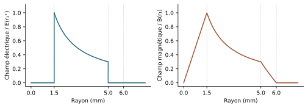
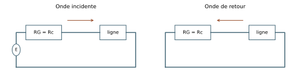
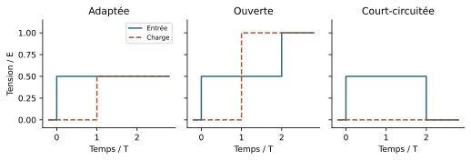
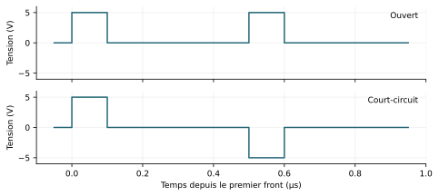

# Banque PT — Physique A 2008 · Corrigé brut

*Corrigé rédigé par IA, non officiel. Signalez toute erreur.*

**Rédaction** · GPT-6.2 Astra Ultra · vitesse non renseignée

**Révision** · GPT-6.2 Astra Ultra · vitesse non renseignée

Les champs d’un câble coaxial déterminent ses paramètres par mètre. Dans une ligne sans pertes, ces paramètres fixent la célérité et l’impédance qui permettent d’interpréter les échos d’une impulsion. Coefficients d’admissibilité : 6 pour l’École polytechnique, 3 pour l’ENS Cachan. [Sujet officiel](https://www.banquept.fr/documents/2008/phys_a_2008.pdf) · [Rapport du jury](https://www.banquept.fr/documents/ecrit/rapport/2008/rapport_phys_a_ecrit_2008.pdf) · [Grille des coefficients](https://www.banquept.fr/documents/livret/2008/Livret_PT_2008.pdf#page=12)

## A — Paramètres primaires du coaxial

### A.1.1–1.3 · Champ électrostatique

**1.1.** Deux plans de symétrie passant par le point, l’un méridien, l’autre orthogonal à l’axe, imposent un champ radial. Translation et rotation imposent $E=E(r)$. **1.2.a.** Dans le cœur métallique $r<r_1$ et le blindage $r_2<r<r_3=r_2+e$, $\vec E=0$. Dans l’isolant, Gauss sur une longueur $H$ donne $2\pi rH\epsilon E=QH/\ell$, soit $E=Q/(2\pi\epsilon\ell r)$.

**1.2.b.** Pour $r>r_3$ les charges libres s’annulent, et le champ extérieur est nul par symétrie. **1.3.a–b.** Le graphe monte par saut en $r_1$, décroît en $1/r$ puis tombe par saut à zéro en $r_2$. Les sauts proviennent des charges libres de surface sur les deux faces en regard (condition normale sur $\vec D$). À $r_3$, aucune charge de surface extérieure et aucun saut.

### A.1.4–1.8 · Capacité et énergie

**1.4.** $U_{12}=V_1-V_2=\int_{r_1}^{r_2}E\,dr=Q\ln(r_2/r_1)/(2\pi\epsilon\ell)$. **1.5.** $Q=C_1\ell U_{12}$ implique $C_1=2\pi\epsilon/\ln(r_2/r_1)$. **1.6.** $W_e=QU_{12}/2=C_1\ell U_{12}^2/2$. **1.7.** Avec $\epsilon=2\epsilon_0$, $r_2/r_1=0,50/0,15$, $C_1=92,4$ pF/m. **1.8.** Pour $\ell=10$ m et $U_{12}=10$ V, $W_e=46,2$ nJ.

### A.2.1–2.3 · Champ des courants aller et retour

**2.1.** Le plan méridien est plan de symétrie des courants et le champ axial de nature magnétique lui est perpendiculaire. Par rotation et translation, $\vec B=B(r)\vec u_\theta$. **2.2.** Ampère donne $B(r)=\mu_0 I_{\rm enl}/(2\pi r)$. Pour une densité volumique uniforme dans chaque métal,
$$\frac{I_{\rm enl}}{I}=\begin{cases}
r^2/r_1^2 &0\le r<r_1,\\
1&r_1<r<r_2,\\
(r_3^2-r^2)/(r_3^2-r_2^2)&r_2<r<r_3,\\
0&r>r_3.
\end{cases}$$
Prendre $B(0)=0$ par continuité.

**2.3.a–b.** $B$ croît linéairement, décroît comme $1/r$, puis s’annule progressivement dans le blindage. Le champ est continu aux trois interfaces car il n’y a ici aucun courant surfacique singulier et la perméabilité est la même. La pente peut changer.

### A.2.4–2.7 · Énergie magnétique et inductance

**2.4.a.** Dans le milieu non magnétique $w_m=B^2/(2\mu_0)$. **b (p. 5).** En négligeant l’énergie dans les métaux, $W_m=\int_{r_1}^{r_2}w_m2\pi r\ell\,dr=\mu_0I^2\ell\ln(r_2/r_1)/(4\pi)$.

**2.5.** Identifier $W_m=\tfrac12 L_1\ell I^2$, d’où $L_1=\mu_0\ln(r_2/r_1)/(2\pi)$. **2.6.** $L_1=2,41\times10^{-7}$ H/m. **2.7.** Pour $I=0,10$ A, $W_m\simeq12,0$ nJ.

### A.3 · Résistance des deux conducteurs

**3.1.** Les deux résistances par unité de longueur s’ajoutent, $R_1=[r_1^{-2}+(r_3^2-r_2^2)^{-1}]/(\pi\gamma)$. **3.2.** Avec $\gamma=5,8\times10^7$ S/m et les rayons en mètres, $R_1=2,94\times10^{-3}$ Ω/m. **3.3.** À $I=0,20$ A avec $R_u=50$ Ω, $E_g=I(R_u+\ell R_1)=10,0059$ V, soit environ 10 V. La ligne ajoute une chute de 5,88 mV.

## B.1 — Équations de la ligne sans pertes

### B.1.1–1.5 · Cellule élémentaire et célérité

**1.1.** Le courant de charge de la capacité est $i(z,t)-i(z+dz,t)=C_1dz\,\partial_tv(z+dz,t)$, donc $\partial_z i=-C_1\partial_t v$. **1.2.** La tension aux bornes de la bobine est $v(z,t)-v(z+dz,t)=L_1dz\,\partial_t i(z,t)$, donc $\partial_zv=-L_1\partial_ti$.

**1.3.** En dérivant une relation en $z$, l’autre en $t$, puis en échangeant les dérivées mixtes, on trouve pour $f=v$ ou $i$, $\partial_z^2f=L_1C_1\partial_t^2f$. **1.4.a–b.** $c=1/\sqrt{L_1C_1}$. Puisque H F $=(\mathrm{V\,s/A})(\mathrm{A\,s/V})=\mathrm{s}^2$, $L_1C_1$ s’exprime en s²/m². **1.5.** $c=2,12\times10^8$ m/s, égal à $1/\sqrt{\mu_0\epsilon}$ dans ce modèle.

### B.1.6–1.8 · Ondes progressives et résistance caractéristique

**1.6.** $f_a(t-z/c)$ se propage vers $+z$ et $f_b(t+z/c)$ vers $-z$, sans déformation, à la même célérité. **1.7.a (suite p. 7).** Pour $u=t-z/c$, $-v_a'/c=-L_1i_a'$, d’où $v_a=R_c i_a+V_{a0}$ avec $R_c=L_1c$. **b.** Pour $w=t+z/c$, $v_b'/c=-L_1i_b'$, soit $v_b=-R_ci_b+V_{b0}$.

**1.8.a–b.** $R_c=\sqrt{L_1/C_1}=51,1$ Ω. Dans la suite, les deux constantes d’intégration sont nulles.

## B.2 — Régime sinusoïdal

### B.2.1–2.3 · Puissance et amplitudes incidente et réfléchie

**2.1.** $\tfrac12\Re(\underline V\underline I^*)=VI\cos\phi/2=\langle vi\rangle$ est la puissance active nette dans le sens $+z$. Sa constance exprime l’absence de dissipation le long de la ligne en régime permanent ; les énergies réactives peuvent varier pendant la période.

**2.2.** $\underline V(0)=V_a+V_b$ et $\underline I(0)=(V_a-V_b)/R_c$. **2.3.** L’addition et la soustraction donnent $V_a=[\underline V(0)+R_c\underline I(0)]/2$ et $V_b=[\underline V(0)-R_c\underline I(0)]/2$. On obtient donc $V_{a,b}=\underline V(0)[1\pm R_c/Z(0)]/2$, lorsque les quotients sont définis.

### B.2.4–2.6 · Transport d’impédance

**2.4.** En notant $V_0=\underline V(0)$, $I_0=\underline I(0)$, on obtient $\underline V(z)=V_0\cos kz-jR_cI_0\sin kz$ et $\underline I(z)=I_0\cos kz-j(V_0/R_c)\sin kz$. Le quotient vaut $Z(z)=R_c[Z(0)-jR_c\tan kz]/[R_c-jZ(0)\tan kz]$.

**2.5.** À l’autre extrémité $Z(\ell)=Z_u$. Isoler $Z(0)$ donne $Z(0)=R_c[Z_u+jR_c\tan(k\ell)]/[R_c+jZ_u\tan(k\ell)]$. Aux pôles de la tangente, utiliser les expressions en sinus et cosinus ou leur limite. **2.6.a.** Le diviseur d’entrée donne $V_0=V_g Z(0)/[Z(0)+R_G]$. **b.** En substituant dans 2.3, $V_{a,b}=(V_g/2)[Z(0)\pm R_c]/[Z(0)+R_G]$.

### B.2.7 · Charge adaptée

**a.** Avec $Z_u=R_c$, $Z(0)=R_c$. **b (p. 9).** $V_b=0$. **c.** $\underline V(z)=V_a e^{-jkz}$ et $\underline I(z)=(V_a/R_c)e^{-jkz}$, onde unique se propageant vers la charge ; tension et courant sont en phase. **d.** $v(\ell,t)=V_g R_c/(R_G+R_c)\cos[\omega(t-\ell/c)]$ et $i(\ell,t)=v(\ell,t)/R_c$.

### B.2.8–2.10 · Extrémités réactives et quart d’onde

**2.8.a–c.** Pour un court-circuit, $Z(0)=jR_c\tan(k\ell)$. Sa partie réelle est nulle ; la charge de tension nulle n’absorbe aucune puissance moyenne et l’entrée non plus. À $\ell=\lambda/4$, l’entrée équivaut à un circuit ouvert.

**2.9.a–c.** Pour le circuit ouvert, $Z(0)=-jR_c\cot(k\ell)$. La puissance moyenne est nulle car le courant de charge est nul. À $\ell=\lambda/4$, l’entrée est un court-circuit. **2.10 (suite p. 10).** Pour une charge finie $Z_u=75$ Ω, le quart d’onde ramène $R_c^2/Z_u$. L’égalité à $R_{\rm ant}=300$ Ω impose $R_c=\sqrt{300\times75}=150$ Ω.

## B.3 — Échelons et réflectométrie

### B.3.1–3.2 · Coefficient de réflexion et source adaptée

**3.1.** À la charge $v_a+v_b=R_u(v_a-v_b)/R_c$. Donc $\Gamma=v_b/v_a=(R_u-R_c)/(R_u+R_c)$ au même point et à la même date. Le module est le rapport d’amplitudes en tension, le signe indique si la réflexion inverse la polarité.

**3.2.a.** À l’entrée, $v_g=v(0,t)+R_Gi(0,t)$ avec $R_G=R_c$. **b.** Substituer $v=v_a+v_b$, $i=(v_a-v_b)/R_c$ donne $v_g=2v_a$. Pour l’échelon, $v_a(0,t)=E/2$ pour $t>0$. **c.** Dans le schéma incident, la source voit $R_c$ en série avec $R_G=R_c$, donc un diviseur par deux. Dans le schéma de retour, on éteint la source idéale et l’onde arrive sur $R_G=R_c$, qui l’absorbe sans nouvel écho. L’onde incidente reste celle du premier schéma.

### B.3.3–3.5 · Échelons aux deux extrémités

Écrire $T=\ell/c$ et $H$ pour l’échelon unité. **3.3.a–c.** Si $R_u=R_c$, $\Gamma=0$. Ainsi $v(\ell,t)=v_g(t-T)/2=(E/2)H(t-T)$, un seul front retardé. **3.4.a–b (p. 11).** Pour le circuit ouvert $\Gamma=+1$, la tension double à la charge et le courant y est nul. $v(\ell,t)=E H(t-T)$ tandis que $v(0,t)=(E/2)[H(t)+H(t-2T)]$.

**3.5.a–b (p. 11).** Pour le court-circuit $\Gamma=-1$, le courant réfléchi s’ajoute au courant incident et la tension de charge reste nulle. À l’entrée $v(0,t)=(E/2)[H(t)-H(t-2T)]$.

### B.3.6 · Lecture des deux oscillogrammes

**a (p. 12).** Chaque impulsion initiale fait $2,5$ divisions à 2 V/div, soit $+5$ V pour une source de 10 V à vide. Le diviseur $5=10R_c/(50+R_c)$ donne $R_c=50$ Ω. Le premier écho fait $+5$ V (réflexion $+1$, circuit ouvert) ; le second $-5$ V (réflexion $-1$, court-circuit). La distance entre fronts homologues est de 5 divisions à 100 ns/div, donc $\Delta t=500$ ns pour l’aller-retour. Les deux discontinuités sont à $d=c\Delta t/2=50$ m de l’entrée de la ligne de mesure. Avec $c=2,0\times10^8$ m/s, $C_1=1/(cR_c)=100$ pF/m et $L_1=R_c/c=250$ nH/m.

**b.** Les valeurs de la partie A sont proches (92,4 pF/m et 241 nH/m). **c (p. 13).** Une impulsion rectangulaire est la superposition d’un front montant et d’un front descendant retardé d’une largeur d’impulsion. Chacun produit à l’entrée la réponse à l’échelon, de signe respectif opposé. Leur somme laisse une impulsion initiale de durée une division puis, après l’aller-retour, une réplique de même durée. Son signe reste positif en circuit ouvert et devient négatif en court-circuit ; la terminaison adaptée au générateur absorbe le retour.

