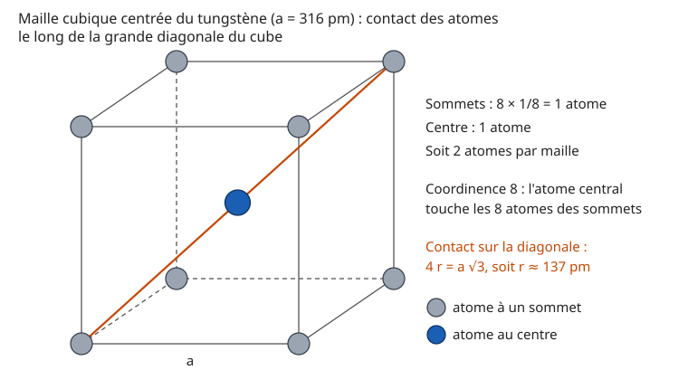
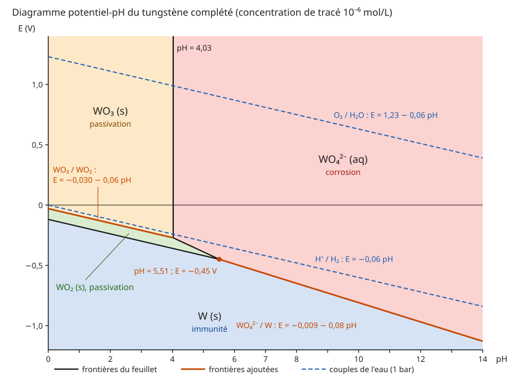
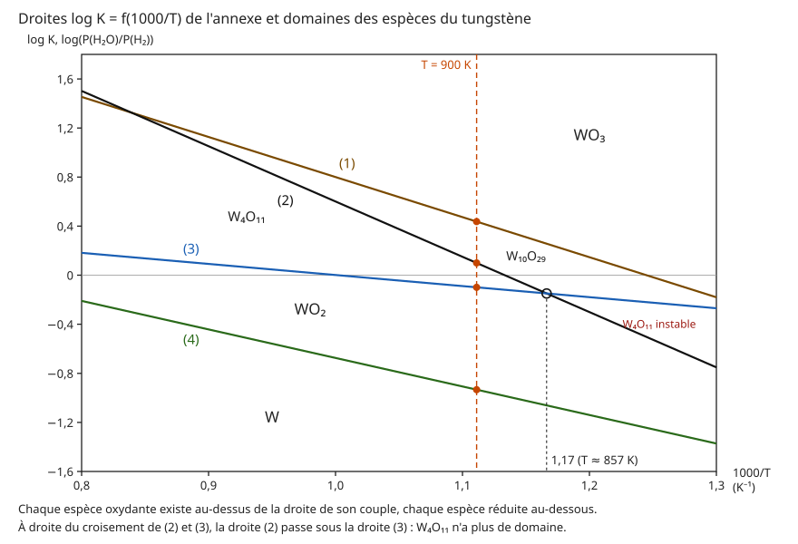

# Banque PT PT — Physique C - Chimie 2008 · Corrigé guidé

*Corrigé rédigé par IA, non officiel. Signalez toute erreur.*

**Rédaction** · modèle exact non renseigné (famille Claude) · effort non renseigné · vitesse non renseignée

**Révision (tour 2)** · modèle exact non renseigné (famille Claude) · effort non renseigné · vitesse non renseignée · 28 novembre 2026

## Présentation du sujet

**Thème.** Le tungstène, de l'atome à la lampe à incandescence. L'épreuve de Physique C dure 4 heures pour deux problèmes de même barème, à rendre sur deux copies séparées ; le problème de chimie est prévu pour 2 heures, **calculatrice autorisée**, résultats numériques à donner avec trois chiffres significatifs. Il comporte 42 questions en quatre parties largement indépendantes. Un feuillet mobile est à rendre avec la copie de chimie : le diagramme potentiel-pH partiel du tungstène, à compléter. Une annexe donne les droites $\log K = f(10^3/T)$ des quatre réactions de réduction des oxydes.

- *Partie I (5 questions)* : masse molaire à partir des abondances isotopiques, configuration électronique (I.1.1 et I.1.2) ; maille cubique centrée, coordinence, compacité, masse volumique (I.2.1 à I.2.3).
- *Partie II (17 questions)* : nombres d'oxydation et équilibre entre le trioxyde et l'ion tungstate (II.1.1 à II.1.6) ; demi-équations des cinq couples (question sans sous-numéro, repérée II.2), frontières, potentiels standard déduits par combinaison, dismutation de $\mathrm{WO_2}$, diagramme à compléter, couples de l'eau, immunité, corrosion et passivation (II.2.1 à II.2.10).
- *Partie III (8 questions)* : réduction de $\mathrm{WO_3}$ par le dihydrogène en quatre étapes : relation de Van't Hoff, constantes et rapport $P_{\mathrm{H_2O}}/P_{\mathrm{H_2}}$, affinité chimique, domaines d'existence lus sur l'annexe, dismutation de $\mathrm{W_4O_{11}}$, conditions d'obtention du métal à 900 K.
- *Partie IV (12 questions)* : rôle du gaz inerte (IV.1, sans sous-numéro), pression de vapeur du tungstène (IV.2.1 à IV.2.3), vitesse de sublimation et durée de vie du filament (IV.3.1 à IV.3.4), lampe à iode : deux équilibres simultanés, variance, loi de Van't Hoff, transport chimique (IV.4.1 à IV.4.4).

**Notions mobilisées.** Structure électronique de l'atome, cristal métallique, équilibres acido-basiques et de solubilité, oxydoréduction et relation de Nernst, diagrammes potentiel-pH et corrosion humide, thermodynamique chimique (relation de Van't Hoff, affinité chimique, quotient de réaction, variance, déplacement et rupture d'équilibre), équilibre solide-vapeur. Le programme est celui en vigueur à la session 2008, antérieur à la réforme de 2013-2014 ; il couvre les deux années de préparation.

**Difficulté.** Les parties I et II sont classiques ; la difficulté de la partie II tient à l'enchaînement des calculs, une erreur sur un potentiel standard faussant le tracé. La partie III demande de raisonner sur une figure et de manier l'affinité chimique ; son énoncé comporte une incohérence entre les équations écrites et la lecture de l'annexe, signalée aux questions III.4 et III.7. Les points délicats de la partie IV sont le signe dans le bilan de masse (IV.3.3) et la variance (IV.4.2).

**Gestion du temps.** Environ 15 minutes pour la partie I, 45 minutes pour la partie II (feuillet compris), 30 minutes pour la partie III et 30 minutes pour la partie IV. Lire tout le sujet d'abord : la fin de la partie IV contient des questions courtes et rapides (IV.2.1 à IV.3.2, IV.4.1).

> [!JURY]
> Le rapport 2008 estime que le temps consacré au problème de chimie est resté raisonnable, sans superflu, et que sa résolution complète demandait une implication plus profonde, partagée par de rares candidats ; la moyenne est au niveau des années précédentes. Il salue la ténacité de ceux qui ont lu tout le sujet et sont allés chercher des points en fin de problème, et juge peu judicieux le choix de quelques candidats de ne pas accorder ses deux heures à la chimie. Points forts relevés : la cristallographie, les réactions d'oxydoréduction et leurs demi-équations, l'écriture des réactions simples, le calcul des constantes d'équilibre dans les cas classiques. Points faibles : le tracé des frontières et l'indication des domaines dans un diagramme potentiel-pH, la thermodynamique chimique en général, le calcul des potentiels standard, le sens physique des signes dans une équation différentielle. La rédaction progresse peu, mais le jury note un intérêt pour la présentation (paragraphes, formules encadrées, dessins parfois soignés).

[Sujet officiel (archive)](https://www.banquept.fr/documents/2008/phys_c_2008.zip) · [Rapport du jury](https://www.banquept.fr/documents/ecrit/rapport/2008/rapport_phys_c_ecrit_2008.pdf)

Le sujet officiel est une archive de deux fichiers communs aux deux problèmes de Physique C : `phys_c_2008_sujet.pdf`, dont la chimie occupe les pages 2 à 8 (annexe en page 8), et `phys_c_2008_doc_reponse.pdf`, dont la page 1 est le feuillet mobile de chimie. Le rapport est lui aussi commun aux deux problèmes ; la chimie en occupe les trois premières pages.

*Mode d'emploi* : chercher chaque question seul, lire la première indication en cas de blocage, réessayer, puis la seconde, et seulement ensuite la solution.

## Partie I — Le tungstène ; isotopes et cristallographie

### Question I.1.1

> [!INDICATION]
> La masse molaire d'un élément est une moyenne pondérée : quels sont les poids, et quelle masse molaire attribuer à chaque isotope quand l'énoncé n'en donne aucune ?

> [!INDICATION]
> Prendre $A\ \mathrm{g\cdot mol^{-1}}$ pour l'isotope de nombre de masse $A$ et pondérer par les pourcentages atomiques divisés par 100. Vérifier d'abord que leur somme vaut 100.

#### Solution

La masse molaire de l'élément est la moyenne des masses molaires des isotopes, pondérée par les abondances atomiques. L'énoncé ne donne pas les masses isotopiques : le corrigé assimile la masse molaire de l'isotope de nombre de masse $A$ à $A\ \mathrm{g\cdot mol^{-1}}$ (l'écart réel est inférieur à $0{,}1\ \%$ ; la valeur tabulée, $183{,}84\ \mathrm{g\cdot mol^{-1}}$, tient compte du défaut de masse, que l'énoncé ne permet pas d'évaluer). La somme des abondances vaut bien $100{,}0\ \%$.

$$M = \sum_i x_i\,A_i$$

$$M = 0{,}0013 \times 180 + 0{,}263 \times 182 + 0{,}143 \times 183 + 0{,}3067 \times 184 + 0{,}286 \times 186$$

$$\boxed{M(\mathrm{W}) \approx 183{,}9\ \mathrm{g\cdot mol^{-1}}}$$

> [!JURY]
> Le rapport note que l'isotopie n'a guère posé de problème, mais s'étonne que la masse molaire du tungstène soit encore parfois donnée en unité de masse atomique au lieu de $\mathrm{g\cdot mol^{-1}}$.

> [!PIEGE]
> « À une décimale près » : donner $183{,}9$, ni $184$ ni $183{,}898$. L'hypothèse sur les masses isotopiques doit être écrite, puisqu'elle ne figure pas dans l'énoncé.

### Question I.1.2

> [!INDICATION]
> Trois règles sont attendues, avec leur nom. Laquelle fixe l'ordre de remplissage des sous-couches, laquelle limite leur contenu, laquelle répartit les électrons dans une sous-couche incomplète ?

> [!INDICATION]
> Ordre de Klechkowski jusqu'à 74 électrons : après $5p^6$ (54 électrons) viennent $6s$, puis $4f$, puis $5d$. Compter les électrons restants pour la sous-couche $5d$.

#### Solution

Règles utilisées :

- *principe d'exclusion de Pauli* : deux électrons d'un atome ne peuvent avoir leurs quatre nombres quantiques identiques, donc une orbitale contient au plus deux électrons, de spins opposés ; une sous-couche $s$, $p$, $d$, $f$ contient au plus 2, 6, 10, 14 électrons ;
- *règle de Klechkowski* : les sous-couches se remplissent par valeurs croissantes de $n + \ell$ et, à $n + \ell$ égal, par valeurs croissantes de $n$ ;
- *règle de Hund* : dans une sous-couche incomplète, les électrons occupent le plus grand nombre possible d'orbitales, avec des spins parallèles.

Pour $Z = 74$, l'ordre de remplissage donne :

$$1s^2\,2s^2\,2p^6\,3s^2\,3p^6\,4s^2\,3d^{10}\,4p^6\,5s^2\,4d^{10}\,5p^6\,6s^2\,4f^{14}\,5d^4$$

$$\boxed{\mathrm{W} : [\mathrm{Xe}]\,4f^{14}\,5d^4\,6s^2}$$

Le décompte est $54 + 14 + 4 + 2 = 74$. D'après la règle de Hund, les quatre électrons $5d$ occupent quatre orbitales distinctes avec des spins parallèles. Le tungstène est un métal de transition de la sixième période et de la sixième colonne ; ses six électrons de valence expliquent le degré d'oxydation maximal $+\mathrm{VI}$ rencontré dans la suite.

> [!JURY]
> D'après le rapport, les règles de remplissage sont moyennement sues : le schéma de Klechkowski est souvent le seul outil mobilisé, tandis que le principe de Pauli ou la règle de Hund sont employés sans être nommés, ou oubliés. Quelques copies les exposent et les utilisent remarquablement.

> [!METHODE]
> Énoncer chaque règle en une phrase, puis seulement écrire la configuration, et terminer par le décompte des électrons : c'est la vérification la plus rapide.

### Question I.2.1

> [!INDICATION]
> Cubique centré : où sont les nœuds du réseau dans le cube ?

> [!INDICATION]
> Un atome à chacun des 8 sommets et un atome au centre du cube. Dessiner le cube en perspective, arêtes cachées en pointillés, et repérer l'arête $a$.

#### Solution

La maille est un cube d'arête $a = 316\ \mathrm{pm}$ ; un atome de tungstène occupe chacun des 8 sommets et un atome occupe le centre du cube.

> [!JURY]
> Le rapport juge la description de la maille plutôt réussie.

### Question I.2.2

> [!INDICATION]
> Combien de mailles se partagent un atome placé à un sommet ? Et l'atome du centre ?

> [!INDICATION]
> Pour la coordinence, se placer sur l'atome central : quels sont ses plus proches voisins et à quelle distance sont-ils ?

#### Solution

Un atome placé à un sommet appartient à 8 mailles, l'atome central à une seule :

$$N = 8 \times \frac18 + 1 = 2$$

L'atome central a pour plus proches voisins les 8 atomes des sommets, tous à la distance $a\sqrt3/2 \approx 274\ \mathrm{pm}$ ; tous les atomes étant équivalents, il en va de même pour un atome de sommet (ses voisins sont les centres des 8 cubes qui se partagent ce sommet).

$$\boxed{2 \text{ atomes par maille ; coordinence } 8}$$

> [!PIEGE]
> Ne pas répondre 6 (les centres des mailles voisines, à la distance $a$) ni 12 (structure compacte) : les plus proches voisins sont les 8 sommets, à $a\sqrt3/2 < a$.

### Question I.2.3

> [!INDICATION]
> Compacité et masse volumique sont deux définitions : volume des atomes sur volume de la maille, masse des atomes de la maille sur volume de la maille. Il faut d'abord relier le rayon atomique à $a$.

> [!INDICATION]
> Le contact a lieu sur la grande diagonale du cube : $4r = a\sqrt3$. Puis $C = 2 \times \tfrac43\pi r^3/a^3$ et $\rho = 2M/(N_A a^3)$, en convertissant $a$ en centimètres pour obtenir des $\mathrm{g\cdot cm^{-3}}$.

#### Solution

Dans le modèle des sphères dures, les atomes sont en contact le long de la grande diagonale du cube, de longueur $a\sqrt3$, qui porte un rayon, un diamètre et un rayon :

$$4r = a\sqrt3$$

$$r = \frac{a\sqrt3}{4} \approx 137\ \mathrm{pm}$$

La compacité est le rapport du volume occupé par les atomes de la maille au volume de la maille :

$$C = \frac{2 \times \dfrac43\pi r^3}{a^3} = \frac{8\pi}{3}\left(\frac{\sqrt3}{4}\right)^3$$

$$\boxed{C = \frac{\pi\sqrt3}{8} \approx 0{,}680}$$

La masse volumique est le rapport de la masse des 2 atomes de la maille à son volume :

$$\rho = \frac{2\,M}{N_A\,a^3}$$

Avec $a = 316\cdot10^{-10}\ \mathrm{cm}$, $a^3 = 3{,}155\cdot10^{-23}\ \mathrm{cm^3}$ :

$$\rho = \frac{2 \times 183{,}9}{6{,}023\cdot10^{23} \times 3{,}155\cdot10^{-23}}$$

$$\boxed{\rho \approx 19{,}4\ \mathrm{g\cdot cm^{-3}} = 1{,}94\cdot10^{4}\ \mathrm{kg\cdot m^{-3}}}$$

Cette valeur est proche de celle que l'énoncé fournit à la question IV.3.4 ($19{,}25\ \mathrm{g\cdot cm^{-3}}$, écart de $0{,}5\ \%$) : le tungstène est l'un des métaux les plus denses.

> [!JURY]
> Le rapport constate que les définitions de la compacité et de la masse volumique sont moins bien connues qu'on aurait pu s'y attendre.

> [!METHODE]
> Comparer le résultat à la valeur que l'énoncé donne plus loin ($19{,}25\ \mathrm{g\cdot cm^{-3}}$, question IV.3.4) : un sujet fournit souvent, quelques pages plus loin, de quoi contrôler un calcul.

## Partie II — Comportement de l'élément tungstène en solution aqueuse

### Question II.1.1

> [!INDICATION]
> Oxygène à $-\mathrm{II}$ ; la somme des nombres d'oxydation vaut la charge de l'édifice.

> [!INDICATION]
> Attention à $\mathrm{W_2O_5}$ (deux atomes de tungstène) et à la charge $2-$ de l'ion tungstate. Classer ensuite du plus grand au plus petit.

#### Solution

On attribue $-\mathrm{II}$ à l'oxygène ; la somme des nombres d'oxydation est égale à la charge de l'édifice. Par exemple, dans $\mathrm{WO_4^{2-}}$ : $x + 4 \times (-2) = -2$, donc $x = +6$ ; dans $\mathrm{W_2O_5}$ : $2x + 5 \times (-2) = 0$, donc $x = +5$.

| Espèce | $\mathrm{WO_3(s)}$ | $\mathrm{WO_4^{2-}(aq)}$ | $\mathrm{W_2O_5(s)}$ | $\mathrm{WO_2(s)}$ | $\mathrm{W(s)}$ |
|---|---|---|---|---|---|
| Nombre d'oxydation de W | $+\mathrm{VI}$ | $+\mathrm{VI}$ | $+\mathrm{V}$ | $+\mathrm{IV}$ | $0$ |

> [!JURY]
> Le rapport relève que le nombre d'oxydation, et son calcul lorsque l'élément est engagé dans une structure, est globalement bien compris et bien exposé.

### Question II.1.2

> [!INDICATION]
> Comparer les nombres d'oxydation du tungstène dans les deux espèces.

> [!INDICATION]
> Pas de variation du nombre d'oxydation, donc pas d'électron échangé : quelle particule est alors échangée ?

#### Solution

Le tungstène est au même degré d'oxydation $+\mathrm{VI}$ dans $\mathrm{WO_3}$ et dans $\mathrm{WO_4^{2-}}$ : aucun électron n'est échangé.

**Ce n'est pas une demi-équation électronique** : c'est un équilibre acido-basique (échange de protons, $\mathrm{WO_3}$ jouant le rôle de l'acide et $\mathrm{WO_4^{2-}}$ celui de la base), doublé d'un équilibre de solubilité puisque l'acide est un solide.

> [!JURY]
> Le rapport signale, dans une minorité de copies, des hésitations pour distinguer une équation d'oxydoréduction (transfert d'électrons) d'une équation acido-basique au sens de Brönsted (transfert de proton entre deux espèces).

### Question II.1.3

> [!INDICATION]
> Écrire $\mathrm{WO_3}$ à gauche avec le coefficient 1, équilibrer l'oxygène avec $\mathrm{H_2O}$ puis l'hydrogène avec $\mathrm{H^+}$.

> [!INDICATION]
> Un seul $\mathrm{H_2O}$ suffit pour passer de 3 à 4 atomes d'oxygène ; il apparaît alors 2 $\mathrm{H^+}$ à droite. Écrire aussitôt $K_6$, activités du solide et du solvant égales à 1.

#### Solution

Avec le nombre stœchiométrique 1 pour le réactif $\mathrm{WO_3(s)}$ :

$$\boxed{\mathrm{WO_3(s)} + \mathrm{H_2O} = \mathrm{WO_4^{2-}(aq)} + 2\,\mathrm{H^+(aq)} \qquad (6)}$$

Les activités du solide et du solvant valant 1, la constante d'équilibre s'écrit, les concentrations étant rapportées à $c^\circ = 1\ \mathrm{mol\cdot L^{-1}}$ :

$$K_6 = [\mathrm{WO_4^{2-}}]\,[\mathrm{H^+}]^2 = 10^{-14{,}05}$$

> [!JURY]
> Le rapport reproche à certains candidats de lire l'énoncé trop vite et d'oublier une information importante : le nombre stœchiométrique imposé pour $\mathrm{WO_3}$.

> [!PIEGE]
> La valeur de $\mathrm{p}K_6$ n'a de sens que pour l'équation écrite avec ce coefficient 1 : avec d'autres coefficients, la constante est une puissance de $K_6$ et tous les pH qui suivent sont faux.

### Question II.1.4

> [!INDICATION]
> Que valent, sur la frontière, la concentration de l'espèce dissoute et l'activité du solide ?

> [!INDICATION]
> Solide présent, donc équilibre (6) réalisé, et $[\mathrm{WO_4^{2-}}] = C_0$ : reporter dans $K_6$ et isoler $[\mathrm{H^+}]$.

#### Solution

Sur la frontière, le solide est présent (l'équilibre (6) est réalisé) et la concentration de l'espèce dissoute vaut la concentration de tracé $C_0$ :

$$K_6 = C_0\,[\mathrm{H^+}]^2$$

$$[\mathrm{H^+}] = \sqrt{\frac{K_6}{C_0}}$$

$$\boxed{\mathrm{pH} = \frac12\left(\mathrm{p}K_6 + \log C_0\right)}$$

### Question II.1.5

> [!INDICATION]
> Simple application numérique : $\log C_0 = -6$.

#### Solution

$$\mathrm{pH} = \frac12\,(14{,}05 - 6)$$

$$\boxed{\mathrm{pH} = 4{,}025 \approx 4{,}03}$$

C'est l'abscisse de la frontière verticale déjà tracée sur le feuillet mobile (lue à $\mathrm{pH} \approx 4$).

> [!METHODE]
> Comparer à la verticale du feuillet mobile : elle est tracée un peu à droite de la quatrième graduation. Le feuillet permet de contrôler plusieurs résultats de cette partie.

### Question II.1.6

> [!INDICATION]
> Que se passe-t-il pour la concentration en ion tungstate, à l'équilibre avec le solide, lorsque le pH augmente ?

> [!INDICATION]
> $[\mathrm{WO_4^{2-}}] = K_6/[\mathrm{H^+}]^2$ doit rester inférieure à $C_0$ tant que le solide existe : en déduire une inégalité sur le pH.

#### Solution

Tant que le solide $\mathrm{WO_3}$ est présent, l'équilibre (6) impose $[\mathrm{WO_4^{2-}}] = K_6/[\mathrm{H^+}]^2$, et cette concentration ne peut dépasser $C_0$ :

$$\frac{K_6}{[\mathrm{H^+}]^2} \leqslant C_0 \iff \mathrm{pH} \leqslant 4{,}03$$

Au-delà, le quotient de réaction $C_0\,[\mathrm{H^+}]^2$ reste inférieur à $K_6$ : la réaction (6) se poursuit dans le sens direct jusqu'à disparition du solide.

**$\mathrm{WO_3(s)}$ existe du côté acide, pour $\mathrm{pH} < 4{,}03$** ; l'ion $\mathrm{WO_4^{2-}}$ prédomine pour $\mathrm{pH} > 4{,}03$. C'est conforme à la règle générale : la forme acide d'un couple se trouve aux pH les plus faibles.

> [!JURY]
> Le rapport rappelle que le domaine de prédominance d'un acide se trouve à un pH plus faible que le $\mathrm{p}K_a$ du couple.

### Question II.2

> [!INDICATION]
> Pour chaque couple : équilibrer le tungstène, puis l'oxygène avec $\mathrm{H_2O}$, l'hydrogène avec $\mathrm{H^+}$, enfin la charge avec les électrons.

> [!INDICATION]
> Contrôler le nombre d'électrons avec les nombres d'oxydation de la question II.1.1 : (variation du nombre d'oxydation) × (nombre d'atomes de tungstène).

#### Solution

Question sans sous-numéro, posée en tête de la section « Frontières rédox ». Les demi-équations sont équilibrées en milieu acide, avec $\mathrm{H^+}$ et $\mathrm{H_2O}$ ; le nombre d'électrons se vérifie par la variation du nombre d'oxydation.

$$\mathrm{2\,WO_3(s) + 2\,H^+ + 2\,e^- = W_2O_5(s) + H_2O} \qquad (1)$$

$$\mathrm{W_2O_5(s) + 2\,H^+ + 2\,e^- = 2\,WO_2(s) + H_2O} \qquad (2)$$

$$\mathrm{WO_2(s) + 4\,H^+ + 4\,e^- = W(s) + 2\,H_2O} \qquad (3)$$

$$\mathrm{WO_4^{2-}(aq) + 4\,H^+ + 2\,e^- = WO_2(s) + 2\,H_2O} \qquad (4)$$

$$\mathrm{WO_4^{2-}(aq) + 8\,H^+ + 6\,e^- = W(s) + 4\,H_2O} \qquad (5)$$

Contrôle : (1) deux atomes passent de $+\mathrm{VI}$ à $+\mathrm{V}$, soit 2 électrons ; (2) deux atomes de $+\mathrm{V}$ à $+\mathrm{IV}$, 2 électrons ; (3) de $+\mathrm{IV}$ à 0, 4 électrons ; (4) de $+\mathrm{VI}$ à $+\mathrm{IV}$, 2 électrons ; (5) de $+\mathrm{VI}$ à 0, 6 électrons.

> [!JURY]
> Le rapport indique que l'écriture formelle des demi-équations d'oxydoréduction a été, dans l'ensemble, réussie.

### Question II.2.1

> [!INDICATION]
> Relation de Nernst pour chaque couple : quelles activités valent 1 ? Que reste-t-il dans le logarithme ?

> [!INDICATION]
> Chaque couple échange autant de protons que d'électrons : pente $-0{,}060$ V par unité de pH pour les trois. Quelle espèce est coincée entre les droites (1) et (2), et quelle est la hauteur de sa bande ?

#### Solution

Les trois couples n'engagent que des solides (activité 1) et des ions $\mathrm{H^+}$. La relation de Nernst donne, pour (1) :

$$E = E^\circ_1 + \frac{0{,}060}{2}\,\log[\mathrm{H^+}]^2 = E^\circ_1 - 0{,}060\,\mathrm{pH}$$

et de même pour (2) (2 électrons, 2 protons) et pour (3) (4 électrons, 4 protons). En volts :

$$\boxed{\begin{aligned} E_1 &= -0{,}029 - 0{,}060\,\mathrm{pH} \\ E_2 &= -0{,}031 - 0{,}060\,\mathrm{pH} \\ E_3 &= -0{,}119 - 0{,}060\,\mathrm{pH} \end{aligned}}$$

Ce sont trois droites parallèles. L'oxyde $\mathrm{W_2O_5}$, réducteur du couple (1) et oxydant du couple (2), existe au-dessous de la droite (1) et au-dessus de la droite (2), soit dans une bande de hauteur

$$E_1 - E_2 = E^\circ_1 - E^\circ_2 = 0{,}002\ \mathrm{V}$$

**Le domaine d'existence de $\mathrm{W_2O_5}$ n'a que 2 mV de hauteur à tout pH** : il est indiscernable à l'échelle du diagramme. Le domaine de $\mathrm{WO_2}$, entre les droites (2) et (3), a en revanche une hauteur de $0{,}088\ \mathrm{V}$.

> [!METHODE]
> Dans un diagramme potentiel-pH, l'oxydant d'un couple est au-dessus de sa frontière, le réducteur au-dessous. Une espèce intermédiaire est donc sous la frontière du couple où elle est réducteur et au-dessus de celle où elle est oxydant.

### Question II.2.2

> [!INDICATION]
> Si l'on supprime l'espèce intermédiaire, quelles espèces la frontière unique sépare-t-elle ? Écrire la demi-équation de ce couple.

> [!INDICATION]
> (7) est la demi-somme de (1) et (2). Ce sont les $\Delta_r G^\circ = -nFE^\circ$ qui s'ajoutent, pas les potentiels standard.

#### Solution

Faire abstraction de $\mathrm{W_2O_5}$ revient à confondre les droites (1) et (2) en une seule frontière, qui sépare directement $\mathrm{WO_3}$ de $\mathrm{WO_2}$ : c'est la frontière du couple $\mathrm{WO_3(s)/WO_2(s)}$, de demi-équation

$$\boxed{\mathrm{WO_3(s) + 2\,H^+ + 2\,e^- = WO_2(s) + H_2O} \qquad (7)}$$

La demi-équation (7) est la demi-somme de (1) et de (2). Les potentiels standard ne s'ajoutent pas ; ce sont les enthalpies libres standard des demi-réactions de réduction, $\Delta_r G^\circ = -n\,F\,E^\circ$, qui s'ajoutent :

$$\Delta_r G^\circ_7 = \frac12\left(\Delta_r G^\circ_1 + \Delta_r G^\circ_2\right)$$

$$-2\,F\,E^\circ_7 = \frac12\left(-2\,F\,E^\circ_1 - 2\,F\,E^\circ_2\right)$$

$$\boxed{E^\circ_7 = \frac{E^\circ_1 + E^\circ_2}{2}}$$

Le résultat est une simple moyenne parce que les deux couples échangent le même nombre d'électrons.

> [!JURY]
> Le rapport insiste : le calcul des potentiels standard est à revoir pour un nombre assez élevé de candidats, car la somme de deux demi-équations ne conduit pas à la somme des $E^\circ$. Il recommande de passer par l'enthalpie libre standard de réaction exprimée en fonction des $E^\circ$, ce qui ne coûte qu'une ligne de calcul de plus.

### Question II.2.3

> [!INDICATION]
> Application directe de la formule précédente.

#### Solution

$$E^\circ_7 = \frac{-0{,}029 - 0{,}031}{2}$$

$$\boxed{E^\circ_7 = -0{,}030\ \mathrm{V}}$$

La frontière correspondante est $E_7 = -0{,}030 - 0{,}060\,\mathrm{pH}$, valable tant que $\mathrm{WO_3}$ existe, soit pour $\mathrm{pH} < 4{,}03$.

### Question II.2.4

> [!INDICATION]
> Chercher une combinaison de (7) et de l'équilibre (6) qui donne la demi-équation (4).

> [!INDICATION]
> (4) = (7) − (6), avec $\Delta_r G^\circ_6 = -RT\ln K_6$ et $\dfrac{RT}{F}\ln 10 = 0{,}060$ V. Pour la frontière : Nernst avec $[\mathrm{WO_4^{2-}}] = C_0$ ; 4 protons pour 2 électrons, donc pente $-0{,}120$ V par unité de pH.

#### Solution

La demi-équation (4) s'obtient en retranchant l'équation (6) de la demi-équation (7) :

$$(4) = (7) - (6)$$

$$\Delta_r G^\circ_4 = \Delta_r G^\circ_7 - \Delta_r G^\circ_6$$

$$-2\,F\,E^\circ_4 = -2\,F\,E^\circ_7 + R\,T^\circ\,\ln K_6$$

$$\boxed{E^\circ_4 = E^\circ_7 - \frac{R\,T^\circ}{2F}\,\ln K_6 = E^\circ_7 + 0{,}030\,\mathrm{p}K_6}$$

$$E^\circ_4 = -0{,}030 + 0{,}030 \times 14{,}05 = 0{,}3915\ \mathrm{V}$$

$$\boxed{E^\circ_4 \approx 0{,}392\ \mathrm{V}}$$

Frontière du couple (4), avec $[\mathrm{WO_4^{2-}}] = C_0 = 10^{-6}\ \mathrm{mol\cdot L^{-1}}$ :

$$E_4 = E^\circ_4 + \frac{0{,}060}{2}\,\log\left(C_0\,[\mathrm{H^+}]^4\right)$$

$$E_4 = E^\circ_4 + 0{,}030\,\log C_0 - 0{,}120\,\mathrm{pH}$$

$$\boxed{E_4 = 0{,}212 - 0{,}120\,\mathrm{pH} \quad (\text{en V, pour } \mathrm{pH} > 4{,}03)}$$

Contrôle de continuité à $\mathrm{pH} = 4{,}025$ : la droite (7) donne $-0{,}030 - 0{,}060 \times 4{,}025 = -0{,}2715\ \mathrm{V}$ et la droite (4) donne $0{,}2115 - 0{,}120 \times 4{,}025 = -0{,}2715\ \mathrm{V}$. Les deux frontières se raccordent sur la verticale, au point où celle-ci s'arrête sur le feuillet (lu vers $-0{,}25\ \mathrm{V}$, le tracé du feuillet étant approximatif).

> [!METHODE]
> Vérifier la continuité : en $\mathrm{pH} = 4{,}03$, les frontières (7) et (4) doivent donner le même potentiel, puisqu'elles se rejoignent sur la verticale. Ce contrôle détecte toute erreur de signe sur le terme en $\mathrm{p}K_6$.

> [!PIEGE]
> $E^\circ_4$ est un potentiel standard (toutes activités égales à 1, $\mathrm{pH} = 0$) : la concentration de tracé n'y figure pas. Elle n'intervient que dans l'équation de la frontière.

### Question II.2.5

> [!INDICATION]
> Entre quelles frontières se trouve $\mathrm{WO_2}$ pour $\mathrm{pH} > 4{,}03$ ? Comparer leurs pentes.

> [!INDICATION]
> Les droites (4) et (3) se coupent : égaler leurs équations. Au-delà, $\mathrm{WO_2}$ donne l'espèce située au-dessus et l'espèce située au-dessous.

#### Solution

Pour $\mathrm{pH} > 4{,}03$, $\mathrm{WO_2}$ est le réducteur du couple (4), donc stable au-dessous de la droite (4), et l'oxydant du couple (3), donc stable au-dessus de la droite (3). La droite (4), de pente $-0{,}120\ \mathrm{V}$ par unité de pH, descend deux fois plus vite que la droite (3), de pente $-0{,}060$ : elles se coupent, et au-delà de leur intersection la droite (4) est sous la droite (3), si bien que le domaine de $\mathrm{WO_2}$ disparaît.

$$0{,}2115 - 0{,}120\,\mathrm{pH} = -0{,}119 - 0{,}060\,\mathrm{pH}$$

$$\mathrm{pH} = \frac{0{,}2115 + 0{,}119}{0{,}060}$$

$$\boxed{\mathrm{pH_{lim}} \approx 5{,}51 \qquad (E \approx -0{,}450\ \mathrm{V})}$$

C'est le sommet du triangle amorcé sur le feuillet mobile (lu vers $\mathrm{pH} \approx 5{,}5$ et $E \approx -0{,}45\ \mathrm{V}$).

Au-delà de ce pH, $\mathrm{WO_2}$ se transforme en tungstène métallique et en ion tungstate :

$$\boxed{\mathrm{3\,WO_2(s) + 2\,H_2O = W(s) + 2\,WO_4^{2-}(aq) + 4\,H^+(aq)}}$$

(un atome passe de $+\mathrm{IV}$ à 0 en captant 4 électrons, deux atomes passent de $+\mathrm{IV}$ à $+\mathrm{VI}$ en en cédant 4). Une espèce de degré d'oxydation intermédiaire qui donne une espèce plus oxydée et une espèce plus réduite subit une **dismutation**.

> [!JURY]
> Le rapport estime que la notion de dismutation doit être revue.

> [!METHODE]
> Pour équilibrer une dismutation, combiner les deux demi-équations où l'espèce intervient, ici (4) lue en oxydation, deux fois, et (3) lue en réduction, une fois, de façon à éliminer les électrons.

### Question II.2.6

> [!INDICATION]
> Quelle combinaison de demi-équations donne (5) ?

> [!INDICATION]
> (5) = (4) + (3) : $-6FE^\circ_5 = -2FE^\circ_4 - 4FE^\circ_3$. Contrôler ensuite que la frontière (5) passe par le point de concours trouvé à la question précédente.

#### Solution

La demi-équation (5) est la somme de (4) et de (3) :

$$\Delta_r G^\circ_5 = \Delta_r G^\circ_4 + \Delta_r G^\circ_3$$

$$-6\,F\,E^\circ_5 = -2\,F\,E^\circ_4 - 4\,F\,E^\circ_3$$

$$\boxed{E^\circ_5 = \frac{E^\circ_4 + 2\,E^\circ_3}{3}}$$

$$E^\circ_5 = \frac{0{,}3915 + 2 \times (-0{,}119)}{3}$$

$$\boxed{E^\circ_5 \approx 0{,}0512\ \mathrm{V}}$$

Frontière du couple (5), pour $\mathrm{pH} > 5{,}51$ :

$$E_5 = E^\circ_5 + \frac{0{,}060}{6}\,\log\left(C_0\,[\mathrm{H^+}]^8\right)$$

$$E_5 = -0{,}009 - 0{,}080\,\mathrm{pH} \quad (\text{en V})$$

Contrôle : à $\mathrm{pH} = 5{,}508$, $E_5 = -0{,}0088 - 0{,}4407 = -0{,}4495\ \mathrm{V}$, valeur commune aux droites (3) et (4) : les trois frontières concourent.

> [!PIEGE]
> $E^\circ_5$ n'est ni $E^\circ_3 + E^\circ_4$ ni leur moyenne simple : la moyenne est pondérée par les nombres d'électrons (4 et 2).

### Question II.2.7

> [!INDICATION]
> Faire la liste des frontières déjà tracées sur le feuillet et de celles que l'on a calculées : lesquelles manquent ?

> [!INDICATION]
> Il manque le segment $\mathrm{WO_3/WO_2}$ (de $\mathrm{pH} = 0$ à $4{,}03$) et la demi-droite $\mathrm{WO_4^{2-}/W}$ (au-delà de $5{,}51$). Placer les espèces : les plus oxydées en haut, la forme acide à gauche de la verticale.

#### Solution

Le feuillet mobile porte déjà la verticale $\mathrm{pH} = 4{,}03$, la frontière (3) de $\mathrm{pH} = 0$ à $5{,}51$ et la frontière (4) de $\mathrm{pH} = 4{,}03$ à $5{,}51$. Il manque deux segments :

- la frontière (7), $E = -0{,}030 - 0{,}060\,\mathrm{pH}$, du point $(0\ ;\ -0{,}030\ \mathrm{V})$ au point $(4{,}03\ ;\ -0{,}27\ \mathrm{V})$ ;
- la frontière (5), $E = -0{,}009 - 0{,}080\,\mathrm{pH}$, à partir du point $(5{,}51\ ;\ -0{,}45\ \mathrm{V})$ ; elle passe par $(14\ ;\ -1{,}13\ \mathrm{V})$.

Domaines, des potentiels élevés vers les potentiels bas :

- $\mathrm{WO_3(s)}$ (domaine d'existence) : à gauche de la verticale, au-dessus de la droite (7) ;
- $\mathrm{WO_4^{2-}(aq)}$ (domaine de prédominance) : à droite de la verticale, au-dessus des droites (4) puis (5) ;
- $\mathrm{WO_2(s)}$ (domaine d'existence) : quadrilatère compris entre les droites (7) et (4) au-dessus et la droite (3) au-dessous, fermé à $\mathrm{pH} = 5{,}51$ ;
- $\mathrm{W(s)}$ (domaine d'existence) : au-dessous des droites (3) puis (5).

> [!JURY]
> Selon le rapport, le diagramme a rarement été complété tout à fait correctement : frontières fausses à cause du calcul des potentiels standard, ou domaines de prédominance et d'existence erronés. Il juge cette partie relativement accessible et attend plus de rigueur et de précision.

### Question II.2.8

> [!INDICATION]
> L'eau peut être oxydée ou réduite : dans quel couple est-elle le réducteur, dans lequel l'oxydant ?

#### Solution

L'eau est l'oxydant du couple $\mathrm{H_2O/H_2(g)}$, noté aussi $\mathrm{H^+/H_2(g)}$, et le réducteur du couple $\mathrm{O_2(g)/H_2O}$ :

$$\mathrm{2\,H^+(aq) + 2\,e^- = H_2(g)} \qquad E^\circ = 0\ \mathrm{V}$$

$$\mathrm{O_2(g) + 4\,H^+(aq) + 4\,e^- = 2\,H_2O} \qquad E^\circ = 1{,}23\ \mathrm{V}$$

La valeur nulle du premier potentiel standard, à toute température, est la convention qui fixe l'origine de l'échelle des potentiels (électrode standard à hydrogène).

> [!JURY]
> Le rapport note que les couples rédox de l'eau sont connus.

### Question II.2.9

> [!INDICATION]
> Nernst pour chaque couple, avec des pressions partielles de 1 bar sur les frontières.

> [!INDICATION]
> Deux droites parallèles de pente $-0{,}060$ V par unité de pH. Regarder ensuite quels domaines du tungstène n'ont aucun point commun avec la bande de stabilité de l'eau.

#### Solution

Avec la convention usuelle d'une pression partielle des gaz égale à $P^\circ = 1\ \mathrm{bar}$ sur les frontières :

$$E = 0 + \frac{0{,}060}{2}\,\log\frac{[\mathrm{H^+}]^2}{P_{\mathrm{H_2}}/P^\circ}$$

$$\boxed{E(\mathrm{H^+/H_2}) = -0{,}060\,\mathrm{pH}}$$

$$E = 1{,}23 + \frac{0{,}060}{4}\,\log\left(\frac{P_{\mathrm{O_2}}}{P^\circ}\,[\mathrm{H^+}]^4\right)$$

$$\boxed{E(\mathrm{O_2/H_2O}) = 1{,}23 - 0{,}060\,\mathrm{pH}}$$

L'eau est stable entre ces deux droites parallèles (tracées en tirets sur la figure 2).

Comparaison avec les frontières du tungstène :

- la droite (7), $-0{,}030 - 0{,}060\,\mathrm{pH}$, est parallèle à la droite $\mathrm{H^+/H_2}$ et située 30 mV au-dessous ;
- la droite (4), $0{,}212 - 0{,}120\,\mathrm{pH}$, passe sous la droite $\mathrm{H^+/H_2}$ dès $\mathrm{pH} > 3{,}5$, donc sur tout son intervalle de validité ($\mathrm{pH} > 4{,}03$) ;
- la droite (5), $-0{,}009 - 0{,}080\,\mathrm{pH}$, est sous la droite $\mathrm{H^+/H_2}$ à tout pH.

Les domaines de $\mathrm{W}$ et de $\mathrm{WO_2}$ sont donc entièrement au-dessous de la droite $\mathrm{H^+/H_2}$ : ils sont disjoints du domaine de stabilité de l'eau. **Le tungstène métallique et le dioxyde $\mathrm{WO_2}$ ne sont pas thermodynamiquement stables dans l'eau, à aucun pH** : ils la réduisent avec dégagement de dihydrogène et sont oxydés jusqu'au degré $+\mathrm{VI}$, en $\mathrm{WO_3(s)}$ pour $\mathrm{pH} < 4{,}03$, en $\mathrm{WO_4^{2-}}$ au-delà. Par exemple :

$$\mathrm{W(s) + 3\,H_2O = WO_3(s) + 3\,H_2(g)} \qquad (\mathrm{pH} < 4{,}03)$$

$$\mathrm{W(s) + 4\,H_2O = WO_4^{2-}(aq) + 2\,H^+(aq) + 3\,H_2(g)} \qquad (\mathrm{pH} > 4{,}03)$$

Les espèces du tungstène(VI), $\mathrm{WO_3}$ et $\mathrm{WO_4^{2-}}$, ont un domaine commun avec celui de l'eau : elles y sont stables. Le diagramme ne renseigne que sur la thermodynamique ; les écarts de potentiel étant faibles en milieu acide (quelques dizaines de millivolts), ces réactions peuvent être très lentes.

> [!PIEGE]
> Un diagramme potentiel-pH est thermodynamique : conclure « le tungstène est oxydé par l'eau » sans réserve cinétique serait excessif, d'autant que les écarts de potentiel sont ici de quelques dizaines de millivolts en milieu acide.

### Question II.2.10

> [!INDICATION]
> Trois définitions : métal stable ; métal oxydé en espèce soluble ; métal oxydé en solide.

> [!INDICATION]
> Associer à chaque domaine du diagramme l'une des trois situations, puis conclure en croisant avec la question II.2.9 : le métal est-il protégé en milieu acide ? en milieu basique ?

#### Solution

Définitions :

- *immunité* : domaine où le métal est thermodynamiquement stable ; il ne peut pas être oxydé ;
- *corrosion* : domaine où le métal est oxydé en une espèce soluble, ici à une concentration supérieure à $10^{-6}\ \mathrm{mol\cdot L^{-1}}$ ; l'attaque se poursuit ;
- *passivation* : domaine où le métal est oxydé en un solide (oxyde ou hydroxyde) qui le recouvre et peut le protéger d'une attaque ultérieure, si la couche est adhérente et imperméable.

Sur le diagramme (figure 2) :

- **immunité** : domaine de $\mathrm{W(s)}$ ;
- **passivation** : domaines de $\mathrm{WO_3(s)}$ et de $\mathrm{WO_2(s)}$ ;
- **corrosion** : domaine de $\mathrm{WO_4^{2-}(aq)}$.

Conclusion : le domaine d'immunité est tout entier hors du domaine de stabilité de l'eau, donc le tungstène ne peut pas être immunisé au contact d'une solution aqueuse sans lui imposer un potentiel très bas. En milieu acide ($\mathrm{pH} < 4$), il se recouvre d'oxyde $\mathrm{WO_3}$ : il est passivé et résiste. En milieu peu acide, neutre ou basique ($\mathrm{pH} > 4$), l'oxydation conduit à l'ion soluble $\mathrm{WO_4^{2-}}$ : il est corrodé. Le tungstène résiste aux acides, pas aux bases ; la protection en milieu acide est toutefois d'origine cinétique, puisqu'elle dépend de la qualité de la couche d'oxyde.

> [!JURY]
> Le rapport constate que les domaines d'immunité, de corrosion et de passivation n'ont pas été indiqués par la grande majorité des candidats.

> [!PIEGE]
> Passivation ne veut pas dire protection garantie : le diagramme dit seulement qu'un oxyde solide se forme. Son efficacité dépend de son adhérence et de son imperméabilité.

## Partie III — Métallurgie préparative : réduction des oxydes de tungstène par l'hydrogène

### Question III.1

> [!INDICATION]
> Quelle relation relie la variation de $K$ avec $T$ à l'enthalpie standard de réaction ? Que vaut la dérivée de $\ln K$ quand $\log K = -a/T + b$ ?

> [!INDICATION]
> Van't Hoff : $\mathrm{d}\ln K/\mathrm{d}T = \Delta_r H^\circ/(RT^2)$, et ici $\mathrm{d}\ln K/\mathrm{d}T = \ln(10)\,a/T^2$. Identifier : $\Delta_r H^\circ = \ln(10)\,R\,a$, constante.

#### Solution

Pour chacun des quatre équilibres, l'énoncé donne une loi de la forme

$$\log K_i = -\frac{a_i}{T} + b_i$$

soit $\ln K_i = \ln(10)\left(b_i - a_i/T\right)$. La relation de Van't Hoff s'écrit :

$$\frac{\mathrm{d}\ln K_i}{\mathrm{d}T} = \frac{\Delta_r H^\circ_i}{R\,T^2}$$

$$\frac{\mathrm{d}\ln K_i}{\mathrm{d}T} = \ln(10)\,\frac{a_i}{T^2}$$

$$\Delta_r H^\circ_i = \ln(10)\,R\,a_i$$

**L'enthalpie standard de chaque réaction est indépendante de la température** sur l'intervalle étudié : c'est exactement ce que traduit une variation affine de $\log K$ avec $1/T$ (approximation d'Ellingham ; l'entropie standard de réaction, $\Delta_r S^\circ_i = \ln(10)\,R\,b_i$, est alors constante elle aussi).

Pour la réaction (1), $a_1 = 3266{,}9\ \mathrm{K}$ :

$$\Delta_r H^\circ_1 = 2{,}3026 \times 8{,}314 \times 3266{,}9$$

$$\boxed{\Delta_r H^\circ_1 \approx 6{,}25\cdot10^{4}\ \mathrm{J\cdot mol^{-1}} = 62{,}5\ \mathrm{kJ\cdot mol^{-1}}}$$

La réaction (1) est endothermique, comme les trois autres ($a_i > 0$) : les constantes augmentent avec la température.

> [!JURY]
> Le rapport regrette que cette partie n'ait pas été traitée par tous, alors qu'elle contenait des questions de cours a priori abordables, et note que la relation de Van't Hoff (ou celle de Gibbs-Helmholtz) n'est pas toujours bien connue, ou est maladroitement utilisée.

> [!PIEGE]
> Le logarithme de l'énoncé est décimal : oublier le facteur $\ln 10$ donne $27{,}2\ \mathrm{kJ\cdot mol^{-1}}$ au lieu de $62{,}5$. Attention aussi au signe : $-a/T$ croît avec $T$, donc $\Delta_r H^\circ > 0$.

### Question III.2

> [!INDICATION]
> Quelles sont les activités des solides ? Écrire chaque constante avec les pressions partielles des deux gaz.

> [!INDICATION]
> Autant de $\mathrm{H_2}$ consommé que de $\mathrm{H_2O}$ formé : $P^\circ$ s'élimine et $K_i$ est une puissance du rapport des pressions, d'exposant égal au nombre stœchiométrique du dihydrogène.

#### Solution

Les solides sont purs dans leur phase (activité 1) ; les gaz sont supposés parfaits, d'activité $P_j/P^\circ$. En notant

$$r = \frac{P_{\mathrm{H_2O}}}{P_{\mathrm{H_2}}}$$

la pression standard s'élimine, chaque réaction consommant autant de moles de dihydrogène qu'elle produit de moles de vapeur d'eau :

$$\boxed{\begin{aligned} K_1 &= r_{\text{éq}} \\ K_2 &= r_{\text{éq}}^{\,3} \\ K_3 &= r_{\text{éq}}^{\,3} \\ K_4 &= r_{\text{éq}}^{\,2} \end{aligned}}$$

À une température donnée, chaque équilibre n'est donc réalisé que pour une seule valeur du rapport $r$, indépendante de la pression totale.

### Question III.3

> [!INDICATION]
> L'affinité se définit comme une dérivée partielle de $G$ : par rapport à quelle variable, à quels paramètres fixés ?

> [!INDICATION]
> $\mathcal{A} = -(\partial G/\partial\xi)_{T,P}$. À $T$ et $P$ constantes, le second principe impose $\mathrm{d}G \leqslant 0$, donc $\mathcal{A}\,\mathrm{d}\xi \geqslant 0$.

#### Solution

Pour un système fermé siège d'une réaction d'avancement $\xi$, l'affinité chimique est l'opposé de la dérivée de l'enthalpie libre par rapport à l'avancement, à température et pression fixées :

$$\boxed{\mathcal{A} = -\left(\frac{\partial G}{\partial \xi}\right)_{T,P} = -\Delta_r G}$$

Pour une évolution spontanée à température et pression constantes, le second principe impose que l'enthalpie libre diminue, l'entropie créée étant positive :

$$\mathrm{d}G = -\mathcal{A}\,\mathrm{d}\xi = -T\,\delta S_{\text{créée}} \leqslant 0$$

$$\boxed{\mathcal{A}\,\mathrm{d}\xi \geqslant 0}$$

- évolution dans le sens direct ($\mathrm{d}\xi > 0$) : $\mathcal{A} > 0$ ;
- évolution dans le sens indirect ($\mathrm{d}\xi < 0$) : $\mathcal{A} < 0$ ;
- à l'équilibre : $\mathcal{A} = 0$.

> [!JURY]
> Le rapport observe que la définition de l'affinité chimique est connue, mais que son utilisation est mal maîtrisée.

> [!METHODE]
> « En le justifiant » : la justification attendue est le critère d'évolution, c'est-à-dire la décroissance de $G$ à $T$ et $P$ fixées, conséquence du second principe (entropie créée positive).

### Question III.4

> [!INDICATION]
> Exprimer $\mathcal{A}$ avec $\Delta_r G = \Delta_r G^\circ + RT\ln Q$. Que vaut $Q$ pour ces réactions ?

> [!INDICATION]
> $\mathcal{A} = RT\ln(K/Q)$ avec $Q = r^{\nu}$. Si le point est au-dessus de la frontière, $Q > K$, $\mathcal{A} < 0$ : la réaction ne peut aller que dans le sens indirect, qui consomme l'espèce réduite.

#### Solution

Avec $\Delta_r G = \Delta_r G^\circ + RT\ln Q$ et $\Delta_r G^\circ = -RT\ln K$ :

$$\boxed{\mathcal{A} = R\,T\,\ln\frac{K}{Q}}$$

Pour la réaction $i$, qui met en jeu $\nu_i$ moles de dihydrogène et de vapeur d'eau ($\nu_1 = 1$, $\nu_2 = \nu_3 = 3$, $\nu_4 = 2$), le quotient de réaction vaut $Q_i = r^{\nu_i}$. En notant $y = \log r$ l'ordonnée d'un point de la figure :

$$\mathcal{A}_i = R\,T\,\ln(10)\left(\log K_i - \nu_i\,y\right)$$

Chaque réaction est écrite dans le sens de la réduction de l'espèce oxydante (l'oxyde le plus riche en oxygène du couple, à gauche). Si $\mathcal{A}_i < 0$, la réaction ne peut évoluer que dans le sens indirect : l'espèce réduite est consommée par la vapeur d'eau jusqu'à disparition (les solides ayant une activité égale à 1, l'équilibre ne peut pas être atteint par simple déplacement), et seule l'espèce oxydante subsiste. Si $\mathcal{A}_i > 0$, c'est l'espèce oxydante qui disparaît.

$$\mathcal{A}_i < 0 \iff y > \frac{\log K_i}{\nu_i}$$

**Le domaine d'existence de l'espèce oxydante est donc au-dessus de la frontière du couple, celui de l'espèce réduite au-dessous** : un mélange gazeux riche en vapeur d'eau (grand $r$) est oxydant, un mélange riche en dihydrogène est réducteur.

Remarque sur l'énoncé. Pour la réaction (1), $\nu_1 = 1$ : la frontière est exactement la droite $\log K_1$ de l'annexe. Pour les réactions (2), (3) et (4), telles qu'elles sont écrites, la frontière est en toute rigueur la droite d'ordonnée $\log K_i/\nu_i$, et non la droite $\log K_i$ elle-même. En demandant de raisonner « au-dessus de la droite $\log K$ » sur une figure dont l'ordonnée est $\log r$, l'énoncé traite les lois numériques fournies comme celles du rapport d'équilibre $r_{\text{éq}}$, c'est-à-dire comme si chaque équation était ramenée à une mole de dihydrogène. Le sens du résultat (oxydant au-dessus) est le même dans les deux lectures ; les conséquences numériques sont précisées à la question III.7. Les questions III.5 et III.6 ne dépendent pas de ce choix.

> [!PIEGE]
> Avec des solides purs, le quotient de réaction ne dépend pas des quantités de solides : si $\mathcal{A} \neq 0$, la réaction se poursuit jusqu'à disparition de l'un d'eux (rupture d'équilibre). C'est ce qui permet de parler de domaines d'existence.

> [!PIEGE]
> L'exposant $\nu_i$ ne disparaît pas tout seul : pour les réactions (2), (3) et (4) telles qu'elles sont écrites, la frontière en $\log r$ est $\log K_i/\nu_i$. L'énoncé passe ce point sous silence ; le dire en une phrase sur la copie, comme l'y invite la consigne de la page de garde sur les erreurs d'énoncé.

### Question III.5

> [!INDICATION]
> De quel couple $\mathrm{W_4O_{11}}$ est-il l'oxydant ? le réducteur ? Entre quelles droites doit-il donc se trouver ?

> [!INDICATION]
> Au-dessus de (3) et au-dessous de (2) : impossible dès que (2) passe sous (3). Lire l'abscisse du croisement sur l'annexe. Pour l'équation, conserver le tungstène et l'oxygène entre $\mathrm{W_4O_{11}}$, $\mathrm{W_{10}O_{29}}$ et $\mathrm{WO_2}$.

#### Solution

L'oxyde $\mathrm{W_4O_{11}}$ est l'espèce oxydante du couple (3) : il existe au-dessus de la droite (3). Il est l'espèce réduite du couple (2) : il existe au-dessous de la droite (2). Son domaine est la zone comprise entre ces deux droites, lorsque la droite (2) est au-dessus de la droite (3).

Sur l'annexe, la droite (2), plus pentue, coupe la droite (3) à l'abscisse lue $10^3/T \approx 1{,}17\ \mathrm{K^{-1}}$ (ordonnée voisine de $-0{,}15$). Pour les abscisses supérieures, la droite (2) est au-dessous de la droite (3) : il faudrait être à la fois au-dessus de (3) et au-dessous de (2), ce qui est impossible.

$$\boxed{\text{Pour } \frac{10^3}{T} > 1{,}17\ \mathrm{K^{-1}} \ (T < 855\ \mathrm{K} \text{ environ}),\ \mathrm{W_4O_{11}} \text{ est instable.}}$$

Contrôle par les lois numériques (non demandé) : $-4508/T + 5{,}1086 = -904/T + 0{,}9054$ donne $T = 3604/4{,}2032 \approx 857\ \mathrm{K}$, soit $10^3/T \approx 1{,}166$. Les réactions (2) et (3) ayant le même nombre stœchiométrique $\nu = 3$, ce point d'intersection est le même dans les deux lectures de la question III.4.

L'oxyde se transforme en ses deux voisins, l'oxyde plus riche en oxygène $\mathrm{W_{10}O_{29}}$ et l'oxyde moins riche $\mathrm{WO_2}$ :

$$\boxed{\mathrm{3\,W_4O_{11}(s) = W_{10}O_{29}(s) + 2\,WO_2(s)}}$$

(12 atomes de tungstène et 33 atomes d'oxygène de chaque côté). Le tungstène, au degré d'oxydation moyen $+5{,}5$ dans $\mathrm{W_4O_{11}}$, passe à $+5{,}8$ dans $\mathrm{W_{10}O_{29}}$ et à $+4$ dans $\mathrm{WO_2}$ : c'est une **dismutation**.

La figure 3 reproduit l'annexe : les domaines y sont placés entre les droites $\log K_i$, comme l'énoncé invite à la lire. Avec les équations telles qu'elles sont écrites, les frontières exactes en $\log r$ sont les droites $\log K_i/\nu_i$ (question III.4) : à 900 K, l'ordre des domaines est inchangé, de même que l'abscisse du croisement de (2) et (3) ; seules les ordonnées des frontières (2), (3) et (4) changent.

Sur la figure, à gauche du croisement des droites (1) et (2), vers $10^3/T \approx 0{,}84\ \mathrm{K^{-1}}$, la droite (2) passe au-dessus de la droite (1) : dans cette lecture, c'est $\mathrm{W_{10}O_{29}}$ qui n'aurait plus de domaine. Ce croisement dépend de la lecture retenue (les droites $\log K_1$ et $\log K_2/3$ ne se coupent pas dans l'intervalle tracé) ; l'énoncé ne le demande pas.

> [!JURY]
> Le rapport signale que la notion de dismutation, ici dans un autre domaine que celui de la partie précédente, n'est guère comprise.

> [!METHODE]
> Le raisonnement est le même que pour $\mathrm{WO_2}$ dans le diagramme potentiel-pH (question II.2.5) : une espèce intermédiaire disparaît là où la frontière du couple dont elle est le réducteur passe sous celle du couple dont elle est l'oxydant.

### Question III.6

> [!INDICATION]
> Placer la verticale d'abscisse $10^3/900$ sur l'annexe et relever l'ordre des quatre droites.

> [!INDICATION]
> $10^3/T = 1{,}11$, à gauche du croisement de (2) et (3) : l'ordre est (1), (2), (3), (4) de haut en bas. Chaque intervalle entre deux droites est le domaine d'un oxyde.

#### Solution

À $T = 900\ \mathrm{K}$, $10^3/T = 1{,}11\ \mathrm{K^{-1}}$, à gauche du croisement des droites (2) et (3) : $\mathrm{W_4O_{11}}$ possède un domaine. Les lois de l'énoncé donnent :

$$\begin{aligned} \log K_1 &= -\frac{3266{,}9}{900} + 4{,}0667 = 0{,}437 \\ \log K_2 &= -\frac{4508}{900} + 5{,}1086 = 0{,}100 \\ \log K_3 &= -\frac{904}{900} + 0{,}9054 = -0{,}099 \\ \log K_4 &= -\frac{2325}{900} + 1{,}650 = -0{,}933 \end{aligned}$$

Les droites se rangent, de haut en bas, dans l'ordre **(1), (2), (3), (4)**, ce que confirme la lecture de l'annexe à l'abscisse $1{,}11$. Les domaines se succèdent donc sans recouvrement, du mélange gazeux le plus oxydant au plus réducteur :

$$\boxed{\mathrm{WO_3} \ \big|_{(1)}\ \mathrm{W_{10}O_{29}} \ \big|_{(2)}\ \mathrm{W_4O_{11}} \ \big|_{(3)}\ \mathrm{WO_2} \ \big|_{(4)}\ \mathrm{W}}$$

Les cinq solides $\mathrm{WO_3}$, $\mathrm{W_{10}O_{29}}$, $\mathrm{W_4O_{11}}$, $\mathrm{WO_2}$ et $\mathrm{W}$ sont tous susceptibles de se former à 900 K, chacun dans son intervalle du rapport $r$, en présence des gaz $\mathrm{H_2}$ et $\mathrm{H_2O}$. Au départ, le réacteur ne contient pas de vapeur d'eau ($r = 0$, point rejeté vers le bas de la figure) : $\mathrm{WO_3}$ est réduit. La vapeur d'eau formée fait monter $r$, et les réductions (1), (2), (3) puis (4) s'enchaînent tant que la quantité de dihydrogène introduite le permet ; le solide final est celui dont le domaine contient la valeur finale de $r$ (ou deux solides voisins si $r$ s'arrête sur une frontière). L'ordre des frontières est le même dans les deux lectures de la question III.4 ($\log K_i/\nu_i$ vaut $0{,}437$, $0{,}033$, $-0{,}033$ et $-0{,}467$).

### Question III.7

> [!INDICATION]
> Sous quelle droite faut-il se placer pour que le métal soit l'espèce stable ?

> [!INDICATION]
> Sous la frontière du couple (4). Calculer $\log K_4$ à 900 K, puis décider comment relier $K_4$ au rapport des pressions (question III.2), en disant ce que l'on fait.

#### Solution

Le tungstène métallique est l'espèce réduite du couple (4), le plus bas des quatre : il n'est obtenu que si le point représentatif de l'état final est au-dessous de la frontière (4), les trois autres étant alors franchies.

D'après la question III.2, l'équation (4) telle qu'elle est écrite donne $K_4 = r_{\text{éq}}^{\,2}$ ; la condition $\mathcal{A}_4 \geqslant 0$ s'écrit donc $r^2 \leqslant K_4$, avec $\log K_4(900\ \mathrm{K}) = -0{,}933$ :

$$r \leqslant \sqrt{K_4(900\ \mathrm{K})} = 10^{-0{,}933/2}$$

$$\boxed{\left(\frac{P_{\mathrm{H_2O}}}{P_{\mathrm{H_2}}}\right)_{\max} = \sqrt{K_4(900\ \mathrm{K})} \approx 0{,}341}$$

Remarque sur l'énoncé. Si l'on lit l'annexe comme l'énoncé y invite à la question III.4, en comparant directement l'ordonnée $\log r$ du point à la droite (4), on écrit $\log r \leqslant \log K_4$ et l'on trouve $r \leqslant 10^{-0{,}933} \approx 0{,}117$. Cette seconde valeur n'est pas cohérente avec la relation $K_4 = r_{\text{éq}}^{\,2}$ de la question III.2 : elle revient à traiter la loi fournie comme celle du rapport d'équilibre lui-même. La valeur retenue ici, $0{,}341$, est un choix du corrigé face à cette incohérence de l'énoncé : c'est celle qui découle des équations et des lois telles que l'énoncé les écrit ; sur une copie, on signale l'écart en une phrase. Dans les deux cas la conclusion pratique est la même : le dihydrogène doit rester en large excès, ce qui impose de l'introduire en grande quantité ou, industriellement, d'évacuer la vapeur d'eau par un balayage de dihydrogène sec.

> [!PIEGE]
> Lire $-0{,}933$ sur la droite (4) et répondre $10^{-0{,}933} = 0{,}117$ oublie l'exposant 2 de la question III.2 : avec l'équation (4) telle qu'elle est écrite, le rapport maximal est $\sqrt{K_4} = 0{,}341$, près de trois fois plus grand. Écrire la relation entre $K_4$ et le rapport avant de donner la valeur.

### Question III.8

> [!INDICATION]
> Comparer la température du réacteur aux températures de changement d'état.

#### Solution

La température de travail, $900\ \mathrm{K}$, est très inférieure à la température de fusion du tungstène ($3695\ \mathrm{K}$) :

**le tungstène est récupéré à l'état solide** (en pratique sous forme de poudre, la réduction se faisant de solide à solide). C'est cohérent avec l'activité égale à 1 retenue pour le métal. Son point de fusion très élevé explique qu'il soit ensuite mis en forme par frittage plutôt que par fusion.

## Partie IV — Une utilisation classique du tungstène

### Question IV.1

> [!INDICATION]
> Quel constituant de l'air réagit avec un métal porté à très haute température ?

> [!INDICATION]
> Pour le vide : que deviennent les atomes de tungstène qui quittent le filament s'ils ne rencontrent aucune molécule ? Penser aussi à la tenue mécanique de l'ampoule et à la difficulté de maintenir un vide poussé.

#### Solution

Question sans sous-numéro, en trois points.

*Pourquoi un gaz inerte plutôt que l'air.* L'air contient du dioxygène. À la température du filament (de l'ordre de 2500 à 3000 K), le tungstène serait oxydé très rapidement : le filament brûlerait et se romprait presque aussitôt, l'oxyde formé se déposant sur le verre. Une réaction attendue, vers le degré d'oxydation maximal :

$$\boxed{\mathrm{2\,W(s) + 3\,O_2(g) = 2\,WO_3(s)}}$$

(l'oxyde, volatil à cette température, se condense ensuite sur le verre plus froid)

Un gaz inerte (argon, krypton, diazote) ne réagit pas avec le métal.

*Pourquoi un gaz inerte plutôt que le vide.* Trois raisons :

- la pression du gaz freine la sublimation du tungstène : les atomes qui quittent le filament sont renvoyés vers lui par les chocs avec les molécules du gaz, alors que dans le vide ils partent sans retour et se déposent sur l'ampoule ; le filament dure plus longtemps et l'ampoule noircit moins ;
- un vide poussé est difficile à réaliser et à conserver (étanchéité, dégazage des parois) ; la moindre entrée d'air détruirait le filament ;
- avec une pression intérieure voisine de la pression atmosphérique, le verre ne supporte pas de différence de pression importante (pas de risque d'implosion, paroi mince).

> [!JURY]
> Le rapport décrit des réponses foisonnantes à cette question, où deux idées ont été bien vues : la nécessité d'empêcher l'oxydation du tungstène dans une atmosphère chauffée contenant du dioxygène, et les difficultés techniques de réalisation d'une ampoule à vide.

### Question IV.2.1

> [!INDICATION]
> Sublimation : passage direct de l'état solide à l'état gazeux.

#### Solution

$$\boxed{\mathrm{W(s) = W(g)} \qquad (1)}$$

Sa constante d'équilibre est $K_1 = P_{\mathrm{W}}/P^\circ$ : à l'équilibre, la pression partielle du tungstène gazeux est la pression de vapeur saturante $P(T)$, fonction de la seule température.

### Question IV.2.2

> [!INDICATION]
> Deux inconnues, deux équations.

> [!INDICATION]
> Soustraire les deux équations pour éliminer $A$ et obtenir $B$, puis reporter. Garder tous les chiffres dans les calculs intermédiaires : $B/2600$ est retranché à un nombre voisin.

#### Solution

Les deux valeurs fournies donnent un système de deux équations :

$$\begin{aligned} -9{,}7158 &= A + \frac{B}{2600} \\ -6{,}8624 &= A + \frac{B}{3100} \end{aligned}$$

Par différence :

$$B\left(\frac{1}{2600} - \frac{1}{3100}\right) = -9{,}7158 + 6{,}8624 = -2{,}8534$$

$$B = -2{,}8534 \times \frac{2600 \times 3100}{500}$$

$$\boxed{B \approx -4{,}60\cdot10^{4}\ \mathrm{K}}$$

$$A = -9{,}7158 - \frac{B}{2600} = -9{,}7158 + 17{,}691$$

$$\boxed{A \approx 7{,}98}$$

($B = -45\,997\ \mathrm{K}$ et $A = 7{,}975$ avant arrondi.) Le signe de $B$ traduit une sublimation endothermique : d'après la relation de Van't Hoff, $\Delta_{\mathrm{sub}} H^\circ = -\ln(10)\,R\,B \approx 881\ \mathrm{kJ\cdot mol^{-1}}$, valeur très élevée, à l'image de la cohésion du métal.

> [!JURY]
> Le rapport indique que, chez ceux qui sont allés jusque-là, l'étude de la sublimation a généralement bien commencé et que $A$ et $B$ ont été déterminés par la résolution d'un système simple.

### Question IV.2.3

> [!INDICATION]
> Les deux logarithmes sont donnés : il suffit de prendre $10^{x}$.

> [!INDICATION]
> Pour conclure, comparer ces pressions à celle du gaz de remplissage, puis l'une à l'autre.

#### Solution

$$P(2600\ \mathrm{K}) = 10^{-9{,}7158}$$

$$\boxed{P(2600\ \mathrm{K}) \approx 1{,}92\cdot10^{-10}\ \mathrm{bar}}$$

$$P(3100\ \mathrm{K}) = 10^{-6{,}8624}$$

$$\boxed{P(3100\ \mathrm{K}) \approx 1{,}37\cdot10^{-7}\ \mathrm{bar}}$$

Conclusion : ces pressions sont infimes devant la pression du gaz de remplissage (1 bar). Le tungstène est très peu volatil, même à 3000 K, ce qui en fait un bon matériau de filament. La pression de vapeur est cependant multipliée par 700 environ entre 2600 et 3100 K : la sublimation, lente mais continue, s'accélère fortement quand on élève la température du filament pour gagner en lumière.

### Question IV.3.1

> [!INDICATION]
> Surface latérale d'un cylindre : périmètre de la base fois la hauteur.

#### Solution

$$\boxed{S = 2\pi\,R\,\ell}$$

(les deux sections d'extrémité, d'aire $\pi R^2$ chacune, sont négligeables pour un fil long et fin, et ne font pas partie de la surface latérale).

### Question IV.3.2

> [!INDICATION]
> Application numérique à 2800 K ; vérifier que la température est dans le domaine de validité.

#### Solution

$$\log v_S = 9{,}34 - \frac{46500}{2800} = 9{,}34 - 16{,}607 = -7{,}267$$

$$\boxed{v_S \approx 5{,}41\cdot10^{-8}\ \mathrm{g\cdot cm^{-2}\cdot s^{-1}}}$$

La température de 2800 K appartient bien à l'intervalle de validité de la loi (2700 à 3500 K).

> [!JURY]
> Le rapport note que le calcul de la vitesse de sublimation n'a guère posé de problème.

### Question IV.3.3

> [!INDICATION]
> Écrire de deux façons la variation de masse du filament pendant $\mathrm{d}t$ : par la géométrie ($\rho\,\mathrm{d}V$) et par la sublimation à travers la surface latérale.

> [!INDICATION]
> $\mathrm{d}V = 2\pi r\ell\,\mathrm{d}r$ et $\mathrm{d}m = -v_S\,2\pi r\ell\,\mathrm{d}t$ : le signe moins traduit la perte de masse. Simplifier, puis intégrer de $R_0$ à $r$.

#### Solution

Le filament garde sa longueur $\ell$ ; son rayon $r$ diminue. Son volume est $V = \pi r^2 \ell$, donc :

$$\mathrm{d}m = \rho\,\mathrm{d}V = \rho\,2\pi\,r\,\ell\,\mathrm{d}r$$

Pendant la durée $\mathrm{d}t$, la sublimation enlève la masse $v_S\,S\,\mathrm{d}t$ à travers la surface latérale $S = 2\pi r \ell$ ; la masse du filament diminue, d'où le signe moins :

$$\mathrm{d}m = -v_S\,2\pi\,r\,\ell\,\mathrm{d}t$$

En égalant les deux expressions, $r$ et $\ell$ se simplifient :

$$\rho\,\mathrm{d}r = -v_S\,\mathrm{d}t$$

$v_S$ étant supposée constante, l'intégration entre l'instant initial ($r = R_0$) et l'instant $t$ donne :

$$\boxed{r(t) = R_0 - \frac{v_S}{\rho}\,t}$$

Le rayon décroît linéairement avec le temps. Homogénéité : $v_S/\rho$ s'exprime en $\mathrm{g\cdot cm^{-2}\cdot s^{-1}}/(\mathrm{g\cdot cm^{-3}}) = \mathrm{cm\cdot s^{-1}}$.

> [!JURY]
> Le rapport relève que le calcul de la durée de vie a parfois conduit à des résultats aberrants, par suite d'une mauvaise intégration de la relation $\mathrm{d}m = \rho\,\mathrm{d}V$, notamment à cause d'une algébrisation erronée ; il range parmi les points faibles le sens physique des signes dans une équation différentielle et ses conséquences à l'intégration.

> [!PIEGE]
> $\mathrm{d}m$ et $\mathrm{d}r$ sont négatifs. Écrire $\mathrm{d}m = +v_S S\,\mathrm{d}t$ conduit à un rayon qui augmente, donc à une durée de vie négative ou absurde.

### Question IV.3.4

> [!INDICATION]
> À quel rayon le filament a-t-il disparu ?

> [!INDICATION]
> $r(\tau) = 0$ donne $\tau = \rho R_0/v_S$. Les unités de l'énoncé (g, cm, s) sont cohérentes entre elles : inutile de convertir. Exprimer le résultat en heures ou en jours pour le commenter.

#### Solution

Dans ce modèle, le filament a disparu lorsque $r = 0$ :

$$\boxed{\tau = \frac{\rho\,R_0}{v_S}}$$

Application numérique à 2800 K, avec $\rho = 19{,}25\ \mathrm{g\cdot cm^{-3}}$, $R_0 = 1{,}25\cdot10^{-2}\ \mathrm{cm}$ et $v_S = 5{,}406\cdot10^{-8}\ \mathrm{g\cdot cm^{-2}\cdot s^{-1}}$ :

$$\tau = \frac{19{,}25 \times 1{,}25\cdot10^{-2}}{5{,}406\cdot10^{-8}}$$

$$\boxed{\tau \approx 4{,}45\cdot10^{6}\ \mathrm{s} \approx 1{,}24\cdot10^{3}\ \mathrm{h} \approx 51{,}5\ \text{jours}}$$

L'ordre de grandeur (un millier d'heures) est celui de la durée de vie usuelle d'une lampe à incandescence. Le modèle surestime pourtant la durée réelle : le filament se rompt bien avant d'avoir entièrement disparu, et un point aminci, plus résistant, chauffe davantage et se sublime plus vite (c'est en cela que l'hypothèse d'une vitesse constante est hardie).

> [!METHODE]
> Toujours traduire une durée en secondes dans une unité parlante et la confronter à l'expérience courante : un millier d'heures est bien la durée de vie annoncée pour une lampe à incandescence.

### Question IV.4.1

> [!INDICATION]
> Question de définition : signe de quelle grandeur ?

#### Solution

Une réaction est exothermique si son enthalpie standard de réaction est négative, $\Delta_r H^\circ < 0$ : menée à température et pression constantes, elle cède un transfert thermique au milieu extérieur ($Q_P = \Delta H = \xi\,\Delta_r H^\circ < 0$ pour un avancement $\xi > 0$) ; menée dans une enceinte adiabatique, elle élève la température du système.

### Question IV.4.2

> [!INDICATION]
> Déplacement ou rupture : la réponse passe par le calcul de la variance du système.

> [!INDICATION]
> Compter les paramètres intensifs ($T$, $P$, trois fractions molaires dans le gaz) et les relations (somme des fractions molaires, deux constantes d'équilibre). Si l'on peut encore choisir librement le paramètre que l'on modifie, les autres étant fixés, l'équilibre se déplace.

#### Solution

On calcule la variance du système, siège des deux équilibres simultanés (1) $\mathrm{W(s) = W(g)}$ et (2) $\mathrm{I_2(g) + W(g) = WI_2(g)}$.

- Paramètres intensifs : $T$, $P$ et les trois fractions molaires de la phase gazeuse $x_{\mathrm{W}}$, $x_{\mathrm{I_2}}$, $x_{\mathrm{WI_2}}$ (le solide est pur), soit 5 paramètres.
- Relations : $x_{\mathrm{W}} + x_{\mathrm{I_2}} + x_{\mathrm{WI_2}} = 1$ et les deux conditions d'équilibre $K_1(T)$ et $K_2(T)$, soit 3 relations. Il n'y a pas de relation supplémentaire, le diiode étant introduit indépendamment du tungstène.

$$\boxed{v = 5 - 3 = 2}$$

(La règle de Gibbs donne le même résultat : 4 constituants, 2 équilibres, 2 phases, $v = (4 - 2) + 2 - 2 = 2$.)

On peut donc fixer indépendamment deux paramètres intensifs, par exemple $T$ et $P$, et le système reste à l'équilibre : la composition de la phase gazeuse est alors déterminée. La modification d'un seul paramètre intensif, l'autre restant fixé, fait passer le système d'un état d'équilibre à un état d'équilibre voisin, où les quatre espèces coexistent toujours.

**Il s'agit d'un déplacement d'équilibre**, et non d'une rupture. Il y aurait rupture si le système ne disposait plus d'aucun degré de liberté une fois les autres paramètres fixés : toute modification ferait alors disparaître une phase ou un constituant.

> [!JURY]
> Le rapport indique que l'étude du système à deux équilibres simultanés a été très peu abordée et qu'elle est la partie la moins bien réussie du problème : l'évaluation de la variance a souvent été fantaisiste, et les notions de déplacement et de rupture d'équilibre, lorsqu'elles sont sues, sont mal comprises.

### Question IV.4.3

> [!INDICATION]
> Énoncer la loi, puis regarder le signe de $\Delta_r H^\circ_2$.

> [!INDICATION]
> $K_2$ décroît quand $T$ augmente. Comparer le quotient de réaction, inchangé juste après la perturbation, à la nouvelle constante.

#### Solution

Loi de Van't Hoff :

$$\boxed{\frac{\mathrm{d}\ln K}{\mathrm{d}T} = \frac{\Delta_r H^\circ}{R\,T^2}}$$

La réaction (2) est exothermique, $\Delta_r H^\circ_2 < 0$ : sa constante $K_2$ est une fonction décroissante de la température. Après une élévation de température à pression constante, le quotient de réaction, qui avait la valeur de l'ancienne constante, est supérieur à la nouvelle : l'affinité $\mathcal{A} = RT\ln(K_2/Q)$ est négative.

**Une élévation de température déplace l'équilibre (2) dans le sens indirect**, celui de la dissociation de $\mathrm{WI_2}$ en diiode et en tungstène gazeux (sens endothermique) ; **un abaissement de température le déplace dans le sens direct**, celui de la formation de $\mathrm{WI_2}$. C'est la loi de modération : le système réagit dans le sens qui s'oppose à la variation de température imposée.

> [!JURY]
> Le rapport note que la loi de Van't Hoff n'a pas été correctement utilisée dans ce cas, sauf exception.

### Question IV.4.4

> [!INDICATION]
> La température n'est pas la même partout dans l'ampoule : appliquer le résultat de la question IV.4.3 près du filament, puis près du verre.

> [!INDICATION]
> Zone froide : formation de $\mathrm{WI_2}$ gazeux, qui piège le tungstène sublimé. Zone chaude : dissociation de $\mathrm{WI_2}$, qui restitue du tungstène gazeux contre le filament ; que devient alors l'équilibre (1) ?

#### Solution

La température n'est pas uniforme dans l'ampoule : très élevée contre le filament, bien plus basse près de la paroi de verre.

- *Loin du filament (zone froide).* L'équilibre (2) est déplacé dans le sens direct : les atomes de tungstène sublimés qui ont diffusé jusque-là sont captés par le diiode sous forme de $\mathrm{WI_2}$ gazeux, au lieu de se condenser sur le verre. L'ampoule ne noircit pas et le tungstène reste disponible en phase gazeuse.
- *Près du filament (zone chaude).* Les molécules de $\mathrm{WI_2}$ qui y reviennent par diffusion et convection se dissocient, l'équilibre (2) étant déplacé dans le sens indirect : elles libèrent du tungstène gazeux au voisinage immédiat du filament. La pression partielle de tungstène y est ainsi maintenue au niveau de la pression de vapeur saturante, voire au-dessus : l'équilibre (1) est déplacé dans le sens de la condensation, et le tungstène se redépose sur le filament. Le diiode libéré repart vers les zones froides.

Le diiode assure donc un transport cyclique du tungstène de la paroi vers le filament : la perte nette de matière du filament est très inférieure à celle du modèle de la question IV.3, où tout atome sublimé était perdu. **La durée de vie est supérieure à celle calculée en IV.3.4**, ce qui permet aussi de faire fonctionner le filament à plus haute température, pour un meilleur rendement lumineux.

> [!METHODE]
> Répondre en décrivant un cycle complet (départ du filament, capture, retour, redépôt) et conclure explicitement sur la comparaison demandée avec la question IV.3.4.

## Bilan

**Ce qu'il faut retenir.**

- *Atome* : masse molaire d'un élément = moyenne des masses molaires isotopiques pondérée par les abondances, en $\mathrm{g\cdot mol^{-1}}$ ; configuration électronique par les règles de Pauli, de Klechkowski et de Hund, citées par leur nom.
- *Cristal cubique centré* : 2 atomes par maille, coordinence 8, contact sur la grande diagonale ($4r = a\sqrt3$), compacité $\pi\sqrt3/8 \approx 0{,}68$, $\rho = 2M/(N_A a^3)$.
- *Potentiels standard* : ils ne s'ajoutent pas ; on combine les $\Delta_r G^\circ = -nFE^\circ$ des demi-équations, et $-RT\ln K$ pour une réaction sans échange d'électrons.
- *Diagramme potentiel-pH* : verticale pour un équilibre sans échange d'électrons, pente $-0{,}06\,m/n$ V par unité de pH pour $m$ protons et $n$ électrons ; oxydant au-dessus, forme acide à gauche ; une espèce intermédiaire se dismute là où ses deux frontières se croisent ; les frontières concourent en un point ; vérifier les raccords.
- *Corrosion humide* : immunité (métal stable), corrosion (espèce soluble), passivation (solide) ; comparer aux droites de l'eau $1{,}23 - 0{,}06\,\mathrm{pH}$ et $-0{,}06\,\mathrm{pH}$ ; réserve cinétique.
- *Thermodynamique chimique* : relation de Van't Hoff, $\log K$ affine en $1/T$ si $\Delta_r H^\circ$ est constante ; $\mathcal{A} = -(\partial G/\partial\xi)_{T,P} = RT\ln(K/Q)$ et $\mathcal{A}\,\mathrm{d}\xi \geqslant 0$ ; avec des solides purs, $\mathcal{A} \neq 0$ entraîne la rupture d'équilibre, d'où des domaines d'existence ; variance pour distinguer déplacement et rupture.
- *Bilan de matière différentiel* : algébriser avant d'intégrer ($\mathrm{d}m < 0$ pour une perte).

**Résultats numériques.** $M(\mathrm{W}) \approx 183{,}9\ \mathrm{g\cdot mol^{-1}}$ ; $[\mathrm{Xe}]\,4f^{14}\,5d^4\,6s^2$ ; $r \approx 137\ \mathrm{pm}$, $C \approx 0{,}680$, $\rho \approx 19{,}4\ \mathrm{g\cdot cm^{-3}}$. Frontière $\mathrm{WO_3/WO_4^{2-}}$ à $\mathrm{pH} = 4{,}03$ ; $E^\circ_7 = -0{,}030\ \mathrm{V}$, $E^\circ_4 \approx 0{,}392\ \mathrm{V}$, $E^\circ_5 \approx 0{,}0512\ \mathrm{V}$ ; frontières $E_4 = 0{,}212 - 0{,}120\,\mathrm{pH}$ et $E_5 = -0{,}009 - 0{,}080\,\mathrm{pH}$ ; dismutation de $\mathrm{WO_2}$ au-delà de $\mathrm{pH} = 5{,}51$. $\Delta_r H^\circ_1 \approx 62{,}5\ \mathrm{kJ\cdot mol^{-1}}$ ; $\mathrm{W_4O_{11}}$ instable pour $10^3/T > 1{,}17\ \mathrm{K^{-1}}$ ; à 900 K, rapport maximal $P_{\mathrm{H_2O}}/P_{\mathrm{H_2}} = \sqrt{K_4} \approx 0{,}341$ ($0{,}117$ si l'on lit la droite (4) comme frontière, lecture non cohérente avec la question III.2). $B \approx -4{,}60\cdot10^{4}\ \mathrm{K}$, $A \approx 7{,}98$ ; $P(2600\ \mathrm{K}) \approx 1{,}92\cdot10^{-10}\ \mathrm{bar}$, $P(3100\ \mathrm{K}) \approx 1{,}37\cdot10^{-7}\ \mathrm{bar}$ ; $v_S \approx 5{,}41\cdot10^{-8}\ \mathrm{g\cdot cm^{-2}\cdot s^{-1}}$ ; $\tau \approx 4{,}45\cdot10^{6}\ \mathrm{s}$, soit environ $1{,}24\cdot10^{3}$ heures ; variance 2 pour la lampe à iode.

**Points signalés par le jury.** Masse molaire donnée en unité de masse atomique ; règles de remplissage non nommées ; définitions de la compacité et de la masse volumique mal connues ; confusion entre équation d'oxydoréduction et équation acido-basique ; nombre stœchiométrique de $\mathrm{WO_3}$ oublié ; domaine de l'acide placé du mauvais côté ; potentiels standard additionnés comme les demi-équations ; diagramme rarement complété correctement, domaines d'immunité, de corrosion et de passivation absents ; dismutation mal comprise, en solution comme en phase sèche ; relation de Van't Hoff et affinité chimique mal utilisées ; signe erroné dans le bilan de masse du filament ; variance fantaisiste, déplacement et rupture d'équilibre mal compris.

**Pour s'entraîner.** Refaire sans aide l'enchaînement II.2.2 à II.2.7 en retraçant le diagramme à main levée et en contrôlant chaque raccord, puis les questions III.3 à III.5 en justifiant chaque signe, enfin IV.3.3 et IV.4.2.
