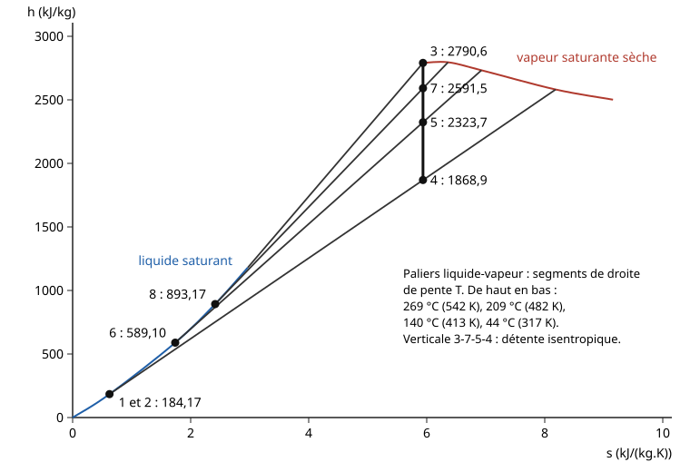
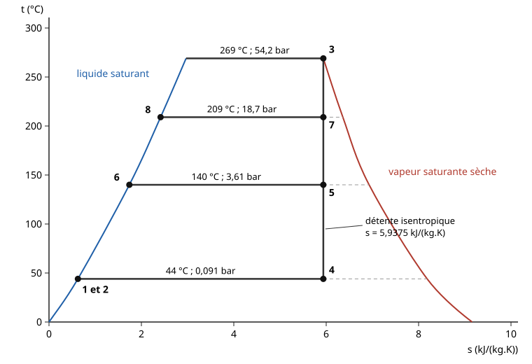

# Banque PT PT — Physique C - Thermodynamique 2008 · Corrigé brut

*Corrigé rédigé par IA, non officiel. Signalez toute erreur.*

**Rédaction** · modèle exact non renseigné (famille Claude) · effort non renseigné · vitesse non renseignée

**Révision (tour 2)** · modèle exact non renseigné (famille Claude) · effort non renseigné · vitesse non renseignée · 28 novembre 2026

Partie thermodynamique de l'épreuve de Physique C (4 heures pour les deux problèmes, chimie et thermodynamique, à barèmes identiques ; calculatrices autorisées) : étude du rendement thermique d'une installation motrice à vapeur sans surchauffe, simple puis à un ou deux soutirages, en 17 questions numérotées de 1 à 17 et réparties en cinq parties. Les 17 questions sont traitées. Les quatre premières parties sont littérales ; les valeurs numériques n'interviennent qu'aux questions 16 et 17. Elles sont lues dans la table de la vapeur d'eau saturée du sujet (page 17/17), sur les seules lignes 44 °C, 140 °C, 209 °C et 269 °C, sans interpolation et avec la précision d'affichage de la table (rappelées à la question 16). Les schémas n°1 à n°5 du sujet ne portent aucune graduation : aucune valeur n'y est lue. Le tableau n°6 du feuillet mobile n°2 est complété à la question 16. Les deux figures du corrigé sont tracées à partir des valeurs de la table. Convention : les travaux et les chaleurs sont comptés positivement quand ils sont reçus par le fluide ; à partir de la seconde partie, ils sont rapportés, comme le demande l'énoncé, à 1 kg de fluide traversant le condenseur.

[Sujet officiel (archive réunissant les deux parties de Physique C)](https://www.banquept.fr/documents/2008/phys_c_2008.zip) · [Rapport du jury](https://www.banquept.fr/documents/ecrit/rapport/2008/rapport_phys_c_ecrit_2008.pdf)

## Première partie — Installation simple, cycle de Rankine

### Question 1 — Organes statiques isobares, pompe isenthalpe

**Relation de départ.** Pour un fluide en écoulement permanent qui traverse un organe, le premier principe s'écrit, par unité de masse de fluide traversant l'organe, entre l'entrée $e$ et la sortie $s$ :

$$(h_s - h_e) + (e_{c,s} - e_{c,e}) + (e_{p,s} - e_{p,e}) = w_i + q$$

où $w_i$ est le travail indiqué massique (travail reçu des parties mobiles de la machine) et $q$ le transfert thermique massique reçu. Les variations d'énergie cinétique et potentielle sont négligées dans tout le problème, de sorte que

$$h_s - h_e = w_i + q$$

Entre deux sections infiniment voisines, la même relation s'écrit $\mathrm{d}h = \delta w_i + \delta q$.

**Organes statiques.** L'énoncé suppose les évolutions réversibles. Pour une évolution réversible du fluide, le second principe donne $\delta q = T\,\mathrm{d}s$. L'identité thermodynamique donne par ailleurs

$$\mathrm{d}h = T\,\mathrm{d}s + v\,\mathrm{d}P$$

En comparant avec $\mathrm{d}h = \delta w_i + \delta q$, il vient

$$\delta w_i = v\,\mathrm{d}P$$

Un organe statique (générateur de vapeur, condenseur, réchauffeur) ne comporte aucune pièce mobile : le fluide n'y reçoit aucun travail indiqué, $\delta w_i = 0$ sur chaque tranche. Comme le volume massique $v$ n'est pas nul,

$$\boxed{\mathrm{d}P = 0 \quad \text{: l'évolution dans un organe statique est isobare}}$$

Ce raisonnement ne suppose pas $\delta q = 0$ : dans un échangeur calorifugé, c'est l'ensemble de l'échangeur qui n'échange pas de chaleur avec l'extérieur, alors que chacun des deux fluides en reçoit ou en cède à l'autre. Il ne s'applique pas au détendeur, seul organe où l'évolution n'est pas réversible.

**Pompe.** L'évolution du liquide y est adiabatique, donc $q = 0$, et l'énoncé demande de négliger le travail indiqué massique de la pompe, $w_i \approx 0$. Le premier principe donne alors

$$\boxed{h_2 - h_1 = w_i + q \approx 0 \quad \text{: l'évolution dans la pompe est isenthalpe}}$$

**Ordre de grandeur (valeurs de la table, ligne 44 °C).** Le liquide étant quasi incompressible, le travail d'une pompe réversible est $w_i = \int v\,\mathrm{d}P \approx v'\,(P_2 - P_1)$. Avec $v' = 1{,}0094\times 10^{-3}\ \mathrm{m^3\cdot kg^{-1}}$, $P_2 = 54{,}2\ \mathrm{bar}$ et $P_1 = 0{,}091\ \mathrm{bar}$ :

$$w_i \approx 1{,}0094\times 10^{-3}\times(54{,}2 - 0{,}091)\times 10^{5} \approx 5{,}5\ \mathrm{kJ\cdot kg^{-1}}$$

C'est très petit devant les quelque $2600\ \mathrm{kJ\cdot kg^{-1}}$ reçus dans le générateur de vapeur : l'approximation est justifiée.

### Question 2 — Travail de la turbine, chaleur du générateur, rendement

Les grandeurs sont rapportées à 1 kg de fluide parcourant le cycle 1-2-3-4, et comptées positivement quand elles sont reçues par le fluide.

**Turbine (3 vers 4).** L'évolution est adiabatique, $q = 0$. Le premier principe en écoulement permanent, $h_4 - h_3 = w_{i,T} + q$, donne

$$\boxed{w_{i,T} = h_4 - h_3}$$

Ce travail est négatif : la turbine fournit le travail $h_3 - h_4 > 0$ à l'extérieur.

**Générateur de vapeur (2 vers 3).** Organe statique, $w_i = 0$. Le premier principe, $h_3 - h_2 = w_i + q_{2\text{-}3}$, donne

$$\boxed{q_{2\text{-}3} = h_3 - h_2}$$

Cette chaleur est positive (échauffement du liquide puis vaporisation totale).

**Rendement thermique.** C'est le rapport du travail net fourni par l'installation à la chaleur reçue de la source chaude. Le travail de la pompe étant négligé, le travail net fourni est $-w_{i,T}$ :

$$\eta_{th,0} = \frac{-w_{i,T}}{q_{2\text{-}3}}$$

$$\boxed{\eta_{th,0} = \frac{h_3 - h_4}{h_3 - h_2}}$$

**Contrôle.** Au condenseur, $q_{4\text{-}1} = h_1 - h_4 < 0$. Sur le cycle, la somme des énergies reçues vaut $(h_4 - h_3) + (h_3 - h_2) + (h_1 - h_4) = h_1 - h_2 = 0$, puisque la pompe est isenthalpe (question 1). Le rendement est bien compris entre 0 et 1, car $h_2 = h_1 < h_4 < h_3$.

## Seconde partie — Un soutirage, réintroduction en aval du réchauffeur

### Question 3 — Bilan enthalpique du réchauffeur

**Système.** On isole le système ouvert, en régime permanent, formé du réchauffeur, de la pompe secondaire et de la jonction où le liquide soutiré rejoint le circuit principal (schéma n°2 du sujet).

**Entrées et sorties, pour une masse unitaire traversant le condenseur.**

- Entrée du liquide principal, venant de la pompe principale : masse 1, enthalpie massique $h_2$.
- Entrée de la vapeur humide soutirée à la turbine : masse $x_1$, enthalpie massique $h_5$.
- Sortie vers le générateur de vapeur : la conservation de la masse en régime permanent impose la masse $1 + x_1$, à l'enthalpie massique $h_6$.

**Énergie échangée avec l'extérieur.** Le réchauffeur est calorifugé : pas de transfert thermique avec l'extérieur, $Q = 0$ (les deux fluides échangent de la chaleur entre eux, à l'intérieur du système). Le réchauffeur et la jonction n'ont pas de pièce mobile, et le travail de la pompe secondaire est négligé : $W_i = 0$.

**Premier principe en écoulement permanent.** Avec plusieurs entrées, et en négligeant les énergies cinétique et potentielle, il s'écrit : enthalpie sortante moins enthalpie entrante égale à $W_i + Q$. Donc

$$(1 + x_1)\,h_6 - \left(x_1\,h_5 + 1\times h_2\right) = 0$$

$$\boxed{(1 + x_1)\,h_6 = x_1\,h_5 + h_2}$$

**Détail organe par organe (contrôle).** Dans le réchauffeur seul, le liquide principal passe de $h_2$ à $h_6$ et le fluide soutiré de $h_5$ à l'état noté $\sim 6$ sur le schéma, liquide à la température $T_6$ : $1\times(h_6 - h_2) = x_1\,(h_5 - h_{\sim 6})$. L'enthalpie d'un liquide ne dépendant pratiquement que de sa température (rappel de l'énoncé avant la question 16), $h_{\sim 6} = h_6$ ; la pompe secondaire est isenthalpe (question 1) et la jonction mélange deux liquides de même enthalpie massique. On retrouve $(1 + x_1)\,h_6 = x_1\,h_5 + h_2$.

On en tire la masse soutirée :

$$x_1 = \frac{h_6 - h_2}{h_5 - h_6}$$

### Question 4 — Travail, chaleur et rendement avec un soutirage

Les grandeurs sont rapportées à l'installation définie par 1 kg de fluide entrant dans le condenseur (l'énoncé parle ici de « débit massique $x_1$ » : il s'agit de la masse $x_1$ soutirée pour 1 kg au condenseur). La turbine et le générateur de vapeur sont donc traversés par la masse $1 + x_1$.

**Turbine.** Elle est adiabatique, avec une entrée (point 3, masse $1 + x_1$) et deux sorties (point 5, masse $x_1$ ; point 4, masse 1). Le premier principe en écoulement permanent donne

$$w_{i,T} = x_1\,h_5 + h_4 - (1 + x_1)\,h_3$$

$$\boxed{w_{i,T} = -\left[(1 + x_1)(h_3 - h_5) + (h_5 - h_4)\right]}$$

La seconde écriture se lit directement : la masse $1 + x_1$ se détend de 3 à 5, puis la masse 1 se détend de 5 à 4. Ce travail est négatif.

**Générateur de vapeur.** Organe statique, traversé par la masse $1 + x_1$ qui passe de l'état 6 à l'état 3 :

$$\boxed{q_{6\text{-}3} = (1 + x_1)(h_3 - h_6)}$$

**Rendement.** Le travail des pompes étant négligé,

$$\eta_{th,1} = \frac{-w_{i,T}}{q_{6\text{-}3}}$$

$$\boxed{\eta_{th,1} = \frac{(1 + x_1)\,h_3 - x_1\,h_5 - h_4}{(1 + x_1)(h_3 - h_6)}}$$

### Question 5 — Amélioration du rendement

La question 3 donne $(1 + x_1)\,h_6 = x_1\,h_5 + h_2$. Le dénominateur de $\eta_{th,1}$ devient

$$(1 + x_1)\,h_3 - (1 + x_1)\,h_6 = (1 + x_1)\,h_3 - x_1\,h_5 - h_2 = (h_3 - h_2) + x_1\,(h_3 - h_5)$$

Le numérateur s'écrit de même

$$(1 + x_1)\,h_3 - x_1\,h_5 - h_4 = (h_3 - h_4) + x_1\,(h_3 - h_5)$$

$$\boxed{\eta_{th,1} = \frac{(h_3 - h_4) + x_1\,(h_3 - h_5)}{(h_3 - h_2) + x_1\,(h_3 - h_5)}}$$

**Comparaison avec $\eta_{th,0}$.** Posons $a = h_3 - h_4$, $b = h_3 - h_2$ et $c = x_1\,(h_3 - h_5)$, de sorte que $\eta_{th,0} = a/b$ et $\eta_{th,1} = (a + c)/(b + c)$.

- $c > 0$ : entre 3 et 5, la vapeur se détend de façon adiabatique dans la turbine en fournissant du travail, donc $h_5 - h_3 < 0$, soit $h_3 - h_5 > 0$ ; et $x_1 > 0$.
- $b > a > 0$ : $b - a = h_4 - h_2 = h_4 - h_1 > 0$, chaleur cédée au condenseur.

Alors

$$\frac{a + c}{b + c} - \frac{a}{b} = \frac{c\,(b - a)}{b\,(b + c)} > 0$$

$$\boxed{\eta_{th,1} > \eta_{th,0}}$$

On ajoute le même terme positif au numérateur et au dénominateur d'une fraction inférieure à 1 : elle augmente. Physiquement, la vapeur soutirée a travaillé de 3 à 5, et toute la chaleur qu'elle a reçue au générateur a été soit convertie en travail, soit rendue à l'eau d'alimentation : elle ne cède rien à la source froide.

## Troisième partie — Un soutirage, réintroduction en amont du réchauffeur

### Question 6 — Détendeur adiabatique

Le détendeur est un organe statique : il n'a pas de pièce mobile, donc le fluide n'y reçoit aucun travail indiqué, $w_i = 0$. Si l'évolution y est adiabatique, $q = 0$. Les variations d'énergie cinétique et potentielle étant négligées, le premier principe en écoulement permanent donne entre l'entrée et la sortie

$$h_s - h_e = w_i + q = 0$$

$$\boxed{h_s = h_e \quad \text{: la détente dans le détendeur est isenthalpe}}$$

L'évolution n'y est pas réversible (c'est la seule exception de l'énoncé) : la pression chute, et la conclusion « isobare » de la question 1, établie pour une évolution réversible, ne s'applique pas.

### Question 7 — Bilan enthalpique avec réintroduction en amont

**Lecture du schéma n°3 du sujet.** Le liquide soutiré, refroidi jusqu'à $T_1$ dans le réchauffeur, traverse le détendeur puis rejoint la conduite qui sort du condenseur, avant le point 1 et la pompe. La pompe et le côté froid du réchauffeur sont donc traversés par la masse $1 + y_1$.

**Système.** On isole le système ouvert, en régime permanent, formé de la jonction, de la pompe, du réchauffeur et du détendeur.

- Entrée du liquide saturant sortant du condenseur : masse 1, enthalpie massique $h_1$.
- Entrée de la vapeur humide soutirée : masse $y_1$, enthalpie massique $h_5$.
- Sortie vers le générateur de vapeur : masse $1 + y_1$ (conservation de la masse), enthalpie massique $h_6$.

Ce système est calorifugé ($Q = 0$) ; le réchauffeur, le détendeur et la jonction n'ont pas de pièce mobile et le travail de la pompe est négligé ($W_i = 0$). Le premier principe en écoulement permanent donne

$$(1 + y_1)\,h_6 = y_1\,h_5 + h_1$$

La pompe étant isenthalpe (question 1), $h_1 = h_2$, d'où

$$\boxed{(1 + y_1)\,h_6 = y_1\,h_5 + h_2}$$

**Détail (contrôle).** Dans le réchauffeur, la masse $1 + y_1$ passe de $h_2$ à $h_6$ et la masse $y_1$ de $h_5$ à l'état $\sim 1$, liquide à la température $T_1$, d'enthalpie $h_1 = h_2$ : $(1 + y_1)(h_6 - h_2) = y_1\,(h_5 - h_2)$, ce qui redonne la relation encadrée. Le détendeur est isenthalpe (question 6) : le liquide qui en sort a l'enthalpie $h_1$, comme celui qui sort du condenseur, et le mélange entre dans la pompe à l'enthalpie $h_1$.

**Comparaison.** C'est la relation de la question 3, avec $y_1$ à la place de $x_1$. Les états 2, 5 et 6 étant les mêmes dans les deux installations,

$$\boxed{y_1 = x_1 = \frac{h_6 - h_2}{h_5 - h_6}}$$

### Question 8 — Conséquence pour le rendement

Les masses soutirées sont égales, $y_1 = x_1$, et les états 3, 4, 5 et 6 sont les mêmes que dans la seconde partie. La turbine et le générateur de vapeur sont donc traversés par les mêmes masses entre les mêmes états :

$$w_{i,T} = -\left[(1 + y_1)(h_3 - h_5) + (h_5 - h_4)\right] \qquad q_{6\text{-}3} = (1 + y_1)(h_3 - h_6)$$

Ces expressions sont celles de la question 4. Le rendement thermique est donc exactement le même :

$$\boxed{\eta_{th} = \frac{(h_3 - h_4) + y_1\,(h_3 - h_5)}{(h_3 - h_2) + y_1\,(h_3 - h_5)} = \eta_{th,1}}$$

Dans ce modèle, où le travail des pompes est négligé, le mode de réintroduction du liquide soutiré (en aval par une pompe secondaire, ou en amont par un détendeur) ne change pas le rendement : le choix entre les deux montages relève de considérations techniques, pas du rendement thermique.

## Quatrième partie — Deux soutirages

### Question 9 — Bilan du premier réchauffeur

**Système.** On isole le système ouvert, en régime permanent, formé du réchauffeur n°1, de la pompe secondaire n°1 et de la jonction située en aval (schéma n°4 du sujet).

- Entrées : masse 1 venant de la pompe principale, à l'enthalpie $h_2$ ; masse $x_1$ soutirée au point 5, à l'enthalpie $h_5$.
- Sortie, après la jonction : masse $1 + x_1$, à l'enthalpie $h_6$ (sur le schéma n°4, le repère 6 est placé juste avant la jonction ; le liquide a la même enthalpie $h_6$ de part et d'autre, puisque le fluide soutiré sort du réchauffeur à la température $T_6$ et que la pompe secondaire est isenthalpe).

Le système est calorifugé ($Q = 0$), sans pièce mobile hormis la pompe dont le travail est négligé ($W_i = 0$). Le premier principe en écoulement permanent donne, comme à la question 3,

$$\boxed{(1 + x_1)\,h_6 = x_1\,h_5 + h_2}$$

**Commentaire.** La relation est exactement celle de l'installation à un seul soutirage. Le réchauffeur n°1 est placé en amont du réchauffeur n°2 sur le trajet de l'eau d'alimentation : son bilan ne fait intervenir que les états 2, 5 et 6, et ignore le second soutirage. La masse $x_1 = (h_6 - h_2)/(h_5 - h_6)$, rapportée à 1 kg traversant le condenseur, garde donc la même valeur que dans la seconde partie.

### Question 10 — Masse soutirée au second réchauffeur

**Système.** On isole le système ouvert, en régime permanent, formé du réchauffeur n°2, de la pompe secondaire n°2 et de la jonction située en aval.

- Entrées : masse $1 + x_1$ venant de la jonction située après le point 6, à l'enthalpie $h_6$ ; masse $x_2$ soutirée au point 7, à l'enthalpie $h_7$.
- Sortie, après la jonction, vers le générateur de vapeur : masse $1 + x_1 + x_2$ (conservation de la masse), à l'enthalpie $h_8$ du point 8.

Le système est calorifugé ($Q = 0$) et ne reçoit pas de travail ($W_i = 0$ : pas de pièce mobile, travail de la pompe négligé). Le fluide soutiré sort du réchauffeur à l'état liquide à la température $T_8$, donc à l'enthalpie $h_8$, que la pompe secondaire n°2 ne modifie pas. Le premier principe en écoulement permanent donne

$$(1 + x_1 + x_2)\,h_8 = (1 + x_1)\,h_6 + x_2\,h_7$$

$$\boxed{x_2 = (1 + x_1)\,\frac{h_8 - h_6}{h_7 - h_8}}$$

Le bilan n'est pas la simple répétition de celui de la question 9 : la masse de liquide à réchauffer est ici $1 + x_1$, et non plus 1.

### Question 11 — Travail, chaleur et rendement avec deux soutirages

Pour 1 kg entrant dans le condenseur, le générateur de vapeur et l'entrée de la turbine sont traversés par la masse $1 + x_1 + x_2$.

**Turbine.** Elle est adiabatique, avec une entrée (point 3, masse $1 + x_1 + x_2$) et trois sorties (point 7, masse $x_2$ ; point 5, masse $x_1$ ; point 4, masse 1). Le premier principe en écoulement permanent donne

$$w_{i,T} = x_2\,h_7 + x_1\,h_5 + h_4 - (1 + x_1 + x_2)\,h_3$$

$$\boxed{w_{i,T} = -\left[(1 + x_1 + x_2)(h_3 - h_7) + (1 + x_1)(h_7 - h_5) + (h_5 - h_4)\right]}$$

La seconde écriture suit la détente : masse $1 + x_1 + x_2$ de 3 à 7, masse $1 + x_1$ de 7 à 5, masse 1 de 5 à 4.

**Générateur de vapeur.** Organe statique, traversé par la masse $1 + x_1 + x_2$ qui passe de l'état 8 à l'état 3 :

$$\boxed{q_{8\text{-}3} = (1 + x_1 + x_2)(h_3 - h_8)}$$

**Rendement.**

$$\boxed{\eta_{th,2} = \frac{(1 + x_1 + x_2)\,h_3 - x_2\,h_7 - x_1\,h_5 - h_4}{(1 + x_1 + x_2)(h_3 - h_8)}}$$

### Question 12 — Amélioration par le second soutirage

Les questions 10 et 9 donnent successivement

$$(1 + x_1 + x_2)\,h_8 = (1 + x_1)\,h_6 + x_2\,h_7 = x_1\,h_5 + h_2 + x_2\,h_7$$

Le dénominateur de $\eta_{th,2}$ devient

$$(1 + x_1 + x_2)\,h_3 - x_1\,h_5 - x_2\,h_7 - h_2 = (h_3 - h_2) + x_1\,(h_3 - h_5) + x_2\,(h_3 - h_7)$$

et le numérateur s'écrit

$$(1 + x_1 + x_2)\,h_3 - x_2\,h_7 - x_1\,h_5 - h_4 = (h_3 - h_4) + x_1\,(h_3 - h_5) + x_2\,(h_3 - h_7)$$

$$\boxed{\eta_{th,2} = \frac{(h_3 - h_4) + x_1\,(h_3 - h_5) + x_2\,(h_3 - h_7)}{(h_3 - h_2) + x_1\,(h_3 - h_5) + x_2\,(h_3 - h_7)}}$$

**Comparaison avec $\eta_{th,1}$.** D'après la question 9, $x_1$ a la même valeur que dans l'installation à un soutirage. On passe donc de $\eta_{th,1} = a'/b'$ à $\eta_{th,2} = (a' + c')/(b' + c')$, avec $a' = (h_3 - h_4) + x_1(h_3 - h_5)$, $b' = (h_3 - h_2) + x_1(h_3 - h_5)$ et $c' = x_2\,(h_3 - h_7)$.

- $c' > 0$ : entre 3 et 7, la vapeur fournit du travail dans la turbine adiabatique, donc $h_3 - h_7 > 0$ ; et $x_2 > 0$.
- $b' - a' = h_4 - h_2 > 0$.

Le calcul de la question 5 s'applique :

$$\eta_{th,2} - \eta_{th,1} = \frac{c'\,(b' - a')}{b'\,(b' + c')} > 0$$

$$\boxed{\eta_{th,2} > \eta_{th,1} > \eta_{th,0}}$$

### Question 13 — Généralisation à n soutirages

Oui : on peut multiplier les soutirages, chacun alimentant un réchauffeur placé en aval du précédent sur le trajet de l'eau d'alimentation. Notons $x_k$ la masse soutirée au $k$-ième soutirage, pour 1 kg traversant le condenseur, et $h_{s,k}$ l'enthalpie massique de la vapeur humide à ce soutirage (ici $h_{s,1} = h_5$, $h_{s,2} = h_7$).

Les résultats des questions 5 et 12 ont la même structure : chaque soutirage ajoute le même terme $x_k\,(h_3 - h_{s,k})$ au numérateur et au dénominateur. On conjecture donc

$$\boxed{\eta_{th,n} = \frac{(h_3 - h_4) + \displaystyle\sum_{k=1}^{n} x_k\,(h_3 - h_{s,k})}{(h_3 - h_2) + \displaystyle\sum_{k=1}^{n} x_k\,(h_3 - h_{s,k})}}$$

Chaque terme ajouté étant positif, le rendement augmente à chaque soutirage supplémentaire : $\eta_{th,n} > \eta_{th,n-1}$, tout en restant inférieur à 1 puisque $h_3 - h_4 < h_3 - h_2$.

**Remarque (hors de ce qui est demandé).** Le rendement ne peut pas dépasser celui de Carnot entre les températures extrêmes $T_3$ et $T_1$ du cycle, $1 - T_1/T_3$. Les gains successifs ne peuvent donc pas rester importants : ici le premier soutirage apporte 2,6 points de rendement et le second 1,0 point seulement (question 17). Chaque soutirage se paie par un réchauffeur et une pompe de plus : le nombre de soutirages est un compromis technique et économique.

## Cinquième partie — Applications numériques

### Question 14 — Forme d'un palier dans le diagramme de Mollier

Le diagramme de Mollier porte l'entropie massique $s$ en abscisse et l'enthalpie massique $h$ en ordonnée. Sur un palier d'équilibre liquide-vapeur, la pression est constante, et la température l'est aussi, puisque la pression d'équilibre d'un corps pur diphasé ne dépend que de la température.

L'identité thermodynamique s'écrit

$$\mathrm{d}h = T\,\mathrm{d}s + v\,\mathrm{d}P$$

Le long du palier, $\mathrm{d}P = 0$, donc $\mathrm{d}h = T\,\mathrm{d}s$ avec $T$ constante :

$$\left(\frac{\partial h}{\partial s}\right)_{P} = T = \text{constante}$$

$$\boxed{\text{Le palier est un segment de droite, de } M' \text{ à } M'', \text{ de pente égale à la température absolue } T}$$

La pente est positive, et d'autant plus forte que la température (donc la pression) du palier est élevée : les paliers ne sont pas parallèles, ils s'ouvrent en éventail. En intégrant de $M'$ à $M''$, on obtient $h'' - h' = T\,(s'' - s')$.

**Contrôle avec la table du sujet (ligne 44 °C).** $(h'' - h')/(s'' - s') = 2397{,}3/(8{,}1842 - 0{,}6252) = 317{,}1\ \mathrm{K}$, soit bien $T = 317{,}15\ \mathrm{K}$.

La figure 1 est tracée par le corrigé à partir des valeurs $s'$, $h'$, $s''$, $h''$ lues dans la table du sujet aux lignes 0,01 °C, 44 °C, 140 °C, 209 °C et 269 °C ; les courbes de saturation, simplement lissées entre ces cinq points, s'arrêtent à 269 °C, dernière ligne de la table (le point critique n'y figure pas).

### Question 15 — Titre de vapeur

Le titre de vapeur $X(M)$ est la fraction massique de vapeur du système diphasé : pour 1 kg de mélange, la masse $X$ est à l'état de vapeur saturante sèche (état $M''$) et la masse $1 - X$ à l'état de liquide saturant (état $M'$). L'enthalpie et l'entropie étant des grandeurs extensives,

$$h(M) = (1 - X)\,h' + X\,h'' \qquad s(M) = (1 - X)\,s' + X\,s''$$

d'où les deux relations demandées (théorème des moments) :

$$\boxed{X(M) = \frac{h(M) - h'}{h'' - h'}}$$

$$\boxed{X(M) = \frac{s(M) - s'}{s'' - s'}}$$

Sur le schéma n°5 du sujet, $X(M)$ est le rapport des longueurs $M'M/M'M''$. On a $X = 0$ en $M'$ et $X = 1$ en $M''$.

### Question 16 — Tableau des états

**Valeurs lues dans la table du sujet (page 17/17).** Chaque valeur est lue directement sur une ligne de la table, sans interpolation, avec la précision d'affichage de la table.

| $t$ (°C) | $p$ (bar) | $h'$ (kJ/kg) | $h''$ (kJ/kg) | $h'' - h'$ (kJ/kg) | $s'$ (kJ/(kg·K)) | $s''$ (kJ/(kg·K)) |
|---|---|---|---|---|---|---|
| 44 | 0,09100 | 184,17 | 2581,5 | 2397,3 | 0,6252 | 8,1842 |
| 140 | 3,614 | 589,10 | 2733,1 | 2144,0 | 1,7390 | 6,9284 |
| 209 | 18,699 | 893,17 | 2795,7 | 1902,6 | 2,4153 | 6,3612 |
| 269 | 54,202 | 1180,1 | 2790,6 | 1610,5 | 2,9672 | 5,9375 |

Les pressions du tableau n°6 sont bien les pressions de saturation aux températures indiquées (la table donne 54,202 bar à 269 °C et 0,09100 bar à 44 °C, que le feuillet mobile arrondit à 54,2 et 0,091 bar). Les points 3, 4, 5, 7 et 1 sont donc sur des paliers ou sur les courbes de saturation.

**Point 1.** Liquide saturant à 44 °C : $X_1 = 0$, $h_1 = h'(44\ \text{°C}) = 184{,}17\ \mathrm{kJ\cdot kg^{-1}}$.

**Point 3.** Vapeur saturante sèche à 269 °C : $X_3 = 1$, $h_3 = h''(269\ \text{°C}) = 2790{,}6\ \mathrm{kJ\cdot kg^{-1}}$, et $s_3 = s''(269\ \text{°C}) = 5{,}9375\ \mathrm{kJ\cdot K^{-1}\cdot kg^{-1}}$.

**Points 7, 5 et 4.** La détente 3-7-5-4 est isentropique : $s_7 = s_5 = s_4 = s_3$. Chacun de ces points est un mélange liquide-vapeur ($s' < s_3 < s''$ à chaque température). La question 15 donne le titre par l'entropie, puis l'enthalpie par $h = h' + X\,(h'' - h')$.

$$X_7 = \frac{5{,}9375 - 2{,}4153}{6{,}3612 - 2{,}4153} = \frac{3{,}5222}{3{,}9459} = 0{,}89262 \qquad h_7 = 893{,}17 + 0{,}89262\times 1902{,}6 = 2591{,}5\ \mathrm{kJ\cdot kg^{-1}}$$

$$X_5 = \frac{5{,}9375 - 1{,}7390}{6{,}9284 - 1{,}7390} = \frac{4{,}1985}{5{,}1894} = 0{,}80905 \qquad h_5 = 589{,}10 + 0{,}80905\times 2144{,}0 = 2323{,}7\ \mathrm{kJ\cdot kg^{-1}}$$

$$X_4 = \frac{5{,}9375 - 0{,}6252}{8{,}1842 - 0{,}6252} = \frac{5{,}3123}{7{,}5590} = 0{,}70278 \qquad h_4 = 184{,}17 + 0{,}70278\times 2397{,}3 = 1868{,}9\ \mathrm{kJ\cdot kg^{-1}}$$

**Points 2, 6 et 8.** Ce sont des liquides à 54,2 bar, à des températures (44 °C, 140 °C, 209 °C) inférieures à la température de saturation à cette pression (269 °C) : liquide seul, sans vapeur, donc $X = 0$. Ces points ne sont pas sur un palier ; on leur attribue, comme le rappelle l'énoncé, l'enthalpie du liquide saturant de même température :

$$h_2 = h'(44\ \text{°C}) = 184{,}17 \qquad h_6 = h'(140\ \text{°C}) = 589{,}10 \qquad h_8 = h'(209\ \text{°C}) = 893{,}17\ \mathrm{kJ\cdot kg^{-1}}$$

On retrouve $h_2 = h_1$ : c'est la pompe isenthalpe de la question 1.

**Tableau n°6 complété.** Les titres y sont arrondis à trois chiffres.

| Point | 1 | 2 | 3 | 4 | 5 | 6 | 7 | 8 |
|---|---|---|---|---|---|---|---|---|
| $P$ (bar) | 0,091 | 54,2 | 54,2 | 0,091 | 3,614 | 54,2 | 18,699 | 54,2 |
| $T$ (°C) | 44 | 44 | 269 | 44 | 140 | 140 | 209 | 209 |
| Titre $X$ | 0 | **0** | 1 | **0,703** | **0,809** | **0** | **0,893** | **0** |
| $h$ (kJ/kg) | **184,17** | **184,17** | **2790,6** | **1868,9** | **2323,7** | **589,10** | **2591,5** | **893,17** |

Les valeurs en gras sont celles à porter sur le feuillet mobile n°2 ; les titres 0 du point 1 et 1 du point 3 y figurent déjà.

La figure 2 est tracée par le corrigé à partir des mêmes lignes de la table (courbes de saturation lissées entre les lignes 0,01 °C, 44 °C, 140 °C, 209 °C et 269 °C, arrêtées à 269 °C) : la détente est une verticale, et les points 2, 6 et 8, liquides sous 54,2 bar, y sont confondus avec le liquide saturant de même température, à l'échelle du tracé.

### Question 17 — Rendements et masses soutirées

Différences d'enthalpie utiles, d'après le tableau de la question 16 (en $\mathrm{kJ\cdot kg^{-1}}$) :

$$h_3 - h_4 = 921{,}7 \qquad h_3 - h_2 = 2606{,}43 \qquad h_3 - h_5 = 466{,}9 \qquad h_3 - h_7 = 199{,}1$$

**Installation simple (question 2).**

$$\eta_{th,0} = \frac{h_3 - h_4}{h_3 - h_2} = \frac{921{,}7}{2606{,}43}$$

$$\boxed{\eta_{th,0} = 0{,}354}$$

**Installation à un soutirage (questions 3 et 5).** Masse soutirée, pour 1 kg traversant le condenseur :

$$x_1 = \frac{h_6 - h_2}{h_5 - h_6} = \frac{589{,}10 - 184{,}17}{2323{,}7 - 589{,}10} = \frac{404{,}93}{1734{,}6}$$

$$\boxed{x_1 = 0{,}233\ \mathrm{kg}}$$

$$\eta_{th,1} = \frac{921{,}7 + 0{,}2334\times 466{,}9}{2606{,}43 + 0{,}2334\times 466{,}9} = \frac{1030{,}7}{2715{,}4}$$

$$\boxed{\eta_{th,1} = 0{,}380}$$

D'après les questions 7 et 8, l'installation du schéma n°3 a la même masse soutirée, $y_1 = 0{,}233\ \mathrm{kg}$, et le même rendement.

**Installation à deux soutirages (questions 9, 10 et 12).** La masse $x_1$ garde la même valeur, $0{,}233\ \mathrm{kg}$, et

$$x_2 = (1 + x_1)\,\frac{h_8 - h_6}{h_7 - h_8} = 1{,}2334\times\frac{893{,}17 - 589{,}10}{2591{,}5 - 893{,}17} = 1{,}2334\times\frac{304{,}07}{1698{,}3}$$

$$\boxed{x_2 = 0{,}221\ \mathrm{kg}}$$

$$\eta_{th,2} = \frac{921{,}7 + 0{,}2334\times 466{,}9 + 0{,}2208\times 199{,}1}{2606{,}43 + 0{,}2334\times 466{,}9 + 0{,}2208\times 199{,}1} = \frac{1074{,}6}{2759{,}4}$$

$$\boxed{\eta_{th,2} = 0{,}389}$$

**Récapitulatif.** Les masses soutirées sont rapportées à 1 kg de fluide traversant le condenseur.

| Installation | Masses soutirées | Rendement thermique |
|---|---|---|
| Simple | aucune | 0,354 |
| Un soutirage | $x_1 = 0{,}233\ \mathrm{kg}$ | 0,380 |
| Deux soutirages | $x_1 = 0{,}233\ \mathrm{kg}$, $x_2 = 0{,}221\ \mathrm{kg}$ | 0,389 |

**Contrôles.** Les formes non simplifiées des questions 4 et 11 redonnent les mêmes valeurs : $1030{,}7/\left[1{,}2334\times(2790{,}6 - 589{,}10)\right] = 0{,}380$ et $1074{,}6/\left[1{,}4543\times(2790{,}6 - 893{,}17)\right] = 0{,}389$. Les rendements croissent avec le nombre de soutirages, comme prévu aux questions 5 et 12, et restent inférieurs au rendement de Carnot entre 44 °C et 269 °C, $1 - 317{,}15/542{,}15 = 0{,}415$. Le premier soutirage fait gagner 2,6 points de rendement, le second 1,0 point de plus.
