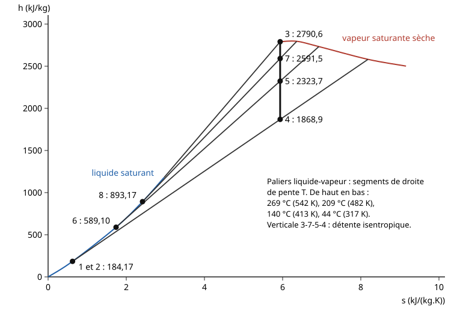
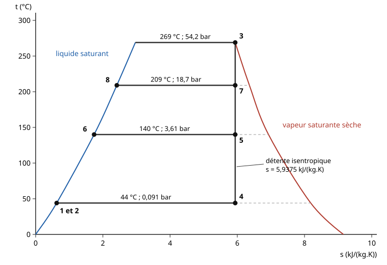

# Banque PT PT — Physique C - Thermodynamique 2008 · Corrigé guidé

*Corrigé rédigé par IA, non officiel. Signalez toute erreur.*

**Rédaction** · modèle exact non renseigné (famille Claude) · effort non renseigné · vitesse non renseignée

## Présentation du sujet

**Thème.** Rendement thermique d'une installation motrice à vapeur d'eau (centrale thermique ou nucléaire), sans surchauffe, et gain apporté par un ou deux soutirages de vapeur à la turbine. L'épreuve de Physique C dure 4 heures pour deux problèmes, chimie et thermodynamique, aux barèmes identiques : le sujet conseille d'y consacrer le même temps, soit 2 heures pour cette partie. **Calculatrices autorisées.** Le problème de thermodynamique comporte 17 questions numérotées de 1 à 17, en cinq parties, et un feuillet mobile (tableau n°6) à rendre avec la copie.

- *Première partie (questions 1 et 2)* : installation simple, cycle de Rankine ; évolutions isobares et isenthalpes, rendement.
- *Seconde partie (questions 3 à 5)* : un soutirage, liquide réintroduit en aval du réchauffeur par une pompe secondaire.
- *Troisième partie (questions 6 à 8)* : un soutirage, liquide réintroduit en amont par un détendeur.
- *Quatrième partie (questions 9 à 13)* : deux soutirages, puis généralisation à n soutirages.
- *Cinquième partie (questions 14 à 17)* : diagramme de Mollier, titre de vapeur, lecture de la table, applications numériques.

**Notions mobilisées.** Premier principe pour un fluide en écoulement permanent, y compris pour un système à plusieurs entrées et sorties ; second principe pour une évolution réversible ; identité thermodynamique $\mathrm{d}h = T\,\mathrm{d}s + v\,\mathrm{d}P$ ; changement d'état liquide-vapeur d'un corps pur, titre de vapeur, théorème des moments ; rendement d'un moteur.

**Documents à lire.** La table de la vapeur d'eau saturée de la page 17/17 du sujet, dont seules quatre lignes servent (44 °C, 140 °C, 209 °C et 269 °C) : on y lit sans interpolation $h'$, $h''$, $h'' - h'$, $s'$ et $s''$. Les schémas n°1 à n°4 décrivent les installations et doivent être lus avec soin (masses qui circulent dans chaque branche, points notés $\sim 6$, $\sim 8$ et $\sim 1$, états de même température que les points 6, 8 et 1 mais de pression différente). Le schéma n°5 est un diagramme de Mollier sans graduation.

**Difficulté.** Les calculs sont courts ; ce sont les démonstrations qui sont notées. Presque tout repose sur une seule relation, $\Delta h = w_i + q$, appliquée à un système bien choisi. Les questions 5 et 12 demandent une vraie comparaison de fractions, et la question 16 une méthode sûre (entropie, titre, enthalpie).

**Gestion du temps.** Environ 20 minutes pour la première partie, 25 minutes pour la seconde, 15 minutes pour la troisième, 25 minutes pour la quatrième et 35 minutes pour la cinquième. La cinquième partie est indépendante des démonstrations : les questions 14 à 16 peuvent être traitées dès le début.

> [!JURY]
> Le rapport 2008 relève une grande confusion dans les notations : beaucoup de candidats ne distinguent pas $\mathrm{d}$, $\delta$ et $\Delta$, et ne vérifient pas l'homogénéité de leurs formules (il cite $\Delta h = \delta w_i + \delta q$ et $\mathrm{d}s = q/T$). Il demande de respecter les conventions de la thermodynamique : majuscules et minuscules sont employées de façon aléatoire ($H$ ou $h$, $Q$ ou $q$), la température absolue est parfois notée $t$, la pression $p$, et des notations sont utilisées sans que leur signification soit précisée. Certains candidats invoquent constamment le premier principe pour un système ouvert en écoulement permanent sans jamais l'écrire en entier. Le rapport rappelle que l'objectif n'est pas de retrouver le bon résultat par n'importe quelle méthode mais de le démontrer correctement, et que le barème en tient largement compte.

[Sujet officiel (archive réunissant les deux parties de Physique C)](https://www.banquept.fr/documents/2008/phys_c_2008.zip) · [Rapport du jury](https://www.banquept.fr/documents/ecrit/rapport/2008/rapport_phys_c_ecrit_2008.pdf)

*Mode d'emploi* : chercher chaque question seul, lire la première indication en cas de blocage, réessayer, puis la seconde, et seulement ensuite la solution. Convention : les travaux et les chaleurs sont comptés positivement quand ils sont reçus par le fluide ; à partir de la seconde partie, ils sont rapportés, comme le demande l'énoncé, à 1 kg de fluide traversant le condenseur.

## Première partie — Installation simple, cycle de Rankine

### Question 1 — Organes statiques isobares, pompe isenthalpe

> [!INDICATION]
> Écrire une fois, en entier, le premier principe pour un fluide en écoulement permanent, puis sa forme entre deux sections voisines. Que vaut le travail indiqué dans un organe sans pièce mobile ?

> [!INDICATION]
> Pour une évolution réversible, $\delta q = T\,\mathrm{d}s$. Comparer le premier principe à l'identité thermodynamique $\mathrm{d}h = T\,\mathrm{d}s + v\,\mathrm{d}P$ : il reste $\delta w_i = v\,\mathrm{d}P$. Pour la pompe, relire les hypothèses de l'énoncé : $q$ et $w_i$ y sont tous deux nuls ou négligés.

#### Solution

**Relation de départ.** Pour un fluide en écoulement permanent qui traverse un organe, le premier principe s'écrit, par unité de masse de fluide traversant l'organe, entre l'entrée $e$ et la sortie $s$ :

$$(h_s - h_e) + (e_{c,s} - e_{c,e}) + (e_{p,s} - e_{p,e}) = w_i + q$$

où $w_i$ est le travail indiqué massique (travail reçu des parties mobiles de la machine) et $q$ le transfert thermique massique reçu. Les variations d'énergie cinétique et potentielle sont négligées dans tout le problème, de sorte que

$$h_s - h_e = w_i + q$$

Entre deux sections infiniment voisines, la même relation s'écrit $\mathrm{d}h = \delta w_i + \delta q$.

**Organes statiques.** L'énoncé suppose les évolutions réversibles. Pour une évolution réversible du fluide, le second principe donne $\delta q = T\,\mathrm{d}s$. L'identité thermodynamique donne par ailleurs

$$\mathrm{d}h = T\,\mathrm{d}s + v\,\mathrm{d}P$$

En comparant avec $\mathrm{d}h = \delta w_i + \delta q$, il vient

$$\delta w_i = v\,\mathrm{d}P$$

Un organe statique (générateur de vapeur, condenseur, réchauffeur) ne comporte aucune pièce mobile : le fluide n'y reçoit aucun travail indiqué, $\delta w_i = 0$ sur chaque tranche. Comme le volume massique $v$ n'est pas nul,

$$\boxed{\mathrm{d}P = 0 \quad \text{: l'évolution dans un organe statique est isobare}}$$

Ce raisonnement ne suppose pas $\delta q = 0$ : dans un échangeur calorifugé, c'est l'ensemble de l'échangeur qui n'échange pas de chaleur avec l'extérieur, alors que chacun des deux fluides en reçoit ou en cède à l'autre. Il ne s'applique pas au détendeur, seul organe où l'évolution n'est pas réversible.

**Pompe.** L'évolution du liquide y est adiabatique, donc $q = 0$, et l'énoncé demande de négliger le travail indiqué massique de la pompe, $w_i \approx 0$. Le premier principe donne alors

$$\boxed{h_2 - h_1 = w_i + q \approx 0 \quad \text{: l'évolution dans la pompe est isenthalpe}}$$

**Ordre de grandeur (valeurs de la table, ligne 44 °C).** Le liquide étant quasi incompressible, le travail d'une pompe réversible est $w_i = \int v\,\mathrm{d}P \approx v'\,(P_2 - P_1)$. Avec $v' = 1{,}0094\times 10^{-3}\ \mathrm{m^3\cdot kg^{-1}}$, $P_2 = 54{,}2\ \mathrm{bar}$ et $P_1 = 0{,}091\ \mathrm{bar}$ :

$$w_i \approx 1{,}0094\times 10^{-3}\times(54{,}2 - 0{,}091)\times 10^{5} \approx 5{,}5\ \mathrm{kJ\cdot kg^{-1}}$$

C'est très petit devant les quelque $2600\ \mathrm{kJ\cdot kg^{-1}}$ reçus dans le générateur de vapeur : l'approximation est justifiée.

> [!JURY]
> Le rapport relève peu de démonstrations rigoureuses à cette question. Il signale des confusions entre adiabatique et isentropique, et entre échangeur calorifugé et évolution adiabatique d'un des flux. Il regrette que certaines relations soient employées comme des résultats fondamentaux, le plus souvent sous la forme « on sait que $\delta w_i = v\,\mathrm{d}P$ », et note l'apparition de la loi de Joule ($\mathrm{d}h = c_p\,\mathrm{d}T$) et de la loi de Laplace. Dans son commentaire général, il reproche à certains candidats de se référer sans cesse au premier principe pour un système ouvert en écoulement permanent sans jamais l'écrire complètement une fois dans la copie.

> [!PIEGE]
> L'eau n'est pas un gaz parfait : ni $\mathrm{d}h = c_p\,\mathrm{d}T$ ni la loi de Laplace ne s'appliquent à un fluide qui change d'état. Dans le générateur de vapeur, l'enthalpie varie beaucoup à température constante pendant la vaporisation.

### Question 2 — Travail de la turbine, chaleur du générateur, rendement

> [!INDICATION]
> Appliquer $\Delta h = w_i + q$ à la turbine (adiabatique), puis au générateur de vapeur (sans pièce mobile).

> [!INDICATION]
> Le rendement d'un moteur est le rapport de ce que l'on récupère (travail fourni, positif) à ce que l'on dépense (chaleur reçue de la source chaude). Le travail de la pompe est négligé.

#### Solution

Les grandeurs sont rapportées à 1 kg de fluide parcourant le cycle 1-2-3-4, et comptées positivement quand elles sont reçues par le fluide.

**Turbine (3 vers 4).** L'évolution est adiabatique, $q = 0$. Le premier principe en écoulement permanent, $h_4 - h_3 = w_{i,T} + q$, donne

$$\boxed{w_{i,T} = h_4 - h_3}$$

Ce travail est négatif : la turbine fournit le travail $h_3 - h_4 > 0$ à l'extérieur.

**Générateur de vapeur (2 vers 3).** Organe statique, $w_i = 0$. Le premier principe, $h_3 - h_2 = w_i + q_{2\text{-}3}$, donne

$$\boxed{q_{2\text{-}3} = h_3 - h_2}$$

Cette chaleur est positive (échauffement du liquide puis vaporisation totale).

**Rendement thermique.** C'est le rapport du travail net fourni par l'installation à la chaleur reçue de la source chaude. Le travail de la pompe étant négligé, le travail net fourni est $-w_{i,T}$ :

$$\eta_{th,0} = \frac{-w_{i,T}}{q_{2\text{-}3}}$$

$$\boxed{\eta_{th,0} = \frac{h_3 - h_4}{h_3 - h_2}}$$

**Contrôle.** Au condenseur, $q_{4\text{-}1} = h_1 - h_4 < 0$. Sur le cycle, la somme des énergies reçues vaut $(h_4 - h_3) + (h_3 - h_2) + (h_1 - h_4) = h_1 - h_2 = 0$, puisque la pompe est isenthalpe (question 1). Le rendement est bien compris entre 0 et 1, car $h_2 = h_1 < h_4 < h_3$.

> [!JURY]
> Le rapport note que, trop souvent, les résultats de cette question ne sont pas correctement démontrés, et qu'une fois sur deux la définition du rendement est fausse (signe erroné ou rapport inversé).

> [!METHODE]
> Pour chaque organe : nommer l'entrée et la sortie, écrire $\Delta h = w_i + q$, puis annuler $q$ (évolution adiabatique) ou $w_i$ (pas de pièce mobile) en donnant l'argument. Le signe du résultat se contrôle par le sens physique : une turbine fournit du travail, un générateur de vapeur fournit de la chaleur au fluide.

## Seconde partie — Un soutirage, réintroduction en aval du réchauffeur

### Question 3 — Bilan enthalpique du réchauffeur

> [!INDICATION]
> Choisir un système ouvert qui englobe le réchauffeur, la pompe secondaire et la jonction : il a deux entrées et une sortie. Quelles masses les traversent, pour 1 kg passant dans le condenseur ?

> [!INDICATION]
> Ce système ne reçoit ni chaleur de l'extérieur (calorifugé) ni travail (pas de pièce mobile, pompe négligée) : l'enthalpie qui entre est égale à l'enthalpie qui sort.

#### Solution

**Système.** On isole le système ouvert, en régime permanent, formé du réchauffeur, de la pompe secondaire et de la jonction où le liquide soutiré rejoint le circuit principal (schéma n°2 du sujet).

**Entrées et sorties, pour une masse unitaire traversant le condenseur.**

- Entrée du liquide principal, venant de la pompe principale : masse 1, enthalpie massique $h_2$.
- Entrée de la vapeur humide soutirée à la turbine : masse $x_1$, enthalpie massique $h_5$.
- Sortie vers le générateur de vapeur : la conservation de la masse en régime permanent impose la masse $1 + x_1$, à l'enthalpie massique $h_6$.

**Énergie échangée avec l'extérieur.** Le réchauffeur est calorifugé : pas de transfert thermique avec l'extérieur, $Q = 0$ (les deux fluides échangent de la chaleur entre eux, à l'intérieur du système). Le réchauffeur et la jonction n'ont pas de pièce mobile, et le travail de la pompe secondaire est négligé : $W_i = 0$.

**Premier principe en écoulement permanent.** Avec plusieurs entrées, et en négligeant les énergies cinétique et potentielle, il s'écrit : enthalpie sortante moins enthalpie entrante égale à $W_i + Q$. Donc

$$(1 + x_1)\,h_6 - \left(x_1\,h_5 + 1\times h_2\right) = 0$$

$$\boxed{(1 + x_1)\,h_6 = x_1\,h_5 + h_2}$$

**Détail organe par organe (contrôle).** Dans le réchauffeur seul, le liquide principal passe de $h_2$ à $h_6$ et le fluide soutiré de $h_5$ à l'état noté $\sim 6$ sur le schéma, liquide à la température $T_6$ : $1\times(h_6 - h_2) = x_1\,(h_5 - h_{\sim 6})$. L'enthalpie d'un liquide ne dépendant pratiquement que de sa température (rappel de l'énoncé avant la question 16), $h_{\sim 6} = h_6$ ; la pompe secondaire est isenthalpe (question 1) et la jonction mélange deux liquides de même enthalpie massique. On retrouve $(1 + x_1)\,h_6 = x_1\,h_5 + h_2$.

On en tire la masse soutirée :

$$x_1 = \frac{h_6 - h_2}{h_5 - h_6}$$

> [!JURY]
> Le rapport constate, en général, peu de démonstrations rigoureuses : le système isolé n'est pas précisé, le premier principe est évoqué sans être écrit, et le résultat est souvent seulement justifié par « la loi des nœuds » ou « la conservation du débit masse ».

> [!PIEGE]
> La conservation de la masse donne $1 + x_1$ à la sortie, mais ne dit rien des enthalpies : la relation demandée est un bilan d'énergie. Il faut donc dire pourquoi $Q = 0$ et $W_i = 0$ pour le système choisi.

### Question 4 — Travail, chaleur et rendement avec un soutirage

> [!INDICATION]
> Quelle masse traverse la turbine entre 3 et 5 ? entre 5 et 4 ? Et le générateur de vapeur ?

> [!INDICATION]
> Appliquer le premier principe à la turbine entière, système adiabatique à une entrée et deux sorties : travail reçu égal à enthalpie sortante moins enthalpie entrante.

#### Solution

Les grandeurs sont rapportées à l'installation définie par 1 kg de fluide entrant dans le condenseur (l'énoncé parle ici de « débit massique $x_1$ » : il s'agit de la masse $x_1$ soutirée pour 1 kg au condenseur). La turbine et le générateur de vapeur sont donc traversés par la masse $1 + x_1$.

**Turbine.** Elle est adiabatique, avec une entrée (point 3, masse $1 + x_1$) et deux sorties (point 5, masse $x_1$ ; point 4, masse 1). Le premier principe en écoulement permanent donne

$$w_{i,T} = x_1\,h_5 + h_4 - (1 + x_1)\,h_3$$

$$\boxed{w_{i,T} = -\left[(1 + x_1)(h_3 - h_5) + (h_5 - h_4)\right]}$$

La seconde écriture se lit directement : la masse $1 + x_1$ se détend de 3 à 5, puis la masse 1 se détend de 5 à 4. Ce travail est négatif.

**Générateur de vapeur.** Organe statique, traversé par la masse $1 + x_1$ qui passe de l'état 6 à l'état 3 :

$$\boxed{q_{6\text{-}3} = (1 + x_1)(h_3 - h_6)}$$

**Rendement.** Le travail des pompes étant négligé,

$$\eta_{th,1} = \frac{-w_{i,T}}{q_{6\text{-}3}}$$

$$\boxed{\eta_{th,1} = \frac{(1 + x_1)\,h_3 - x_1\,h_5 - h_4}{(1 + x_1)(h_3 - h_6)}}$$

> [!JURY]
> Le rapport renvoie aux remarques de la question 2 (démonstrations insuffisantes, définition du rendement fausse une fois sur deux). Il ajoute que, malgré l'hypothèse mise en gras dans l'énoncé et annoncée par « important », certains candidats ont raisonné sur une masse unitaire entrant dans le générateur de vapeur ou dans la turbine, et que certains résultats, erronés, ne respectent pas la conservation du débit masse.

### Question 5 — Amélioration du rendement

> [!INDICATION]
> Remplacer $(1 + x_1)\,h_6$ dans le dénominateur, puis faire apparaître $h_3 - h_4$, $h_3 - h_2$ et $h_3 - h_5$.

> [!INDICATION]
> On obtient une fraction de la forme $(a + c)/(b + c)$ avec $a < b$ et $c > 0$. La comparer à $a/b$ en formant la différence. Justifier le signe de $h_3 - h_5$ par le fonctionnement de la turbine.

#### Solution

La question 3 donne $(1 + x_1)\,h_6 = x_1\,h_5 + h_2$. Le dénominateur de $\eta_{th,1}$ devient

$$(1 + x_1)\,h_3 - (1 + x_1)\,h_6 = (1 + x_1)\,h_3 - x_1\,h_5 - h_2 = (h_3 - h_2) + x_1\,(h_3 - h_5)$$

Le numérateur s'écrit de même

$$(1 + x_1)\,h_3 - x_1\,h_5 - h_4 = (h_3 - h_4) + x_1\,(h_3 - h_5)$$

$$\boxed{\eta_{th,1} = \frac{(h_3 - h_4) + x_1\,(h_3 - h_5)}{(h_3 - h_2) + x_1\,(h_3 - h_5)}}$$

**Comparaison avec $\eta_{th,0}$.** Posons $a = h_3 - h_4$, $b = h_3 - h_2$ et $c = x_1\,(h_3 - h_5)$, de sorte que $\eta_{th,0} = a/b$ et $\eta_{th,1} = (a + c)/(b + c)$.

- $c > 0$ : entre 3 et 5, la vapeur se détend de façon adiabatique dans la turbine en fournissant du travail, donc $h_5 - h_3 < 0$, soit $h_3 - h_5 > 0$ ; et $x_1 > 0$.
- $b > a > 0$ : $b - a = h_4 - h_2 = h_4 - h_1 > 0$, chaleur cédée au condenseur.

Alors

$$\frac{a + c}{b + c} - \frac{a}{b} = \frac{c\,(b - a)}{b\,(b + c)} > 0$$

$$\boxed{\eta_{th,1} > \eta_{th,0}}$$

On ajoute le même terme positif au numérateur et au dénominateur d'une fraction inférieure à 1 : elle augmente. Physiquement, la vapeur soutirée a travaillé de 3 à 5, et toute la chaleur qu'elle a reçue au générateur a été soit convertie en travail, soit rendue à l'eau d'alimentation : elle ne cède rien à la source froide.

> [!JURY]
> Le rapport indique que cette question est rarement traitée correctement : toutes les justifications sont avancées pour affirmer que le rendement s'améliore, au point que $h_3 - h_5$ devient parfois négatif.

> [!METHODE]
> Pour comparer $(a + c)/(b + c)$ à $a/b$, former la différence et la réduire au même dénominateur : le signe se lit sur $c\,(b - a)$. C'est plus sûr qu'un argument qualitatif.

## Troisième partie — Un soutirage, réintroduction en amont du réchauffeur

### Question 6 — Détendeur adiabatique

> [!INDICATION]
> Même démarche qu'à la question 2 : écrire $\Delta h = w_i + q$ et examiner chacun des deux termes.

> [!INDICATION]
> Le détendeur n'a pas de pièce mobile. L'argument ne fait intervenir aucune propriété particulière du fluide.

#### Solution

Le détendeur est un organe statique : il n'a pas de pièce mobile, donc le fluide n'y reçoit aucun travail indiqué, $w_i = 0$. Si l'évolution y est adiabatique, $q = 0$. Les variations d'énergie cinétique et potentielle étant négligées, le premier principe en écoulement permanent donne entre l'entrée et la sortie

$$h_s - h_e = w_i + q = 0$$

$$\boxed{h_s = h_e \quad \text{: la détente dans le détendeur est isenthalpe}}$$

L'évolution n'y est pas réversible (c'est la seule exception de l'énoncé) : la pression chute, et la conclusion « isobare » de la question 1, établie pour une évolution réversible, ne s'applique pas.

> [!JURY]
> Le rapport juge cette question généralement bien traitée, mais relève l'argument faux selon lequel l'évolution serait isenthalpe parce qu'elle est isotherme et que $\mathrm{d}h = c_p\,\mathrm{d}T$.

### Question 7 — Bilan enthalpique avec réintroduction en amont

> [!INDICATION]
> Bien lire le schéma n°3 : où le liquide soutiré rejoint-il le circuit principal ? Quelle masse traverse la pompe et le côté froid du réchauffeur ?

> [!INDICATION]
> Isoler l'ensemble jonction, pompe, réchauffeur et détendeur : deux entrées (condenseur, soutirage), une sortie (point 6), ni chaleur ni travail reçus de l'extérieur. Utiliser ensuite $h_1 = h_2$.

#### Solution

**Lecture du schéma n°3 du sujet.** Le liquide soutiré, refroidi jusqu'à $T_1$ dans le réchauffeur, traverse le détendeur puis rejoint la conduite qui sort du condenseur, avant le point 1 et la pompe. La pompe et le côté froid du réchauffeur sont donc traversés par la masse $1 + y_1$.

**Système.** On isole le système ouvert, en régime permanent, formé de la jonction, de la pompe, du réchauffeur et du détendeur.

- Entrée du liquide saturant sortant du condenseur : masse 1, enthalpie massique $h_1$.
- Entrée de la vapeur humide soutirée : masse $y_1$, enthalpie massique $h_5$.
- Sortie vers le générateur de vapeur : masse $1 + y_1$ (conservation de la masse), enthalpie massique $h_6$.

Ce système est calorifugé ($Q = 0$) ; le réchauffeur, le détendeur et la jonction n'ont pas de pièce mobile et le travail de la pompe est négligé ($W_i = 0$). Le premier principe en écoulement permanent donne

$$(1 + y_1)\,h_6 = y_1\,h_5 + h_1$$

La pompe étant isenthalpe (question 1), $h_1 = h_2$, d'où

$$\boxed{(1 + y_1)\,h_6 = y_1\,h_5 + h_2}$$

**Détail (contrôle).** Dans le réchauffeur, la masse $1 + y_1$ passe de $h_2$ à $h_6$ et la masse $y_1$ de $h_5$ à l'état $\sim 1$, liquide à la température $T_1$, d'enthalpie $h_1 = h_2$ : $(1 + y_1)(h_6 - h_2) = y_1\,(h_5 - h_2)$, ce qui redonne la relation encadrée. Le détendeur est isenthalpe (question 6) : le liquide qui en sort a l'enthalpie $h_1$, comme celui qui sort du condenseur, et le mélange entre dans la pompe à l'enthalpie $h_1$.

**Comparaison.** C'est la relation de la question 3, avec $y_1$ à la place de $x_1$. Les états 2, 5 et 6 étant les mêmes dans les deux installations,

$$\boxed{y_1 = x_1 = \frac{h_6 - h_2}{h_5 - h_6}}$$

> [!JURY]
> Le rapport renvoie ici aux remarques de la question 3 : démonstrations peu rigoureuses, système non précisé, premier principe évoqué sans être écrit, résultat justifié par « la loi des nœuds » ou « la conservation du débit masse ».

### Question 8 — Conséquence pour le rendement

> [!INDICATION]
> Comparer les masses qui traversent la turbine et le générateur de vapeur, et les états extrêmes, dans les installations des schémas n°2 et n°3.

> [!INDICATION]
> Si le travail de la turbine et la chaleur reçue au générateur ont les mêmes expressions avec $y_1 = x_1$, que dire du rendement ? Conclure par une égalité, pas par une ressemblance.

#### Solution

Les masses soutirées sont égales, $y_1 = x_1$, et les états 3, 4, 5 et 6 sont les mêmes que dans la seconde partie. La turbine et le générateur de vapeur sont donc traversés par les mêmes masses entre les mêmes états :

$$w_{i,T} = -\left[(1 + y_1)(h_3 - h_5) + (h_5 - h_4)\right] \qquad q_{6\text{-}3} = (1 + y_1)(h_3 - h_6)$$

Ces expressions sont celles de la question 4. Le rendement thermique est donc exactement le même :

$$\boxed{\eta_{th} = \frac{(h_3 - h_4) + y_1\,(h_3 - h_5)}{(h_3 - h_2) + y_1\,(h_3 - h_5)} = \eta_{th,1}}$$

Dans ce modèle, où le travail des pompes est négligé, le mode de réintroduction du liquide soutiré (en aval par une pompe secondaire, ou en amont par un détendeur) ne change pas le rendement : le choix entre les deux montages relève de considérations techniques, pas du rendement thermique.

> [!JURY]
> Le rapport relève des réponses évasives (le rendement « ressemble au précédent », il aurait « une forme pratiquement identique ») ou une discussion limitée à la comparaison de $x_1$ et $y_1$.

## Quatrième partie — Deux soutirages

### Question 9 — Bilan du premier réchauffeur

> [!INDICATION]
> Isoler le réchauffeur n°1 avec sa pompe secondaire et sa jonction : ses entrées et sa sortie sont-elles modifiées par la présence du second réchauffeur ?

> [!INDICATION]
> Le bilan est celui de la question 3. Le commentaire attendu porte sur la valeur de $x_1$ par rapport à l'installation à un soutirage.

#### Solution

**Système.** On isole le système ouvert, en régime permanent, formé du réchauffeur n°1, de la pompe secondaire n°1 et de la jonction située en aval (schéma n°4 du sujet).

- Entrées : masse 1 venant de la pompe principale, à l'enthalpie $h_2$ ; masse $x_1$ soutirée au point 5, à l'enthalpie $h_5$.
- Sortie : masse $1 + x_1$ au point 6, à l'enthalpie $h_6$.

Le système est calorifugé ($Q = 0$), sans pièce mobile hormis la pompe dont le travail est négligé ($W_i = 0$). Le premier principe en écoulement permanent donne, comme à la question 3,

$$\boxed{(1 + x_1)\,h_6 = x_1\,h_5 + h_2}$$

**Commentaire.** La relation est exactement celle de l'installation à un seul soutirage. Le réchauffeur n°1 est placé en amont du réchauffeur n°2 sur le trajet de l'eau d'alimentation : son bilan ne fait intervenir que les états 2, 5 et 6, et ignore le second soutirage. La masse $x_1 = (h_6 - h_2)/(h_5 - h_6)$, rapportée à 1 kg traversant le condenseur, garde donc la même valeur que dans la seconde partie.

> [!JURY]
> Selon le rapport, cette question est traitée correctement lorsqu'elle est abordée.

### Question 10 — Masse soutirée au second réchauffeur

> [!INDICATION]
> Même système qu'à la question 9, autour du réchauffeur n°2. Attention à la masse de liquide qui y entre par le point 6.

> [!INDICATION]
> Écrire que l'enthalpie entrante, $(1 + x_1)\,h_6 + x_2\,h_7$, est égale à l'enthalpie sortante, puis isoler $x_2$.

#### Solution

**Système.** On isole le système ouvert, en régime permanent, formé du réchauffeur n°2, de la pompe secondaire n°2 et de la jonction située en aval.

- Entrées : masse $1 + x_1$ venant du point 6, à l'enthalpie $h_6$ ; masse $x_2$ soutirée au point 7, à l'enthalpie $h_7$.
- Sortie : masse $1 + x_1 + x_2$ (conservation de la masse) au point 8, à l'enthalpie $h_8$.

Le système est calorifugé ($Q = 0$) et ne reçoit pas de travail ($W_i = 0$ : pas de pièce mobile, travail de la pompe négligé). Le fluide soutiré sort du réchauffeur à l'état liquide à la température $T_8$, donc à l'enthalpie $h_8$, que la pompe secondaire n°2 ne modifie pas. Le premier principe en écoulement permanent donne

$$(1 + x_1 + x_2)\,h_8 = (1 + x_1)\,h_6 + x_2\,h_7$$

$$\boxed{x_2 = (1 + x_1)\,\frac{h_8 - h_6}{h_7 - h_8}}$$

Le bilan n'est pas la simple répétition de celui de la question 9 : la masse de liquide à réchauffer est ici $1 + x_1$, et non plus 1.

> [!JURY]
> Selon le rapport, cette question est traitée correctement lorsqu'elle est abordée, mais souvent seulement justifiée par un « comme précédemment » qui n'était pas toujours correct.

### Question 11 — Travail, chaleur et rendement avec deux soutirages

> [!INDICATION]
> Suivre la vapeur dans la turbine : quelle masse se détend de 3 à 7, de 7 à 5, de 5 à 4 ?

> [!INDICATION]
> Turbine adiabatique à une entrée et trois sorties : travail reçu égal à enthalpie sortante moins enthalpie entrante. Générateur : masse $1 + x_1 + x_2$, de l'état 8 à l'état 3.

#### Solution

Pour 1 kg entrant dans le condenseur, le générateur de vapeur et l'entrée de la turbine sont traversés par la masse $1 + x_1 + x_2$.

**Turbine.** Elle est adiabatique, avec une entrée (point 3, masse $1 + x_1 + x_2$) et trois sorties (point 7, masse $x_2$ ; point 5, masse $x_1$ ; point 4, masse 1). Le premier principe en écoulement permanent donne

$$w_{i,T} = x_2\,h_7 + x_1\,h_5 + h_4 - (1 + x_1 + x_2)\,h_3$$

$$\boxed{w_{i,T} = -\left[(1 + x_1 + x_2)(h_3 - h_7) + (1 + x_1)(h_7 - h_5) + (h_5 - h_4)\right]}$$

La seconde écriture suit la détente : masse $1 + x_1 + x_2$ de 3 à 7, masse $1 + x_1$ de 7 à 5, masse 1 de 5 à 4.

**Générateur de vapeur.** Organe statique, traversé par la masse $1 + x_1 + x_2$ qui passe de l'état 8 à l'état 3 :

$$\boxed{q_{8\text{-}3} = (1 + x_1 + x_2)(h_3 - h_8)}$$

**Rendement.**

$$\boxed{\eta_{th,2} = \frac{(1 + x_1 + x_2)\,h_3 - x_2\,h_7 - x_1\,h_5 - h_4}{(1 + x_1 + x_2)(h_3 - h_8)}}$$

> [!JURY]
> Le rapport renvoie aux remarques de la question 4 : résultats insuffisamment démontrés, raisonnement sur une masse unitaire entrant dans le générateur ou la turbine malgré la consigne de l'énoncé, résultats ne respectant pas la conservation du débit masse.

### Question 12 — Amélioration par le second soutirage

> [!INDICATION]
> Enchaîner les relations des questions 10 et 9 pour exprimer $(1 + x_1 + x_2)\,h_8$ sans $h_6$ ni $h_8$.

> [!INDICATION]
> Le résultat a la même structure qu'à la question 5, avec un terme $x_2\,(h_3 - h_7)$ en plus au numérateur et au dénominateur. L'argument de comparaison n'est valable que parce que $x_1$ n'a pas changé (question 9).

#### Solution

Les questions 10 et 9 donnent successivement

$$(1 + x_1 + x_2)\,h_8 = (1 + x_1)\,h_6 + x_2\,h_7 = x_1\,h_5 + h_2 + x_2\,h_7$$

Le dénominateur de $\eta_{th,2}$ devient

$$(1 + x_1 + x_2)\,h_3 - x_1\,h_5 - x_2\,h_7 - h_2 = (h_3 - h_2) + x_1\,(h_3 - h_5) + x_2\,(h_3 - h_7)$$

et le numérateur s'écrit

$$(1 + x_1 + x_2)\,h_3 - x_2\,h_7 - x_1\,h_5 - h_4 = (h_3 - h_4) + x_1\,(h_3 - h_5) + x_2\,(h_3 - h_7)$$

$$\boxed{\eta_{th,2} = \frac{(h_3 - h_4) + x_1\,(h_3 - h_5) + x_2\,(h_3 - h_7)}{(h_3 - h_2) + x_1\,(h_3 - h_5) + x_2\,(h_3 - h_7)}}$$

**Comparaison avec $\eta_{th,1}$.** D'après la question 9, $x_1$ a la même valeur que dans l'installation à un soutirage. On passe donc de $\eta_{th,1} = a'/b'$ à $\eta_{th,2} = (a' + c')/(b' + c')$, avec $a' = (h_3 - h_4) + x_1(h_3 - h_5)$, $b' = (h_3 - h_2) + x_1(h_3 - h_5)$ et $c' = x_2\,(h_3 - h_7)$.

- $c' > 0$ : entre 3 et 7, la vapeur fournit du travail dans la turbine adiabatique, donc $h_3 - h_7 > 0$ ; et $x_2 > 0$.
- $b' - a' = h_4 - h_2 > 0$.

Le calcul de la question 5 s'applique :

$$\eta_{th,2} - \eta_{th,1} = \frac{c'\,(b' - a')}{b'\,(b' + c')} > 0$$

$$\boxed{\eta_{th,2} > \eta_{th,1} > \eta_{th,0}}$$

> [!JURY]
> Le rapport renvoie aux remarques de la question 5 : question rarement traitée correctement, amélioration du rendement affirmée avec des justifications de toute sorte.

### Question 13 — Généralisation à n soutirages

> [!INDICATION]
> Comparer les expressions des questions 5 et 12 : qu'ajoute chaque soutirage au numérateur et au dénominateur ?

> [!INDICATION]
> Introduire une notation indexée pour la masse soutirée et l'enthalpie de chaque soutirage, puis écrire une somme sur les n soutirages.

#### Solution

Oui : on peut multiplier les soutirages, chacun alimentant un réchauffeur placé en aval du précédent sur le trajet de l'eau d'alimentation. Notons $x_k$ la masse soutirée au $k$-ième soutirage, pour 1 kg traversant le condenseur, et $h_{s,k}$ l'enthalpie massique de la vapeur humide à ce soutirage (ici $h_{s,1} = h_5$, $h_{s,2} = h_7$).

Les résultats des questions 5 et 12 ont la même structure : chaque soutirage ajoute le même terme $x_k\,(h_3 - h_{s,k})$ au numérateur et au dénominateur. On conjecture donc

$$\boxed{\eta_{th,n} = \frac{(h_3 - h_4) + \displaystyle\sum_{k=1}^{n} x_k\,(h_3 - h_{s,k})}{(h_3 - h_2) + \displaystyle\sum_{k=1}^{n} x_k\,(h_3 - h_{s,k})}}$$

Chaque terme ajouté étant positif, le rendement augmente à chaque soutirage supplémentaire : $\eta_{th,n} > \eta_{th,n-1}$, tout en restant inférieur à 1 puisque $h_3 - h_4 < h_3 - h_2$.

**Remarque (hors de ce qui est demandé).** Le rendement ne peut pas dépasser celui de Carnot entre les températures extrêmes $T_3$ et $T_1$ du cycle, $1 - T_1/T_3$. Le gain apporté par chaque nouveau soutirage va donc en diminuant, et il se paie par un réchauffeur et une pompe de plus : le nombre de soutirages est un compromis technique et économique.

> [!JURY]
> Le rapport note que la réponse se résume généralement à une affirmation accompagnée d'une discussion technique plus ou moins pertinente, et que peu de candidats proposent une expression correcte du rendement, avec l'indice $n$.

## Cinquième partie — Applications numériques

### Question 14 — Forme d'un palier dans le diagramme de Mollier

> [!INDICATION]
> Quelles grandeurs intensives restent constantes pendant un changement d'état d'un corps pur à l'équilibre ? Les nommer toutes les deux.

> [!INDICATION]
> Écrire l'identité thermodynamique pour l'enthalpie, $\mathrm{d}h = T\,\mathrm{d}s + v\,\mathrm{d}P$, le long du palier : que vaut la pente $\mathrm{d}h/\mathrm{d}s$ ?

#### Solution

Le diagramme de Mollier porte l'entropie massique $s$ en abscisse et l'enthalpie massique $h$ en ordonnée. Sur un palier d'équilibre liquide-vapeur, la pression est constante, et la température l'est aussi, puisque la pression d'équilibre d'un corps pur diphasé ne dépend que de la température.

L'identité thermodynamique s'écrit

$$\mathrm{d}h = T\,\mathrm{d}s + v\,\mathrm{d}P$$

Le long du palier, $\mathrm{d}P = 0$, donc $\mathrm{d}h = T\,\mathrm{d}s$ avec $T$ constante :

$$\left(\frac{\partial h}{\partial s}\right)_{P} = T = \text{constante}$$

$$\boxed{\text{Le palier est un segment de droite, de } M' \text{ à } M'', \text{ de pente égale à la température absolue } T}$$

La pente est positive, et d'autant plus forte que la température (donc la pression) du palier est élevée : les paliers ne sont pas parallèles, ils s'ouvrent en éventail. En intégrant de $M'$ à $M''$, on obtient $h'' - h' = T\,(s'' - s')$.

**Contrôle avec la table du sujet (ligne 44 °C).** $(h'' - h')/(s'' - s') = 2397{,}3/(8{,}1842 - 0{,}6252) = 317{,}1\ \mathrm{K}$, soit bien $T = 317{,}15\ \mathrm{K}$.

La figure 1 est tracée par le corrigé à partir des valeurs $s'$, $h'$, $s''$, $h''$ lues dans la table du sujet aux lignes 0,01 °C, 44 °C, 140 °C, 209 °C et 269 °C ; les courbes de saturation, simplement lissées entre ces cinq points, s'arrêtent à 269 °C, dernière ligne de la table (le point critique n'y figure pas).

> [!JURY]
> Le rapport juge cette question généralement bien traitée, mais note que certains candidats oublient de préciser que $P$ et $T$ sont ici constantes, et signale quelques confusions entre le diagramme de Mollier et le diagramme $(T, s)$, voire $(h, \log P)$.

> [!PIEGE]
> Dans le diagramme $(T, s)$, le palier est horizontal ; dans le diagramme de Mollier, il est incliné, de pente $T$. Le schéma n°5 du sujet montre bien un segment incliné.

### Question 15 — Titre de vapeur

> [!INDICATION]
> Le titre est la fraction massique de vapeur. Écrire l'enthalpie de 1 kg de mélange comme la somme des enthalpies de sa partie liquide et de sa partie vapeur.

> [!INDICATION]
> Faire de même avec l'entropie, puis isoler $X$ dans chaque relation.

#### Solution

Le titre de vapeur $X(M)$ est la fraction massique de vapeur du système diphasé : pour 1 kg de mélange, la masse $X$ est à l'état de vapeur saturante sèche (état $M''$) et la masse $1 - X$ à l'état de liquide saturant (état $M'$). L'enthalpie et l'entropie étant des grandeurs extensives,

$$h(M) = (1 - X)\,h' + X\,h'' \qquad s(M) = (1 - X)\,s' + X\,s''$$

d'où les deux relations demandées (théorème des moments) :

$$\boxed{X(M) = \frac{h(M) - h'}{h'' - h'}}$$

$$\boxed{X(M) = \frac{s(M) - s'}{s'' - s'}}$$

Sur le schéma n°5 du sujet, $X(M)$ est le rapport des longueurs $M'M/M'M''$. On a $X = 0$ en $M'$ et $X = 1$ en $M''$.

> [!JURY]
> Selon le rapport, cette question est traitée correctement par la majorité des candidats.

### Question 16 — Tableau des états

> [!INDICATION]
> Deux points sont immédiats : le point 1 (liquide saturant) et le point 3 (vapeur saturante sèche). Lire aussi $s_3$ dans la table : c'est la clé de la suite.

> [!INDICATION]
> La détente est isentropique : $s_7 = s_5 = s_4 = s_3$. À chaque température, en déduire le titre par l'entropie (question 15), puis l'enthalpie. Pour les points 2, 6 et 8, comparer la température à la température de saturation sous 54,2 bar.

#### Solution

**Valeurs lues dans la table du sujet (page 17/17).** Chaque valeur est lue directement sur une ligne de la table, sans interpolation, avec la précision d'affichage de la table.

| $t$ (°C) | $p$ (bar) | $h'$ (kJ/kg) | $h''$ (kJ/kg) | $h'' - h'$ (kJ/kg) | $s'$ (kJ/(kg·K)) | $s''$ (kJ/(kg·K)) |
|---|---|---|---|---|---|---|
| 44 | 0,09100 | 184,17 | 2581,5 | 2397,3 | 0,6252 | 8,1842 |
| 140 | 3,614 | 589,10 | 2733,1 | 2144,0 | 1,7390 | 6,9284 |
| 209 | 18,699 | 893,17 | 2795,7 | 1902,6 | 2,4153 | 6,3612 |
| 269 | 54,202 | 1180,1 | 2790,6 | 1610,5 | 2,9672 | 5,9375 |

Les pressions du tableau n°6 sont bien les pressions de saturation aux températures indiquées (la table donne 54,202 bar à 269 °C et 0,09100 bar à 44 °C, que le feuillet mobile arrondit à 54,2 et 0,091 bar). Les points 3, 4, 5, 7 et 1 sont donc sur des paliers ou sur les courbes de saturation.

**Point 1.** Liquide saturant à 44 °C : $X_1 = 0$, $h_1 = h'(44\ \text{°C}) = 184{,}17\ \mathrm{kJ\cdot kg^{-1}}$.

**Point 3.** Vapeur saturante sèche à 269 °C : $X_3 = 1$, $h_3 = h''(269\ \text{°C}) = 2790{,}6\ \mathrm{kJ\cdot kg^{-1}}$, et $s_3 = s''(269\ \text{°C}) = 5{,}9375\ \mathrm{kJ\cdot K^{-1}\cdot kg^{-1}}$.

**Points 7, 5 et 4.** La détente 3-7-5-4 est isentropique : $s_7 = s_5 = s_4 = s_3$. Chacun de ces points est un mélange liquide-vapeur ($s' < s_3 < s''$ à chaque température). La question 15 donne le titre par l'entropie, puis l'enthalpie par $h = h' + X\,(h'' - h')$.

$$X_7 = \frac{5{,}9375 - 2{,}4153}{6{,}3612 - 2{,}4153} = \frac{3{,}5222}{3{,}9459} = 0{,}89262 \qquad h_7 = 893{,}17 + 0{,}89262\times 1902{,}6 = 2591{,}5\ \mathrm{kJ\cdot kg^{-1}}$$

$$X_5 = \frac{5{,}9375 - 1{,}7390}{6{,}9284 - 1{,}7390} = \frac{4{,}1985}{5{,}1894} = 0{,}80905 \qquad h_5 = 589{,}10 + 0{,}80905\times 2144{,}0 = 2323{,}7\ \mathrm{kJ\cdot kg^{-1}}$$

$$X_4 = \frac{5{,}9375 - 0{,}6252}{8{,}1842 - 0{,}6252} = \frac{5{,}3123}{7{,}5590} = 0{,}70278 \qquad h_4 = 184{,}17 + 0{,}70278\times 2397{,}3 = 1868{,}9\ \mathrm{kJ\cdot kg^{-1}}$$

**Points 2, 6 et 8.** Ce sont des liquides à 54,2 bar, à des températures (44 °C, 140 °C, 209 °C) inférieures à la température de saturation à cette pression (269 °C) : liquide seul, sans vapeur, donc $X = 0$. Ces points ne sont pas sur un palier ; on leur attribue, comme le rappelle l'énoncé, l'enthalpie du liquide saturant de même température :

$$h_2 = h'(44\ \text{°C}) = 184{,}17 \qquad h_6 = h'(140\ \text{°C}) = 589{,}10 \qquad h_8 = h'(209\ \text{°C}) = 893{,}17\ \mathrm{kJ\cdot kg^{-1}}$$

On retrouve $h_2 = h_1$ : c'est la pompe isenthalpe de la question 1.

**Tableau n°6 complété.** Les titres y sont arrondis à trois chiffres.

| Point | 1 | 2 | 3 | 4 | 5 | 6 | 7 | 8 |
|---|---|---|---|---|---|---|---|---|
| $P$ (bar) | 0,091 | 54,2 | 54,2 | 0,091 | 3,614 | 54,2 | 18,699 | 54,2 |
| $T$ (°C) | 44 | 44 | 269 | 44 | 140 | 140 | 209 | 209 |
| Titre $X$ | 0 | **0** | 1 | **0,703** | **0,809** | **0** | **0,893** | **0** |
| $h$ (kJ/kg) | **184,17** | **184,17** | **2790,6** | **1868,9** | **2323,7** | **589,10** | **2591,5** | **893,17** |

Les valeurs en gras sont celles à porter sur le feuillet mobile n°2 ; les titres 0 du point 1 et 1 du point 3 y figurent déjà.

La figure 2 est tracée par le corrigé à partir des mêmes lignes de la table (courbes de saturation lissées entre les lignes 0,01 °C, 44 °C, 140 °C, 209 °C et 269 °C, arrêtées à 269 °C) : la détente est une verticale, et les points 2, 6 et 8, liquides sous 54,2 bar, y sont confondus avec le liquide saturant de même température, à l'échelle du tracé.

> [!JURY]
> Le rapport indique qu'en général seules deux valeurs numériques étaient correctes ($h_1$ et $h_3$), et que certains candidats ont rendu un tableau correct sauf pour le titre de vapeur des points 2, 6 et 8.

> [!METHODE]
> Pour un point d'une détente isentropique qui aboutit dans le domaine diphasé : entropie connue, titre par $X = (s - s')/(s'' - s')$, puis enthalpie par $h = h' + X\,(h'' - h')$. On ne peut pas lire $h_4$, $h_5$ ou $h_7$ directement dans la table : ce ne sont ni des liquides saturants ni des vapeurs saturantes sèches.

### Question 17 — Rendements et masses soutirées

> [!INDICATION]
> Calculer d'abord les différences $h_3 - h_4$, $h_3 - h_2$, $h_3 - h_5$ et $h_3 - h_7$, puis les masses $x_1$ (question 3) et $x_2$ (question 10).

> [!INDICATION]
> Utiliser les formes simplifiées des questions 2, 5 et 12. Contrôle : les trois rendements doivent croître avec le nombre de soutirages et rester inférieurs à $1 - T_1/T_3$, avec les températures en kelvins.

#### Solution

Différences d'enthalpie utiles, d'après le tableau de la question 16 (en $\mathrm{kJ\cdot kg^{-1}}$) :

$$h_3 - h_4 = 921{,}7 \qquad h_3 - h_2 = 2606{,}43 \qquad h_3 - h_5 = 466{,}9 \qquad h_3 - h_7 = 199{,}1$$

**Installation simple (question 2).**

$$\eta_{th,0} = \frac{h_3 - h_4}{h_3 - h_2} = \frac{921{,}7}{2606{,}43}$$

$$\boxed{\eta_{th,0} = 0{,}354}$$

**Installation à un soutirage (questions 3 et 5).** Masse soutirée, pour 1 kg traversant le condenseur :

$$x_1 = \frac{h_6 - h_2}{h_5 - h_6} = \frac{589{,}10 - 184{,}17}{2323{,}7 - 589{,}10} = \frac{404{,}93}{1734{,}6}$$

$$\boxed{x_1 = 0{,}233\ \mathrm{kg}}$$

$$\eta_{th,1} = \frac{921{,}7 + 0{,}2334\times 466{,}9}{2606{,}43 + 0{,}2334\times 466{,}9} = \frac{1030{,}7}{2715{,}4}$$

$$\boxed{\eta_{th,1} = 0{,}380}$$

D'après les questions 7 et 8, l'installation du schéma n°3 a la même masse soutirée, $y_1 = 0{,}233\ \mathrm{kg}$, et le même rendement.

**Installation à deux soutirages (questions 9, 10 et 12).** La masse $x_1$ garde la même valeur, $0{,}233\ \mathrm{kg}$, et

$$x_2 = (1 + x_1)\,\frac{h_8 - h_6}{h_7 - h_8} = 1{,}2334\times\frac{893{,}17 - 589{,}10}{2591{,}5 - 893{,}17} = 1{,}2334\times\frac{304{,}07}{1698{,}3}$$

$$\boxed{x_2 = 0{,}221\ \mathrm{kg}}$$

$$\eta_{th,2} = \frac{921{,}7 + 0{,}2334\times 466{,}9 + 0{,}2208\times 199{,}1}{2606{,}43 + 0{,}2334\times 466{,}9 + 0{,}2208\times 199{,}1} = \frac{1074{,}6}{2759{,}4}$$

$$\boxed{\eta_{th,2} = 0{,}389}$$

**Récapitulatif.** Les masses soutirées sont rapportées à 1 kg de fluide traversant le condenseur.

| Installation | Masses soutirées | Rendement thermique |
|---|---|---|
| Simple | aucune | 0,354 |
| Un soutirage | $x_1 = 0{,}233\ \mathrm{kg}$ | 0,380 |
| Deux soutirages | $x_1 = 0{,}233\ \mathrm{kg}$, $x_2 = 0{,}221\ \mathrm{kg}$ | 0,389 |

**Contrôles.** Les formes non simplifiées des questions 4 et 11 redonnent les mêmes valeurs : $1030{,}7/\left[1{,}2334\times(2790{,}6 - 589{,}10)\right] = 0{,}380$ et $1074{,}6/\left[1{,}4543\times(2790{,}6 - 893{,}17)\right] = 0{,}389$. Les rendements croissent avec le nombre de soutirages, comme prévu aux questions 5 et 12, et restent inférieurs au rendement de Carnot entre 44 °C et 269 °C, $1 - 317{,}15/542{,}15 = 0{,}415$. Le premier soutirage fait gagner 2,6 points de rendement, le second 1,0 point de plus.

> [!JURY]
> Le rapport décrit cette question comme une simple application numérique, dépendante de la précédente, et s'étonne que des rendements supérieurs à un n'aient pas interpellé leur auteur.

> [!PIEGE]
> Les masses $x_1$ et $x_2$ sont rapportées à 1 kg traversant le condenseur, pas à 1 kg de vapeur produite. Rapportées à la vapeur sortant du générateur, les fractions soutirées sont $x_1/(1 + x_1 + x_2) = 0{,}161$ et $x_2/(1 + x_1 + x_2) = 0{,}152$ dans l'installation à deux soutirages.

## Bilan

**Résultats à retenir.**

| Grandeur | Résultat |
|---|---|
| Organe statique, évolution réversible (question 1) | $\delta w_i = v\,\mathrm{d}P = 0$ : évolution isobare |
| Rendement du cycle de Rankine (question 2) | $\eta_{th,0} = (h_3 - h_4)/(h_3 - h_2)$ |
| Bilan d'un réchauffeur (questions 3, 7 et 9) | $(1 + x_1)\,h_6 = x_1\,h_5 + h_2$ |
| Second réchauffeur (question 10) | $x_2 = (1 + x_1)(h_8 - h_6)/(h_7 - h_8)$ |
| Rendement à n soutirages (questions 5, 12 et 13) | on ajoute $\sum x_k\,(h_3 - h_{s,k})$ au numérateur et au dénominateur de $\eta_{th,0}$ |
| Palier dans le diagramme de Mollier (question 14) | segment de droite de pente $T$ |
| Titre de vapeur (question 15) | $X = (h - h')/(h'' - h') = (s - s')/(s'' - s')$ |
| Enthalpies de la détente (question 16) | $h_7 = 2591{,}5$, $h_5 = 2323{,}7$, $h_4 = 1868{,}9\ \mathrm{kJ\cdot kg^{-1}}$ |
| Rendements (question 17) | $0{,}354$ ; $0{,}380$ ; $0{,}389$, avec $x_1 = 0{,}233\ \mathrm{kg}$ et $x_2 = 0{,}221\ \mathrm{kg}$ |

**Méthodes à retenir.**

- Écrire une fois en entier le premier principe en écoulement permanent, puis l'appliquer organe par organe en justifiant chaque terme nul : $q = 0$ (adiabatique), $w_i = 0$ (pas de pièce mobile).
- Pour un organe à plusieurs entrées et sorties (réchauffeur, turbine à soutirages) : définir le système, faire le bilan de masse, puis écrire que l'enthalpie sortante moins l'enthalpie entrante vaut le travail et la chaleur reçus de l'extérieur.
- Détente isentropique aboutissant dans le domaine diphasé : entropie, puis titre, puis enthalpie.
- Comparer deux rendements en formant leur différence.

**Points de vigilance.**

- Un échangeur calorifugé n'échange pas de chaleur avec l'extérieur, mais chacun de ses deux fluides en échange avec l'autre.
- Adiabatique ne veut pas dire isentropique : le détendeur est adiabatique et irréversible.
- L'eau qui change d'état n'est pas un gaz parfait : pas de $\mathrm{d}h = c_p\,\mathrm{d}T$, pas de loi de Laplace.
- Les masses soutirées sont rapportées à 1 kg traversant le condenseur.
- Un rendement doit être compris entre 0 et 1, et ici inférieur au rendement de Carnot (0,415).
