# Banque PT 2008 — Sciences industrielles A · Corrigé guidé

*Corrigé rédigé par IA, non officiel. Signalez toute erreur.*

**Rédaction** · GPT-6.2 Astra Ultra · vitesse non renseignée · 27 novembre 2026

**Révision (tour 1)** · GPT-6.2 Astra Ultra · vitesse non renseignée · 27 novembre 2026

**Révision (tour 2)** · GPT-6.2 Astra Ultra · vitesse non renseignée · 27 novembre 2026

Le système de distribution automobile décale la rotation de l’arbre à cames par rapport à la poulie entraînée par le vilebrequin. Le sujet compte quatre parties et 51 questions. Les références au cahier donnent la page physique de son PDF de six planches. Les figures 1 à 12 du cahier sont identifiées par leur numéro imprimé.

[Sujet et cahier officiels](https://www.banquept.fr/documents/2008/si_a_2008.zip) · [Rapport du jury](https://www.banquept.fr/documents/ecrit/rapport/2008/rapport_si_a_ecrit_2008.pdf)

Le rapport insiste sur le choix du système isolé, les unités et le parcours orienté du lieu de Black. Les bilans ci-dessous distinguent les efforts aux deux contacts, la vitesse de la came de celle du vilebrequin et les six combinaisons d’entrée absentes des tableaux de Karnaugh.

## I — Fonction de service et chaîne de déphasage

### Question 1 — Fonctions et phases de vie

> [!INDICATION]
> Partir de la phase de vie nommée au-dessus de la figure I.1.

#### Solution

Les éléments extérieurs délimitent le système et les échanges qu’il doit assurer. Un critère, un niveau et une flexibilité rendent une fonction vérifiable, par exemple la précision d’un calage dans une plage de régime. Montage, accélération, entretien ou fin de vie mobilisent des acteurs et imposent des contraintes différents. Un diagramme par phase fait apparaître ces changements.

[Archive officielle, fichier sujet p. 9](https://www.banquept.fr/documents/2008/si_a_2008.zip)

### Question 2 — Du calculateur à l’arbre à cames

> [!INDICATION]
> Suivre séparément la consigne, la puissance hydraulique et l’entraînement de la poulie.

#### Solution

L’électronique compare la consigne au déphasage déduit des deux positions et commande l’électro-aimant. Le servo-distributeur module puis oriente le débit d’huile sous pression. Le vérin convertit ce débit et la différence de pression en translation du piston. Les cannelures superposent le déphasage à la rotation reçue de la poulie pour entraîner l’arbre sous le couple résistant. Les fuites sortent de la partie hydraulique. La figure complète les flux intermédiaires de la figure 1.

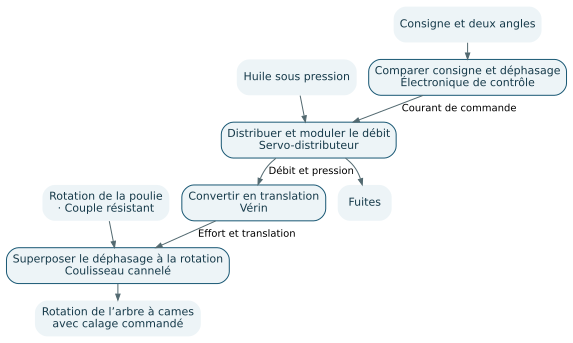

[Archive officielle, fichier sujet p. 9 · fichier cahier p. 2](https://www.banquept.fr/documents/2008/si_a_2008.zip)

## II — Distribution, affolement et liaison hélicoïdale

### Question 3 — Référentiel galiléen

> [!INDICATION]
> Énoncer le principe d’inertie pour le centre de masse.

#### Solution

Dans un référentiel galiléen, le centre de masse d’un système isolé ou de résultante extérieure nulle conserve son vecteur vitesse. La loi $\sum\vec F=m\vec a_G$ y prend sa forme usuelle. Un référentiel en translation rectiligne uniforme par rapport à lui est également galiléen.

[Archive officielle, fichier sujet p. 10](https://www.banquept.fr/documents/2008/si_a_2008.zip)

### Question 4 — Accélération du véhicule

> [!INDICATION]
> Convertir la vitesse finale en mètres par seconde et la masse en kilogrammes.

#### Solution

$a=(100/3,6)/5,7=4,87$ m/s². Pour la soupape, l’inertie d’entraînement vaut $0,055a=0,268$ N, dirigée à l’opposé de l’accélération. Le rapport à 1500 N vaut $1,79\times10^{-4}$. Pendant cette translation rectiligne, négliger ce terme dans le référentiel de la culasse est donc justifié à l’échelle des charges étudiées.

### Question 5 — Déphasage et démultiplication

> [!INDICATION]
> Compter les tours nécessaires à un cycle moteur complet.

#### Solution

L’admission et l’échappement se reproduisent après deux tours du vilebrequin et un tour de la came. La poulie tourne avec $\theta_1=\theta_v/2$ aux origines choisies. En ajoutant le décalage piloté $\Delta\theta=\theta_2-\theta_1$, on obtient $\theta_2=\theta_v/2+\Delta\theta$ et $\lambda=1/2$.

### Question 6 — Réaction au contact soupape–linguet

> [!INDICATION]
> Projeter le bilan sur la verticale orientée vers le haut. La levée est positive vers le bas.

#### Solution

Sur 7, la force du ressort vaut $F_0+kh+(m_8/3)\ddot h$ vers le haut et le linguet exerce $-F_E$. L’accélération projetée vaut $-\ddot h$. La liaison de guidage parfaite ne transmet aucune force axiale. Ainsi $F_E=F_0+kh+m_{\rm eq}\ddot h$, avec $m_{\rm eq}=m_7+m_8/3$.

### Question 7 — Moment dynamique en B

> [!INDICATION]
> Distinguer rotation propre du galet et mouvement de son centre C.

#### Solution

B est fixe. Le linguet apporte $I_6\dot\theta_6$, le transport du centre C apporte $m_5\ell^2\dot\theta_6$ et la rotation absolue du galet apporte $I_5(\dot\theta_5+\dot\theta_6)$. En dérivant la composante axiale de ce moment cinétique, $\delta_{Bx}=I_{\rm eq}\ddot\theta_6+I_5\ddot\theta_5$, où $I_{\rm eq}=I_6+I_5+m_5\ell^2$.

### Question 8 — Réaction entre la came et le galet

> [!INDICATION]
> Sur l’ensemble 5 et 6 les forces de leur liaison mutuelle s’éliminent.

#### Solution

Avec $\overrightarrow{BI}=U\vec u+V\vec v$, l’effort de la came sur le galet est $-F_I\vec u$, de moment $+VF_I$. À E, la force $F_E\vec y_0$ donne $-L\cos\theta_6 F_E$. Le pivot en B ne fournit pas de moment axial. Donc $F_I=(L\cos\theta_6 F_E+I_{\rm eq}\ddot\theta_6+I_5\ddot\theta_5)/V$.

### Question 9 — Premier contact qui s’ouvre

> [!INDICATION]
> Le terme inertiel additionnel du galet-linguet augmente la masse ramenée au contact.

#### Solution

Pour une came à vitesse constante, l’approximation imposée sur $\theta_5$ donne $\ddot\theta_5\simeq0$ et $\ddot\theta_6\simeq\ddot h/L$. Avec $m'_{\rm eq}=m_{\rm eq}+I_{\rm eq}/L^2$, on a $(V/L)F_I=F_0+kh+m'_{\rm eq}\ddot h$ et $F_E=F_0+kh+m_{\rm eq}\ddot h$. Quand $\ddot h<0$, la première expression devient plus petite que la seconde et peut atteindre zéro, le contact en I s’ouvre en premier pour $V>0$.

### Question 10 — Vitesse critique sur les paraboles

> [!INDICATION]
> Rechercher le plus petit effort sur le tronçon où la courbure est négative.

#### Solution

Sur la parabole centrale, $\ddot h=-24h_{\max}\omega_2^2/\pi^2$. Sur les deux raccords externes, $\ddot h=+72h_{\max}\omega_2^2/\pi^2$. Le minimum de la force pondérée sur la portion centrale est obtenu à sa plus petite levée, $h_{\rm aff}=h_{\max}/4$, en $\theta_2=\pi/4$ ou $3\pi/4$, du côté central du raccord. On en déduit $\omega_{2,\rm aff}=\pi\sqrt{(F_0+kh_{\max}/4)/(24m'_{\rm eq}h_{\max})}$. Au raccord, l’accélération du modèle a deux limites distinctes.

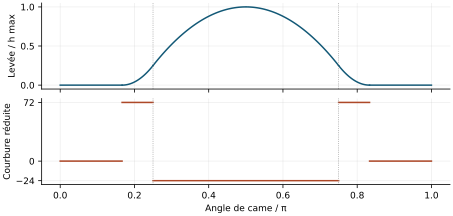

[Archive officielle, fichier sujet p. 13](https://www.banquept.fr/documents/2008/si_a_2008.zip)

### Question 11 — Précharge minimale

> [!INDICATION]
> Le régime annoncé est celui du vilebrequin. Diviser par deux avant de passer en rad/s.

#### Solution

$m_{\rm eq}=0,06833$ kg, $I_{\rm eq}=1,335\times10^{-4}$ kg·m² et $m'_{\rm eq}=0,10542$ kg. Le seuil voulu est 8580 tr/min moteur, soit 4290 tr/min de came ou 449,25 rad/s. L’équation précédente donne $F_0=24m'_{\rm eq}h_{\max}\omega_{2,\rm aff}^2/\pi^2-kh_{\max}/4=464,86$ N. On retiendra une précharge d’au moins 465 N dans ce modèle.

### Question 12 — Maximum de la réaction

> [!INDICATION]
> Prendre le côté de courbure positive au raccord et préciser le bras de levier employé.

#### Solution

La force pondérée $VF_I/L$ atteint sa limite supérieure sur les paraboles extérieures pour $h=h_{\max}/4$. Au régime maximal d’utilisation de 7800 tr/min moteur, elle vaut $F_0+kh_{\max}/4+72m'_{\rm eq}h_{\max}\omega_2^2/\pi^2=1800$ N. En assimilant le bras de la normale à $V\simeq\ell=30$ mm, $F_{I,\max}\simeq3,60$ kN. Au régime d’affolement de 8580 tr/min, la même estimation donne 4,14 kN. Le feuillet définit $V(\theta_2)$ sans en fournir la fonction numérique. Un maximum exact de l’effort non pondéré exige ce bras de levier ou le profil complet de la came. Les deux nombres précédents utilisent l’approximation explicite $V\simeq\ell$.

### Question 13 — Graphe des liaisons

> [!INDICATION]
> Énumérer les relations par leurs deux solides et préciser axe ou normale.

#### Solution

Les six arêtes sont 0–1 pivot $(O,\vec x_0)$, 0–2 pivot $(O,\vec x_0)$, 0–3 sphère-cylindre $(P,\vec x_0)$, 1–4 hélicoïdale $(A,\vec x_0)$ à droite, 2–4 glissière de direction $\vec x_0$, et 3–4 appui-plan de normale $\vec x_0$. Les liaisons 0–1 et 0–2 sont distinctes même si leurs axes coïncident.

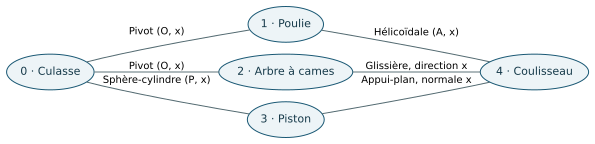

[Archive officielle, fichier sujet p. 14](https://www.banquept.fr/documents/2008/si_a_2008.zip)

### Question 14 — Mobilités et hyperstatisme

> [!INDICATION]
> Faire les fermetures avant de compter les inconnues de liaison.

#### Solution

Les rotations de 1 et 2 sont libres. La glissière impose à 4 la rotation de 2 et l’hélice impose sa translation à partir de la rotation relative 2/1. Le piston suit cette translation par l’appui-plan. Le centrage impose sa position radiale, l’appui-plan empêche ses bascules, sa rotation propre axiale reste libre. D’où deux mobilités utiles, une interne et $m=3$. Les liaisons ont respectivement 1, 1, 4, 1, 1 et 3 degrés de liberté, soit 11. Pour six arêtes et cinq solides, deux cycles indépendants donnent $h=6\times2-11+m=4$.

### Question 15 — Commande axiale du piston

> [!INDICATION]
> Combiner une relation cinématique, un moment sur 2 et 4, puis une résultante sur 3 et 4.

#### Solution

Posons $k_h=p_{as}/(2\pi)>0$ et prenons $\dot x_4$ dans le sens du torseur imprimé. Alors $\ddot x_4=k_h\Delta\ddot\theta$. Le moment dynamique de 2 et 4 sur leur axe commun donne $L_{14}+L_5=(I_2+I_4)(\ddot\theta_1+\Delta\ddot\theta)$. La puissance nulle dans la liaison hélicoïdale parfaite impose $L_{14}+k_h X_{14}=0$. Ainsi $X_{14}=[L_5-(I_2+I_4)(\ddot\theta_1+\Delta\ddot\theta)]/k_h$. En isolant 3 et 4 et en projetant sur l’axe, $F_H=(m_3+m_4)\ddot x_4-X_{14}$. Le guidage axial parfait de 4 sur 2 et le centrage de 3 ne transmettent aucune composante sur cet axe.

### Question 16 — Pas de la cannelure

> [!INDICATION]
> Développer l’hélice sur le cylindre moyen. L’angle est mesuré par rapport à l’axe du cylindre.

#### Solution

Un tour parcourt $2\pi r_{\rm moy}$ dans la direction circonférentielle et $p_{as}$ dans la direction axiale. Donc $\tan\alpha=2\pi r_{\rm moy}/p_{as}$ et $p_{as}=2\pi r_{\rm moy}/\tan\alpha$.

### Question 17 — Effort local de contact

> [!INDICATION]
> Au point M de la figure II.4, le brin positif de la tangente suit le mouvement du coulisseau.

#### Solution

Dans la base du flanc, $\mathrm d\vec N=p\,\mathrm dS\,\vec n$ et $\mathrm d\vec T=-p\tan\varphi\,\mathrm dS\,\vec t$. Le frottement s’oppose au glissement pour $\dot\theta_4>0$. Il n’y a pas de composante suivant $\vec z$ pour cet élément.

### Question 18 — Effort axial et couple de la poulie

> [!INDICATION]
> Projeter les efforts élémentaires, puis intégrer sur le flanc chargé.

#### Solution

Au point M, $\vec t=\cos\alpha\,\vec x_4-\sin\alpha\,\vec y_4$ et $\vec n=\sin\alpha\,\vec x_4+\cos\alpha\,\vec y_4$. Après intégration à pression uniforme, $X_{14}=pS(\sin\alpha-f\cos\alpha)$ et $L_{14}=-r_{\rm moy}pS(\cos\alpha+f\sin\alpha)$. Pour le moment, $\overrightarrow{AM}$ a une composante radiale positive suivant $\vec z_4$ et le terme axial de la force ne contribue pas.

### Question 19 — Relation couple–effort

> [!INDICATION]
> Éliminer le produit de pression par surface en factorisant les cosinus.

#### Solution

On obtient $X_{14}=-(L_{14}/r_{\rm moy})\tan(\alpha-\varphi)$. Pour $\alpha\ne\varphi$, $L_{14}=-r_{\rm moy}X_{14}/\tan(\alpha-\varphi)$. La première forme reste valable au seuil où $X_{14}=0$.

### Question 20 — Puissances d’entrée et de sortie

> [!INDICATION]
> Choisir une même vitesse relative 4/1 dans les deux produits de puissance.

#### Solution

La puissance algébrique de l’arbre moteur est $P_m=L_{24}\dot\theta_4>0$. L’action axiale du piston reçoit la puissance opposée à celle qu’elle exerce sur 4, $P_r=X_{34}\dot x_4<0$. Le rendement dans ce sens de transmission vaut $\eta=-P_r/P_m$.

### Question 21 — Rendement de la transmission

> [!INDICATION]
> Écrire deux équilibres indépendants pour le coulisseau.

#### Solution

À inerties négligées, $L_{24}=-L_{14}$ et $X_{34}=-X_{14}$. Or $\dot x_4/\dot\theta_4=r_{\rm moy}/\tan\alpha$. En remplaçant dans la définition du rendement, $\eta=\tan(\alpha-\varphi)/\tan\alpha$. Avec $f=0$ on retrouve 1.

### Question 22 — Condition d’irréversibilité

> [!INDICATION]
> Examiner le signe de la puissance qui pourrait être transmise axialement.

#### Solution

Pour $\alpha>\varphi$, le couple peut déplacer le piston sous charge résistante, car le rendement dans ce sens est positif. À $\alpha=\varphi$ l’effort axial moteur disponible tend vers zéro. Pour $\alpha<\varphi$, la combinaison supposée de mouvement et de puissance serait incompatible avec une puissance de sortie positive. La transmission est autobloquante dans ce sens.

### Question 23 — Angle seuil et encombrement

> [!INDICATION]
> Le déplacement axial par radian vaut le rayon moyen divisé par la tangente de l’angle.

#### Solution

$\alpha_{\max}=\arctan(0,1)=5,71°$. Pour $\Delta\theta=15°=\pi/12$, la course minimale en conservant l’autoblocage est $c_{\min}=0,020(\pi/12)/0,1=0,0524$ m, soit 52,4 mm. Une hélice plus proche de l’axe allongerait encore le vérin.

### Question 24 — Course réelle et tenue de position

> [!INDICATION]
> Comparer 20° à l’angle de frottement puis examiner les orifices au neutre.

#### Solution

$c=0,020(\pi/12)/\tan20°=14,4$ mm. Comme $20°>5,71°$, le couple de l’arbre peut entraîner le coulisseau. Au neutre, le centre fermé du distributeur 4/3 isole les chambres. Le fluide emprisonné s’oppose au déplacement du piston. Fuites et compressibilité limitent la rigidité et imposent une correction en service.

### Question 25 — Réduction de course à autoblocage conservé

> [!INDICATION]
> Repartir de $c=r_{\rm moy}\Delta\theta/\tan\alpha$ au seuil.

#### Solution

À charge admissible inchangée après vérification des contraintes, réduire le rayon moyen réduit la course dans la même proportion sans changer la condition $\alpha\le\varphi$. Une autre solution est d’augmenter le coefficient de frottement par le couple de matériaux, puis d’adopter un angle plus grand, compatible avec le nouvel angle de frottement. Cela exige une nouvelle étude des pertes et de l’usure.

## III — Commande électrohydraulique

### Question 26 — Schéma en variables de déphasage

> [!INDICATION]
> Annuler les variations du vilebrequin dans les deux voies où elles interviennent.

#### Solution

Si $\theta_v=0$ dans le modèle aux variations, alors $\theta_1=0$ et $\theta_2=\Delta\theta$. Le terme de demi-vitesse venu du vilebrequin et sa mesure sont nuls. L’erreur se réduit à $C\Delta\theta_c-C\Delta\theta$. Restent en cascade l’amplificateur, le distributeur, le vérin et le coulisseau, avec le seul capteur d’arbre en retour négatif.

[Archive officielle, fichier sujet p. 19](https://www.banquept.fr/documents/2008/si_a_2008.zip)

### Question 27 — Fluide incompressible

> [!INDICATION]
> Une vitesse de piston multipliée par l’aire donne le débit.

#### Solution

Avec des conditions initiales nulles, $Q=SpX$. Dans la figure 2, la consigne passe par $C$, le comparateur reçoit $-C\Delta\Theta$, puis viennent $1$, $K_e$, $1/(Sp)$ et $K_c$ dans la voie directe. La sortie fournit le déphasage en radians. L’ordre des signaux est $U_c,\epsilon,I,Q,X,\Delta\Theta$.

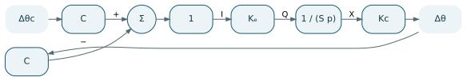

[Archive officielle, fichier sujet p. 19 · fichier cahier p. 3](https://www.banquept.fr/documents/2008/si_a_2008.zip)

### Question 28 — Réglage du temps de réponse

> [!INDICATION]
> Mettre la boucle fermée sous forme de premier ordre de gain statique unité.

#### Solution

$H_{BF}=\Delta\Theta/\Delta\Theta_c=K/(p+K)$, où $K=CK_eK_c/S$. Le résidu relatif après un échelon vaut $e^{-Kt}$. Pour 0,250 s à 5 %, $K=\ln(20)/0,250=11,98$ s⁻¹. Avec $S=9,6\times10^{-4}$ m², $C=10$ V/rad et $K_c=18$ rad/m, $K_e=6,39\times10^{-5}$ (m³/s)/A, avec l’amplificateur unitaire en A/V.

### Question 29 — Schéma avec compressibilité

> [!INDICATION]
> Conserver la vitesse comme variable interne commune aux deux bilans.

#### Solution

Dans la figure 3, le premier comparateur hydraulique donne $Q-SpX$. Le bloc $B/(Vp)$ le transforme en pression $P$. Le bloc $S$ donne la force du vérin. Soustraire $F_{1\to4}$, passer par $1/(Mp)$ pour obtenir la vitesse puis par $1/p$ pour obtenir $X$. Renvoyer la vitesse via $S$ vers l’entrée négative du premier comparateur. Les blocs $C,1,K_e,K_c,C$ des voies électrique et mécanique sont conservés.

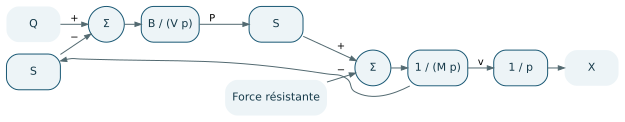

[Archive officielle, fichier sujet p. 20 · fichier cahier p. 3](https://www.banquept.fr/documents/2008/si_a_2008.zip)

### Question 30 — Débit, force et déplacement

> [!INDICATION]
> Éliminer la pression, puis poser le même dénominateur mécanique pour les deux transferts.

#### Solution

De $Q=SpX+(V/B)pP$ et $Mp^2X=SP-F$, on déduit $X=H_Q Q+H_F F$ avec $H_Q=1/[a_1p(1+a_2p^2)]$, $H_F=a_3/(1+a_2p^2)$. À quatre chiffres significatifs, $a_1=S=9,600\times10^{-4}$ m², $a_2=MV/(BS^2)=1,736\times10^{-8}$ s² et $a_3=-V/(BS^2)=-3,472\times10^{-8}$ m/N. Le signe négatif découle de la définition résistante de la force.

### Question 31 — Critère de Routh en boucle fermée

> [!INDICATION]
> Appliquer le tableau au polynôme caractéristique de la boucle fermée.

#### Solution

L’équation caractéristique vaut $a_2p^3+0p^2+p+K=0$. Dans le tableau de Routh, remplaçons le zéro de première colonne par $\varepsilon>0$. Les premiers coefficients sont $a_2,\varepsilon,1-a_2K/\varepsilon,K$. Lorsque $\varepsilon$ tend vers zéro positif, il y a deux changements de signe, donc deux pôles dans le demi-plan droit. À débit de fuite nul, le système n’est pas stable.

### Question 32 — Lieu de Black autour de la résonance

> [!INDICATION]
> Lire à une même pulsation la phase et le gain, puis suivre les pulsations croissantes.

#### Solution

La boucle ouverte est $T=K/[p(1+2\zeta_Qp/\Omega_Q+p^2/\Omega_Q^2)]$, avec $\Omega_Q=7589,5$ rad/s. Pour $\zeta_Q=10^{-4}$, sur l’agrandissement imprimé (figure III.5), les couples (phase en degrés, gain en dB) lus pour les pulsations croissantes sont environ $(-94;-4,4)$ à 7586 rad/s, $(-112;+9,3)$ à 7594, $(-180;+18)$ vers 7596, $(-235;+13,1)$ à 7597 et $(-264;-1,5)$ à 7603. Le passage imprimé à −180° est ainsi décalé d’environ 6,4 rad/s vers la droite par rapport à $\Omega_Q$ calculée avec les valeurs littérales. Le tracé orienté de la figure 4 passe au-dessus du point critique près de la résonance.

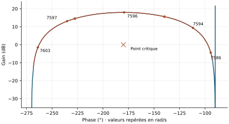

[Archive officielle, fichier sujet p. 21 · fichier cahier p. 3](https://www.banquept.fr/documents/2008/si_a_2008.zip)

### Question 33 — Seuil d’amortissement

> [!INDICATION]
> Examiner le lieu au passage à −180° et recouper avec un tableau de Routh.

#### Solution

Rétroaction négative, boucle ouverte sans pôle dans le demi-plan droit, intégrateur contourné à l’origine : le critère de Nyquist impose au lieu fermé un enroulement net nul de $-1$ pour que la boucle fermée soit stable. En Black, pour ce parcours de phase décroissante, le passage à $-180°$ doit se faire sous 0 dB. À $\omega=\Omega_Q$, le module est $K/(2\zeta_Q\Omega_Q)$. Il faut $\zeta_Q>K/(2\Omega_Q)=7,894\times10^{-4}$. Le modèle à $10^{-4}$ est instable. Le critère de Routh du cubique $p^3+2\zeta_Q\Omega_Q p^2+\Omega_Q^2p+K\Omega_Q^2$ donne la même inégalité.

### Question 34 — Marges au seuil

> [!INDICATION]
> Au seuil, la courbe passe sur le point critique.

#### Solution

À $\zeta_Q=K/(2\Omega_Q)$, la marge de gain est 0 dB et la marge de phase associée à ce croisement vaut 0°. Les pôles critiques sont $\pm j\Omega_Q$, le troisième vaut $-K$. Pour comparaison, à $\zeta_Q=0,001$ la marge de gain au passage par −180° est environ 2,05 dB.

### Question 35 — Poursuite avec le mode dominant

> [!INDICATION]
> Comparer la pulsation de coupure basse aux 7589 rad/s du sous-système hydraulique.

#### Solution

Dans la zone utile de commande, $T\simeq K/p$ et $H_{BF}\simeq K/(p+K)$. Pour une rampe unité $\Delta\theta_c=t$, le déphasage vaut $t-(1-e^{-Kt})/K$. L’écart limite est $1/K=0,08345$ rad et le retard de la rampe est 0,08345 s. À la sortie du comparateur l’écart correspondant vaut $C/K=0,8345$ V. La bande passante à −3 dB du modèle fermé va de 0 à $K=11,98$ rad/s, soit 1,91 Hz.

### Question 36 — Ajout d’une intégration

> [!INDICATION]
> À tout point du tracé ouvert, l’intégrateur retire 90° et $20\log_{10}\omega$ décibels.

#### Solution

La boucle ouverte réduite est $K/p^2$. Sa droite passe par $20\log_{10}K=21,6$ dB à 1 rad/s, de pente −40 dB/décade, avec coupure à $\sqrt K=3,46$ rad/s et phase −180°. La marge de phase est nulle et les pôles réduits sont $\pm j\sqrt K$. Avec le modèle complet, au-delà de $\Omega_Q$ la pente tend vers −80 dB/décade et la phase vers −360°. À la première coupure la phase est légèrement inférieure à −180° : le modèle complet est instable. La figure 5 (cahier) distingue le diagramme asymptotique de la courbe exacte au voisinage de la résonance.

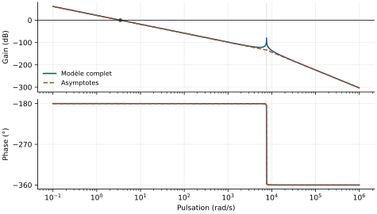

[Archive officielle, fichier sujet p. 23 · fichier cahier p. 4](https://www.banquept.fr/documents/2008/si_a_2008.zip)

### Question 37 — Récupération de la coupure avant correction de phase

> [!INDICATION]
> Lire la première traversée de 0 dB avant l’intégrateur et l’atténuation que celui-ci y ajoute.

#### Solution

Avant l’intégration supplémentaire, $\omega_c\simeq12$ rad/s. À cette pulsation, $1/p$ retire $20\log_{10}(12)=21,6$ dB. Un gain seul $K_{AV}\simeq12$ restaure la coupure à cette étape du réglage. La valeur finale à employer dépend aussi du module du réseau d’avance ajouté en question 38.

### Question 38 — Avance de phase et ajustement du gain

> [!INDICATION]
> Le maximum d’avance est centré à $1/(\tau_{AV}\sqrt a)$ et y apporte un module $1/\sqrt a$.

#### Solution

Pour $50°$, $a=(1-\sin50°)/(1+\sin50°)=0,1325$. Pour conserver exactement la première coupure à 11,98 rad/s, centrer le réseau par $\tau_{AV}=1/(11,98\sqrt a)=0,229$ s et réajuster le gain global à $K_{AV}=11,98\sqrt a=4,36$. Si l’on conserve impérativement le gain 11,98 de Q37, la coupure après avance se déplace vers $\sqrt{KK_{AV}/\sqrt a}=19,9$ rad/s. Il faut alors $\tau_{AV}=0,138$ s pour y centrer l’avance de 50°. La première solution conserve la dynamique initiale au sens de la pulsation de coupure. La phase supplémentaire de l’étage hydraulique à ces pulsations est inférieure à 0,001°. Le gain statique et la pulsation de centrage doivent être contrôlés ensemble.

## IV — Capteur, multiplexage et démultiplexage

### Question 39 — Transcodage des dix positions

> [!INDICATION]
> Lire les pistes du bord vers le centre, en affectant 1 au blanc. Écrire ensuite le numéro du secteur en base deux.

#### Solution

La table de la figure 6 donne les entrées $xyzt$ et les sorties $dcba$. Les six mots absents n’ont pas de valeur imposée par ce disque.

| Position | Entrées xyzt | Sorties dcba |
|---:|:---:|:---:|
| 0 | 1000 | 0000 |
| 1 | 1010 | 0001 |
| 2 | 0010 | 0010 |
| 3 | 0110 | 0011 |
| 4 | 1110 | 0100 |
| 5 | 1111 | 0101 |
| 6 | 0111 | 0110 |
| 7 | 0011 | 0111 |
| 8 | 1011 | 1000 |
| 9 | 1001 | 1001 |

[Archive officielle, fichier sujet p. 25 · fichier cahier p. 5](https://www.banquept.fr/documents/2008/si_a_2008.zip)

### Question 40 — Cartes de Karnaugh

> [!INDICATION]
> Ordonner les lignes et les colonnes selon 00, 01, 11, 10 pour préserver l’adjacence.

#### Solution

Pour chaque case des quatre cartes de la figure 7, reporter le bit de sortie lu en Q39. Les colonnes représentent $xy$, les lignes $zt$. Un tiret marque un mot d’entrée jamais produit en régime normal. On peut l’utiliser pour agrandir un groupe de 1.

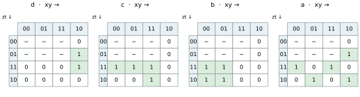

[Archive officielle, fichier sujet p. 25 · fichier cahier p. 5](https://www.banquept.fr/documents/2008/si_a_2008.zip)

### Question 41 — Expressions des sorties

> [!INDICATION]
> Grouper les cases par puissances de deux et employer les combinaisons indifférentes.

#### Solution

Une solution en sommes de produits est $d=x\bar y t$, $c=xy+\bar x t$, $b=\bar x$. Pour la sortie de poids faible, $a=\bar zt+xyt+\bar x\bar y t+\bar x y\bar t+x\bar y z\bar t$. Ici la barre porte sur la seule lettre qui suit. Le remplacement des dix mots de la table reproduit successivement les entiers de 0 à 9.

### Question 42 — Chronogrammes avec défaut d’alignement

> [!INDICATION]
> Le mouvement amène le secteur 1 sous les capteurs. Le lecteur x décalé vers ce secteur franchit sa limite en premier.

#### Solution

Pour le premier disque, avant/après le passage de 0 à 1, $xyzt=1000,1010$. Seul $z$ monte. Avec le lecteur aligné, la position change à $t_1$. Avec $x$ décalé, le passage prématuré de la frontière sous $x$ est sans effet électrique : le mot reste 1000 tant que $z$ n’a pas commuté et vaut ensuite 1010. Pour le second disque, les mots des secteurs 0 et 1 sont 1000 et 0010. Bien alignés, $x$ descend et $z$ monte simultanément. Si $x$ anticipe, les trois mots sont 1000, 0000, 0010, soit les positions 0, 9, 1 du second disque. Dans la figure, les deux repères du cas décalé distinguent le passage géométrique sous $x$ de celui sous les lecteurs alignés. Si $t_1$ désigne strictement le premier changement électrique, il coïncide avec le front de $z$ dans le deuxième cas et aucun front supplémentaire ne se produit dans ce passage.

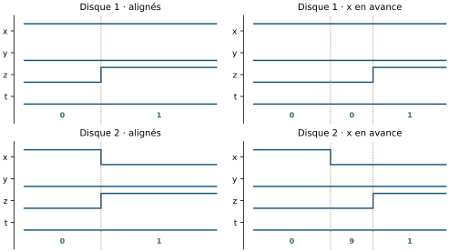

[Archive officielle, fichier sujet p. 26 · fichier cahier p. 6](https://www.banquept.fr/documents/2008/si_a_2008.zip)

### Question 43 — Intérêt du codage circulaire

> [!INDICATION]
> Comparer le nombre de pistes qui changent à une frontière donnée.

#### Solution

Sur le premier disque chaque transition, y compris 9 vers 0, n’affecte qu’une piste. Une légère désynchronisation fait lire l’ancien ou le nouveau secteur sans introduire un troisième mot. Sur le second disque, deux changements successifs au lieu d’être simultanés produisent la lecture transitoire 9 à la frontière 0–1.

### Question 44 — Équation du multiplexeur

> [!INDICATION]
> Associer à chaque entrée le minterme de son adresse.

#### Solution

En posant $u=\bar a_1\bar a_0$, $v=\bar a_1a_0$, $w=a_1\bar a_0$ et $r=a_1a_0$, la sortie est $s=xu+yv+zw+tr$. Une seule des quatre autorisations vaut 1 à une adresse donnée.

### Question 45 — Logigramme du multiplexeur

> [!INDICATION]
> Fabriquer les compléments des deux adresses une seule fois.

#### Solution

La figure 9 présente quatre portes ET à trois entrées. Elles forment dans l’ordre $x\bar a_1\bar a_0$, $y\bar a_1a_0$, $za_1\bar a_0$, $ta_1a_0$. Une porte OU réunit leurs quatre sorties. Avec des portes à deux entrées, décomposer chaque ET et le OU en cascade sans changer l’équation.

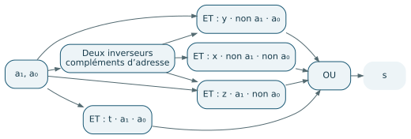

[Archive officielle, fichier sujet p. 27 · fichier cahier p. 6](https://www.banquept.fr/documents/2008/si_a_2008.zip)

### Question 46 — Reconstitution de la sortie série

> [!INDICATION]
> Échantillonner les chronogrammes au milieu des cases d’adresse.

#### Solution

Chaque groupe de quatre cases fournit dans l’ordre $x,y,z,t$. Les dix premiers groupes lus sur la figure 10 valent 1000, 1010, 0010, 0110, 1110, 1111, 0111, 0011, 1011, 1001. La répétition suivante recommence par 1000 puis 1010 sur le prolongement en pointillé. Le diagramme donne le signal haut ou bas sur chaque intervalle.

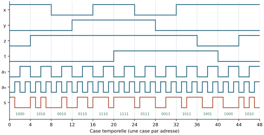

[Archive officielle, fichier sujet p. 27 · fichier cahier p. 5](https://www.banquept.fr/documents/2008/si_a_2008.zip)

### Question 47 — Cadences de sélection et de données

> [!INDICATION]
> Une trame doit lire chacune des pistes avant une nouvelle variation utile.

#### Solution

Les adresses bouclent $00,01,10,11$. Avec une case de durée $T_b$, $f_{a0}=1/(2T_b)$ et $f_{a1}=1/(4T_b)$. Les quatre pistes sont des signaux de position dont les durées hautes et basses dépendent du disque et de la vitesse. Elles ne sont pas quatre horloges uniformes. Le dessin réserve quatre cases à chaque secteur afin de transmettre tous les états avant le secteur suivant.

### Question 48 — Résolution et cadence pour un tour

> [!INDICATION]
> Distinguer positions par tour, changements d’état par seconde et périodes complètes par seconde.

#### Solution

Il faut au moins $360/0,3=1200$ secteurs, donc 11 pistes puisque $2^{10}<1200\le2^{11}$. Pour un disque de 2048 secteurs, la résolution vaut 0,176°. À 4000 tr/min, la fréquence de secteur atteint 136,5 kHz. Toute piste binaire peut au plus changer une fois par secteur, soit une borne de 68,27 kHz en périodes complètes. En binaire naturel les pistes, du poids faible au fort, ont pour fréquences $68,27/2^j$ kHz avec $j=0,\ldots,10$. Un code cyclique à transition unique a un spectre différent : pour le Gray réfléchi la piste la plus rapide vaut 34,13 kHz, les suivantes sont divisées par deux, les deux plus lentes valant 66,67 Hz. Quatre bits adressent les onze pistes. Avec une trame binaire complète de seize cases par secteur, il faut 2,185 M cases/s et $f_{a0}=1,092$ MHz. Ces ordres de grandeur sont accessibles à l’électronique automobile ; la transmission physique doit accepter ce débit. Avec exactement 1200 secteurs utiles et seize adresses, les valeurs deviennent 80 k secteurs/s, 1,28 M cases/s et 640 kHz pour $a_0$. Un balayage raccourci aux seules voies utilisées changerait aussi la cadence requise.

### Question 49 — Table de routage du démultiplexeur

> [!INDICATION]
> À une adresse donnée, une seule ligne est pilotée. Écrire Hi sur les trois autres.

#### Solution

Dans la figure 11, chacune des quatre adresses possède deux lignes selon $s=0$ ou 1. La sortie sélectionnée reçoit $s$ et les autres passent en haute impédance (Hi). Les bloqueurs en aval conservent leur dernière valeur entre deux sélections.

| Adresse | s | x | y | z | t |
|:---:|:---:|:---:|:---:|:---:|:---:|
| 00 | 0 | 0 | Hi | Hi | Hi |
| 00 | 1 | 1 | Hi | Hi | Hi |
| 01 | 0 | Hi | 0 | Hi | Hi |
| 01 | 1 | Hi | 1 | Hi | Hi |
| 10 | 0 | Hi | Hi | 0 | Hi |
| 10 | 1 | Hi | Hi | 1 | Hi |
| 11 | 0 | Hi | Hi | Hi | 0 |
| 11 | 1 | Hi | Hi | Hi | 1 |

### Question 50 — Expressions logiques du démultiplexeur

> [!INDICATION]
> Un produit logique décrit le niveau haut transmis ; donner aussi l’autorisation trois états.

#### Solution

Avec les quatre sélections $u,v,w,r$ de Q44, les équations logiques de routage sont $x=s\bar a_1\bar a_0$, $y=s\bar a_1a_0$, $z=sa_1\bar a_0$, $t=sa_1a_0$. Physiquement, pour chaque ligne, le pilote présente $s$ si son autorisation vaut 1 et Hi sinon. Pour un bloqueur idéal de sortie $q$ et d’autorisation $e$, $q^+=es+\bar e q$.

### Question 51 — Réalisation en NAND à deux entrées

> [!INDICATION]
> Un inverseur s’obtient en reliant les deux entrées d’un NAND.

#### Solution

Notons $N(u,v)=\overline{uv}$. Calculer $n_1=N(a_1,a_1)$ et $n_0=N(a_0,a_0)$. Pour chacune des quatre sorties, prendre $(b,c)=(n_1,n_0),(n_1,a_0),(a_1,n_0),(a_1,a_0)$. Former $h=N(b,c)$, $e=N(h,h)$, $j=N(e,s)$, puis $N(j,j)=es$. La figure 12 dessine les six NAND à deux entrées de la voie $x$, inverseurs compris. Pour la sortie physique du démultiplexeur, $e$ commande le pilote trois états ou le bloqueur décrit en Q50 : les seules portes NAND usuelles réalisent la fonction booléenne, la haute impédance requiert un étage adapté.

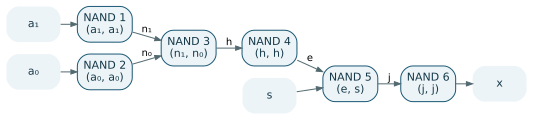

[Archive officielle, fichier sujet p. 28 · fichier cahier p. 3](https://www.banquept.fr/documents/2008/si_a_2008.zip)
