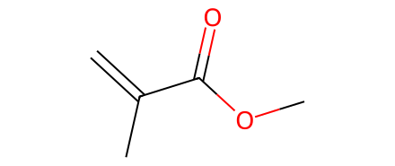
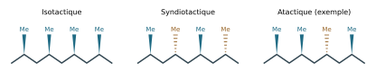
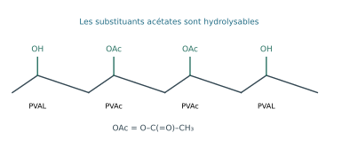
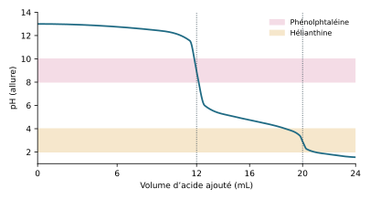
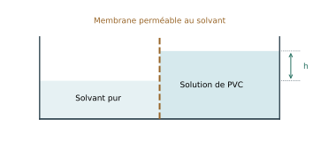
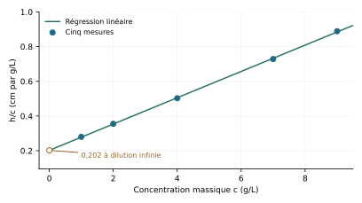

# ENS de Lyon — Second concours, Chimie 2008 · Corrigé brut

*Corrigé rédigé par IA, non officiel.*

**Rédaction (tour 1)** · GPT-6.2 Astra Ultra · vitesse non renseignée

Ces éditions traitent 47 des 55 questions ou sous-questions terminales imprimées. La partie D d’osmométrie est entière. En A et B, les passages sur l’activation de l’amorceur, la reproduction du cycle catalytique ou la préparation d’une mousse (A.5, A.6, A.21, B.6, B.8, B.9) sont hors couverture, ainsi que C.1 et C.2 sur la réalisation matérielle de l’hydrolyse. Le scan saute de B.6 à B.8 et ne contient aucune B.7. Le rapport de jury et les onze pages du sujet ont été consultés.

## A.1. Motifs et propagation

### Question A.1 — Structure du monomère

Le méthacrylate de méthyle (MMA) s’écrit $\mathrm{CH_2=C(CH_3){-}C(=O){-}OCH_3}$. Il comporte un **alcène** et un **ester**. La double liaison et le carbonyle sont conjugués.

### Question A.2 — Masse molaire du MMA

La formule brute est $\mathrm{C_5H_8O_2}$. Les masses de l’annexe donnent $M=5(12{,}0)+8(1{,}01)+2(16{,}0)=\mathbf{100{,}08\,g\,mol^{-1}}$, soit environ 100 g par mole.

### Question A.3 — Site d’addition radicalaire

Dans la polymérisation considérée, la double liaison **C=C** du MMA subit une addition radicalaire. Le motif ester constitue un substituant pendant de la chaîne obtenue.

### Question A.4 — Addition du radical méthyle

L’addition sur le carbone terminal donne $\mathrm{CH_3{-}CH_2{-}C^{\bullet}(CH_3){-}C(=O)OCH_3}$. L’orientation inverse laisserait un radical primaire terminal. Le radical préféré se situe sur le carbone le plus substitué et est en outre stabilisé par conjugaison avec le carbonyle. L’addition tête–queue correspondante est donc privilégiée.

*Question A.5 hors couverture.*

*Question A.6 hors couverture.*

### Question A.7 — Première unité de la chaîne

Avec $M=\mathrm{CH_2=C(CH_3)CO_2Me}$, $\mathrm{R^{\bullet}+M\to R{-}CH_2{-}C^{\bullet}(CH_3)CO_2Me}$. La première liaison entre R et le monomère se forme sur le carbone terminal. L’électron célibataire se retrouve à l’extrémité qui pourra propager la chaîne.

### Question A.8 — Propagation en tête–queue

Notons $P^{\bullet}=\mathrm{P'{-}CH_2{-}C^{\bullet}(CH_3)CO_2Me}$. Le radical se lie au $\mathrm{CH_2}$ terminal d’un monomère et la liaison π fournit le nouvel électron célibataire sur le carbone substitué. L’extrémité devient $\mathrm{P'{-}CH_2{-}C(CH_3)(CO_2Me){-}CH_2{-}C^{\bullet}(CH_3)CO_2Me}$. Une unité est incorporée et un seul radical reste présent.

### Question A.9 — Terminaison par combinaison

Deux extrémités radicalaires s’unissent par une liaison simple, $\mathrm{P_i^{\bullet}+P_j^{\bullet}\to P_i{-}P_j}$. Les deux radicaux disparaissent. La molécule morte comporte les $i+j$ unités apportées par les deux brins.

## A.2. Cinétique de chaînes

### Question A.10 — Schéma cinétique abstrait

En notations formelles, $A\xrightarrow{k_a}2R^{\bullet}$, puis $R^{\bullet}+M\xrightarrow{k_i}P_1^{\bullet}$. Ensuite $P_1^{\bullet}+M\to P_2^{\bullet}$, $P_2^{\bullet}+M\to P_3^{\bullet}$, $P_{n-1}^{\bullet}+M\to P_n^{\bullet}$ et $P_n^{\bullet}+M\to P_{n+1}^{\bullet}$, toutes de constante $k_p$. Les terminaisons sont $P_i^{\bullet}+P_j^{\bullet}\to D_{i+j}$ pour $i
e j$ (constante $k_t$) et $2P_i^{\bullet}\to D_{2i}$ (constante $k'_t$). $D$ désigne ici une chaîne inactive.

### Question A.11 — Consommation du monomère

Posons $S=\sum_{i\geq1}[P_i^{\bullet}]$. Alors $v=-d[M]/dt=k_i[R^{\bullet}][M]+k_p[M]S$. Le premier terme compte une unité par initiation, le second toutes celles de propagation. La terminaison par combinaison ne consomme pas de monomère supplémentaire.

### Question A.12 — Quasi-stationnarité

Après le bref régime transitoire, on suppose que la consommation des radicaux compense presque leur formation. On pose $d[R^{\bullet}]/dt\simeq0$ et, dans le modèle stationnaire des distributions, $d[P_i^{\bullet}]/dt\simeq0$. Cela permet des flux élémentaires non nuls. L’approximation peut échouer au démarrage ou lors d’un changement rapide de milieu.

### Question A.13 — Vitesses d’amorçage et d’initiation

Si $v_a=k_a[A]$ est la vitesse de dissociation de l’amorceur et $v_i=k_i[R^{\bullet}][M]$ la vitesse d’apparition des premiers brins, $d[R^{\bullet}]/dt=2v_a-v_i$. D’où **$v_i\simeq2v_a$** pour le rendement d’initiation égal à un supposé dans le sujet.

### Question A.14 — Bilans de chaque longueur

Prenons $k_t$ comme coefficient de rencontre de deux tailles distinctes. Pour deux tailles identiques, la vitesse d’événements est $k'_t[P_i]^2$ avec $k'_t\simeq k_t/2$ si chaque paire non ordonnée n’est comptée qu’une fois. Deux radicaux disparaissent par événement identique. La perte de la classe $i$ est alors $k_t[P_i]S$. Les bilans donnent $[P_1]=v_i/(k_p[M]+k_tS)$, puis $[P_i]=k_p[M][P_{i-1}]/(k_p[M]+k_tS)$ pour $i\geq2$. Les crochets $[P_i]$ désignent ici des brins actifs. Dans une convention où la constante de terminaison représente directement un coefficient global de vitesse d’événements, le facteur deux se reporte sur la définition de cette constante.

### Question A.15 — Ordre de la loi globale

Au régime stationnaire, création et perte de brins donnent $2k_a[A]=k_tS^2$ avec la convention de A.14. Si une chaîne est longue, la consommation lors de l’initiation est faible devant celle de propagation. Ainsi **$v\simeq k_p\sqrt{2k_a/k_t}\,[M]\sqrt{[A]}$** et $K=k_p\sqrt{2k_a/k_t}$. Si l’on note $k_t^{\rm ev}=k_t/2$ dans $v_{\rm terminaison}=k_t^{\rm ev}S^2$, on obtient de façon identique $K=k_p\sqrt{k_a/k_t^{\rm ev}}$. Les ordres sont un en monomère et un demi en amorceur.

### Question A.16 — Longueur de chaîne cinétique

Par unité de volume et de temps, $v$ moles de monomère sont consommées et $2v_a$ moles de radicaux naissent. La longueur cinétique demandée vaut **$\ell=v/(2v_a)$**.

### Question A.17 — Degré moyen en nombre

Deux brins actifs se réunissent en une molécule morte. Sans transfert de chaîne, $DP_n=2\ell=v/v_a$. Pour des brins longs et dans notre convention, **$DP_n\simeq k_p\sqrt{2/(k_a k_t)}\,[M]/\sqrt{[A]}$**. Un autre mode de terminaison modifierait le comptage des molécules produites.

### Question A.18 — Dépendance en concentration d’amorceur

À concentration de monomère et température fixées, $v$ est proportionnelle à $[A]^{1/2}$ et $DP_n$ à $[A]^{-1/2}$. Par exemple, un facteur quatre sur $[A]$ double la vitesse et divise par deux le nombre moyen d’unités par molécule dans ce modèle.

### Question A.19 — Effets de l’énergie d’activation

Pour $v$, la combinaison est $k_p k_a^{1/2}k_t^{-1/2}$, d’où $E_{\rm app}=26+(123-8)/2=\mathbf{83{,}5\,kJ\,mol^{-1}}$. Pour $DP_n$, elle est $k_p k_a^{-1/2}k_t^{-1/2}$, d’où $26-(123+8)/2=\mathbf{-39{,}5\,kJ\,mol^{-1}}$. L’élévation de température fait donc croître la vitesse et décroître $DP_n$ dans ces hypothèses. Ces valeurs sont des paramètres apparents de lois globales.

## A.3. Structure électronique et tacticité

### Question A.20 — Électrons de valence du titane

Le titane, $Z=22$, a pour configuration fondamentale $[\mathrm{Ar}]\,3d^24s^2$. Il apporte **quatre électrons de valence** au comptage par la méthode neutre.

*Question A.21 hors couverture.*

### Question A.22 — Coordination de l’alcène

La deuxième étape associe un éthène, ligand neutre de type L, au complexe activé. Le nombre d’électrons comptés au métal augmente de **deux** (10 à 12 dans le schéma) tandis que le nombre d’oxydation demeure **+IV**. La coordination n’est pas un échange redox.

### Question A.23 — Insertion migratoire

L’alkyle et l’éthène coordonnés se transforment en un alkyle allongé. Un ligand L disparaît du comptage, alors que le nombre de X est conservé. Le nombre d’électrons passe de 12 à 10, donc **$\Delta NE=-2$**, et $\Delta NO=0$. Le métal reste Ti(IV).

### Question A.24 — Propène et polypropylène

Le propène est $\mathrm{CH_2=CH{-}CH_3}$. Le motif répété du polypropylène est $\mathrm{[-CH_2-CH(CH_3)-]}$. Le passage d’un alcène à la chaîne saturée ne supprime aucun atome du monomère.

### Question A.25 — Tacticité

Sur une chaîne étendue représentée avec le même sens de parcours, les méthyles des centres successifs apparaissent du même côté dans une chaîne **isotactique** et en alternance régulière dans une chaîne **syndiotactique**. Une chaîne **atactique** ne présente pas de succession stéréorégulière. Les liaisons en coin du schéma distinguent avant et arrière. Une rotation autour d’une liaison simple ne change pas la tacticité.

## B. Polymères par étapes

### Question B.1 — Première liaison du PET

Une première estérification s’écrit $\mathrm{HOOC{-}pC_6H_4{-}COOH+HOCH_2CH_2OH\rightleftharpoons HOOC{-}pC_6H_4{-}COOCH_2CH_2OH+H_2O}$. Le préfixe $p$ indique que les deux substituants aromatiques sont en para. Le produit possède encore un alcool et un acide carboxylique et peut poursuivre la croissance.

### Question B.2 — Famille de polymérisation

C’est une **polycondensation** par étapes entre fonctions acide et alcool. Une molécule d’eau se forme avec chaque nouvelle liaison ester. Les oligomères fonctionnels peuvent eux aussi réagir les uns avec les autres.

### Question B.3 — Motif du PET

Le motif est $\mathrm{[-O{-}CH_2{-}CH_2{-}O{-}C(=O){-}pC_6H_4{-}C(=O)-]}$. La liaison finale au motif suivant est une liaison entre carbone carbonylé et oxygène. La chaîne comporte deux fonctions ester par motif et le noyau benzénique est substitué en para.

### Question B.4 — Évolution infrarouge

Dans un PET de longue chaîne, les bandes OH d’acide et d’alcool sont fortement diminuées, sauf celles des extrémités ou de l’eau résiduelle. On observe un carbonyle d’ester et des bandes C–O d’ester, notamment dans la région $1000$–$1300\,\mathrm{cm^{-1}}$. Le noyau aromatique reste présent. L’annexe concerne des carbonyles non conjugués. La conjugaison du carbonyle du PET avec le noyau peut déplacer sa bande vers des nombres d’onde plus faibles.

### Question B.5 — Hydrolyse des fonctions ester du PET

C’est une **saponification**. L’hydrolyse totale d’une mole de motifs consomme formellement deux moles d’ions hydroxyde et donne une mole de téréphtalate $\mathrm{^-OOC{-}pC_6H_4{-}COO^-}$ et une mole d’éthane-1,2-diol. Le bilan de motifs néglige les groupes terminaux de la chaîne. L’hydrolyse coupe ici la chaîne principale.

*Question B.6 hors couverture.*

*Question B.8 hors couverture.*

*Question B.9 hors couverture.*

## C. Composition du copolymère

*Question C.1 hors couverture.*

*Question C.2 hors couverture.*

### Question C.3 — Effet d’une dilution sur le dosage

Si le solvant n’apporte ni acide ni base et qu’aucune matière n’est perdue, la dilution ne modifie pas les quantités de réactifs à titrer. Les volumes d’acide aux équivalences restent les mêmes. Les concentrations, la forme de la courbe et les pH apparents peuvent en revanche dépendre de la dilution et du milieu alcoolique.

### Question C.4 — Chaîne de copolymère

Un fragment possible est $\mathrm{{-}CH_2{-}CH(OH){-}CH_2{-}CH(OAc){-}CH_2{-}CH(OAc){-}CH_2{-}CH(OH){-}}$, où $\mathrm{OAc=O{-}C(=O)CH_3}$. La saponification rompt les liaisons **entre l’oxygène du polymère et le carbone carbonylé de l’acétate**. Le squelette principal C–C et la liaison entre l’oxygène et le carbone du squelette sont conservés.

### Question C.5 — Saponification du substituant acétate

En notant P le groupe polymère, $\mathrm{OH^-}$ attaque le carbone de $\mathrm{P{-}O{-}C(=O)CH_3}$ et le doublet π va sur l’oxygène carbonylé. Dans l’intermédiaire tétraédrique, O reforme la liaison C=O et la liaison acyle–O(P) se rompt. Un transfert acido-basique fournit $\mathrm{P{-}OH}$ et $\mathrm{CH_3COO^-}$. Le bilan consomme un hydroxyde par fonction ester.

### Question C.6 — Deux neutralisations

D’abord $\mathrm{OH^-+H_3O^+\to2H_2O}$. Quand l’excès de base forte est consommé, l’acide protonne l’acétate formé, $\mathrm{CH_3COO^-+H_3O^+\to CH_3COOH+H_2O}$. La différence des deux volumes équivalents mesure donc la quantité d’acétate et le nombre de motifs ester hydrolysés.

### Question C.7 — Deux indicateurs et deux équivalences

La courbe décroît et comporte un premier saut près de **12 mL** puis un second près de **20 mL**. La phénolphtaléine, rose en milieu basique, vire à l’incolore dans sa plage 8–10 au voisinage du premier volume. L’hélianthine passe du jaune à l’orange puis au rouge dans sa plage 2–4 près du second. Entre les deux, l’acétate et l’acide acétique forment une zone tampon. Le schéma est qualitatif, car le mélange de solvants ne permet pas de transposer exactement une échelle de pH aqueuse.

### Question C.8.a — Quantité d’hydroxyde consommée

La saponification a consommé $n_{\rm OH}=c_bV_b-c_aV_{E1}=0{,}50\times0{,}0400-1{,}00\times0{,}012=0{,}0080\,\mathrm{mol}$. On retrouve $c_a(V_{E2}-V_{E1})=1{,}00(0{,}020-0{,}012)=\mathbf{8{,}0\,mmol}$.

### Question C.8.b — Indice d’ester

$I_e=1000\,n_{\rm OH}M_{\rm KOH}/m$, avec $M_{\rm KOH}=56{,}11\,\mathrm{g\,mol^{-1}}$. Pour $m=2{,}0\,\mathrm g$, **$I_e\simeq224\,\mathrm{mg\ KOH\,g^{-1}}$**.

### Question C.8.c — Nombre de motifs avant l’essai

On trouve $a=n_{\rm OH}=8{,}0\,\mathrm{mmol}$ d’unités PVAc. Le motif PVAc ($\mathrm{C_4H_6O_2}$) a une masse molaire d’environ 86,06 et le motif PVAL ($\mathrm{C_2H_4O}$) de 44,04 g par mole. Donc $b=(m-aM_{\rm PVAc})/M_{\rm PVAL}=\mathbf{29{,}8\,mmol}$ environ.

### Question C.8.d — Fraction molaire hydrolysée

$\eta=b/(a+b)\simeq29{,}8/(8{,}0+29{,}8)=\mathbf{0{,}788}$, soit environ **79 %** de motifs alcool dans l’échantillon avant saponification analytique. La part molaire résiduelle en motifs acétate est d’environ 21 %.

### Question C.8.e — État de l’échantillon

Le matériau de départ est **partiellement hydrolysé** et contient encore une proportion importante de fonctions ester. Si le code commercial « 140 » désigne l’indice d’ester nominal de cette qualité, la mesure d’environ 224 indique davantage d’ester et une hydrolyse moindre que cette valeur nominale. Le sujet n’explicite pas la convention de désignation du grade. Sans cette interprétation ou sa fiche technique, seule la composition mesurée est acquise.

### Question C.8.f — Interpréter un écart

Une hydrolyse partielle du PVAc lors de l’élaboration explique la coexistence des deux motifs. Pour un écart à une spécification nominale, un prélèvement non représentatif, un mélange avec une fraction plus riche en acétate ou une perturbation du titrage constituent des hypothèses à vérifier. Une hydrolyse supplémentaire pendant le stockage ferait au contraire baisser l’indice d’ester. Les volumes mesurés ne permettent pas d’attribuer l’écart à une cause unique.

## D. Osmométrie du PVC

### Question D.1 — Équilibre osmotique

Le solvant traverse la membrane. À température uniforme et en équilibre, son potentiel chimique est donc identique de part et d’autre : $\mu_s^*(P)=\mu_s(x_s,P+\Pi)$. Le soluté, retenu, n’est pas soumis à cette condition d’égalité entre les compartiments.

### Question D.2 — Lien pression–fraction molaire

Pour un solvant incompressible et une solution idéale diluée, $\mu_s(x_s,P+\Pi)=\mu_s^*(P)+V_m\Pi+RT\ln x_s$. L’égalité d’équilibre donne **$\Pi=-(RT/V_m)\ln x_s$**. Puisque $0<x_s<1$, la pression osmotique est positive.

### Question D.3 — Développement du logarithme

Posons $x=x_{\rm PVC}\ll1$. Alors $\ln x_s=\ln(1-x)=-x-x^2/2+O(x^3)$. Les deux premiers termes sont négatifs.

### Question D.4 — Pression au second ordre

On obtient $\Pi=(RT/V_m)(x+x^2/2+O(x^3))$. Au premier ordre, $x\simeq V_m\Pi/(RT)$. La relation du second ordre donne l’origine d’un terme correctif en concentration.

### Question D.5 — Concentration massique et molaire

Dans la limite diluée $x\simeq n_{\rm PVC}/n_s\simeq V_m c_{\rm mol}$ et $c_{\rm mol}=c_{\rm PVC}/M_{\rm PVC}$. Ainsi $\Pi\simeq RTc_{\rm mol}=RTc_{\rm PVC}/M_{\rm PVC}$. Si l’on approxime $x$ par $V_m c_{\rm PVC}/M$ jusque dans le terme quadratique de D.4, on écrit $\Pi\simeq RTc/M+(RTV_m/2)(c/M)^2$. Le coefficient quadratique exact en concentration massique dépend aussi du passage de fraction molaire à volume réel et de la non-idéalité. Pour déterminer $M$, seule la limite $\Pi/c\to RT/M$ est requise.

### Question D.6 — Pression hydrostatique

Dans le modèle du montage, **$\Pi=\rho gh$**. $\rho$ est la masse volumique de la solution diluée, assimilée à celle du solvant, et $h$ la dénivellation. Avec $\rho$ en kg par mètre cube et $h$ en mètres, la pression est en pascals.

### Question D.7 — Linéarisation de la mesure

En posant $c=c_{\rm PVC}$ massique, $h/c=RT/(\rho g M)+bc+O(c^2)$, où $b$ rassemble la correction du second ordre. Dans l’approximation quadratique de D.5, $b=RTV_m/(2\rho g M^2)$. **L’ordonnée à l’origine**, indépendante de cette approximation sur la pente, vaut $RT/(\rho gM)$.

### Question D.8 — Méthode d’extrapolation

Pour chacune des cinq mesures, calculer $h/c$, puis ajuster ces rapports en fonction de $c$. On extrapole à $c=0$ et on prend l’ordonnée à l’origine $b_0$. La masse molaire moyenne **en nombre**, à laquelle l’osmose est sensible, est $M_n=RT/(\rho gb_0)$.

### Question D.9 — Masse molaire du PVC

Dans l’ordre des concentrations 1, 2, 4, 7 et 9 g par litre, les rapports $h/c$ valent **0,280 ; 0,355 ; 0,5025 ; 0,7286 ; 0,8889**, en cm par (g/L). L’ajustement sur les cinq points donne $h/c\simeq0{,}2022+0{,}07582\,c$ dans ces unités. Or $1\,\mathrm{g/L}=1\,\mathrm{kg/m^3}$, donc $b_0=0{,}002022\,\mathrm{m^4\,kg^{-1}}$. Avec $\rho=980\,\mathrm{kg\,m^{-3}}$, $T=298\,\mathrm K$ et $g=9{,}81\,\mathrm{m\,s^{-2}}$, $M_n\simeq127\,\mathrm{kg\,mol^{-1}}=\mathbf{1{,}27\times10^5\,g\,mol^{-1}}$. Une lecture graphique donnerait environ $1{,}3\times10^5\,\mathrm{g\,mol^{-1}}$.

