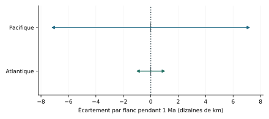
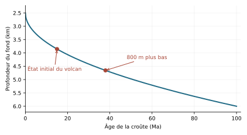
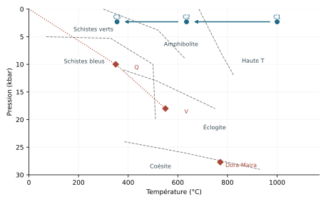
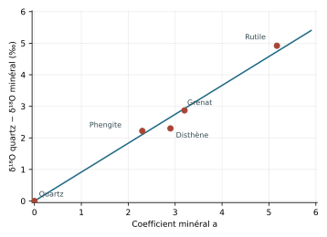

# ENS de Lyon — Second concours, Géosciences 2008 · Corrigé guidé

*Corrigé rédigé par IA, non officiel.*

**Rédaction (tour 1)** · GPT-6.2 Astra Ultra · vitesse non renseignée

Les 29 consignes sont traitées, y compris la synthèse. Les reports demandés sur les pages 9 et 10 sont restitués sous forme de deux diagrammes originaux. Les pentes de refroidissement sont des estimations établies à partir des plages graphiques de la figure 3.7. L’archive de 2008 ne rattache pas de rapport écrit à cette épreuve.

## 1. Anomalies magnétiques et âge

### Question 1.1 — Définir l’anomalie magnétique marine

> [!INDICATION]
> Partir du champ effectivement mesuré et du champ de référence. Quelle propriété du basalte subsiste après son refroidissement ?

#### Solution

L’anomalie est la différence entre le champ mesuré et le champ régional de référence au même endroit, après correction de ses variations temporelles. Les minéraux magnétiques des laves océaniques acquièrent en refroidissant une aimantation thermorémanente orientée suivant le champ terrestre de l’époque. La succession des périodes de polarité normale et inverse produit des bandes d’aimantations opposées qui renforcent ou affaiblissent localement la contribution mesurée. La latitude et la géométrie de l’aimantation influencent aussi la forme du signal.

### Question 1.2 — Obtenir les profils

> [!INDICATION]
> Imaginer un navire traversant des bandes de polarité. Comment passer de ses mesures successives à une carte ?

#### Solution

Un magnétomètre marin mesure l’intensité du champ le long de profils géoréférencés, souvent perpendiculaires à l’axe de la dorsale. Le capteur remorqué à distance de la coque limite le signal du navire. Le retrait du champ principal calculé et des variations temporelles donne le profil d’anomalie. Les croisements entre profils servent à recaler les mesures et à suivre une même anomalie d’une ligne à l’autre.

### Question 1.3 — Identifier les roches porteuses

> [!INDICATION]
> Dans la croûte océanique nouvellement créée, quelles roches refroidissent rapidement au contact de l’eau ?

#### Solution

Les basaltes de la croûte supérieure, notamment les laves en coussins, renferment des oxydes de fer et de titane comme les titanomagnétites. En refroidissant sous leurs températures de blocage, ils fixent une aimantation durable. Les filons et les gabbros peuvent contribuer au champ crustal. Les bandes marines sont classiquement interprétées à partir de l’aimantation acquise par la croûte basaltique lors de sa mise en place.

### Question 1.4 — Dater le plancher par magnétostratigraphie

> [!INDICATION]
> Une seule bande de polarité normale n’a pas d’âge unique. Une succession de largeurs et de polarités peut être reconnue.

#### Solution

À l’axe se crée de la croûte. Elle est entraînée sur les deux flancs lorsque l’expansion se poursuit. La succession des inversions du champ se trouve ainsi inscrite dans l’espace. On identifie une **séquence** de bandes et on la corrèle à l’échelle des polarités datées indépendamment, notamment par radiochronologie. Une limite d’inversion reconnue de part et d’autre date la croûte formée à cet instant. Forages, âge du premier dépôt sur le socle et datations des roches permettent d’éprouver la corrélation.

### Question 1.5 — Lire la carte mondiale

> [!INDICATION]
> Identifier symétries, interruptions et variation de largeur à âge donné.

#### Solution

Les linéations s’allongent de part et d’autre des dorsales et suivent approximativement leurs segments. Les anomalies les plus jeunes bordent l’axe et les plus anciennes en sont généralement éloignées. Leur ordre se retrouve en miroir sur les deux flancs. Des décalages aux failles transformantes interrompent cette continuité. Dans le Pacifique oriental, les bandes jeunes sont très espacées pour un même intervalle temporel. Dans l’Atlantique nord, la succession se prolonge jusqu’aux anciennes marges, près de Terre-Neuve et de l’Ibérie. Les marges actives peuvent consommer une partie de l’enregistrement, et la couverture des mesures varie.

### Question 1.6 — Comparer les taux d’expansion

> [!INDICATION]
> Mesurer perpendiculairement aux bandes de même âge sur les deux flancs. La barre de B vaut environ 100 km et celle de C environ 1 000 km.

#### Solution

Dans le détail B (dorsale Est-Pacifique), les deux repères 3.2 âgés de 4,62 Ma sont distants d’environ 6,6–6,9 barres de 100 km. Le taux total vaut donc $670/4,62\simeq145$ km/Ma, soit **14–15 cm/an**. Le taux sur un flanc est voisin de 7 cm/an. Dans le détail C (dorsale médio-atlantique), les anomalies 34, âgées de 85 Ma, sont séparées d’environ 1,7–1,9 barre de 1 000 km dans la partie centrale. D’où $1\,800/85\simeq21$ km/Ma, soit **environ 2,1 cm/an** pour l’ouverture et 1,1 cm/an par flanc. La direction de mesure et la courbure des traits justifient l’arrondi. Les durées moyennées diffèrent, mais les deux relevés distinguent clairement une dorsale rapide et une dorsale lente.

## 2. État thermique du plancher océanique

### Question 2.1a — Décrire la bathymétrie

> [!INDICATION]
> Prendre la profondeur à l’axe, puis vers 20, 50 et 100 Ma. La graduation augmente vers le bas.

#### Solution

Le fond océanique est le moins profond au voisinage de l’axe, vers 2,5 km. La profondeur augmente rapidement pendant les premiers millions d’années. Elle approche 4 km vers 20 Ma, 5 km vers 50 Ma et environ 5,5–5,7 km vers 100 Ma. Le taux d’approfondissement diminue avec l’âge. Les mesures des océans Pacifique, Indien et Atlantique se distribuent autour d’une tendance commune, avec une dispersion visible pour un même âge.

### Question 2.1b — Décrire le flux de chaleur

> [!INDICATION]
> Lire l’unité de la figure 2.2. L’enveloppe représente la dispersion des mesures, le trait épais un modèle.

#### Solution

Près de la dorsale, le modèle décroît à partir de plus de 15 unités de $10^{-2}$ W/m² tandis que les mesures couvrent un domaine large, notamment sur les flancs. Vers 3 000–4 000 km, on atteint un flux voisin de 5 unités, soit 50 mW/m². Loin de l’axe, l’enveloppe est étroite, autour de 40–50 mW/m². La décroissance et la dispersion sont donc surtout marquées sur le plancher jeune. Les valeurs mesurées y sont souvent inférieures au flux conducteur théorique.

### Question 2.1c — Interpréter l’écart au modèle thermique

> [!INDICATION]
> Comparer transport de chaleur par conduction dans une plaque et transport par circulation d’eau dans ses fractures.

#### Solution

La lithosphère jeune est chaude et mince. En vieillissant, elle se refroidit, s’épaissit et son gradient près de la surface diminue. Dans l’approximation du demi-espace conducteur refroidissant, le flux décroît comme $1/\sqrt t$. Près de l’axe, les fractures de la croûte perméable permettent à l’eau de mer de circuler. L’eau froide à la recharge et l’eau chaude à la décharge redistribuent la chaleur. Une sonde placée dans les sédiments mesure surtout le gradient conducteur local et peut manquer les sorties hydrothermales concentrées. Les variations du volcanisme, de la fracturation et de la couverture sédimentaire amplifient la dispersion. Avec l’âge, fractures colmatées et couverture sédimentaire atténuent ces contrastes.

### Question 2.2a — Expliquer la succession des récifs

> [!INDICATION]
> La surface de l’eau fixe la limite supérieure du récif. Suivre séparément le socle volcanique et la partie vivante des coraux.

#### Solution

Autour d’une île émergée, des coraux construisent un récif frangeant en eau peu profonde et éclairée. Lorsque le socle s’abaisse avec la lithosphère qui refroidit, la croissance verticale peut maintenir la couronne près de la surface. Un lagon se creuse entre le récif barrière et l’île. Lorsque le sommet volcanique est sous l’eau, le récif annulaire entoure le lagon et forme un atoll. L’érosion du volcan et les changements de niveau marin peuvent infléchir le détail du scénario. Le refroidissement explique physiquement la subsidence déjà envisagée par Darwin.

### Question 2.2b — Tester la loi empirique

> [!INDICATION]
> Évaluer la profondeur en quelques âges sur les axes de la figure avant de discuter sa validité.

#### Solution

La relation $P(t)=2\,500+350\sqrt t$, avec $P$ en mètres et $t$ en Ma, donne 3,61 km à 10 Ma, 4,25 km à 25 Ma, 4,97 km à 50 Ma et 6,00 km à 100 Ma. Elle reproduit la croissance initiale et sa décélération. Les points anciens atteignent environ 5,5–5,7 km à 100 Ma, donc un peu moins que les 6,0 km du modèle. Une plaque d’épaisseur thermique finie, la variabilité du relief et la couverture sédimentaire contribuent à limiter la portée d’une extrapolation.

### Question 2.2c — Tracer la courbe de subsidence

> [!INDICATION]
> Préciser le sens de l’axe vertical du tracé. Quelle valeur subsiste à l’âge nul ?

#### Solution

À $t=0$, $P(0)=2\,500$ m. La croûte se met donc en place à une profondeur moyenne d’environ 2,5 km. La courbe progresse ensuite comme la racine carrée de l’âge. Sa dérivée pour $t>0$ est $175/\sqrt t$ m/Ma. La pente est forte au voisinage de l’origine et de plus en plus faible sur le plancher ancien.

### Question 2.2d — Dater la submersion du sommet volcanique

> [!INDICATION]
> L’origine des temps de la loi est la naissance de la croûte, antérieure de 15 Ma à l’état initial du volcan.

#### Solution

Soit $t_f$ l’âge de la croûte lorsque 800 m de subsidence ont été atteints. En supposant un niveau marin fixe et un édifice de hauteur constante, $350(\sqrt{t_f}-\sqrt{15})=800$. D’où $t_f=(\sqrt{15}+800/350)^2\simeq37,93$ Ma. Le **temps écoulé** est $37,93-15=22,93$ Ma, soit environ 23 millions d’années. Le fond passe d’environ 3,86 à 4,66 km de profondeur.

## 3. Les ophiolites alpines

### Question 3.1 — Reconnaître les ophiolites

> [!INDICATION]
> Reconstituer de bas en haut les matériaux d’une lithosphère océanique et distinguer sa naissance de sa mise en place dans une chaîne.

#### Solution

Une ophiolite est un fragment de lithosphère océanique aujourd’hui accessible à terre. Une succession bien conservée comprend péridotites mantelliques parfois serpentinisées, gabbros, filons basaltiques, laves en coussins et sédiments pélagiques. Les dorsales lentes peuvent produire des successions discontinues. Ces roches se forment lors d’accrétion océanique, parfois dans un bassin d’arrière-arc ou au-dessus d’une subduction. On peut ensuite les retrouver obductées sur une marge, accrétées à un prisme ou exhumées après subduction. Le Chenaillet et le Mont Viso en sont des exemples alpins, l’ophiolite d’Oman un exemple d’obduction.

### Question 3.2a — Identifier les roches du sommet du Chenaillet

> [!INDICATION]
> Repérer les contours bombés qui séparent des volumes emboîtés. Comment une coulée se comporterait-elle sous l’eau ?

#### Solution

À l’affleurement, on observe des volumes arrondis décimétriques à métriques, accolés, séparés par des limites plus sombres. Leurs formes en coussins et leurs bordures individualisées s’expliquent par l’émission d’une lave basaltique sous l’eau. Une enveloppe rapidement figée se rompt, laissant sortir de nouveaux lobes. Ces laves en coussins forment la partie volcanique supérieure de l’ancienne croûte océanique.

### Question 3.2b — Identifier C1

> [!INDICATION]
> Comparer l’échantillon grenu en main avec les cristaux maclés et les minéraux sombres en lame mince.

#### Solution

Les plages claires correspondent au plagioclase. Les cristaux tabulaires présentent en lumière analysée des macles polysynthétiques en bandes. Les cristaux sombres en main, à relief plus marqué et à deux clivages proches de 90°, sont des clinopyroxènes. Les minéraux visibles et jointifs donnent une texture grenue, holocristalline. C1 est un **gabbro**, cristallisé lentement en profondeur dans la croûte d’une dorsale. La composition est apparentée à celle des basaltes du sommet, mais le refroidissement a permis la croissance de cristaux bien plus grands.

### Question 3.2c — Déduire le sens des réactions

> [!INDICATION]
> Une couronne qui s’interpose entre deux minéraux leur est postérieure. Examiner ensuite l’assemblage qui marque les zones les plus déformées.

#### Solution

Dans C2, un reliquat de clinopyroxène est entouré de hornblende, au contact du plagioclase. La réaction qualitative est clinopyroxène + plagioclase + eau → hornblende, avec du plagioclase encore présent dans la matrice. Dans C3, l’actinote et la chlorite marquent les domaines foliés. Le refroidissement et l’hydratation poursuivent la transformation de l’assemblage à hornblende et plagioclase vers un assemblage à actinote + chlorite, avec plagioclase résiduel ou recristallisé plus sodique. Le plagioclase, abondant autour des couronnes, est en excès à l’échelle de la réaction locale. Un cœur de pyroxène isolé par la couronne peut subsister faute de contact ou de diffusion. Il ne suffit pas à établir un bilan modal global.

### Question 3.2d — Reporter C1, C2 et C3 dans la grille

> [!INDICATION]
> Suivre à faible pression les domaines de stabilité successifs des minéraux indicateurs. Distinguer un gabbro magmatique d’un faciès métamorphique.

#### Solution

C1 se place à basse pression du côté plagioclase + clinopyroxène, à haute température près du solidus, par exemple 950–1 050 °C pour quelques kbar. C’est le gabbro peu transformé. Son assemblage anhydre se projette du côté des hautes températures de la grille, vers le champ granulitique, sans établir à lui seul un événement métamorphique granulitique. C2 se place vers 550–700 °C à faible pression, dans le domaine à hornblende du faciès amphibolite. C’est un métagabbro à hornblende. C3 se place vers 250–450 °C à faible pression dans le faciès des schistes verts. C’est un métagabbro folié à actinote et chlorite. Les points dessinés représentent des domaines autorisés par la grille.

### Question 3.2e — Reconstruire le trajet du Chenaillet

> [!INDICATION]
> Suivre C1 → C2 → C3. Identifier la grandeur qui varie le plus nettement.

#### Solution

Le trajet passe d’un gabbro chaud peu hydraté à un métagabbro amphibolitique puis à un métagabbro de faciès schistes verts. Le déplacement se fait vers les températures décroissantes à pression assez faible. Il enregistre la cristallisation, puis le refroidissement et l’hydratation de croûte océanique. La circulation des fluides se concentre dans les zones déformées. La conservation de laves en coussins et de gabbros peu transformés indique qu’au Chenaillet une portion océanique a échappé à l’enfouissement profond, avant d’être incorporée à l’édifice alpin.

### Question 3.2f — Placer l’échantillon du Mont Viso

> [!INDICATION]
> Quels minéraux de 3.6 B remplacent l’assemblage plagioclase + pyroxène de basse pression ?

#### Solution

Dans V, le grenat et l’omphacite (clinopyroxène sodique) coexistent avec quartz et épidote. L’assemblage grenat + omphacite sans plagioclase primaire caractérise le **faciès éclogite**. On place V sous la limite conduisant à omphacite + quartz, vers 16–21 kbar et environ 500–600 °C comme illustration compatible avec la grille et la chronologie. Le protolithe basaltique ou gabbroïque est devenu une éclogite.

### Question 3.2g — Estimer le géotherme de subduction

> [!INDICATION]
> Associer à Q la glaucophane et la lawsonite, à V le grenat et l’omphacite. Convertir la pression à l’aide de l’échelle de droite.

#### Solution

L’échantillon du Queyras porte glaucophane et lawsonite avec reliques de pyroxène et de plagioclase. Le faciès schistes bleus est illustré par $T\simeq350$ °C et $P\simeq10$ kbar, soit environ 33 km. Pour le Viso, on peut retenir environ 550 °C et 18 kbar, soit 60 km. Les quotients $T/z$ sont proches de 11 et 9 °C/km. La pente entre ces deux repères est $(550-350)/(60-33)\simeq7,4$ °C/km. Selon le point choisi dans chaque domaine, on obtient un ordre de grandeur de **8 à 12 °C/km** pour le géotherme apparent depuis la surface. Ces roches distinctes n’échantillonnent pas nécessairement un profil vertical synchrone.

### Question 3.2h — Expliquer les contrastes entre unités

> [!INDICATION]
> La carte 3.1 place successivement Chenaillet, Queyras et Viso. Examiner comment change la pression maximale conservée.

#### Solution

Les trois massifs proviennent du domaine océanique alpin aujourd’hui fermé. Le Chenaillet conserve la succession ophiolitique et son refroidissement océanique à faible pression. Le Queyras enregistre une subduction froide en faciès schistes bleus. Plus à l’est, le Viso a atteint des pressions plus grandes, suffisantes pour former une éclogite. La convergence a détaché et exhumé des fragments à des profondeurs différentes, puis les a juxtaposés par empilement tectonique. L’ordre géographique actuel traduit cet assemblage d’unités et leurs histoires propres.

### Question 3.3a — Déduire une profondeur de la coésite

> [!INDICATION]
> Quelle relation structurale unit quartz et coésite ? Lire la limite en fonction de la température, car elle est inclinée.

#### Solution

La coésite est un polymorphe dense de SiO₂ stable à très haute pression. Sa présence, parfois préservée en inclusion malgré l’exhumation, atteste le franchissement de la limite quartz–coésite. Sur la figure 3.5, cette limite atteint environ 24–25 kbar dans sa portion froide accessible et environ 27–28 kbar vers 700–800 °C. Une pression minimale d’ordre **2,5 à 2,8 GPa** correspond à environ 80–95 km sur l’échelle de profondeur du document. La température trouvée ensuite conduit à retenir près de 90 km. Cela témoigne de la subduction profonde d’une unité continentale.

### Question 3.3b — Reporter les fractionnements de l’oxygène

> [!INDICATION]
> Prendre la valeur du quartz comme origine commune et retrancher la valeur de chaque minéral. La droite théorique passe par (0, 0).

#### Solution

Dans le repère $(a_y,\delta^{18}O_{\rm qtz}-\delta^{18}O_y)$ on obtient les couples suivants, en millièmes pour la seconde coordonnée.

| Minéral | $a_y$ | Différence au quartz (‰) |
| --- | ---: | ---: |
| Quartz | 0 | 0 |
| Grenat | 3,2 | 2,87 |
| Rutile | 5,17 | 4,92 |
| Disthène | 2,9 | 2,30 |
| Phengite | 2,3 | 2,22 |

Les points se rangent approximativement sur une droite issue de l’origine. Le disthène est celui qui s’en écarte le plus (environ 0,36 ‰ sous l’ajustement). L’alignement autorise l’estimation d’une température commune dans la précision du graphique. Sans incertitudes analytiques et minéralogiques, il ne démontre pas l’équilibre exact de chaque paire.

### Question 3.3c — Calculer la température isotopique

> [!INDICATION]
> La pente de la droite est $10^6/T^2$ avec $T$ en kelvins. Ajuster en imposant le zéro du quartz.

#### Solution

L’ajustement par l’origine donne $m=\sum a_y\Delta_y/\sum a_y^2\simeq0,916$ d’où $T=\sqrt{10^6/m}\simeq1\,045$ K, soit **environ 772 °C**. Une droite tracée à la main de pente 0,90–0,95 conduirait à environ 750–780 °C. Le couple quartz–disthène seul donnerait une température plus élevée, ce qui justifie de conserver une précision modérée.

### Question 3.4a — Estimer les vitesses de refroidissement

> [!INDICATION]
> Lire les rectangles comme des intervalles d’âge et de température de fermeture. Pour deux repères successifs, diviser la perte de température par la durée positive.

#### Solution

La figure 3.7 donne plusieurs plages de fermeture, parfois superposées. On peut estimer des pentes par des couples de plages compatibles avec chaque unité. Les nombres suivants sont des lectures arrondies et la vitesse varie au cours de l’exhumation.

| Unité | Exemple de deux repères (Ma, °C) | Refroidissement moyen |
| --- | --- | --- |
| Dora Maira | (35–36, 650) puis (30, 300) | environ 60–70 °C/Ma pour cet épisode rapide |
| Viso | (50–52, 550) puis (37–38, 380) | environ 11–14 °C/Ma |
| Est-Queyras | (52, 350) puis (24, 250) et (12, 100) | environ 4 °C/Ma, puis 12 °C/Ma. La moyenne de 350 à 100 °C approche 6 °C/Ma |
| Ouest-Queyras | (75, 350) puis (40, 250) et (23, 100) | environ 3 puis 9 °C/Ma, ou environ 5 °C/Ma entre les extrêmes |

Par exemple, au Viso $(550-380)/(51-37)\simeq12$ °C/Ma. Le grand rectangle de l’Ouest-Queyras autorise d’autres pentes. Dans un champ thermique à peu près stationnaire de gradient $G$, une roche remontant à vitesse $u$ se refroidit approximativement à la vitesse $G u$. Il faut connaître ce gradient et son évolution pour convertir le refroidissement en km/Ma. Conduction, détente et déformation peuvent aussi modifier la température.

### Question 3.4b — Vérifier la cohérence des thermomètres

> [!INDICATION]
> Les méthodes de datation enregistrent la fermeture de systèmes isotopiques. Un maximum antérieur de température peut dépasser une température de fermeture.

#### Solution

Au Viso, les repères grenat–clinopyroxène sont vers 500–600 °C, compatibles avec l’estimation dans le faciès éclogite. Le Queyras passe par des domaines proches de 300–400 °C, cohérents avec le faciès schistes bleus suivi de refroidissement. À Dora Maira, le thermomètre de l’oxygène suggère environ 770 °C, un peu au-dessus des plus hauts rectangles (environ 600–710 °C). Un pic d’équilibre plus chaud peut précéder la fermeture du système daté. Les compositions métamorphiques et les âges de fermeture enregistrent donc des étapes cohérentes sans devoir fournir la même valeur exacte.

### Question 3.4c — Reconstituer l’ordre des événements alpins

> [!INDICATION]
> Choisir un même âge avant de comparer les différentes unités. Peut-on fermer plusieurs bassins et exhumer toutes les unités au même instant ?

#### Solution

Les unités aujourd’hui voisines suivent des évolutions décalées. L’Ouest-Queyras atteint des températures de quelques centaines de degrés dès les temps les plus anciens de la compilation. Vers 50 Ma, le Viso enregistre encore 500–600 °C tandis que des unités du Queyras sont proches de 300–400 °C. Vers 35 Ma, l’unité continentale de Dora Maira enregistre encore la haute température alors que plusieurs unités océaniques sont déjà en refroidissement. La subduction atteint successivement les domaines océaniques puis la marge continentale. Le détachement et l’exhumation d’écailles ramènent à la même altitude actuelle des unités qui ont atteint leurs maxima à des époques et profondeurs distinctes. La phase initiale de refroidissement de Dora Maira est particulièrement rapide.

## 4. Bilan du cycle océanique

### Question 4 — Synthèse de la naissance à l’exhumation d’une lithosphère

> [!INDICATION]
> Relier, en une page au plus, les preuves de l’accrétion, celles du refroidissement et celles de la fermeture océanique.

#### Solution

**Une lithosphère naît à la dorsale.** Les basaltes y enregistrent la polarité terrestre en refroidissant. La succession d’anomalies symétriques permet de dater le plancher et de mesurer l’ouverture, d’environ 14–15 cm/an dans l’exemple est-pacifique contre 2 cm/an dans l’exemple atlantique. Gabbros et basaltes en coussins du Chenaillet conservent l’architecture de cette croûte.

**En s’éloignant, elle refroidit et s’enfonce.** Le flux thermique décroît et la profondeur augmente approximativement comme la racine carrée de l’âge jeune. La circulation hydrothermale perturbe le flux conducteur près de l’axe et hydrate la croûte. Les transformations à hornblende puis à actinote et chlorite du Chenaillet enregistrent ce refroidissement. La subsidence d’un volcan installé sur la plaque permet à un récif frangeant de devenir un récif barrière puis un atoll.

**La convergence laisse des archives de profondeur et d’âge différents.** La glaucophane et la lawsonite du Queyras, puis le grenat et l’omphacite du Viso, documentent l’enfouissement froid de fragments océaniques. À Dora Maira, la coésite et le thermomètre isotopique témoignent de l’entraînement d’une unité continentale vers 90 km de profondeur, à environ 770 °C. Les systèmes isotopiques se ferment pendant un refroidissement diachrone. Les écailles exhumées et juxtaposées dans les Alpes donnent aujourd’hui accès à différentes étapes du cycle océanique.
