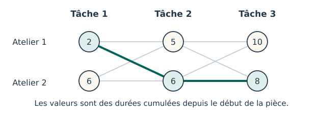
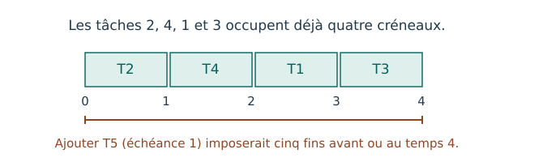
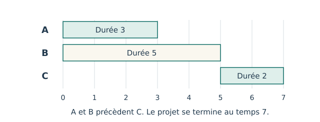

# ENS de Lyon · Second concours · Informatique 2008 — corrigé brut

*Corrigé rédigé par IA, non officiel. Signalez toute erreur.*

**Rédaction** · GPT-6.2 Astra Ultra · vitesse non renseignée · 25 novembre 2026

Les quatre parties étudient le choix des ateliers, les indépendants pondérés, les pénalités de retard et les dépendances entre tâches.

## 1. Ateliers de fabrication

### Question 1.1 · Durée d’un chemin donné

Dans les formules, $t_{k,i}$ est le temps de la tâche $k$ dans l’atelier $i$ et $c_{ij}$ le temps de transport de $i$ à $j$, avec $c_{ii}=0$. Pour les ateliers $f(1),\ldots,f(n)$, la durée vaut

$$
\sum_{k=1}^{n}t_{k,f(k)}+\sum_{k=2}^{n}c_{f(k-1),f(k)}.
$$

Initialiser un accumulateur à $t_{1,f(1)}$. Pour chaque $k$ de 2 à $n$, ajouter le transport depuis l’atelier précédent, puis le temps de la tâche courante. Renvoyer le résultat. Il n’y a pas de transport avant la première tâche. Temps $O(n)$, espace auxiliaire $O(1)$.

### Question 1.2 · Exemple à deux ateliers

Après $T_1$, les meilleurs temps pour finir dans $A_1,A_2$ sont 2 et 6. Après $T_2$, ils sont $\min(2,6+2)+3=5$ et $\min(2+2,6)+2=6$. Après $T_3$, ils sont $\min(5,6+2)+5=10$ et $\min(5+2,6)+2=8$. Le minimum est donc **8**. Le chemin correspondant suit $A_1,A_2,A_2$, pour un total de $2+2+2+2=8$ (une opération dans le premier atelier, un transport et deux opérations dans le second).



### Question 1.3 · Nombre de chemins

Chaque tâche a $p$ choix indépendants d’atelier. Le nombre de suites de $n$ ateliers vaut donc $p^n$. Deux chemins sont différents dès qu’ils choisissent deux ateliers différents pour une même tâche.

### Question 1.4 · Récurrence

Pour une seule tâche, $t_{\min}[1,i]=t_{1,i}$. Pour $k\ge2$,

$$
t_{\min}[k,i]=t_{k,i}+\min_{1\le j\le p}\bigl(t_{\min}[k-1,j]+c_{ji}\bigr).
$$

Tout chemin finissant la tâche $k$ dans l’atelier $i$ la précède d’une tâche dans un certain atelier $j$. Son préfixe coûte au moins $t_{\min}[k-1,j]$. Réciproquement, joindre un préfixe optimal d’un atelier réalisant le minimum à la dernière opération donne exactement le membre de droite. Le transport utilise bien l’indice de départ $j$ en premier.

### Question 1.5 · Programmation dynamique

Voici un calcul pour au moins une tâche et un atelier. Les indices Python commencent à zéro. La ligne `t[k]` contient les coûts de la tâche `k` dans l’ordre des ateliers.

```python
def duree_minimale(t, c):
    precedent = list(t[0])
    p = len(precedent)
    for k in range(1, len(t)):
        suivant = []
        for i in range(p):
            arrivee = min(precedent[j] + c[j][i] for j in range(p))
            suivant.append(arrivee + t[k][i])
        precedent = suivant
    return min(precedent)
```

La première ligne initialise la récurrence de 1.4. Chaque tour construit exactement la ligne suivante à partir de la précédente. Le minimum de la dernière ligne autorise tous les ateliers d’arrivée. Temps $O(p+(n-1)p^2)$, espace auxiliaire $O(p)$ en plus des données.

### Question 1.6 · Retrouver les ateliers

Pour chaque $k\ge2$ et $i$, écrire dans $P[k,i]$ l’un des indices $j$ qui a réalisé le minimum de 1.4. Choisir un atelier $i_n$ minimisant la dernière ligne. Pour $k=n,n-1,\ldots,2$, poser $i_{k-1}=P[k,i_k]$. Afficher ensuite $i_1,\ldots,i_n$ dans l’ordre direct. En remontant une case, on retrouve exactement le préfixe dont le coût a servi au calcul. Les égalités éventuelles autorisent n’importe lequel des prédécesseurs minimisants. La table occupe $O(np)$ et la remontée prend $O(n)$.

## 2. Théorie des matroïdes

### Question 2.1 · Taille des indépendants maximaux

Soient $A$ et $B$ maximaux pour l’inclusion. Si $|A|<|B|$, l’échange fournit $b\in B\setminus A$ tel que $A\cup\{b\}$ soit indépendant. Cela contredit la maximalité de $A$. L’inégalité inverse s’exclut par symétrie. Tous les indépendants maximaux ont donc le même cardinal.

### Question 2.2 · Faire entrer le premier singleton admissible dans un optimum

Soit $B$ un indépendant de poids maximal et, parmi eux, de cardinal maximal. Les poids sont non négatifs, donc $B$ est maximal pour l’inclusion. Si $s_k\in B$, le résultat est acquis. Sinon, partir de $A=\{s_k\}$ et, tant que $|A|<|B|$, utiliser l’échange entre $A$ et $B$ pour ajouter à $A$ un élément de $B\setminus A$. Comme $|B|\ge1$, on finit avec un indépendant de la forme $(B\setminus\{b\})\cup\{s_k\}$.

L’hérédité assure que $\{b\}$ est indépendant. Son indice est donc au moins $k$ et $w(b)\le w(s_k)$. Le nouvel ensemble a un poids au moins égal à celui de $B$, donc optimal, et contient $s_k$. L’argument vaut aussi si les deux poids sont égaux.

### Question 2.3 · Optimalité du glouton

Posons $S_i=\{s_1,\ldots,s_i\}$ et $G_i$ l’ensemble choisi après $i$ itérations. Si un élément a été refusé, l’ajouter aux éléments choisis à cet instant créait une dépendance. L’hérédité empêche de l’ajouter à un ensemble plus grand. Ainsi $G_i$ est maximal parmi les indépendants contenus dans $S_i$. Pour tout indépendant $B$, l’échange implique $|B\cap S_i|\le|G_i|$ (sinon $G_i$ pourrait encore être agrandi). Écrivons $G=G_n$ et $w_i=w(s_i)$, avec $w_{n+1}=0$. En comptant chaque élément du préfixe autant de fois qu’il y apparaît, on obtient

$$
w(B)=\sum_{i=1}^n (w_i-w_{i+1})\,|B\cap S_i|.
$$

En effet, un élément $s_j$ de $B$ contribue au total $\sum_{i=j}^n(w_i-w_{i+1})=w_j$. Chaque coefficient étant positif ou nul et $G\cap S_i=G_i$, on en déduit $w(B)\le w(G)$. Le glouton est donc optimal pour le poids.

## 3. Retards et pénalités

### Question 3.1 · Mettre à l’heure les tâches qui peuvent l’être

Conserver d’abord l’ordre relatif des tâches à l’heure et les avancer toutes en tête de liste. Aucune ne termine plus tard qu’avant. Si deux tâches à l’heure successives $i,j$ sont placées dans cet ordre avec $d_i>d_j$, les permuter. La tâche $j$ termine plus tôt, et $i$ termine à l’ancien instant de fin de $j$, donc au plus à $d_j<d_i$. Trier ainsi le bloc de tête par échéances croissantes préserve toutes ses échéances.

Les tâches en retard de l’ordonnancement initial sont repoussées après ce bloc en conservant leur ordre relatif. Elles ne sont pas avancées et restent en retard. L’ordonnancement est canonique et conserve ici la pénalité initiale $P$, ce qui satisfait la borne demandée.

### Question 3.2 · Suivre les listes de l’algorithme

Le rapport du jury corrige la première ligne de l’algorithme. On examine les tâches par **pénalités décroissantes**, donc dans l’ordre $T_1,\ldots,T_7$. Pour les échéances égales, nous insérons la nouvelle tâche après celles déjà présentes. Les listes ci-dessous contiennent les indices des tâches.

| Tâche | Liste $A$ | Liste $B$ |
|---|---|---|
| 1 | 1 | vide |
| 2 | 2, 1 | vide |
| 3 | 2, 1, 3 | vide |
| 4 | 2, 4, 1, 3 | vide |
| 5 | 2, 4, 1, 3 | 5 |
| 6 | 2, 4, 1, 3 | 5, 6 |
| 7 | 2, 4, 1, 3, 7 | 5, 6 |

L’insertion de 5 ou de 6 ferait apparaître cinq tâches d’échéance au plus 4. Avec 7, la cinquième tâche a l’échéance 6. La séquence finale $A$ suivie de $B$ paie $p_5+p_6=5$.

Si l’on exécute littéralement le tri **croissant** imprimé, on obtient la trace suivante. Elle explique la portée de l’erratum, puisque sa pénalité finale est $p_2+p_1=13$.

| Tâche | Liste $A$ | Liste $B$ |
|---|---|---|
| 7 | 7 | vide |
| 6 | 6, 7 | vide |
| 5 | 5, 6, 7 | vide |
| 4 | 5, 4, 6, 7 | vide |
| 3 | 5, 4, 6, 3, 7 | vide |
| 2 | 5, 4, 6, 3, 7 | 2 |
| 1 | 5, 4, 6, 3, 7 | 2, 1 |



### Question 3.3 · Trois critères équivalents

Les dates limites sont comptées en créneaux entiers positifs. Si toutes les tâches de $A$ sont à l’heure dans un ordre, chacune des $N_t(A)$ tâches d’échéance au plus $t$ occupe un des $t$ premiers créneaux. Donc (a) implique (b).

Supposons (b). Ranger $A$ par échéances croissantes. Si la tâche en position $j$ a pour échéance $d\le n$, alors $j\le N_d(A)\le d$. Si $d>n$, on a directement $j\le n<d$. Aucune tâche ne finit en retard. Ainsi (b) implique (c). Enfin l’ordre canonique sans retard fournit l’ordonnancement demandé dans (a).

### Question 3.4 · Échange entre deux ensembles réalisables

Posons $N_0(A)=0$ et soit $t_*$ le plus grand $t\in\{0,\ldots,n\}$ tel que $N_t(A)=t$. Comme $|A|<|B|\le n$, on a $t_*<n$. Par indépendance de $B$, $N_{t_*}(B)\le t_*=N_{t_*}(A)$. Le nombre de tâches de $B$ ayant une échéance strictement supérieure à $t_*$ est donc strictement supérieur au nombre correspondant pour $A$ :

$$
|B|-N_{t_*}(B)>|A|-N_{t_*}(A).
$$

Il existe ainsi une tâche de $B\setminus A$ dont l’échéance $d$ dépasse $t_*$. Pour $t<d$, son ajout ne change pas $N_t$. Pour $d\le t\le n$, on avait $N_t(A)<t$ par maximalité de $t_*$. Augmenter ce compteur d’une unité respecte donc encore la contrainte. Le critère de 3.3 prouve l’indépendance du nouvel ensemble.

### Question 3.5 · Pénalité minimale

L’ensemble vide est réalisable et supprimer des tâches d’un ordonnancement réalisable préserve l’indépendance. Avec l’échange de 3.4, les ensembles réalisables forment donc un matroïde. Donner à la tâche $i$ le poids $p_i$. L’insertion dans la liste triée contrôle exactement l’indépendance par 3.3. Le tri décroissant et le test appliquent alors le glouton de 2.3. Sa liste $A$ maximise le poids des tâches réalisables.

Pour tout ordonnancement, le poids des tâches à l’heure ne peut dépasser $w(A)$. Exécuter $A$ puis $B$ donne au moins ce poids à l’heure, puisqu’on respecte les dates de $A$. La pénalité minimale vaut donc $\sum_i p_i-w(A)$, soit 5 pour les sept tâches de 3.2.

## 4. Gestion de projet

### Question 4.1 · Ordre de traitement par une seule personne

Construire le graphe orienté avec l’arc $i\to k$ dès que $D[i,k]=1$. Calculer les degrés entrants et placer tous les sommets de degré entrant nul dans une file. En sortir un sommet $i$, l’ajouter en fin du tableau $L$, puis décrémenter le degré entrant de chacun de ses successeurs. Insérer dans la file ceux dont le degré devient nul. Continuer jusqu’à épuisement de la file.

Un sommet extrait a tous ses prédécesseurs déjà extraits. Si le tableau contient $n$ tâches, c’est un ordre compatible. Sinon, chacun des sommets restants possède un prédécesseur restant. En suivant ces prédécesseurs dans un ensemble fini on rencontre un cycle, qui interdit tout ordre de traitement. L’existence équivaut ainsi à l’absence de circuit. Avec la matrice fournie, lire les arcs coûte $O(n^2)$. Les listes de successeurs permettent ensuite le parcours en $O(n+|E|)$.

### Question 4.2 · Dates au plus tôt et date de fin

Si 4.1 détecte un circuit, aucun calendrier ne satisfait les précédences. Sinon, parcourir $L$ dans l’ordre topologique. Pour chaque $k$,

$$
D_{\min}[k]=\max\bigl(\{0\}\cup\{D_{\min}[i]+t_i:D[i,k]=1\}\bigr).
$$

Une source commence à 0. Un successeur ne peut démarrer qu’une fois **tous** ses prédécesseurs terminés, ce qui impose la borne ci-dessus. Avec un exécutant disponible par tâche, on peut effectivement le lancer à cet instant. Par induction dans l’ordre topologique, toutes les dates calculées sont ainsi simultanément réalisables et minimales. Le temps total est $\max_k(D_{\min}[k]+t_k)$. On peut transmettre les dates de fin aux successeurs en un parcours des arcs, en $O(n+|E|)$ après lecture de la matrice.


