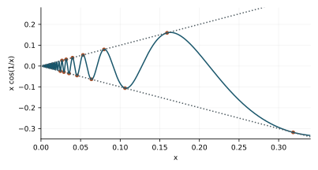

# ENS de Lyon — Second concours de mathématiques 2008 · Corrigé guidé

*Corrigé rédigé par IA, non officiel. Signalez toute erreur.*

**Rédaction** · GPT-6.2 Astra Ultra · vitesse non renseignée · 25 novembre 2026

**Révision** · GPT-6.2 Astra Ultra · vitesse non renseignée · 26 novembre 2026

Les deux exercices portent sur la variation totale puis sur une forme hermitienne qui localise les racines d’un polynôme. Dans la dernière partie, l’indépendance annoncée pour toutes les factorisations nécessite une hypothèse : le corrigé donne le contre-exemple et démontre le critère de signature.

## Exercice 1. Fonctions à variation bornée

### Question 1.1

> [!INDICATION]
> Supprimer les valeurs absolues en utilisant le sens de variation.

#### Solution

Si $f$ est croissante, toute subdivision donne $\sum_i|f(x_{i+1})-f(x_i)|=\sum_i(f(x_{i+1})-f(x_i))=f(b)-f(a)$. La variation est donc exactement ce nombre fini.

### Question 1.2

> [!INDICATION]
> Appliquer la formule fondamentale sur chaque sous-intervalle.

#### Solution

Pour $f\in C^1$, $|f(x_{i+1})-f(x_i)|=|\int_{x_i}^{x_{i+1}}f'(t)dt|\le\int_{x_i}^{x_{i+1}}|f'(t)|dt$. Après addition, toute subdivision est majorée par $\int_a^b|f'|$, quantité finie par continuité. Le supremum satisfait la même inégalité.

### Question 1.3.a

> [!INDICATION]
> Isoler l’unique point où la formule change.

#### Solution

La fonction $x\mapsto x\cos(1/x)$ est continue pour $x>0$. Comme $|x\cos(1/x)|\le x\to0$ quand $x\downarrow0$, le prolongement par $f(0)=0$ est continu sur $[0,1]$.

### Question 1.3.b

> [!INDICATION]
> Calculer les valeurs de la fonction aux abscisses où le cosinus vaut ±1.

#### Solution

Pour $x_k=1/(k\pi)$ on a $f(x_k)=(-1)^k/(k\pi)$. Pour deux points successifs, la distance verticale vaut $(1/k+1/(k+1))/\pi$. La variation sur la subdivision donnée est donc au moins $\pi^{-1}\sum_{k=1}^{n-1}(1/k+1/(k+1))$ en omettant les deux accroissements extérieurs, positifs ou nuls. Cette borne tend vers $+\infty$ par divergence harmonique.

Dans l’ordre croissant des points de la subdivision, l’ajout de $0$ et de $1$ fournit même la somme exacte $2H_n/\pi+\cos(1)$, où $H_n=\sum_{k=1}^n1/k$. En effet le premier accroissement a longueur $1/(n\pi)$ et le dernier vaut $\cos(1)+1/\pi$.

### Question 1.3.c

> [!INDICATION]
> Réutiliser l’exemple qui vient d’être calculé.

#### Solution

Non. La fonction de 1.3.a est continue sur le segment et sa variation est infinie par 1.3.b.

### Question 1.4

> [!INDICATION]
> Prolonger les subdivisions sur un segment plus grand.

#### Solution

Toute subdivision de $[a,x]$ peut être prolongée jusqu’à $b$ en ajoutant un point, d’où $0\le g(x)\le V(f;[a,b])<\infty$. Si $a\le x<y\le b$, ajouter $y$ donne $g(y)\ge g(x)+|f(y)-f(x)|$ en prenant le supremum des sommes initiales. Donc $g$ croît, avec $g(a)=0$.

### Question 1.5

> [!INDICATION]
> Construire la seconde fonction croissante à partir de la variation cumulée.

#### Solution

Si $f=p-q$ avec $p,q$ croissantes, l’inégalité triangulaire sur une subdivision majore sa variation par $p(b)-p(a)+q(b)-q(a)$. Réciproquement, si $f$ est à variation bornée, 1.4 montre $g(y)-g(x)\ge f(y)-f(x)$ pour $x<y$. Donc $g-f$ est croissante, et $f=g-(g-f)$ est bien différence de deux fonctions croissantes.

## Exercice 2. Résultant de Sylvester

### Question 2.1.a

> [!INDICATION]
> Construire la relation à partir d’un facteur commun et utiliser le lemme de Gauss dans l’autre sens.

#### Solution

Si $z_0$ est racine commune, on peut prendre $h=g/(z-z_0)$ et $k=f/(z-z_0)$. Ils sont non nuls et de degrés $m-1,n-1$. Réciproquement, si $f,g$ étaient premiers entre eux, $hf=kg$ impliquerait $f\mid k$, impossible pour $k\ne0$ de degré inférieur à $n$. Il existe donc un facteur commun non constant qui possède une racine complexe.

### Question 2.1.b

> [!INDICATION]
> Comparer le coefficient de chaque puissance en partant du degré maximal.

#### Solution

En posant $a_i=0$ hors de $0\le i\le n$ et $b_i=0$ hors de $0\le i\le m$, le coefficient de $z^{m+n-1-\ell}$ donne
\[
 \sum_{j=0}^{m-1}a_{\ell-j}\alpha_j-\sum_{j=0}^{n-1}b_{\ell-j}\beta_j=0,\qquad 0\le\ell<m+n.
\]
Ces $m+n$ équations homogènes portent sur les $m+n$ coefficients annoncés.

### Question 2.1.c

> [!INDICATION]
> Regarder la matrice transposée, une ligne par coefficient inconnu.

#### Solution

Dans la transposée, la ligne de $\alpha_j$ est $(a_0,\ldots,a_n)$ décalée de $j$ colonnes vers la droite et complétée par des zéros. La ligne de $\beta_j$ est $-(b_0,\ldots,b_m)$ décalée de $j$. Après transposition, le déterminant est inchangé. Extraire un signe de chacune des $n$ dernières lignes donne $(-1)^n$ fois le déterminant affiché par le sujet.

### Question 2.1.d

> [!INDICATION]
> Relier le noyau du système aux relations polynomiales.

#### Solution

Une racine commune existe exactement quand $R(f,g)=0$. En effet l’annulation du déterminant équivaut à une solution non triviale du système. Si l’un des deux polynômes $h,k$ de cette solution était nul, $hf=kg$ forcerait l’autre à être nul aussi. Le critère de 2.1.a s’applique donc dans les deux sens.

## Exercice 2. Forme hermitienne et situation des racines

### Question 2.2.a

> [!INDICATION]
> Diviser le numérateur par la différence des deux variables.

#### Solution

Le numérateur $f(z)f^*(w)-f(w)f^*(z)$ est un polynôme qui s’annule sur $z=w$, donc divisible par $z-w$ dans $\mathbb C[w][z]$. Son quotient a degré au plus $n-1$ en $z$ et est symétrique en $z,w$ car les deux signes changent à l’échange. Son degré en $w$ est donc aussi au plus $n-1$. Les coefficients $A_{hk}$ sont ceux de ce quotient dans la base $z^hw^k$.

### Question 2.2.b

> [!INDICATION]
> Exploiter la symétrie puis la conjugaison des coefficients.

#### Solution

La symétrie donne $A_{hk}=A_{kh}$. D’autre part $\overline{K(f;\bar z,\bar w)}=-K(f;z,w)$, puisque la conjugaison des coefficients échange $f$ et $f^*$. L’identification donne $\bar A_{hk}=-A_{hk}=-A_{kh}$.

### Question 2.2.c

> [!INDICATION]
> Vérifier la symétrie hermitienne de la matrice des coefficients.

#### Solution

En posant $M_{hk}=A_{hk}/i$, on a $\overline{M_{kh}}=-\bar A_{kh}/i=A_{hk}/i=M_{hk}$. Ainsi la forme sesquilinéaire $\sum M_{hk}u_h\bar v_k$ est hermitienne, et sa valeur diagonale est le $H(f)$ demandé.

### Question 2.2.d

> [!INDICATION]
> Ajouter et retrancher un produit croisé dans le noyau de la fraction.

#### Solution

Pour deux variables $z,w$, on a
\[
 K(f_1f_2)=f_2(z)f_2^*(w)K(f_1)+f_1^*(z)f_1(w)K(f_2).
\]
L’identité se vérifie en remultipliant par $z-w$, les deux termes croisés s’annulant. Écrivons $f_2(z)=\sum_{j=0}^s b_jz^j$ et $f_1^*(z)=\sum_{j=0}^r c_jz^j$ en puissances croissantes. Le développement donne $v_h=\sum_{j=0}^s b_j u_{h+j}$ pour $h<r$, et $w_k=\sum_{j=0}^r c_j u_{k+j}$ pour $k<s$. En contractant les coefficients avec $u_h\bar u_k/i$, l’identité devient $H(f_1f_2)(u)=H(f_1)(v)+H(f_2)(w)$.

### Question 2.2.e

> [!INDICATION]
> Remettre les deux blocs de coefficients dans l’ordre du résultant.

#### Solution

La matrice des formes écrites en 2.2.d a $r$ lignes de coefficients croissants de $f_2$, puis $s$ lignes de ceux de $f_1^*$, chaque fois décalées. Renverser les $n$ colonnes puis l’ordre des lignes dans chaque bloc les place en puissances décroissantes. Pour obtenir le résultant $R(f_1^*,f_2)$, échanger enfin les deux blocs. Le signe total est $(-1)^{n(n-1)/2+r(r-1)/2+s(s-1)/2+rs}=1$, car $n=r+s$. Le déterminant est donc exactement ce résultant.

### Question 2.2.f

> [!INDICATION]
> Tester l’indépendance du changement de variables avant chaque étape de récurrence.

#### Solution

Pour un facteur $z-\zeta$, le noyau vaut $\zeta-\bar\zeta$ et la forme vaut $2\Im(\zeta)|u_0|^2$. De plus $H(af)=|a|^2H(f)$. En appliquant 2.2.d successivement aux facteurs, on obtient bien
\[
 H(f)(u)=|a|^2\sum_j 2\Im(z_j)|F_j(u)|^2
\]
avec $a$ coefficient dominant. Si $f$ et $f^*$ sont premiers entre eux, à chaque étape le facteur ajouté $z-z_j$ est premier avec le conjugué du produit antérieur. Par 2.2.e et 2.1.d le changement est inversible. L’indépendance des formes au rang précédent, jointe à la nouvelle coordonnée, se conserve. Cela démontre la version nécessaire à la suite.

L’indépendance sans hypothèse est fausse dans la question imprimée. Pour $f(z)=(z-i)(z+i)=z^2+1$, on a $f=f^*$ et $H(f)=0$. Si les deux formes étaient indépendantes, le changement de coordonnées serait inversible et $2|F_1|^2-2|F_2|^2$ ne serait pas identiquement nul. La formule de récurrence reste vraie avec des formes parfois dépendantes.

Le calcul de 2.2.d fait apparaître le défaut directement. En prenant $f_1=z-i$ et $f_2=z+i$, on a $f_2=f_1^*=z+i$. Les deux formes obtenues sont identiques, $v_0=w_0=iu_0+u_1$, et leurs contributions à $H(f)$ se compensent. En revanche $(z-i)^2$ a une racine double et reste premier avec $(z+i)^2$. La multiplicité seule ne provoque donc pas cette annulation.

### Question 2.2.g

> [!INDICATION]
> Retirer d’abord le pgcd afin que l’indépendance soit effectivement disponible.

#### Solution

Prenons le pgcd unitaire $g$ de $f,f^*$, de degré $r$. La conjugaison des coefficients préserve le pgcd unitaire donc $g^*=g$. Avec $f=gf_1$, $f_1$ et $f_1^*$ sont premiers entre eux et $K(f;z,w)=g(z)g(w)K(f_1;z,w)$. Si $g(z)=\sum_{j=0}^r c_jz^j$ ($c_r=1$), on a $H(f)(u)=H(f_1)(v)$ où $v_h=\sum_{j=0}^r c_j u_{h+j}$, $0\le h<n-r$. Cette application est surjective : en fixant les $r$ premières coordonnées, résoudre successivement pour $u_r,\ldots,u_{n-1}$. Si $r=n$, $K(f)=0$ directement.

Aucune racine de $f_1$ n’est réelle et la version non dégénérée de 2.2.f s’applique. Elle donne rang $n-r$ et autant de coefficients positifs (respectivement négatifs) que de racines de $f_1$ de partie imaginaire positive (respectivement négative), comptées avec multiplicité. La surjection ajoute $r$ directions nulles, sans changer les deux indices de la signature.

### Question 2.2.h

> [!INDICATION]
> Examiner quand le rang est plein et tous les signes positifs.

#### Solution

Si toutes les racines de $f$ sont dans le demi-plan supérieur ouvert, celles de $f^*$ sont dans le demi-plan inférieur et le pgcd vaut un. La signature par 2.2.g est $(n,0)$, donc $H(f)$ est définie positive. Inversement si $H(f)$ est définie positive, son rang est $n$, donc $r=0$, et son indice positif $n$ compte toutes les racines de $f$ dans le demi-plan supérieur.

### Question 2.2.i

> [!INDICATION]
> Tourner le demi-plan gauche vers le demi-plan supérieur.

#### Solution

Posons $P(z)=f(iz)$. À une racine $\zeta$ de $f$ correspond la racine $-i\zeta$ de $P$, dont la partie imaginaire est $-\Re\zeta$. Ainsi toutes les racines de $f$ ont partie réelle strictement négative si et seulement si $H(P)=H(f(i\,\cdot))$ est définie positive. On peut tester cette condition par la positivité des mineurs principaux dominants de sa matrice hermitienne.
