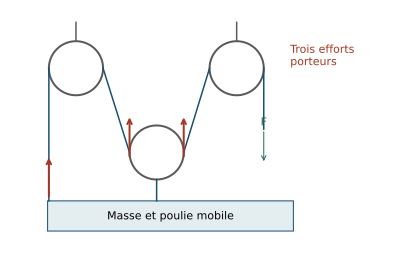
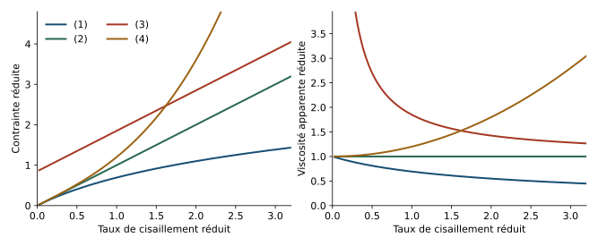
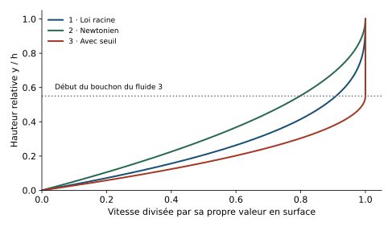

# ENS de Lyon, second concours 2008 — Physique · Corrigé brut

*Corrigé rédigé par IA, non officiel. Signalez toute erreur.*

**Rédaction** · GPT-6.2 Astra Ultra · vitesse non renseignée

## I — Questionnaire

### Question I.1 — Quatre constantes

La charge élémentaire est $e\simeq1.60\times10^{-19}$ C. La célérité de la lumière dans le vide est $c\simeq3.00\times10^8\,\mathrm{m\,s^{-1}}$. La masse de l’électron est $m_e\simeq9.11\times10^{-31}$ kg. La constante de Planck est $h\simeq6.63\times10^{-34}\,\mathrm{J\,s}$.

### Question I.2 — Quatre ordres de grandeur

Dans l’air à $25\,^\circ\mathrm C$ sous une atmosphère, le son se propage à environ $346\,\mathrm{m\,s^{-1}}$. Le rayon moyen de la Terre est $6.37\times10^6$ m. Les distances moyennes de centre à centre valent environ $3.84\times10^8$ m de la Terre à la Lune et $1.50\times10^{11}$ m de la Terre au Soleil.

### Question I.3 — Année-lumière

C’est la distance parcourue par la lumière dans le vide pendant une année. Pour une année de $365.25$ jours, cela donne $c\times365.25\times86400\,\mathrm s\simeq9.46\times10^{15}$ m.

### Question I.4 — Équations usuelles

Gaz parfait, $PV=nRT$. Force de Coulomb exercée par 1 sur 2, $\mathbf F_{1\to2}=q_1q_2\hat{\mathbf r}_{12}/(4\pi\epsilon_0 r_{12}^2)$, avec $\hat{\mathbf r}_{12}$ orienté de 1 vers 2. Théorème de Gauss, $\oint_{\mathcal S}\mathbf E\cdot d\mathbf S=Q_{\rm int}/\epsilon_0$ pour une surface fermée orientée vers l’extérieur. Équation de Maxwell–Ampère dans le vide en présence de sources, $\nabla\times\mathbf B=\mu_0\mathbf j+\mu_0\epsilon_0\,\partial_t\mathbf E$.

## II — Systèmes de poulies

### Question II.1 — Inertie du disque

On cherche le moment autour de l’axe passant par le centre et perpendiculaire au disque. Sa masse surfacique uniforme vaut $M/(\pi R^2)$. Une couronne de rayon $r$ et d’épaisseur $dr$ porte $dm=2Mr\,dr/R^2$. Ainsi $I=\int_0^Rr^2\,dm=2M R^{-2}\int_0^Rr^3dr=MR^2/2$.

### Question II.2 — Trois brins porteurs

Les deux poulies supérieures sont fixes, celle du bas est liée à la charge et une extrémité du câble est directement fixée à la charge. La tension a partout le module $F$. La poulie mobile reçoit $2F$ vers le haut et l’extrémité du câble fournit encore $F$. L’équilibre exige $3F=Mg$. La force exercée sur le brin libre vaut donc $Mg/3$, verticalement vers le bas sur la figure 1a.

### Question II.3 — Montage à un nombre impair de poulies

Dans le prolongement du montage dessiné, $n$ poulies mobiles reçoivent chacune $2F$ et l’attache directe apporte $F$. Les $n+1$ poulies fixes changent la direction du câble. Le bilan est $(2n+1)F=Mg$. Ainsi $F=Mg/(2n+1)$, et un déplacement vertical de la charge demande un déplacement du brin libre $2n+1$ fois plus grand en module.

### Question II.4 — Dynamique du câble qui se déroule

L’axe $z$ de la figure 1b est ascendant. Notons $T$ la tension et $s=-z$ le déplacement descendant. La masse obéit à $M\ddot s=Mg-T$. Le disque de masse $M_1$ vérifie $I_1\ddot\theta=TR_1$ dans le sens du déroulement et $\ddot s=R_1\ddot\theta$. Alors $T=(I_1/R_1^2)\ddot s$. Avec $I_1=M_1R_1^2/2$, on obtient $(M+M_1/2)\ddot z=-Mg$. L’inertie du disque réduit l’accélération de chute.

### Question II.5 — Loi horaire

L’accélération est constante. Pour $z(0)=\dot z(0)=0$, $z(t)=-Mg\,t^2/[2(M+M_1/2)]$. Elle est négative dans le repère du dessin. Si $M_1\to0$, on retrouve la chute libre $z=-gt^2/2$.

## III — Écoulements de fluides complexes

### Question III.1 — Dimension de la viscosité

Dans $F=\eta S\,\partial_yv_x$, le gradient de vitesse a les unités d’un inverse de temps. La viscosité dynamique $\eta$ s’exprime en $\mathrm{Pa\,s}=\mathrm{kg\,m^{-1}\,s^{-1}}$, et a pour dimension $M L^{-1}T^{-1}$.

### Question III.2 — Contrainte et taux de cisaillement

$\sigma=F/S$ a la dimension d’une pression $M L^{-1}T^{-2}$ et s’exprime en pascals. Le taux $\dot\gamma=\partial_yv_x$ se mesure en $\mathrm{s^{-1}}$ et a pour dimension $T^{-1}$.

### Question III.3 — Construire les viscosités apparentes

Pour $\dot\gamma>0$, $\eta_{\rm app}=\sigma/\dot\gamma$ est la pente de la sécante joignant l’origine au point de la courbe de contrainte. Sur la **courbe 1**, la sécante s’aplatit avec le cisaillement, donc la viscosité décroît. La **courbe 2** donne une constante. Pour la **courbe 3**, une droite d’ordonnée à l’origine $\sigma_0>0$ et de pente $\eta_0$, on trouve $\eta_0+\sigma_0/\dot\gamma$, qui part de l’infini et rejoint $\eta_0$. La **courbe 4** donne une viscosité croissante. Le tracé ci-dessous restitue les allures qualitatives de la figure 3 du sujet.

### Question III.4 — Identifier les quatre comportements

Le fluide **1** est rhéo-fluidifiant car sa viscosité apparente diminue. Le **2** est newtonien, avec une proportionnalité stricte entre cisaillement et contrainte. Le **3** est un fluide à seuil, capable de supporter une contrainte finie au repos. Le **4** est rhéo-épaississant, sa viscosité augmente avec le taux de cisaillement.

### Question III.5 — Exemples

Le dentifrice est un exemple usuel de matériau à seuil. Une suspension concentrée d’amidon dans l’eau peut être rhéo-épaississante. Une solution de gomme xanthane est couramment rhéo-fluidifiante. Ces classifications décrivent une gamme de sollicitations, de concentrations et de températures.

### Question III.6 — Dépendance transverse de la vitesse

Le champ est parallèle au plan avec une seule composante $v_x(x,y)$. L’incompressibilité s’écrit $\nabla\cdot\mathbf v=0$, donc $\partial_xv_x=0$. Il reste $\mathbf v=v_x(y)\mathbf e_x$.

### Question III.7 — Termes de l’équation de mouvement

$\rho D\mathbf v/Dt$ est la masse volumique multipliée par l’accélération matérielle, somme de l’accélération locale et de l’accélération convective $(\mathbf v\cdot\nabla)\mathbf v$. $-\nabla P$ représente la force de pression volumique, $\rho\mathbf g$ le poids volumique et $\eta\Delta\mathbf v$ la force visqueuse volumique du fluide newtonien incompressible de viscosité constante. Dans le profil étudié, l’accélération locale est nulle par stationnarité et la convective vaut $v_x\partial_x\mathbf v=\mathbf0$.

### Question III.8 — Divergence de la contrainte tangentielle

La tranche $[y,y+dy]$ de section $S$ reçoit $+S\sigma(y+dy)\mathbf e_x$ de la couche supérieure et $-S\sigma(y)\mathbf e_x$ de la couche inférieure. Après division par $Sdy$ puis passage à la limite, $\mathbf f_{\rm visq}=\partial_y[\eta(\dot\gamma)\dot\gamma]\mathbf e_x$.

### Question III.9 — Équation pour le fluide complexe

Dans cette géométrie, $\rho D\mathbf v/Dt=-\nabla P+\rho\mathbf g+\partial_y[\eta(\dot\gamma)\dot\gamma]\mathbf e_x$. Pour le profil stationnaire pleinement développé, le membre de gauche est nul. Si $\eta$ est constante, le terme tangent se réduit à $\eta\,\partial_y^2v_x$.

### Question III.10 — Conditions aux limites

La paroi solide est fixe et le fluide y adhère, d’où $v_x(0)=0$. À la surface libre, on néglige la contrainte tangentielle exercée par l’air, donc $\sigma(h)=0$. Pour les lois considérées, l’énoncé admet $\partial_yv_x(h)=0$. Dans un matériau à seuil, la zone de surface peut précisément se déplacer sans se cisailler.

### Question III.11 — Pression

La coordonnée $y$ est normale au plan et tournée vers l’extérieur. La projection normale donne $0=-\partial_yP-\rho g\cos\alpha$. Avec $P(h)=P_0$, cela donne $P(y)=P_0+\rho g(h-y)\cos\alpha$. Comme $h$, $\alpha$ et $P_0$ sont constants suivant $x$, $\partial_xP=0$.

### Question III.12 — Contrainte au sein de la couche

L’axe $x$ est orienté vers l’aval. La projection tangentielle est $0=\rho g\sin\alpha+d\sigma/dy$. Avec la contrainte nulle à la surface, $\sigma(y)=\rho g\sin\alpha(h-y)$. Dans la notation $\eta(\dot\gamma)\dot\gamma=a(b-y)$, $a=\rho g\sin\alpha$ et $b=h$. Ce résultat est un bilan des forces indépendant de la loi rhéologique.

### Question III.13 — Appliquer les trois lois de comportement

Écrivons $A=\rho g\sin\alpha$ et supposons la pente positive. Pour le fluide 1, $\kappa\sqrt{v_1'}=A(h-y)$. Pour le fluide 2, $\eta_0v_2'=A(h-y)$. Pour le fluide 3, là où il est cisaillé, $\sigma_0+\eta_0v_3'=A(h-y)$. Si $A(h-y)\le\sigma_0$, le matériau 3 accepte cette contrainte à $v_3'=0$. Le prime désigne $d/dy$. La loi racine du fluide 1 est celle fournie pour le calcul, le fascicule précise qu’elle diffère du dessin qualitatif.

### Question III.14 — Profils des deux premiers fluides

On a $v_1'=(A/\kappa)^2(h-y)^2$ et $v_2'=A(h-y)/\eta_0$. L’intégration depuis la paroi où $v_i(0)=0$ donne
$$
v_1(y)=\frac{A^2}{3\kappa^2}\,[h^3-(h-y)^3],\qquad
v_2(y)=\frac{A}{2\eta_0}\,[h^2-(h-y)^2].
$$
Les deux profils sont croissants et ont une tangente de gradient nul en surface. Leurs vitesses maximales sont respectivement $A^2h^3/(3\kappa^2)$ et $Ah^2/(2\eta_0)$.

### Question III.15 — Débits et comparaison

Intégrer $L v_i(y)$ sur l’épaisseur donne $Q_1=LA^2h^4/(4\kappa^2)$ et $Q_2=LAh^3/(3\eta_0)$. Pour une pente non nulle, $Q_1/Q_2=3\eta_0Ah/(4\kappa^2)$. Ainsi $Q_1>Q_2$ si $\rho gh\sin\alpha>4\kappa^2/(3\eta_0)$. Le membre de gauche est la contrainte au fond. Quand elle augmente, le premier fluide se fluidifie, et son débit devient supérieur malgré une comparaison possible en sens inverse à faible sollicitation.

### Question III.16 — Contrainte au repos

Le bilan tangent du poids de la couche au-dessus de $y$ vaut aussi au repos, donc $\sigma(y)=A(h-y)$. Le matériau 3 peut soutenir cette contrainte statique tant qu’elle reste au plus égale à $\sigma_0$. Le maximum se situe au fond et vaut $Ah$.

### Question III.17 — Début de l’écoulement

Un écoulement sur la paroi adhérente apparaît lorsque la contrainte au fond dépasse strictement le seuil, soit $\rho gh\sin\alpha>\sigma_0$. Pour une pente donnée, $h$ doit donc dépasser $\sigma_0/(\rho g\sin\alpha)$. À l’égalité, seule la paroi atteint le seuil et l’épaisseur de la zone cisaillée est encore nulle.

### Question III.18 — Bouchon de surface

La surface de séparation $y_c$ entre les zones cisaillée et non cisaillée satisfait $A(h-y_c)=\sigma_0$. L’épaisseur superficielle est donc $\Delta=h-y_c=\sigma_0/(\rho g\sin\alpha)$. Dans la base $0\le y\le y_c$, $v_3'=A(y_c-y)/\eta_0$ et $v_3=A(y_cy-y^2/2)/\eta_0$. Dans la couche supérieure $v_3'=0$ et tout le bouchon avance à $v_3(y_c)=Ay_c^2/(2\eta_0)$. La continuité de la vitesse et du cisaillement explique le raccordement horizontal du gradient de vitesse à zéro.

