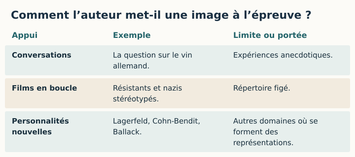

# ENS Rennes · D1 · Allemand 2008 — Corrigé brut

*Corrigé rédigé par IA, non officiel. Signalez toute erreur.*

**Rédaction** · GPT-6.2 Astra Ultra · vitesse non renseignée

Écrit de l’ENS de Cachan, conservé dans les archives D1 de Rennes. Ulrich Fichtner, Spiegel Online, 14 mai 2007.

## Version française

**Comment les Français découvrent avec étonnement une Allemagne qui prend plaisir à changer**

Il y a en France des gens à qui, en bavardant avec des Allemands, il vient à l’idée de demander s’il existe vraiment du vin allemand. Il y a des Français, au fin fond de la province, derrière les bois, qui s’imaginent que Helmut Kohl est encore chancelier à Bonn. Il y a des gens qui parlent du monde comme si le mur de Berlin n’était jamais tombé. Et tout cela n’a rien de métaphorique : ce sont des expériences personnelles toutes récentes.

Il y a une France qui, obstinément, ignore tout de l’Allemagne et tient à continuer de tout en ignorer, une France qui s’installe devant la télévision avec ses paquets de chips pour regarder en boucle des films montrant combien les résistants étaient malins et les nazis balourds. Il y a des Français qui, tout simplement, n’aiment pas les Allemands. Mais, ces années-ci, ils sont de moins en moins nombreux.

Heureusement, il y a toujours eu, sur la rive gauche du Rhin, des Allemands bien éloignés des stéréotypes habituels. On peut dire aujourd’hui que des personnalités aussi dissemblables que Karl Lagerfeld, Daniel Cohn-Bendit et Michael Ballack ont fait davantage, et des choses plus importantes, pour l’image des Allemands en France que quarante ans de diplomatie officielle. Ces trois-là sont à peu près les Allemands les plus célèbres dans ce pays. Ils ont pris la place de Heidegger, de Nietzsche, de Hegel et aussi d’Hitler. Une nouvelle époque s’est ouverte.

## Expression en allemand

Dire si l’image de l’Allemagne et des Allemands en France évolue à l’époque de l’article. 100 mots.

Meiner Meinung nach verändert sich das Deutschlandbild in Frankreich, sobald Menschen mehr als eine einzige Geschichte über das Nachbarland hören. Wer einen deutschen Fußballspieler kennt, sieht zunächst einen Sportler und vielleicht erst später einen Deutschen. Dadurch verliert das alte nationale Klischee etwas von seiner Macht. Dennoch genügt ein berühmter Name kaum, um die Gesellschaft hinter ihm zu verstehen. Ein Schüleraustausch oder ein gemeinsames Musikprojekt kann mehr bewirken, weil man dabei Unterschiede zwischen einzelnen Menschen erlebt. Das Bild wandelt sich also tatsächlich, aber ungleichmäßig: Persönliche Begegnungen können es erweitern, während dieselben alten Filme immer wieder dieselben Erwartungen beim französischen Publikum wecken.

*100 mots, comptés par espaces.*

[Feuillet original, p. 3](https://www.ens-rennes.fr/medias/fichier/sujet08d1langues_1421752176045-pdf#page=3)
