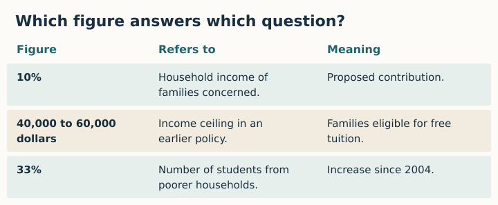

# ENS Rennes · D1 · Anglais 2008 — Corrigé guidé

*Corrigé rédigé par IA, non officiel. Signalez toute erreur.*

**Rédaction** · GPT-6.2 Astra Ultra · vitesse non renseignée

Écrit de l’ENS de Cachan, conservé dans les archives D1 de Rennes. Eric Konigsberg, The New York Times, 30 décembre 2007.

## Version française

**Ne plus jamais avoir à dire « C’est trop cher »**

En annonçant, au début du mois, qu’elle apporterait une aide financière substantielle aux étudiants dont les familles gagnent entre 120 000 et 180 000 dollars par foyer, l’université Harvard a fait apparaître une figure inattendue : celle du boursier issu de la classe moyenne supérieure.

Harvard espère qu’en demandant à ces étudiants 10 % des revenus du foyer, elle attirera des enfants de familles des classes moyennes et moyennes supérieures que son tarif de plus de 45 000 dollars avait découragés. Le pari paraît peu risqué. Depuis 2004, année où Harvard a commencé à dispenser de frais de scolarité les familles dont les revenus ne dépassaient pas 40 000 dollars, seuil relevé depuis à 60 000, le nombre d’étudiants issus de familles modestes a augmenté de 33 %.

Les responsables de Harvard ont toutefois exprimé un autre espoir, celui de voir leur nouvelle politique atténuer le clivage, encore très présent dans l’université, entre « maîtres et domestiques ». Ils ont évoqué une fracture qui permet aux seuls étudiants aisés de saisir des occasions très précieuses de faire de la recherche sans être payés, d’effectuer des stages d’été non rémunérés ou d’aller étudier à l’étranger.

Richard Kahlenberg, chercheur confirmé à la Century Foundation et partisan de longue date d’une politique de discrimination positive fondée sur le milieu social, estime qu’il faut saluer le choix de Harvard. Symboliquement, l’université range la classe moyenne supérieure du côté de tous ceux qui gagnent moins qu’elle plutôt que du côté de ceux qui gagnent davantage.

« Politiquement, il est plus tenable de distinguer, au sein de Harvard, les riches et tous les autres que d’opposer les pauvres à tout le reste de l’université, explique M. Kahlenberg. Jusqu’ici, on avait des gens de la classe moyenne supérieure qui en voulaient aux plus pauvres de pouvoir étudier à l’œil. »

## Expression en anglais

Is Harvard’s new policy conducive to integration or exclusion? 100 mots.

Harvard’s plan could promote integration because uncertainty about fees may deter a family before a student even applies. Naming a predictable share of household income gives applicants a reason to consider the university. It may also build support for financial aid among parents who previously thought that only other families benefited. Yet admission and affordable tuition do not guarantee participation on equal terms. An unpaid summer placement still costs money if a student must give up paid work to accept it. The policy therefore opens one door, but its success depends on whether poorer students can use opportunities after admission.

*100 mots, comptés par espaces.*

## Comment construire la réponse

**Identifier les quatre bases numériques.** Les revenus de 120 000 à 180 000 dollars définissent une catégorie de foyers. La contribution proposée est de 10 % de leurs revenus. Les seuils de 40 000 puis de 60 000 dollars concernent une autre politique, la gratuité des frais de scolarité. Les 33 % mesurent l’augmentation du nombre d’étudiants modestes, pas leur part dans l’effectif total.

**Comprendre deux images de classe.** Les étages d’une grande maison opposent maîtres et domestiques. L’université compte une seule communauté institutionnelle, mais des conditions de vie distinctes. *Getting a free ride* restitue le regard de ceux qui reprochent aux autres un avantage, d’où le registre familier de la fin.

**Mesurer l’intégration à deux moments.** Le modèle distingue la possibilité de poser sa candidature de celle de profiter d’un stage après l’admission. Il peut ainsi défendre l’effet d’intégration du tarif et nommer une inégalité que la mesure ne résout pas à elle seule.

[Feuillet original, p. 4](https://www.ens-rennes.fr/medias/fichier/sujet08d1langues_1421752176045-pdf#page=4) · [Rapport du jury, partie écrite](https://www.ens-rennes.fr/medias/fichier/r1a_08_d1_lv1_1404897184762.pdf#page=2)
