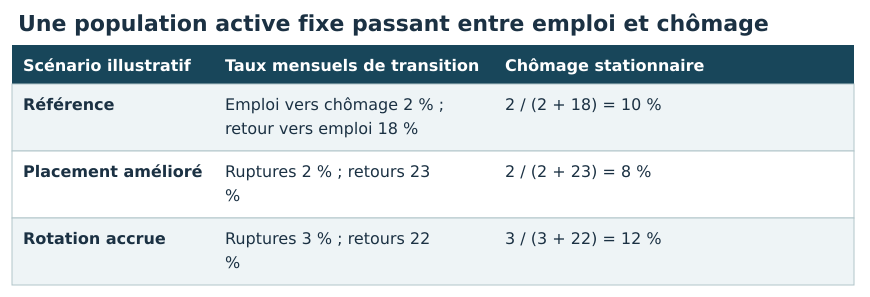

# ENS de Cachan D1 — Composition d’ordre économique 2008 · Corrigé brut

*Corrigé rédigé par IA, non officiel. Signalez toute erreur.*

**Rédaction** · GPT-6.2 Astra Ultra · vitesse non renseignée

## Réformer le fonctionnement du marché du travail est-il suffisant pour résoudre le problème du chômage en France ?

### Introduction

Au quatrième trimestre de 2007, le taux de chômage en France métropolitaine atteint 7,5 % selon l’estimation publiée par l’Insee en mars 2008. Pendant qu’une partie des actifs cherche un emploi, des entreprises déclarent des difficultés de recrutement. Réorganiser les services de placement paraît répondre directement à cette coexistence. Mais même un service qui renseignerait immédiatement chaque candidat sur toutes les offres pourrait-il procurer un poste à chacun ?

Au sens du Bureau international du travail, un chômeur est une personne sans emploi, disponible pour travailler et en recherche active, ou ayant déjà trouvé un emploi qui commencera prochainement selon les critères de l’enquête. Le taux de chômage rapporte ces personnes aux actifs. Réformer le marché du travail, c’est modifier durablement les règles de fixation des rémunérations, d’emploi, d’indemnisation ou de rencontre entre salariés et employeurs. Le rapport de 2008 demande de relier ces règles à des « faits concrets relatifs au cas français ». L’enjeu est de savoir jusqu’où une amélioration du fonctionnement de ce marché peut abaisser durablement le chômage, compte tenu des décisions de production et des revenus auxquels l’emploi donne lieu.

### I. Les réformes peuvent réduire les difficultés durables d’accès à l’emploi

#### A. Le coût d’une embauche et les règles de rémunération influencent la demande de travail

Une entreprise qui envisage d’embaucher compare le coût du travail supplémentaire, cotisations comprises, à la valeur de la production additionnelle qu’elle pense pouvoir vendre. Un allègement de cotisations patronales ciblé sur les bas salaires peut rendre rentables des embauches pour lesquelles l’écart initial était faible. Cette voie, empruntée en France depuis les années 1990, maintient le salaire net des personnes concernées. L’effet dépend de la réaction des prix, des marges et des salaires. Une partie de l’aide finance des emplois qui auraient existé même en son absence. Sa dégressivité peut aussi augmenter le coût pour l’employeur d’une hausse de salaire. Ces deux effets limitent le nombre d’emplois supplémentaires par euro dépensé.

Une baisse du salaire minimum n’aurait pas nécessairement les mêmes effets. Lorsque l’employeur peut fixer un salaire inférieur à la valeur du travail fourni parce que les salariés ont peu d’alternatives, un minimum modéré peut relever à la fois le salaire et l’emploi. Un employeur peut aussi offrir volontairement un salaire supérieur au salaire de réservation pour améliorer l’effort, retenir les salariés et réduire les coûts de remplacement. La théorie du salaire d’efficience explique ainsi pourquoi la suppression d’une règle publique ne ferait pas disparaître toute rigidité. Dans le modèle de fixation des salaires et des prix, le chômage d’équilibre dépend à la fois des revendications salariales pour un chômage donné et du salaire réel compatible avec la productivité et les marges des entreprises. Une réforme des seules règles salariales agit sur une partie du mécanisme.

#### B. L’appariement et la sécurité des transitions commandent aussi la durée du chômage

Un demandeur d’emploi peut manquer d’information, de qualification ou de mobilité. Des offres d’aide-soignant et des demandeurs formés à la mécanique dans un autre bassin ne constituent pas une réserve de postes immédiatement interchangeables. La formation, l’aide au transport ou au logement et le rapprochement des services de placement et d’indemnisation peuvent réduire ces délais. La loi française du 13 février 2008 organise une nouvelle institution du service public de l’emploi. À la date de l’épreuve, elle fournit un exemple de réforme engagée, dont il serait prématuré de chiffrer les résultats. Sur une courbe de Beveridge portant les postes vacants en ordonnée et le chômage en abscisse, un meilleur appariement permet un chômage moindre pour un même niveau de vacances.

Les flux importent autant que les délais. Dans un exemple à population active fixe, soit $s$ la proportion des personnes en emploi qui deviennent chômeuses chaque mois et $f$ celle des chômeurs qui reprennent un emploi. À l’équilibre des flux, $s(1-u)=fu$, d’où $u=s/(s+f)$. Une simplification des contrats peut accroître $f$ en levant la crainte d’une embauche difficile à défaire. Elle peut simultanément augmenter $s$ si les ruptures deviennent plus fréquentes. La diffusion de contrats courts peut ainsi faciliter l’accès à une première expérience tout en multipliant les retours au chômage. Les chiffres de la figure isolent ce mécanisme.

### II. Le volume des débouchés et les effets en retour sur les revenus limitent la portée d’une action isolée

#### A. Une entreprise bien informée et libre d’embaucher attend néanmoins des commandes

La demande de travail est dérivée de la demande de biens et de services. Si tous les employeurs d’un bassin réduisent leurs projets parce que leurs carnets de commandes se vident, le chômage augmente même lorsque les qualifications restent adaptées. Une telle contraction fait généralement baisser les vacances d’emploi en même temps qu’elle augmente le chômage. Cela correspond à un déplacement le long de la courbe de Beveridge, différent d’une détérioration de l’appariement. De même, la régularité empirique dite loi d’Okun relie ralentissement de la production relativement à sa tendance et hausse du chômage. Les ajustements d’heures, de productivité et de participation rendent le lien variable.

L’extension de la population active, par exemple par le maintien en activité de travailleurs plus âgés, accroît le potentiel de production. Elle peut d’abord grossir le nombre de chômeurs si les postes tardent à être créés. Inversement, un chômage de longue durée peut déqualifier les salariés, les décourager ou conduire les employeurs à écarter leurs candidatures. Un choc initialement conjoncturel devient alors persistant, phénomène d’hystérèse. Prévenir une forte contraction des débouchés peut donc servir également un objectif structurel.

#### B. Combiner la sécurité des transitions avec des politiques de demande et d’investissement

Réduire les indemnités peut hâter l’acceptation de certains emplois en modifiant le revenu de remplacement. Une allocation assure aussi le revenu pendant la recherche, finance le temps nécessaire à la qualification et soutient la consommation des ménages qui disposent de peu d’épargne. Une baisse simultanée des salaires ou de la sécurité des revenus peut contracter les ventes, surtout si les ménages accroissent leur épargne de précaution. Une hausse des exportations peut compenser une partie de ce recul, selon l’état de la demande étrangère, la spécialisation des entreprises et la réaction des partenaires. L’effet agrégé diffère donc de celui qu’éprouve l’entreprise qui réduit seule ses coûts.

L’expérience danoise de flexibilité des contrats, d’assurance et d’accompagnement actif illustre la complémentarité des institutions. Transposer une facilité de rupture isolément écarterait le financement de la formation et la sécurité de revenu qui rendent la mobilité praticable. Dans une France membre de la zone euro, la politique monétaire répond à la conjoncture de la zone. Le budget national conserve des stabilisateurs automatiques. Les prestations et l’ajustement des prélèvements amortissent le recul de la demande. L’investissement productif, les infrastructures et la concurrence sur les marchés de biens peuvent ouvrir des débouchés et améliorer la productivité à moyen terme. L’emploi créé dépend alors de la réaction de la production et de la qualification des personnes prêtes à occuper ces postes.

### Conclusion

Réduire la durée des transitions, corriger un coût d’embauche excessif et faciliter les reconversions peuvent faire reculer une composante persistante du chômage. La conjoncture, les débouchés et la manière de financer les réformes fixent cependant les conditions du résultat. On jugera une réforme française à son effet sur les entrées au chômage, sur les sorties durables vers l’emploi et sur la capacité des entreprises à développer leur activité, en tenant compte des personnes qui sortent de la population active.

[Rapport du jury](https://www.ens-rennes.fr/medias/fichier/r1a_08_d1_ecosocial_1404897104294.pdf) · [Sujet de la session](https://www.ens-rennes.fr/medias/fichier/sujet08d1compo-sujet-ordre-eco-social_1421752166033-pdf) · [Insee, Note de conjoncture de mars 2008](https://www.insee.fr/fr/statistiques/fichier/1407735/NdC_Mars_2008.pdf) · [Loi du 13 février 2008 relative au service public de l’emploi](https://www.legifrance.gouv.fr/jorf/id/JORFTEXT000018117826)
