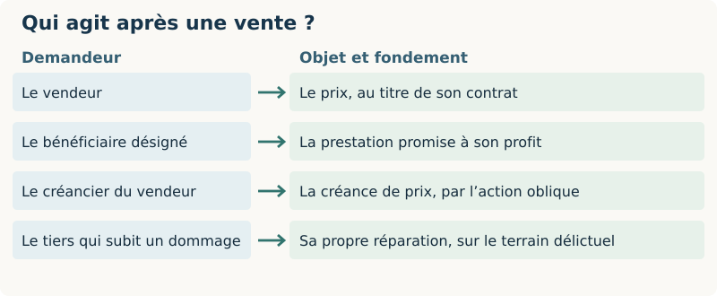

# ENS de Cachan D1 — Droit civil 2008 · Corrigé guidé

*Corrigé rédigé par IA, non officiel. Signalez toute erreur.*

**Lecture du rapport du jury** · GPT-6.2 Astra Ultra · vitesse non renseignée

**Rédaction** · GPT-6.2 Astra Ultra · vitesse non renseignée

## Le contrat et les tiers

### Introduction

> [!INDICATION]
> Dessiner une vente entre A et B, puis ajouter C. Demander successivement si C doit le prix, s’il doit respecter le transfert et s’il peut invoquer une livraison défectueuse qui lui a causé un dommage. Les trois questions portent sur le même contrat.

Une entreprise loue un immeuble. Une autre, qui exploite le commerce dans les lieux, perd une partie de sa clientèle parce que leur accès est mal entretenu. Cette seconde société peut-elle invoquer les obligations d’un bail qu’elle n’a pas signé ? L’Assemblée plénière de la Cour de cassation a eu à connaître d’une situation de cet ordre le 6 octobre 2006 dans l’affaire *Boot Shop*. Le problème est aussi ancien que l’explication du contrat par l’autonomie de la volonté. Si chacun peut régler ses affaires par accord avec autrui, à quelle autorité deux volontés pourraient-elles prétendre sur une troisième ?

L’article 1165 du Code civil, dans sa rédaction en vigueur au concours, dispose que « les conventions n’ont d’effet qu’entre les parties contractantes ». La partie est celle à qui l’accord est juridiquement imputé, y compris lorsqu’elle a été valablement représentée. Le tiers est celui qui demeure étranger à cet accord. Encore faut-il déterminer de quel effet il s’agit. L’obligation de verser le loyer et l’existence d’un bail que doit prendre en considération un acquéreur de l’immeuble constituent deux effets différents. Comment réserver aux parties la maîtrise de leur engagement tout en protégeant les intérêts qui se forment autour de son exécution ? Le consentement délimite le cercle de l’obligation contractuelle. L’ordre juridique organise ensuite les actions des tiers lorsque le contrat atteint leurs biens, leur crédit ou leur activité.

### I. Le contrat réserve la dette aux parties tout en créant une situation juridique ouverte aux tiers

#### A. La liberté d’engager son patrimoine délimite le cercle des débiteurs et des créanciers

> [!INDICATION]
> Faire varier le rôle du signataire. Un mandataire signe pour son mandant, un porte-fort promet personnellement le fait d’un tiers. Dans chaque cas, nommer celui à qui le créancier peut demander l’exécution.

La force obligatoire reconnue par l’article 1134 aux conventions légalement formées se comprend par rapport à « ceux qui les ont faites ». L’acheteur peut exiger la délivrance du vendeur, qui peut lui réclamer le prix. Le voisin de l’acheteur, intéressé par la livraison, ne peut en réclamer l’exécution pour son propre compte. Une signature n’épuise toutefois pas la qualification de partie. Dans les limites du mandat, l’engagement pris au nom du mandant oblige celui-ci. Les ayants cause universels ou à titre universel recueillent en principe les droits et charges transmissibles de leur auteur, sous réserve notamment des règles successorales et des droits attachés à sa personne. L’ayant cause à titre particulier, qui reçoit un bien déterminé, ne recueille pas pour autant toutes les dettes de son auteur. Il faut identifier le droit attaché au bien ou le texte qui organise la transmission.

Le porte-fort permet précisément d’obtenir une garantie lorsque le consentement d’autrui manque. Selon l’article 1120 ancien, celui qui promet la ratification du tiers engage son propre patrimoine. Si le titulaire d’un bien refuse de ratifier la vente dont un proche s’était porté fort, l’acheteur peut demander une indemnité au promettant dans les conditions de son engagement. Le titulaire conserve la faculté de refuser. La stipulation pour autrui va plus loin en faveur du tiers. Dans les conditions de l’article 1121, le stipulant obtient du promettant un engagement dont le bénéficiaire acquiert directement le bénéfice. Le capital assuré au profit d’une personne désignée en offre l’illustration. Celle-ci peut agir contre le promettant. Son acceptation, lorsqu’elle intervient, consolide le bénéfice en faisant obstacle à la révocation dans les conditions du texte. L’accord initial a pu conférer un droit au tiers tout en respectant sa liberté de décliner le bénéfice.

#### B. L’opposabilité protège à la fois la situation créée par l’accord et les tiers qu’elle concerne

Le vendeur qui transfère un droit sur une chose modifie la composition de son patrimoine. Cette situation a vocation à être reconnue par les tiers. L’opposabilité est cette aptitude à faire prendre en considération la situation juridique créée par le contrat. Elle peut dépendre d’une formalité. Ainsi la publicité foncière permet, dans les conflits de droits concurrents sur un même immeuble, d’identifier le droit opposable selon les conditions du décret du 4 janvier 1955. Un accord valable entre les parties peut laisser son titulaire désarmé contre un autre ayant cause qui a publié un droit concurrent dans les conditions légales. Réciproquement, le tiers peut se prévaloir de l’existence d’un contrat comme d’un fait, par exemple pour établir à quelle date un cocontractant a perdu la disposition d’un bien.

L’opposabilité impose aussi de respecter l’engagement d’autrui. Un concurrent qui, en connaissance de cause, aide activement un fournisseur à violer une exclusivité peut avoir commis envers le distributeur une faute délictuelle. Ce dernier devra établir cette faute, son dommage et le lien causal. L’aide apportée à la violation permet de mettre le tiers en cause sans le transformer en débiteur de l’exclusivité. Inversement, le tiers peut être celui dont les intérêts souffrent du contrat. Il faut alors déterminer en quelle qualité il agit et à qui profitera la décision.

### II. Les actions ouvertes aux tiers adaptent les remèdes à l’intérêt que l’opération met en jeu

#### A. Le créancier peut préserver son gage et le tiers lésé obtenir réparation

> [!INDICATION]
> Comparer deux créanciers impayés. Le débiteur du premier omet de réclamer une somme. Celui du second a donné un bien pour organiser son insolvabilité. Où vont les sommes récupérées dans le premier cas ? À qui l’acte est-il déclaré inopposable dans le second ?

Le patrimoine du débiteur forme le gage commun de ses créanciers. L’un d’eux peut avoir besoin d’agir dans une relation contractuelle à laquelle il est étranger. Si le débiteur néglige de recouvrer un prix et compromet ainsi les droits de son créancier, l’action oblique de l’article 1166 permet à celui-ci d’exercer, du chef de son débiteur, un droit patrimonial qui n’est pas exclusivement attaché à sa personne. Le prix recouvré entre dans le patrimoine du débiteur et profite au gage commun. Si, au contraire, un débiteur se dépouille d’un actif en fraude des droits de son créancier, celui-ci dispose, en son nom personnel, de l’action paulienne de l’article 1167. Au préjudice et à la fraude du débiteur s’ajoute, pour un acte à titre onéreux, la connaissance de la fraude par le tiers acquéreur. Lorsque l’action aboutit, l’acte devient inopposable au créancier poursuivant à concurrence de ses droits. Il peut ainsi poursuivre le bien comme si l’acte ne le lui avait pas soustrait.

Le tiers dont l’activité subit les conséquences d’une inexécution dispose d’une action distincte. Dans l’arrêt *Boot Shop* (Ass. plén., 6 octobre 2006, n° 05-13.255), le locataire-gérant d’un fonds de commerce se plaignait du défaut d’entretien des locaux par les bailleurs. L’Assemblée plénière admet que le tiers invoque « sur le fondement de la responsabilité délictuelle, un manquement contractuel dès lors que ce manquement lui a causé un dommage ». La victime établit donc le contenu de l’obligation méconnue, le manquement, son dommage personnel et leur lien causal. Elle peut ainsi utiliser le contrat pour caractériser le fait générateur sans avoir à démontrer un comportement fautif distinct. Elle agit sur le terrain de l’article 1382 ancien et réclame son propre préjudice. L’obligation initiale demeure due au preneur. Cette proximité entre les deux régimes explique la « quasi-contractualisation » de l’action évoquée par le jury.

#### B. Une opération commune rapproche des contrats dont il faut encore justifier les liens juridiques

> [!INDICATION]
> Suivre un matériel défectueux du fabricant à l’utilisateur. Une succession de ventes fait circuler le même droit sur la chose. Un contrat d’entreprise suivi d’une sous-traitance appelle une autre qualification, même si le défaut matériel paraît identique.

Dans une chaîne translative de propriété, le sous-acquéreur reçoit avec la chose les droits et actions qui lui sont attachés. Il peut ainsi exercer directement contre le fabricant une action de nature contractuelle à raison du défaut de la chose transmise (Ass. plén., 7 février 1986, notamment n° 84-15.189). La transmission explique à la fois l’action et ses limites. Le sous-acquéreur fait valoir le droit qui lui a été transmis, dans les conditions attachées à ce droit. L’unité économique ne suffit pourtant pas. Dans l’arrêt *Besse* (Ass. plén., 12 juillet 1991, n° 90-13.602), le sous-traitant n’est pas contractuellement lié au maître de l’ouvrage. La participation de tous deux à un chantier ne permet donc pas d’appliquer indistinctement le régime contractuel entre tous ses intervenants.

Le lien peut enfin concerner le sort des conventions elles-mêmes. Une entreprise fait l’acquisition d’un matériel auprès d’un fournisseur et s’engage envers un autre partenaire pour le financement d’une opération dont l’exploitation de ce matériel constitue la raison d’être. À la date du concours, le juge recherche, à la lumière des stipulations, du but connu et des circonstances de la conclusion, si les parties ont voulu des contrats indivisibles. Lorsqu’un contrat est anéanti, la disparition de l’autre peut être demandée si sa survie autonome est incompatible avec le lien ainsi établi. Une simple concomitance de dates ne suffit pas à cette démonstration. La question n’est plus de contraindre le financeur à livrer une machine, mais de savoir si le financement garde son objet économique et sa justification contractuelle après la disparition du contrat dont les parties l’ont rendu dépendant.

### Conclusion

Le cocontractant peut exiger la prestation qui lui est due. Le tiers peut, selon le cas, recueillir un avantage stipulé, faire respecter son gage, établir un dommage ou exercer une action transmise avec un bien. Chacun de ces mécanismes précise une qualité pour agir, un défendeur et un remède. Cette diversité donne à l’effet relatif sa juste portée. Le consentement désigne le débiteur de l’engagement et le droit civil prend en charge les conséquences que son exercice ou sa violation produit au-delà des parties.

> [!INDICATION]
> Pour contrôler la conclusion, reprendre le cas du début. Le locataire-gérant devra chiffrer la perte dont il demande réparation et expliquer le lien avec l’accès dégradé. Le seul constat qu’une clause du bail a été violée ne chiffre aucun dommage personnel.

[Sujet de la session](https://www.ens-rennes.fr/medias/fichier/sujet08d1droit-civil_1421752170812-pdf) · [Rapport du jury](https://www.ens-rennes.fr/medias/fichier/r1a_08_d1_droit_civil1_1404897129689.pdf) · [Code civil en avril 2008](https://www.legifrance.gouv.fr/codes/texte_lc/LEGITEXT000006070721/2008-04-01/)
