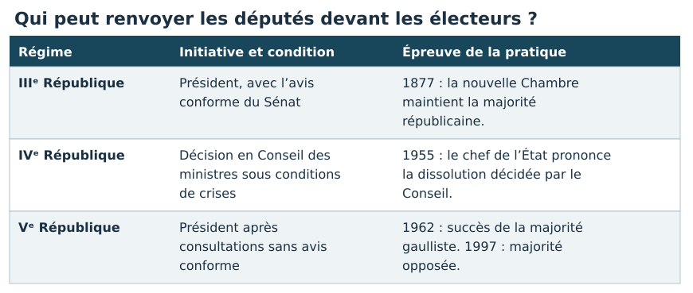

# ENS de Cachan D1 — Droit public 2008 · Corrigé guidé

*Corrigé rédigé par IA, non officiel. Signalez toute erreur.*

**Rédaction** · GPT-6.2 Astra Ultra · vitesse non renseignée

## Le Président de la République et le Parlement en France depuis 1875

### Introduction

En 1877, Mac-Mahon dissout la Chambre des députés pour faire trancher un conflit par les électeurs. En 1962, de Gaulle emploie à son tour la dissolution après la censure du gouvernement Pompidou. La majorité républicaine sort confirmée du premier scrutin, tandis que les élections de 1962 confortent le chef de l’État. Pourquoi une prérogative apparemment semblable produit-elle des conséquences si différentes ?

Le Parlement comprend deux chambres dont les pouvoirs varient suivant les constitutions. Le président de la République est le chef de l’État au sein d’un exécutif qui comporte aussi des ministres. Il faut donc distinguer la relation directe entre le président et les assemblées de celle qui passe par un gouvernement politiquement responsable. Entre 1875 et le printemps 2008, la source de la légitimité présidentielle et les moyens de sortir d’un conflit changent. Les premières Républiques font du Parlement le principal arbitre du gouvernement. La Ve République institue un arbitrage présidentiel distinct, dont la portée dépend encore de la majorité élue à l’Assemblée nationale.

> [!INDICATION]
> Comparer 1877 et 1962 en posant deux questions. Qui a juridiquement décidé la dissolution ? Qui a politiquement gagné le scrutin ? La distinction fournit le fil du devoir.

### I. Le Parlement choisit le président et impose progressivement sa prééminence dans le gouvernement

#### A. Le compromis de 1875 ménage au président des moyens d’action sur les chambres

La loi du 25 février 1875 dispose que « le Président de la République est élu à la majorité absolue des suffrages par le Sénat et par la Chambre des députés réunis en Assemblée nationale » (article 2). Ce président élu pour sept ans et rééligible possède cependant une durée de mandat propre. Il nomme les ministres, dispose de l’initiative législative concurremment avec les membres des chambres et promulgue les lois. Il peut, par un message motivé, demander une nouvelle délibération avant promulgation. Ses messages sont lus par un ministre. La présence d’un intermédiaire correspond au régime de responsabilité. Sauf haute trahison, le président est irresponsable. Chacun de ses actes exige le contreseing d’un ministre, et les ministres répondent de la politique générale devant les chambres.

Le conflit du 16 mai 1877 révèle l’ambiguïté du compromis. Mac-Mahon obtient la démission de Jules Simon et choisit le duc de Broglie, auquel les députés républicains refusent leur appui. Le président ne peut renvoyer le Sénat devant ses électeurs. Il peut dissoudre la Chambre avec l’avis conforme du Sénat, ce qu’il fait en juin. La victoire républicaine aux élections d’octobre lui impose de composer avec la majorité. En 1879, après le basculement du Sénat et la démission de Mac-Mahon, Jules Grévy s’engage à respecter la volonté nationale exprimée par ses organes constitutionnels. La dissolution tombe en désuétude sous la IIIe République. Les ministères doivent avant tout conserver la confiance parlementaire. Le chef de l’État conserve néanmoins, notamment lors des crises ministérielles, une influence dans le choix de la personne chargée de former un cabinet.

> [!INDICATION]
> Au brouillon, entourer « conforme ». Un désaccord du Sénat suffisait à empêcher Mac-Mahon de dissoudre. Ce mot permet de faire apparaître le rôle de la chambre haute.

#### B. La Constitution de 1946 tente d’organiser l’instabilité dans un système centré sur l’Assemblée

La rupture de 1940 interrompt la comparaison ordinaire entre républiques parlementaires. Le vote des pleins pouvoirs constituants du 10 juillet et les actes du régime de Vichy écartent les institutions républicaines. La Libération ouvre une phase de rétablissement de la légalité républicaine et d’assemblées constituantes. La Constitution du 27 octobre 1946 confie de nouveau au Parlement l’élection du président pour sept ans. Le président désigne un candidat à la présidence du Conseil. Dans le mécanisme initial, celui-ci présente son programme à l’Assemblée nationale et doit obtenir son investiture avant la nomination du gouvernement. La révision de 1954 modifie cette procédure. L’Assemblée reste en mesure de décider si un cabinet peut gouverner. Le Conseil de la République participe à la législation, mais la responsabilité politique du gouvernement se joue devant l’Assemblée nationale.

Le chef de l’État peut demander une seconde délibération de la loi et exercer une influence de conseil. Il conserve ainsi un rôle lors des recherches de majorité, comme l’illustre l’appel de René Coty à de Gaulle en 1958. La dissolution prévue aux articles 51 et 52 de la Constitution de 1946 ne constitue pourtant pas une arme présidentielle disponible. Elle suppose notamment deux crises ministérielles dans les conditions constitutionnelles au cours de dix-huit mois, après les dix-huit premiers mois de la législature. Décidée en Conseil des ministres, elle est prononcée par décret présidentiel. Des gouvernements se retirant sans que les conditions constitutionnelles d’une crise soient réunies, l’instabilité peut persister sans ouvrir le droit de dissoudre. La dissolution de 1955 demeure exceptionnelle.

> [!INDICATION]
> Distinguer « prononcer » et « décider ». Sous la IVe République, la signature du décret indique la forme juridique de la dissolution. Il faut encore rechercher qui décide et sous quelles conditions.

### II. La Ve République autonomise le président et fait des élections législatives une épreuve de son autorité

#### A. L’indépendance du mandat présidentiel transforme les relations directes avec le Parlement

Dès 1958, un collège électoral élargi, comprenant notamment des élus locaux, remplace l’élection par les seules assemblées. La révision de 1962 instaure l’élection au suffrage universel direct, appliquée en 1965. Le droit de dissolution de l’Assemblée nationale devient un pouvoir propre du président. L’article 12 impose la consultation du Premier ministre et des présidents des assemblées, sans exiger leur accord. Le président peut également saisir le Conseil constitutionnel d’une loi avant sa promulgation et, sous les conditions de l’article 11, soumettre un projet au référendum. En 1962, l’utilisation de cet article pour réviser le mode d’élection présidentielle, au lieu de la procédure de l’article 89, suscite précisément la contestation des parlementaires. L’Assemblée censure le gouvernement Pompidou. Le président dissout l’Assemblée, le référendum approuve la réforme et les élections législatives donnent à la majorité présidentielle les moyens de gouverner.

Le Parlement continue de voter les lois. Le président promulgue et peut demander une nouvelle délibération, qui ne saurait être refusée, sans disposer pour autant d’un veto définitif. Au printemps 2008, l’article 18 prévoit des messages présidentiels lus aux deux assemblées sans débat. Un changement institutionnel déjà accompli mérite en revanche d’être cité. Depuis la révision de février 2007, le Parlement constitué en Haute Cour peut destituer le président en cas de manquement à ses devoirs manifestement incompatible avec l’exercice de son mandat. La gravité de la condition et les majorités renforcées distinguent ce mécanisme de la censure pour désaccord politique.

> [!INDICATION]
> Se placer à la date de l’épreuve. Pour les communications présidentielles, lire l’article 18 dans sa version du printemps 2008. Pour la destitution, la révision de février 2007 est déjà en vigueur.

#### B. Le gouvernement responsable assure la liaison entre les deux légitimités

Le président nomme le Premier ministre. Les articles 20 et 49 maintiennent un gouvernement responsable devant le Parlement, susceptible d’être renversé par l’Assemblée nationale. Lorsque le président et la majorité des députés partagent une orientation politique, le chef de l’État peut déterminer les grandes orientations, le gouvernement portant les projets de loi et en assurant la discussion. La maîtrise gouvernementale d’une partie décisive de la procédure parlementaire bénéficie alors politiquement au président. Elle ne lui confère ni le pouvoir de déposer lui-même un projet de loi ordinaire ni le pouvoir de faire adopter le budget par sa seule décision.

La cohabitation en montre la limite. En 1986, en 1993 et à la suite de la dissolution de 1997, le président doit choisir un Premier ministre capable de conserver l’appui de la nouvelle majorité. Celle-ci peut soutenir un programme distinct de celui du chef de l’État. Une dissolution reste un pari dont les électeurs fixent l’issue. Le quinquennat adopté en 2000 et l’enchaînement de la présidentielle et des législatives à partir de 2002 favorisent la concordance politique des deux élections. Les mandats demeurent néanmoins distincts et l’Assemblée conserve le pouvoir de censurer le gouvernement.

> [!INDICATION]
> Utiliser 1997 comme contre-épreuve. Un président qui dispose du pouvoir propre de dissoudre peut néanmoins voir la nouvelle majorité lui imposer un Premier ministre d’une autre orientation.

### Conclusion

De 1875 à 1946, les assemblées choisissent le président et déterminent de plus en plus nettement la survie des cabinets. Depuis 1958, et plus encore depuis l’élection présidentielle directe, le chef de l’État peut opposer une légitimité propre à celle du Parlement et demander aux électeurs de trancher. Le résultat du scrutin revient cependant au cœur de la relation. La capacité du président à faire traduire ses orientations en lois dépend de l’existence d’un gouvernement que l’Assemblée accepte de soutenir.

[Sujet de la session](https://www.ens-rennes.fr/medias/fichier/sujet08d1options_1421752181536-pdf#page=3) · [Lois constitutionnelles de 1875](https://www.elysee.fr/la-presidence/les-lois-constitutionnelles-de-1875) · [Constitution du 4 octobre 1958 au printemps 2008](https://www.legifrance.gouv.fr/loda/id/JORFTEXT000000571356/2008-04-01/)
