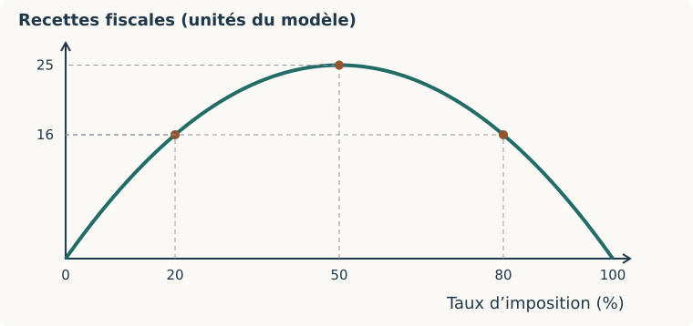

# ENS de Cachan D1 — Interrogation orale d’économie 2008 · Corrigé guidé

*Corrigé rédigé par IA, non officiel. Signalez toute erreur.*

**Lecture du rapport du jury** · GPT-6.2 Astra Ultra · vitesse non renseignée

**Rédaction** · GPT-6.2 Astra Ultra · vitesse non renseignée

Le jury écrit, page 4 du PDF, « On attend en effet une réponse ciblée sur le sujet. » La page suivante donne sept exemples de sujets posés. Ce corrigé traite ces sept exemples dans leur ordre imprimé. La liste exhaustive des tirages de la session reste à retrouver. Les questions de relance ont été rédigées pour l’entraînement.

## 1. Les canaux de transmission de la politique monétaire (sur l’économie réelle).

> [!INDICATION]
> Prendre pour point de départ une entreprise qui hésite à acheter une machine. Nommer à chaque étape un prix, un bilan ou une décision réelle. Les expressions « l’argent coûte plus cher » et « l’activité ralentit » laissent toute la chaîne intermédiaire à expliquer.

**Comment un taux au jour le jour atteint-il une décision d’investissement à cinq ans ?** Dans la zone euro, la banque centrale influence le taux auquel les banques se procurent des liquidités à court terme. Les taux à plus longue échéance intègrent les taux courts futurs anticipés et des primes de terme et de risque. Une hausse annoncée comme durable peut donc renchérir dès aujourd’hui le crédit à long terme. Ce qui entre dans le calcul réel de l’entreprise est le taux nominal corrigé de l’inflation anticipée. Pour une machine coûtant 100 et rapportant un unique paiement réel de 105 dans un an, la valeur actuelle est 100,96 à 4 % et 99,06 à 6 %. Dans cette hypothèse, relever le taux réel fait passer le projet d’un gain à une perte.

**Le crédit, les actifs et le change transmettent aussi la décision.** Une banque confrontée à un refinancement plus coûteux peut réduire les montants prêtés. Si les prix d’actifs baissent, les garanties offertes par un emprunteur valent moins, et un entrepreneur pourtant disposé à payer davantage peut se voir refuser le financement. Un ménage dont le patrimoine perd de sa valeur peut reporter un achat. Enfin, toutes choses égales par ailleurs, un rendement plus élevé des actifs en euros peut susciter une appréciation de l’euro. Les produits importés deviennent moins chers et les exportateurs moins compétitifs en prix. Le résultat sur les volumes dépend des réactions des clients et des délais d’ajustement.

**Pourquoi l’effet varie-t-il ?** Un prêt ancien à taux fixe protège les échéances déjà convenues. Une PME dépendante d’un découvert ressent plus vite la décision. Les banques peuvent aussi accroître leur prime de risque alors que le taux directeur demeure stable. Le 9 août 2007, l’Eurosystème a fourni environ 94,8 milliards d’euros pour une journée afin de détendre le marché monétaire. Préserver le fonctionnement de ce marché et modifier durablement l’orientation des taux sont deux décisions distinctes. La politique monétaire atteint la production et l’emploi par des prix, des quantités de financement et des anticipations, avec des délais variables.

**Relance d’entraînement.** À taux nominal inchangé de 4 %, l’inflation anticipée passe de 2 % à 1 %. Le crédit est-il aussi favorable à l’investissement ? Le taux réel anticipé passe d’environ 2 % à 3 %. Si les flux réels attendus restent identiques, leur valeur actuelle baisse.

## 2. Les enjeux de l’investissement

> [!INDICATION]
> Inclure une machine de remplacement et une machine ajoutée dans l’accroche. Dans les deux cas il y a une demande présente de biens d’équipement, alors que leur contribution au stock de capital peut être différente.

**Pourquoi une dépense d’aujourd’hui modifie-t-elle la production de demain ?** L’investissement productif engage des ressources présentes pour acquérir un actif utilisé durablement dans la production. La formation brute de capital fixe comprend par exemple l’achat d’une machine neuve par une entreprise ou la construction d’une école. Acheter une action existante transmet un titre financier et ne constitue pas en soi une formation de capital fixe. L’investissement brut inclut le remplacement des équipements usés. Si les acquisitions s’élèvent à 120 et la consommation de capital fixe à 80, l’investissement net est de 40. Un remplacement peut néanmoins améliorer la productivité lorsqu’une machine récente incorpore une technique supérieure.

**Un pari privé devient une composante de la conjoncture.** L’entreprise compare les recettes futures attendues, actualisées et nettes de coûts, à la mise initiale. Des carnets de commandes pleins justifient une extension de capacité. Une grande incertitude peut au contraire rendre avantageux le report d’un projet irréversible, même si le crédit est bon marché. La commande de la machine constitue parallèlement une demande pour le fabricant, qui verse des revenus. Dans une économie fermée à prix fixes, en sous-emploi et sans impôt, une hausse autonome d’investissement de 10 entraîne une hausse finale du revenu de 25 si la propension marginale à consommer vaut 0,6. L’effet total de $10/(1-0,6)$ se réduit en présence de fuites vers les importations ou de tensions sur les capacités.

**La sélection des projets engage la croissance et sa répartition.** Du capital supplémentaire accroît les capacités, mais ses rendements peuvent décroître si les compétences et les infrastructures complémentaires manquent. Une entreprise ne capte pas nécessairement tous les gains d’un investissement diffusant des connaissances. Un financement public ou une infrastructure collective peut alors rapprocher la décision du rendement social, sous réserve de comparer les alternatives et d’intégrer les coûts de fonctionnement. Inversement un fabricant peut investir dans un équipement très rentable à titre privé mais générateur de pollution. Le volume d’investissement mesure une dépense, et la qualité de son allocation détermine une part essentielle de son rendement collectif.

**Relance d’entraînement.** Une entreprise produit davantage avec une machine plus performante et réduit son effectif sur un atelier. L’investissement a-t-il détruit des emplois à l’échelle nationale ? Il y a substitution locale. Pour établir l’effet global, il faut aussi suivre la production de l’équipement, les gains de prix ou de revenu et la demande adressée aux autres activités.

## 3. La consommation

> [!INDICATION]
> Inventer deux ménages qui reçoivent la même prime exceptionnelle. L’un doit régler des dépenses différées, l’autre a déjà de l’épargne. Ce cas permet de faire travailler ensemble les contraintes de liquidité et l’idée de revenu permanent.

**Qu’est-ce qui gouverne le passage d’un revenu à une dépense ?** La consommation finale satisfait directement des besoins. Les dépenses des ménages en biens et services en constituent une composante. Leur consommation effective inclut aussi certains services individualisables financés par les administrations, par exemple des soins. Pour une famille, un revenu disponible de 2 000 euros dont 1 800 sont consommés laisse 200 d’épargne. La propension moyenne à consommer vaut 90 %. Si un revenu supplémentaire de 100 déclenche 60 de dépenses, la propension marginale n’est que de 60 %. L’allocation de ce budget entre alimentation, logement et loisirs dépend des préférences et des prix relatifs. La loi d’Engel exprime la tendance de la part de l’alimentation à diminuer lorsque le revenu s’élève, même si la dépense alimentaire augmente en euros.

**La date et la répartition du revenu modifient la réaction.** Dans une lecture keynésienne de court terme, le revenu courant et la propension marginale à consommer déterminent la transmission d’une variation de revenu à la demande. Avec le revenu permanent de Friedman et le cycle de vie de Modigliani, l’horizon s’élargit. Un ménage pouvant épargner et emprunter peut répartir une ressource temporaire sur plusieurs années. Une hausse durable de son salaire accroît davantage ses perspectives de consommation. Les contraintes de crédit, l’incertitude sur l’emploi ou la faible liquidité du patrimoine empêchent cependant le lissage parfait. Deux ménages de même revenu courant peuvent donc réagir différemment à une prime.

**La consommation est aussi un débouché pour la production.** Une dépense supplémentaire accroît le revenu des producteurs et peut susciter d’autres dépenses. La part importée alimente toutefois des revenus à l’étranger, et un supplément de demande adressé à une offre déjà saturée peut hausser les prix. Distribuer un euro à un ménage contraint financièrement et à un ménage qui épargne cette ressource n’a pas le même effet immédiat sur l’activité. Le diagnostic exige donc d’identifier les personnes concernées, la permanence du revenu et les capacités de production mobilisables.

**Relance d’entraînement.** L’augmentation du taux d’intérêt fait-elle toujours baisser la consommation présente ? Elle incite à reporter la dépense en rendant l’épargne plus rémunératrice. Pourtant, un ménage créancier peut aussi se sentir plus riche, tandis qu’un emprunteur à taux variable peut subir une hausse de ses mensualités. L’effet agrégé dépend des bilans et de la réaction des ménages.

## 4. L’inflation

> [!INDICATION]
> Faire passer un indice de 100 à 104, puis à 106,08. L’indice augmente deux fois, mais le rythme d’augmentation ralentit. Employer cette observation pour introduire la distinction entre inflation, désinflation et baisse du niveau des prix.

**Quand le renchérissement d’un produit devient-il de l’inflation ?** L’inflation est une hausse du niveau général des prix. Un indice de prix à la consommation agrège des évolutions par poste, avec des poids correspondant à une structure de dépense. Si l’énergie représente 10 % d’un panier fixe et renchérit de 20 % alors que le reste des prix reste stable, l’indice gagne 2 % sur la période. Si tous les prix se stabilisent ensuite, le taux d’inflation de la période suivante retombe à zéro, alors même que le panier reste plus cher. L’indice harmonisé de la zone euro et la dépense vécue d’une famille très dépendante de sa voiture peuvent ainsi donner des impressions différentes.

**Le même taux peut résulter de chocs opposés sur l’activité.** Une demande dynamique, confrontée à une offre rigide à court terme, accroît d’abord la production disponible puis pousse les prix à la hausse. Un choc de coût, par exemple un renchérissement importé du pétrole, comprime au contraire les marges et la production possible à prix inchangés. Sa répercussion sur le reste des prix dépend du degré de concurrence et des coûts d’absorption. Les demandes de compensation salariale et les anticipations peuvent ensuite prolonger l’inflation. Il faut distinguer hausse initiale, propagation et persistance. La relation quantitative $MV=PY$ ne permet d’attribuer toute hausse de $P$ à $M$ sans hypothèses supplémentaires sur la vitesse de circulation et la production.

**La politique doit arbitrer la vitesse du retour à la stabilité.** Pour un prêteur rémunéré à taux nominal fixe, une inflation plus forte qu’anticipé réduit le rendement réel, au bénéfice du débiteur à dette nominale fixe. Des prix plus instables compliquent aussi le calcul des prix relatifs. En 2008, la BCE visait à moyen terme un rythme d’inflation inférieur à, mais proche de, 2 % selon sa clarification de 2003. Un relèvement des taux freine la demande et peut ancrer les anticipations. Il ne produit pas le pétrole dont l’économie manque et peut accentuer la perte de production à court terme. Le diagnostic de l’origine et de la diffusion du choc importe donc autant que la lecture du dernier chiffre.

**Relance d’entraînement.** Passer de 4 % à 2 % d’inflation rend-il son pouvoir d’achat à un salarié dont le salaire nominal reste fixe ? Les prix continuent de monter, plus lentement. À revenu nominal inchangé, le pouvoir d’achat continue par conséquent de reculer.

## 5. La déréglementation financière est-elle un facteur favorable à la croissance ?

> [!INDICATION]
> Nommer la règle que l’on envisage de retirer. Lever une restriction à l’entrée sur un marché, autoriser une nouvelle forme de financement et diminuer une exigence de solvabilité n’ont pas les mêmes conséquences.

**Le gain potentiel tient aux projets supplémentaires qui trouvent un financement.** La déréglementation desserre des contraintes sur les taux, l’accès aux marchés ou le champ des activités autorisées. En France, les réformes financières des années 1980 ont notamment élargi les possibilités de financement de marché et décloisonné des circuits auparavant spécialisés. La mise en concurrence d’intermédiaires peut réduire les marges et le coût des ressources. Un marché plus liquide facilite la revente des titres et le partage des risques. Si des entrepreneurs disposant de projets productifs étaient rationnés, ces changements peuvent accroître l’investissement, l’innovation et, à terme, la production réelle. Le montant élevé des transactions financières mesure cependant un volume d’échanges de titres, pas la contribution des projets à la productivité.

**Une circulation plus facile du risque peut aussi masquer son accumulation.** Le prêteur connaît moins bien le projet que l’emprunteur. Il doit sélectionner et surveiller ce dernier. Lorsque l’initiateur d’un prêt peut rapidement en vendre le risque, l’incitation à vérifier la solvabilité peut s’affaiblir si aucun mécanisme ne le responsabilise. La titrisation peut diversifier un portefeuille exposé à des sinistres indépendants. Elle protège beaucoup moins contre un recul immobilier commun. Des banques dépendant de ressources à très court terme peuvent alors être forcées de vendre des actifs simultanément, ce qui réduit leur prix, dégrade les bilans et accélère les ventes. Les perturbations du marché interbancaire européen d’août 2007 illustraient déjà ce mécanisme de défiance avant le concours.

**La condition de croissance est institutionnelle.** La concurrence et l’innovation financière peuvent ouvrir l’accès au capital, si l’information est fiable, les risques visibles et les intermédiaires suffisamment capitalisés et liquides. Des règles prudentielles et une supervision des risques communs répondent au fait qu’une banque ne supporte pas seule le coût de la déstabilisation des autres. Le choix pertinent porte sur la contrainte supprimée, la défaillance qu’elle corrigeait et l’existence d’un dispositif plus efficace. Une plus grande liberté des prix peut améliorer la sélection des projets tandis qu’une surveillance affaiblie du levier peut rendre leurs financements plus fragiles.

**Relance d’entraînement.** Un bilan comprend 100 d’actifs pour 95 de dettes et 5 de fonds propres. Une perte de 4 sur les actifs est-elle mineure ? Les fonds propres tombent de 5 à 1, soit une perte de 80 % du coussin de solvabilité, même si la baisse des actifs n’est que de 4 %. Le levier amplifie donc un choc initial modéré.

## 6. Faut-il alléger la fiscalité en France ?

> [!INDICATION]
> Choisir deux réformes d’un même montant, par exemple une baisse de taxe sur la consommation et une diminution de l’impôt dû par les ménages les plus aisés. Suivre pour chacune le revenu effectivement libéré, l’usage probable de ce revenu et la contrepartie budgétaire.

**Alléger quel impôt et dans quel but ?** Une baisse du taux marginal d’imposition du travail augmente la part de rémunération conservée lors d’une heure supplémentaire. L’effet de substitution encourage cette heure si elle est disponible, tandis que l’effet de revenu peut conduire le ménage à choisir davantage de temps libre. En France, la loi du 21 août 2007 en faveur du travail, de l’emploi et du pouvoir d’achat a notamment prévu des exonérations fiscales et sociales sur les heures supplémentaires sous conditions. Ce mécanisme vise le travail additionnel des personnes déjà en emploi. Il faut distinguer les heures effectivement induites, celles qui auraient eu lieu à l’identique et la substitution éventuelle à une embauche. Le nombre d’heures déclarées au dispositif ne mesure pas son effet net.

**L’incidence et le financement conditionnent l’opportunité.** Une réduction de TVA peut profiter au consommateur si les prix baissent, au producteur si la marge augmente, ou aux deux. La répartition dépend des élasticités de l’offre et de la demande et de la concurrence. Sur le plan conjoncturel, l’effet d’un supplément de revenu sur la demande dépend de la propension à consommer des bénéficiaires, des importations et des capacités inutilisées. Un allégement financé par la réduction d’un investissement public productif doit être évalué avec ce coût. S’il est financé à crédit, le gain présent s’accompagne d’intérêts futurs et doit demeurer compatible avec la trajectoire de dette. Simplifier une assiette ou supprimer une niche peut enfin financer une baisse du taux sans baisse générale des recettes.

**Une décision distributive autant que productive.** Les prélèvements financent des services et des transferts et peuvent corriger des externalités. Une baisse de taxation sur une activité polluante réduit le prix d’une nuisance et peut accroître son coût collectif. Une baisse concentrée sur des foyers imposables n’accroît pas directement le revenu des foyers qui n’acquittent pas cet impôt. Il est donc possible de justifier des allégements ciblés sur des distorsions avérées, à condition de préciser qui en bénéficie, quelles dépenses ou recettes changent et quelle activité supplémentaire en résulte. Une proposition générale d’allégement laisserait ces choix sans réponse.

**Relance d’entraînement.** Un prélèvement est versé au fisc par les vendeurs. Est-ce une preuve qu’ils en supportent tout le coût ? L’obligation de versement identifie le redevable légal. Une partie peut être répercutée sur le prix de vente ou, en amont, sur les rémunérations des facteurs. Il faut étudier les possibilités de substitution de chaque côté du marché.

## 7. « Trop d’impôt tue l’impôt »

> [!INDICATION]
> Tracer deux colonnes pour le taux et l’assiette. À assiette fixe, la proposition du sujet n’a aucun sens arithmétique. Elle exige précisément de montrer comment l’assiette réagit, puis de vérifier si cette réaction est suffisante.

**Une proposition conditionnelle sur les recettes.** Pour un impôt proportionnel stylisé de taux $t$ et d’assiette $B(t)$, les recettes sont $R(t)=tB(t)$. Une hausse de taux rapporte mécaniquement davantage sur l’ancienne base, mais elle peut modifier les décisions de travailler, d’investir ou de déclarer le revenu dans cette assiette. Si $B$ est positive et décroissante, alors $R'(t)=B(t)+tB'(t)$. Pour $t>0$, une hausse du taux réduit localement les recettes lorsque l’élasticité de la base au taux, prise en valeur absolue, est supérieure à un. Cette condition exige une réponse quantitative, pas seulement la possibilité d’un comportement d’évitement.

**Une illustration montre les deux branches de la courbe.** Supposons, exclusivement pour le calcul, $B(t)=100(1-t)$ avec $t$ compris entre 0 et 1. À 20 %, la recette vaut 16. À 40 %, elle vaut 24. À 60 %, elle retrouve 24. À 80 %, elle tombe à 16. Comme $R'(t)=100-200t$, le maximum est 25 à 50 % dans cet exemple. Réduire le taux de 80 à 60 % augmente la recette de 8, tandis que le réduire de 40 à 20 % lui fait perdre 8. Rien dans cette courbe construite ne situe la France de 2008 sur l’une ou l’autre branche. Une recette nulle à 100 % est ici une hypothèse sur l’assiette, et tout impôt réel n’a pas cette propriété.

**Les faits pertinents dépendent de l’impôt, du délai et de l’objectif.** Une baisse du taux d’imposition des bénéfices peut attirer des écritures comptables vers la France sans produire une hausse comparable de l’activité réelle. À court terme des contribuables avancent ou retardent des opérations, à plus long terme l’emploi, l’implantation des entreprises ou la résidence fiscale peuvent évoluer. L’évaluation doit comparer les recettes observées à celles qui auraient été perçues sans réforme, en tenant compte de la conjoncture et des modifications d’assiette. Par ailleurs, le taux qui maximise la recette n’est pas nécessairement celui qui maximise le bien-être. Réduire une pollution, financer un service et redistribuer des revenus sont des objectifs différents. Le slogan de la courbe de Laffer établit une possibilité. Il ne démontre l’autofinancement d’aucune baisse particulière.

**Relance d’entraînement.** Un taux baisse de 25 à 20 %. De combien la base doit-elle augmenter pour que les recettes restent constantes ? La nouvelle base doit vérifier $0,20B_1=0,25B_0$, donc être supérieure de 25 % à son niveau initial. Une hausse de la base de 5 %, même réelle, laisse une perte de recettes.

[Rapport du jury, pages 4 et 5](https://www.ens-rennes.fr/medias/fichier/r1a_08_d1_ecosocial_1404897104294.pdf#page=4) · [BCE, stratégie de 2003](https://www.ecb.europa.eu/pub/pdf/mobu/mb200305en.pdf) · [BCE, rapport annuel 2007](https://www.ecb.europa.eu/pub/pdf/annrep/ar2007en.pdf) · [France, loi du 21 août 2007](https://www.legifrance.gouv.fr/jorf/id/JORFTEXT000000278649)
