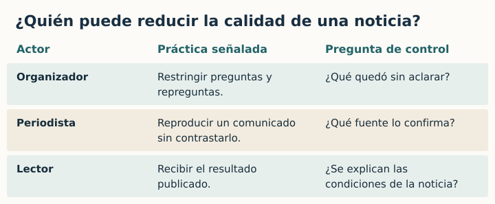

# ENS Rennes · D1 · Espagnol 2008 — Corrigé brut

*Corrigé rédigé par IA, non officiel. Signalez toute erreur.*

**Rédaction** · GPT-6.2 Astra Ultra · vitesse non renseignée

Écrit de l’ENS de Cachan, conservé dans les archives D1 de Rennes. José Miguel Larraya, « Figurantes », El País, 29 octobre 2006.

## Version française du passage délimité

« Nous constatons une dégradation générale des bonnes pratiques professionnelles, tant chez les acteurs de l’actualité que chez les journalistes. Les premiers abusent de prétendues déclarations aux “institutions”, sans autoriser les questions. Lorsqu’on peut poser des questions, il est interdit de relancer, ou alors on restreint à l’extrême le temps qui leur est accordé, le choix des personnes qui les posent et leur nombre. Du côté des journalistes professionnels, nous constatons aussi que l’on reprend sans esprit critique des communiqués officiels qui sont reproduits dans les médias et que l’on cite rarement les sources susceptibles de garantir la fiabilité des nouvelles publiées. »

## Expression en espagnol

Discuter le jugement de l’auteur sur les conférences de presse sans questions comme exigence du marché et leurs effets sur le journalisme et les citoyens. 100 mots.

Comparto la crítica del articulista, aunque entiendo por qué este formato interesa a quienes convocan la rueda de prensa. Una declaración breve se puede distribuir inmediatamente, cuesta poco y permite controlar la imagen pública del portavoz. Sin embargo, lo que ahorra tiempo a una institución puede privar al ciudadano de una aclaración indispensable. Si un alcalde anuncia viviendas nuevas, importa saber cuántas estarán disponibles y quién podrá solicitarlas. Sin repreguntas, una cifra vistosa puede ocultar esa información. El periodista puede consultar documentos y contrastar testimonios, pero debe explicar qué preguntas quedaron sin respuesta y quién impuso las condiciones del encuentro.

*100 mots, comptés par espaces.*

[Feuillet original, p. 5](https://www.ens-rennes.fr/medias/fichier/sujet08d1langues_1421752176045-pdf#page=5) · [Rapport du jury, partie écrite](https://www.ens-rennes.fr/medias/fichier/r1a_08_d1_lv1_1404897184762.pdf#page=5)
