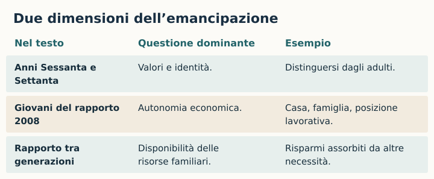

# ENS Rennes · D1 · Italien 2008 — Corrigé guidé

*Corrigé rédigé par IA, non officiel. Signalez toute erreur.*

**Rédaction** · GPT-6.2 Astra Ultra · vitesse non renseignée

Écrit de l’ENS de Cachan, conservé dans les archives D1 de Rennes. Eurispes, Rapporto Italia 2008, synthèse pour la presse.

## Version française

**Être jeune aujourd’hui.** L’émancipation engagée par les jeunes des années soixante portait sur les valeurs. Il fallait construire une identité nouvelle, qui se réclamât de nouveaux mythes et de valeurs opposées à l’identité des adultes, autrement dit de ceux qui s’étaient déjà fait une place dans la société. Près de cinquante ans se sont écoulés depuis, et les jeunes d’aujourd’hui doivent faire face à un processus d’émancipation de nature différente, qui est surtout d’ordre économique. Autrefois, on se battait pour imposer sa manière de voir le monde. Aujourd’hui, les jeunes luttent pour leur indépendance économique et pour tout ce qui en dépend étroitement : vivre chez soi, fonder sa propre famille, obtenir une situation professionnelle stable. Dans les années soixante et soixante-dix, être jeune était une valeur à défendre, cela signifiait que l’on avait une identité à faire connaître et à protéger. Aujourd’hui, être jeune revient à accepter de relever un défi, celui qui consiste à conquérir sa propre place dans la société.

**La question de l’héritage.** Parmi les nouvelles formes d’inégalité auxquelles la société doit faire face figure l’inégalité entre générations. Les perspectives offertes aux jeunes diffèrent considérablement de celles du passé et de celles qu’ont connues leurs parents. De plus, leur situation dépend du peu de possibilités qu’ils ont de disposer des richesses accumulées par leurs parents. D’une part, l’épargne familiale sert souvent à surmonter des difficultés économiques imprévues. D’autre part, l’espérance de vie moyenne s’est allongée ces derniers temps, ce qui contribue à faire reculer les taux de mortalité.

## Expression en italien

Le preoccupazioni economiche condizionano il modo in cui i giovani considerano il loro avvenire? 100 mots.

Le preoccupazioni economiche incidono sulle decisioni dei giovani soprattutto quando una scelta richiede un impegno duraturo. Con un contratto breve, affittare un appartamento può sembrare troppo rischioso anche a chi desidera vivere da solo. Questo non significa che le aspirazioni siano scomparse: spesso si cambia la data di un progetto senza rinunciare al progetto stesso. Inoltre, due coetanei con lo stesso stipendio possono immaginare futuri diversi se soltanto uno riceve aiuto dalla famiglia. Per questo, a mio parere, parlare di prudenza individuale non basta. Servono condizioni di lavoro e di accesso alla casa che permettano di decidere con maggiore libertà.

*100 mots, comptés par espaces.*

## Comment construire la réponse

**Chercher l’axe des deux paragraphes.** Le premier oppose deux enjeux dominants de l’émancipation, l’identité et l’indépendance matérielle. Le second précise comment le rapport à la génération précédente conditionne l’accès aux ressources. Le texte présente cette opposition comme une analyse du rapport Eurispes de 2008.

**Suivre les enchaînements.** *Andava costruita* exprime une nécessité passée. *Perlopiù* atténue l’idée d’un primat économique absolu. Dans le deuxième paragraphe, la corrélation *sia perché … sia perché* introduit deux raisons de ne pas pouvoir disposer immédiatement des richesses parentales. Il n’est pas question d’un refus des parents de les transmettre.

**Distinguer les ambitions de leur calendrier.** Repousser un déménagement fournit un exemple d’influence économique qui ne suppose pas une disparition des aspirations. La comparaison entre deux jeunes ayant le même salaire fait ensuite apparaître le rôle de l’épargne familiale.

[Feuillet original, p. 6](https://www.ens-rennes.fr/medias/fichier/sujet08d1langues_1421752176045-pdf#page=6)
