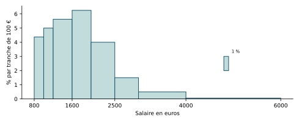
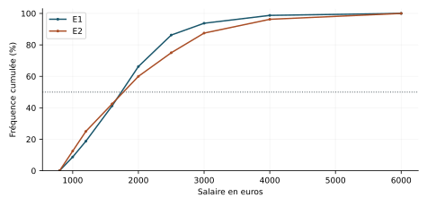
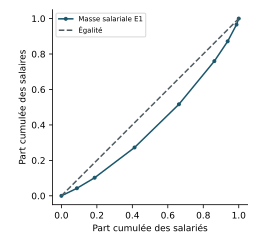
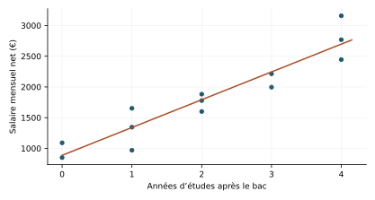

# ENS de Cachan D1 — Mathématiques appliquées et statistiques 2008 · Corrigé guidé

*Corrigé rédigé par IA, non officiel. Signalez toute erreur.*

**Rédaction** · GPT-6.2 Astra Ultra · vitesse non renseignée

**Révision** · GPT-6.2 Astra Ultra · vitesse non renseignée

Les deux entreprises emploient chacune 400 salariés. Les estimations issues des classes sont distinguées des observations individuelles du second tableau. Les fonctions et le protocole de tirage sont étudiés sur leurs domaines effectifs.

## Exercice 1. Statistiques descriptives des salaires

### Question 1.I.1

> [!INDICATION]
> Distinguer la grandeur mesurée des effectifs affichés.

#### Solution

La variable est le salaire mensuel individuel, exprimé en euros. Il est traité comme une variable quantitative continue regroupée en huit classes d’amplitudes différentes, dans chacune des entreprises.

### Question 1.I.2

> [!INDICATION]
> Utiliser la base 400 dans les deux entreprises et additionner les classes par ordre croissant.

#### Solution

Toutes les valeurs du tableau sont en pourcentage. Le cumul inclut la classe de la ligne.

| Salaire en euros | E1 | Cumul E1 | E2 | Cumul E2 |
|---|---:|---:|---:|---:|
| 800 à moins de 1000 | 8,75 | 8,75 | 12,50 | 12,50 |
| 1000 à moins de 1200 | 10,00 | 18,75 | 12,50 | 25,00 |
| 1200 à moins de 1600 | 22,50 | 41,25 | 17,50 | 42,50 |
| 1600 à moins de 2000 | 25,00 | 66,25 | 17,50 | 60,00 |
| 2000 à moins de 2500 | 20,00 | 86,25 | 15,00 | 75,00 |
| 2500 à moins de 3000 | 7,50 | 93,75 | 12,50 | 87,50 |
| 3000 à moins de 4000 | 5,00 | 98,75 | 8,75 | 96,25 |
| 4000 à moins de 6000 | 1,25 | 100,00 | 3,75 | 100,00 |

Dans E1, 86,25 % gagnent strictement moins de 2500 euros. Dans E2, 57,50 % gagnent **au moins** 1600 euros. Pour le modèle continu attendu, la masse au seuil est nulle et la même proportion gagne plus de 1600 euros. Le tableau groupé seul ne dénombre pas les salaires égaux au seuil.

### Question 1.I.3

> [!INDICATION]
> Pour des amplitudes inégales, représenter les fréquences par les aires.

#### Solution

Les hauteurs en points de pourcentage par 100 euros sont successivement $4{,}375$, $5$, $5{,}625$, $6{,}25$, $4$, $1{,}5$, $0{,}5$ et $0{,}0625$. Par exemple la classe de 1600 à 2000 euros a une largeur de quatre centaines et une aire de 25 %.

### Question 1.I.4

> [!INDICATION]
> Approcher chaque salaire de classe par son centre pour calculer les deux moments.

#### Solution

Avec les centres 900, 1100, 1400, 1800, 2250, 2750, 3500 et 5000 euros, calculons $\bar s=\sum n_i c_i/400$ et $V=\sum n_i(c_i-\bar s)^2/400$.

| Entreprise | Moyenne (€) | Variance (€²) | Écart-type (€) | Coefficient de variation |
|---|---:|---:|---:|---:|
| E1 | 1 847,50 | 534 306,25 | 730,96 | 39,56 % |
| E2 | 1 985,00 | 936 337,50 | 967,65 | 48,75 % |

Les salaires de E2 sont davantage dispersés en euros et relativement à leur moyenne. Le coefficient de variation $\sigma/\bar s$, sans dimension, facilite cette dernière comparaison. Ce sont des estimations sur données groupées.

### Question 1.I.5

> [!INDICATION]
> Positionner le cumul à la borne supérieure de chaque classe.

#### Solution

Les deux courbes partent du point $(800,0)$ et atteignent $(6000,100)$ avec les hauteurs cumulées de 1.I.2 aux bornes successives. En supposant les revenus répartis uniformément dans chaque classe, joindre les points par segments. Prolonger par 0 % avant 800 et 100 % au-delà de 6000.

### Question 1.I.6

> [!INDICATION]
> Interpoler entre les bornes de la classe contenant la moitié des observations.

#### Solution

Dans E1, la médiane est estimée par $1600+400(50-41{,}25)/(66{,}25-41{,}25)=1740$ euros. Dans E2, elle est estimée par $1600+400(50-42{,}5)/(60-42{,}5)\simeq1771{,}43$ euros. Ce sont les abscisses des intersections avec l’horizontale à 50 %. Elles partagent chacune des entreprises en deux moitiés de salariés.

### Question 1.I.7

> [!INDICATION]
> Pondérer chaque effectif par le salaire de centre et rapporter les masses au total.

#### Solution

La masse estimée de E1 est 739 000 euros. En reprenant les classes dans l’ordre du tableau, les parts $100n_i c_i/739000$ et leurs cumuls sont les suivantes.

| Borne supérieure (€) | Part de masse (%) | Cumul de masse (%) |
|---:|---:|---:|
| 1000 | 4,26 | 4,26 |
| 1200 | 5,95 | 10,22 |
| 1600 | 17,05 | 27,27 |
| 2000 | 24,36 | 51,62 |
| 2500 | 24,36 | 75,98 |
| 3000 | 11,16 | 87,14 |
| 4000 | 9,47 | 96,62 |
| 6000 | 3,38 | 100,00 |

Ainsi les 41,25 % de salariés sous 1600 euros reçoivent environ 27,27 % de la masse. Le polygone de Lorenz est sous la diagonale d’égalité. Le coefficient de Gini groupé, égal à un moins deux fois l’aire sous ce polygone, est environ 0,206.

### Question 1.II.1

> [!INDICATION]
> Mettre les années d’études en abscisse, le salaire en ordonnée.

#### Solution

Les 13 points forment des colonnes aux abscisses 0 à 4. Dans ces données les salaires ont tendance à être plus élevés lorsque les études sont plus longues, avec des différences entre salariés d’un même niveau.

### Question 1.II.2

> [!INDICATION]
> Multiplier les deux valeurs de chaque ligne avant de sommer les produits. Diviser par 13, puis soustraire le produit des deux moyennes pour obtenir la covariance.

#### Solution

Les 13 couples imprimés page 6 donnent les totaux suivants.

| $\sum N$ | $\sum W$ | $\sum N^2$ | $\sum W^2$ | $\sum NW$ |
|---:|---:|---:|---:|---:|
| 27 | 23 749 | 81 | 49 156 999 | 60 605 |

Le calcul sur les observations utilise, par exemple, $V_N=81/13-(27/13)^2$ et $C_{NW}=60605/13-(27/13)(23749/13)$. Avec $N$ le nombre d’années et $W$ le salaire, $\bar N\simeq2{,}07692$, $\bar W\simeq1826{,}84615$ euros. Les variances avec diviseur 13 valent $V_N\simeq1{,}91716$ et $V_W\simeq443940{,}74556$. La covariance $\sum N_iW_i/13-\bar N\bar W\simeq867{,}70414$.

### Question 1.II.3

> [!INDICATION]
> Diviser la covariance par le produit des écarts-types.

#### Solution

$r=C_{NW}/\sqrt{V_NV_W}\simeq0{,}94055$. L’association linéaire entre années et salaire est positive et forte dans cet échantillon.

### Question 1.II.4

> [!INDICATION]
> Ajuster le salaire sur les années d’études.

#### Solution

La pente est $a=C_{NW}/V_N\simeq452{,}59877$ euros par année et $b=\bar W-a\bar N\simeq886{,}83333$ euros. La droite est $\widehat W=886{,}83+452{,}60N$. L’ordonnée initiale est le salaire ajusté sans année post-bac. La pente donne l’écart ajusté de salaire entre deux niveaux différant d’un an, sans établir un effet causal.

### Question 1.II.5

> [!INDICATION]
> Élever le coefficient de corrélation au carré.

#### Solution

Le coefficient de détermination vaut $R^2=r^2\simeq0{,}88463$. Environ 88,46 % de la variance observée du salaire est expliquée par cette droite dans les 13 observations.

### Question 1.II.6

> [!INDICATION]
> Évaluer la droite en dehors du dernier rang observé.

#### Solution

Pour bac + 5, $\widehat W=b+5a\simeq3149{,}83$ euros nets par mois. Il s’agit d’une extrapolation d’un an au-delà de l’échantillon.

## Exercice 2. Demande et production

### Question 2.I.1

> [!INDICATION]
> Utiliser le rapport de la variation relative de la quantité à celle du prix.

#### Solution

La demande est $q(p)=e^{-\alpha p+2\beta}>0$ et $q'=-\alpha q$. Son élasticité-prix ponctuelle vaut $pq'(p)/q(p)=-\alpha p$.

### Question 2.I.2.a

> [!INDICATION]
> Interpréter le signe et la valeur absolue pour une petite hausse.

#### Solution

Une élasticité de $-1/4$ signifie qu’autour du prix considéré une hausse de 1 % du prix diminue la quantité demandée d’environ 0,25 %. La demande est localement peu élastique.

### Question 2.I.2.b

> [!INDICATION]
> Remplacer p par 5 dans la formule de l’élasticité.

#### Solution

$-5\alpha=-1/4$ donne $\alpha=1/20=0{,}05$ par unité de prix.

### Question 2.II.1

> [!INDICATION]
> Traduire le facteur multiplicatif 3 dans les quantités.

#### Solution

Si la quantité de facteur est triplée, $f(3x)<3f(x)$ : la production obtenue est inférieure au triple de la production initiale, pour tout $x>0$.

### Question 2.II.2

> [!INDICATION]
> Comparer deux puissances de δ, qui est strictement supérieur à 1.

#### Solution

Avec $f(x)=x^{2\alpha}$ pour $x>0$, on a $f(\delta x)/f(x)=\delta^{2\alpha}$. Cette quantité est strictement inférieure à $\delta$ pour tout $\delta>1$ exactement quand $2\alpha<1$, soit $\alpha<1/2$. Si l’on exige en plus que la production croisse strictement avec le facteur, on ajoute $\alpha>0$.

### Question 2.II.3

> [!INDICATION]
> Comparer productivité marginale et productivité moyenne sur la plage de croissance.

#### Solution

Pour $x>0$, $f(x)=-x^3+2x^2+4x$ a pour dérivée $-3x^2+4x+4=-3(x-2)(x+2/3)$. La fonction croît strictement jusqu’à $x=2$, sa dérivée est positive pour $0<x<2$ et nulle en 2. La différence $f'(x)-f(x)/x=-2x^2+2x=2x(1-x)$ est négative exactement pour $x>1$. Les rendements locaux décroissants sur la plage croissante correspondent donc à $1<x\le2$, ou $1<x<2$ si l’on impose une dérivée strictement positive. Pour interpréter ces deux seuils, la productivité moyenne vaut $f(x)/x=-x^2+2x+4$. Elle atteint son maximum en $1$ puis diminue. À $x=1{,}5$, une unité de facteur produit en moyenne $4{,}75$ unités de bien et la productivité marginale vaut $3{,}25$. Une petite hausse de la quantité de facteur accroît donc encore la production totale tout en abaissant la production par unité de facteur.

## Exercice 3. Dérivation et extrema

### Question 3.1

> [!INDICATION]
> Exclure le zéro du dénominateur et appliquer produit, chaîne et quotient.

#### Solution

Pour un entier $n\ge1$, posons $U=xy+5x^2+2y$ et $V=1+x^3$. Le domaine est $x\ne-1$, $y\in\mathbb R$. On a
$$f_x=\frac{nU^{n-1}(y+10x)V-3x^2U^n}{V^2},\qquad f_y=\frac{nU^{n-1}(x+2)}{V}.$$

### Question 3.2.a

> [!INDICATION]
> La racine réelle impose un radicand positif ou nul, et le dénominateur impose y non nul.

#### Solution

Pour $n$ entier, si $n=0$, $x^0$ désigne le monôme constant 1 et le domaine est $\mathbb R\times]0,+\infty[$. Si $n>0$ est pair, le domaine est constitué de tous les points avec $y>0$ et des points $(0,y)$ avec $y<0$. En effet, $x^n$ est positif pour $x\ne0$ et nul en 0. Si $n$ est impair, le domaine est $\{(x,y):y\ne0,\ xy\ge0\}$. Pour $x=0$, le quotient vaut zéro des deux côtés de l’axe lorsque $n>0$.

### Question 3.2.b

> [!INDICATION]
> Pour n = 2, la racine de x au carré est la valeur absolue de x.

#### Solution

Sur $y>0$, $f=x|x|y^{-3/2}$. Comme $(x|x|)'=2|x|$, y compris en 0, on obtient $f_x=2|x|y^{-3/2}$ et $f_y=-(3/2)x|x|y^{-5/2}$. Sur le demi-axe supplémentaire $x=0,y<0$, $f$ est nulle le long de l’axe : la dérivée partielle en $y$ vaut 0. La dérivée partielle usuelle en $x$ n’y est pas définie, les points voisins à $y$ fixé sortant du domaine.

### Question 3.3

> [!INDICATION]
> Étudier chaque fonction sur ses composantes de domaine.

#### Solution

Pour $u(x)=4x+5\sqrt{9-3x}$, $x<3$, la dérivée est $4-15/(2\sqrt{9-3x})$. Elle passe du signe positif au négatif en $x=117/64$, où $u=267/16$ est le maximum global. Comme $u(x)\to-\infty$ quand $x\to-\infty$, il n’y a pas de minimum.

Pour $v(x)=x^2/(3-x)$, $v'(x)=x(6-x)/(3-x)^2$. Sur $]-\infty,3[$, la fonction décroît jusqu’au minimum local $v(0)=0$ puis croît vers $+\infty$. Sur $]3,+\infty[$, elle croît depuis $-\infty$ jusqu’au maximum local $v(6)=-12$ puis décroît. Sur le domaine entier, elle n’admet aucun extremum global.

## Exercice 4. Épuisement d’une couleur

### Question 4

> [!INDICATION]
> Représenter la permutation aléatoire des six boules par les deux positions blanches.

#### Solution

Les $\binom62=15$ paires de positions blanches sont équiprobables. Le jeu s’arrête au minimum des rangs de la dernière blanche et de la dernière rouge. Si la sixième boule est rouge, le dernier rang blanc $k$ vaut 2, 3, 4 ou 5. Il y a alors $k-1$ paires possibles, car l’autre blanche est avant $k$. Si la sixième boule est blanche, la dernière rouge vaut 4 pour la paire blanche $\{5,6\}$, ou 5 pour les quatre paires $\{j,6\}$, $1\le j\le4$. D’où la loi suivante.

| $k$ | 2 | 3 | 4 | 5 |
|---|---:|---:|---:|---:|
| $P(X=k)$ | $1/15$ | $2/15$ | $4/15$ | $8/15$ |

Le premier joueur gagne aux rangs impairs, avec probabilité $10/15=2/3$. Le second gagne avec probabilité $1/3$. L’ordre le plus favorable est donc la première place.
