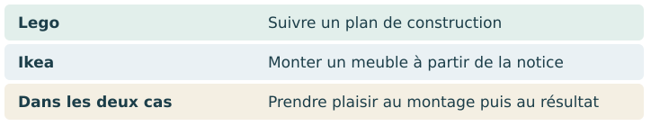

# ENS · MP-PC · Allemand (LV1) 2008 — Corrigé guidé

*Corrigé rédigé par IA, non officiel. Signalez toute erreur.*

**Rédaction** · GPT-6.2 Astra Ultra · vitesse non renseignée

**Des briques Lego aux meubles en kit.** La garde 80.12PM annonce deux heures pour les ENS de Paris, de Lyon et de Cachan. Le dictionnaire est interdit. La version compte pour 12 points et les deux réponses pour 8 points. La page 2 ne fixe pas de longueur pour les réponses.

Süddeutsche Zeitung, 28 janvier 2008.

## Version française

> [!INDICATION]
> Lucile Reynaud, pour les PC, rappelle que Tischler est un métier et que trotzdem introduit une phrase indépendante. É. Chevrel, pour les MP, distingue letztlich (« en fin de compte ») de endlich mal (« enfin », avec l’idée d’une occasion retrouvée).

> [!INDICATION]
> Le narrateur tourne en dérision son propre sérieux lorsqu’il raconte le prétendu « déclin » de l’homme à la puberté. Le conditionnel sur les micro-organismes prolonge cette ironie ; la propriété de biodégradabilité relève du souhait plaisanté. Gardez la brièveté de la dernière phrase.

Lego mérite sa place sur l’Olympe des jouets d’enfants qui resteront à jamais géniaux. L’histoire de Lego et du menuisier danois Ole Kirk Christiansen, qui à l’origine travaillait le bois et inventa la brique Lego, est depuis longtemps entrée dans la légende de l’entreprise. Après une enfance passée avec les Lego, on sait bien sûr que, tout l’amour qu’on leur porte mis à part, ils ont aussi leurs inconvénients. Le grand doute sur les Lego survient à la puberté, quand le goût du jeu s’émousse et que commence le déclin de l’être humain. Avec l’âge, on finit par comprendre : les Lego sont en plastique et le plastique, c’est le mal. Surtout au temps des campagnes scolaires pour sauver la forêt tropicale, au temps des canots pneumatiques de Greenpeace devant les plateformes pétrolières.

En matière d’environnement, il faut pourtant en convenir, Lego jouit d’une si bonne image que l’on aimerait croire les briques biodégradables, pourvu que les micro-organismes les mâchent assez vigoureusement. Du reste, ces trucs restent comme neufs si on les passe de temps en temps à la machine à laver. Quant aux autres inconvénients, l’amour, c’est bien connu, fait aussi souffrir.

Nos parents savaient tout de même ce qu’ils nous achetaient. Jouer aux Lego était censé exercer notre capacité à nous représenter les choses dans l’espace, notre patience et notre motricité fine. Et les plans de construction ressemblent aux notices d’un autre grand groupe scandinave qui fournit beaucoup de marchandises à l’Allemagne. Voilà pourquoi les joueurs de Lego n’ont jamais peur des modes d’emploi Ikea, et n’ont jamais de mal à monter les meubles de la marque. En fin de compte, Lego et Ikea reposent sur le même principe de jeu : le plaisir de construire, puis la fierté de celui qui contemple l’objet terminé. Sans doute bien des gens ne font-ils leurs achats chez Ikea que pour avoir enfin l’occasion de monter de nouveau quelque chose. Des Lego pour adultes.

## Question 1 · Quels jeux ont marqué votre enfance ?

> [!INDICATION]
> Indiquez d’abord à quel jeu vous pensez. Précisez ensuite la forme de son influence par un souvenir assez détaillé pour qu’on comprenne comment vous avez appris quelque chose en y jouant.

Als Kind spielte ich oft mit einem Brettspiel, bei dem wir gemeinsam eine Strecke planen mussten. Am Anfang suchte ich einfach den kürzesten Weg für meine eigene Figur. Erst nach einigen verlorenen Runden verstand ich, dass wir alle früher ans Ziel kamen, wenn einer zunächst einen Umweg machte. Besonders spannend war die Diskussion nach dem Spiel: Mein Bruder erklärte seinen Plan, und plötzlich sah ich auf demselben Brett etwas, das mir vorher völlig entgangen war. Dieses Spiel hat mich geprägt, weil ich dort ohne große Folgen eine Entscheidung ausprobieren und später ändern konnte. Heute erinnere ich mich weniger an die einzelnen Siege als an den Moment, in dem aus mehreren Einzelplänen eine gemeinsame Idee wurde.

## Question 2 · Jouer aujourd’hui

> [!INDICATION]
> L’adverbe heute fait passer du souvenir d’enfance au présent. Vous pouvez soutenir l’importance du jeu ou la relativiser. Appuyez ce jugement sur une pratique actuelle distincte du souvenir développé dans la réponse précédente.

Spielen ist mir auch heute wichtig, gerade weil seine Ziele für eine Weile überschaubar sind. Beim Rätseln mit Freunden können wir eine Vermutung äußern, sie zurücknehmen und gemeinsam lachen, wenn sie sich als falsch erweist. Anders als bei einer Prüfung muss niemand den Irrtum verstecken. Ich finde aber nicht, dass jede freie Stunde einen Lerneffekt haben sollte. Manchmal genügt es, dass alle an derselben Sache Freude haben. Wichtig ist für mich, dass wir das Spiel freiwillig beginnen und genauso freiwillig wieder aufhören können. Wenn nur noch der Punktestand zählt und niemand mehr zuhört, suche ich lieber eine andere Beschäftigung. Der Wert des Spiels liegt für mich also auch in der Art, wie wir miteinander umgehen.

Lucile Reynaud traite les 44 copies de PC. É. Chevrel commente séparément les 53 copies de MP.

[Cahier, allemand p. 2](https://banques-ecoles.fr/cms/wp-content/data/filiere-pc/annales-de-la-banque-pc/session-2008/sujet-ecrit-2008_mppc_sujet_langue_vivante_1.pdf#page=2) · [Rapport de PC](https://banques-ecoles.fr/cms/wp-content/data/filiere-pc/rapports-des-jurys-de-la-banque-pc/session-2008/rapport-2008-pc_ecrit_langue_vivante_1_allemand.pdf) · [Rapport de MP](https://banques-ecoles.fr/cms/wp-content/data/filiere-mp/rapports-des-jurys-de-la-banque-mp/rapport-de-jury-session-2008/rapport-2008-mp_ecrit_langue_vivante_1_allemand.pdf)
