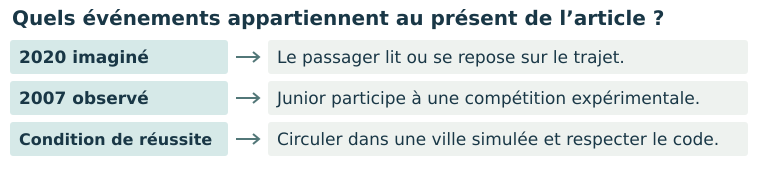
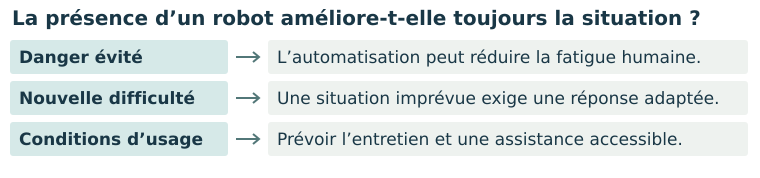

# ENS · MP-PC · Anglais (LE2) 2008 — Corrigé guidé

*Corrigé rédigé par IA, non officiel. Signalez toute erreur.*

**Rédaction** · GPT-6.2 Astra Ultra · vitesse non renseignée

Le cahier commun aux ENS de Paris et de Cachan dure deux heures. Dictionnaire et calculatrice interdits pour l’anglais. La version vaut 15 points, la question 5. La réponse doit compter au moins 100 mots.

## V. Version française

Le présent initial installe le lecteur dans une scène fictive située en 2020. Maintenir les impératifs qui lui proposent plusieurs activités. *The hot favourite* désigne le grand favori de la compétition. *Stunt drivers* désigne les cascadeurs au volant des autres véhicules. Respecter le passage du reportage au discours direct de Thrun.

**Une course automobile en ville simulée donne un aperçu d’un avenir sans conducteur**

C’est le moment le plus reposant de la journée. Allongez les jambes, récupérez le sommeil perdu à vous coucher tard, lisez le journal, regardez un film ou rattrapez votre retard dans vos courriels. En 2020, le trajet quotidien jusqu’au travail n’a plus rien à voir avec le pénible cheminement dans les embouteillages qui mettait les nerfs à rude épreuve au début du XXIe siècle. Votre voiture robotisée autonome vous permet désormais de lâcher le volant et de vous livrer à une activité plus agréable et plus productive, même si, au début, rouler à vive allure pare-chocs contre pare-chocs avec la voiture de devant avait quelque chose d’un peu inquiétant.

C’est ainsi que Sebastian Thrun imagine le trajet quotidien une fois que nous aurons tous confié notre sort à un chauffeur robot. Pour le professeur Thrun, la réalité de la conduite est bien loin de l’image de liberté que vantent les publicités pour automobiles.

« Personne au monde ne me fera croire que les trajets entre le domicile et le travail sont amusants. On ne conduit pas pour le plaisir. On conduit parce qu’il le faut. On pourrait libérer ce temps », a-t-il déclaré.

Pis encore, les êtres humains représentent un danger au volant. « Quand on assiste aux obsèques d’une personne morte parce qu’un autre conducteur a décroché son portable et n’a pas fait attention, il est extrêmement difficile de défendre notre droit de conduire à notre guise. » Et, comme les robots sont plus précis et réagissent plus vite, les voitures peuvent se suivre de plus près.

Le professeur Thrun, directeur du laboratoire d’intelligence artificielle de l’université Stanford, est à la tête d’une équipe d’ingénieurs et d’informaticiens qui ont créé Junior, grand favori d’une course de voitures robotisées autonomes richement dotée et financée par l’armée américaine.

Les participants au Darpa Urban Challenge, dont le point culminant a lieu aujourd’hui, doivent construire des voitures sans conducteur capables de suivre un parcours urbain simulé en évitant les obstacles, en respectant le code de la route et en évitant les autres véhicules, conduits par des cascadeurs. Les épreuves de qualification à Victorville, en Californie, ont notamment consisté à s’insérer dans un trafic dense, à trouver un autre itinéraire en présence d’un obstacle et à se garer. […]

## 1. Does the use of robots always mean a safer and more comfortable life for people?

*Always* est décisif. Donner un usage où sécurité et confort progressent ensemble, puis une situation où le progrès dépend d’une condition négligée. Le bénéfice doit être évalué pour tous les usagers concernés.

A robot can improve safety when a repetitive or dangerous task is well understood. An inspection machine entering an unstable building can send back information without exposing a rescuer to falling debris. An autonomous car might likewise help someone who cannot drive reach work independently. Neither advantage establishes that every robot improves daily life for everyone. A vehicle that behaves perfectly on a test course may encounter a crossing guard whose gesture it does not recognise. A passenger who does not understand the warning on the dashboard may feel less comfortable than before, while a pedestrian bears part of the risk. I would judge a system by its performance in the conditions where it will actually be used, the provision for help when it fails and the experience of people outside the vehicle as well as those sitting inside.

*139 mots.*

Le texte de The Guardian est daté du 3 novembre 2007. Son trajet imaginaire de 2020 reste une projection de l’auteur. Le concours, son parcours simulé et les qualifications en Californie appartiennent au récit de 2007. Le sujet et le rapport d’anglais LE2 ont été consultés.

[Version et consignes](https://banques-ecoles.fr/cms/wp-content/data/filiere-pc/annales-de-la-banque-pc/session-2008/sujet-ecrit-2008_mp-pc_sujet_langue_etrangere_2.pdf#page=3) · [Rapport du jury](https://banques-ecoles.fr/cms/wp-content/data/filiere-pc/rapports-des-jurys-de-la-banque-pc/session-2008/rapport-2008-pc_ecrit_langue_etrangere_2_anglais.pdf)
