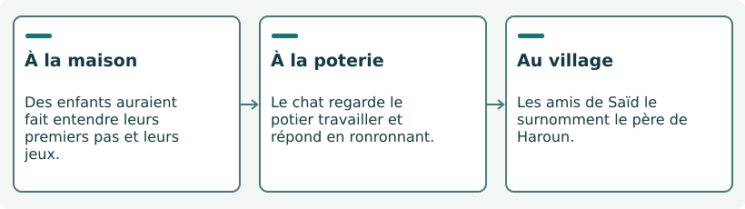

# ENS · MP-PC · Arabe (LE2) 2008 — Corrigé guidé

*Corrigé rédigé par IA, non officiel. Signalez toute erreur.*

**Rédaction** · GPT-6.2 Astra Ultra · vitesse non renseignée

Le sujet associe un récit de Sabah Mohieddine à une question sur le rôle que jouent parfois les animaux familiers. Le registre fournit le cahier de l’épreuve.

## I. Version française

Le prénom Saïd signifie « heureux ». La phrase qui dit son bonheur fait donc écho au titre. Les verbes habituels à l’imparfait installent le rythme de la maison et du métier. Conserver le « comme si » devant les pensées prêtées au chat, puis traduire le surnom final pour faire entendre le mot « père ».

### Proposition rédigée

**Saïd le potier**

Il y avait alors au village un homme du nom de Saïd le potier. Son métier consistait à fabriquer des cruches et des gobelets de terre cuite rouge et à les vendre. Saïd était, à la vérité, heureux dans sa vie et homme de bien dans ses actes. Il ne connaissait que le chemin de sa maison à son travail et ne manquait à aucun de ses devoirs religieux. Sa femme était elle aussi une femme pieuse, qui passait le plus clair de son temps à égrener les louanges de Dieu et à prier. Tout ce qui manquait à Saïd et à sa femme, c’étaient des enfants qui feraient leurs premiers pas dans la maison et l’empliraient de chants et de gazouillis. La femme avait essayé toutes les drogues et les herbes du guérisseur. Elle avait bu toutes les coupes des devins, récité toutes les prières et fait mille vœux, sans que le Tout-Puissant lui accordât d’enfant.

Saïd accepta le décret de Dieu. Pas un mot de protestation contre son jugement ne lui échappa. Il ne songea plus aux enfants, mais il se choisit un chat sur lequel il reporta toute sa tendresse et toute son affection. Il l’emmenait même travailler avec lui à la poterie. « Haroun », c’était le nom du chat, se tenait alors assis sur son arrière-train à côté de son maître. De ses yeux verts et profonds il le regardait tirer d’un morceau d’argile de belles formes dont il faisait des cruches et des gobelets. Saïd parlait au chat comme à un être humain, et « Haroun » lui répondait par un ronronnement qui variait au gré des propos de son maître, comme s’il les comprenait et partageait ses pensées et ses sentiments.

Le soir, Saïd dînait, se reposait un peu, puis se rendait à la mosquée du marché pour la prière du soir. Le chat le suivait jusqu’à la porte de la mosquée et l’attendait là jusqu’à sa sortie. Les amis de Saïd le taquinaient à propos du chat, si bien qu’ils lui donnèrent le surnom d’Abou Haroun, le père de Haroun.

D’après Sabah Mohieddine.

## II. Question en arabe

Le sujet invite à élargir le cas de Saïd. Le regard du chat dans l’atelier et son attente devant la mosquée sont deux observations précises qui permettent de définir la compagnie. L’exemple du chien et du voisin déplace ensuite l’analyse vers les liens entre humains. Le dernier paragraphe donne à l’animal des besoins qui lui sont propres.

### Proposition rédigée

يعرف أهل القرية سعيداً من خلال مهنته، ثم يمنحونه بفضل قطه اسماً آخر هو أبو هارون. وبين الاسمين نرى الدور الذي قد يلعبه الحيوان الأليف في حياة صاحبه. فهو رفيق يشهد تفاصيل لا يشاركه فيها أحد. يجلس إلى جانب الفخاري وهو يعيد الحركة نفسها لساعات، وينتظره عند باب المسجد من غير أن يطالبه بتفسير شيء. لا يعوض القط الطفل الذي تمناه الزوجان، لكنه يتيح لسعيد أن يمنح حنانه لكائن حي وأن يجد، حين يرفع رأسه عن الطين، عينين تنظران إليه.

وقد يغير الحيوان إيقاع يوم بأكمله. فالذي يعيش وحده ويخرج ليمشي مع كلبه في ساعة معلومة قد يتعرف إلى جار كان يمر به من قبل من غير كلام. والطفل الذي يتولى ملء وعاء الماء يتعلم أن الاهتمام بالآخر فعل يتكرر حتى في اليوم الذي لا يرغب فيه باللعب. غير أن هذه الصداقة تقوم على احترام اختلاف الحيوان عنا. قد يحسب الإنسان مواء قطه جوابا عن سؤاله بينما يكون القط جائعا أو مريضا. ومن يحب الحيوان حقا ينتبه إلى حاجاته الخاصة ويهيئ له الرعاية والمكان المناسبين. بذلك يصبح الأنس الذي نجده عنده علاقة نتعهدها كل يوم.

[Sujet](https://banques-ecoles.fr/cms/wp-content/data/filiere-pc/annales-de-la-banque-pc/session-2008/sujet-ecrit-2008_mp-pc_sujet_langue_etrangere_2.pdf#page=4)
