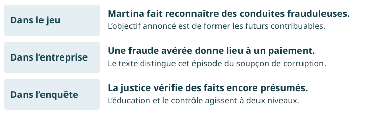

# ENS · MP-PC · Espagnol (LV1) 2008 — corrigé guidé

*Corrigé rédigé par IA, non officiel. Signalez toute erreur.*

**Rédaction** · GPT-6.2 Astra Ultra · vitesse non renseignée · 25 novembre 2026

Épreuve de deux heures, sans dictionnaire, commune aux ENS de Paris, de Lyon et de Cachan. La version vaut 12 points et l’expression 8 points. Longueur indiquée pour l’expression : 100 mots au minimum.

## 1. Version française

**L’Argentine lance un jeu vidéo pour combattre la fraude**

### Avant de traduire

*Fisco* désigne l’administration fiscale et *recaudación* le montant des recettes. *Créditos del BID* renvoie au financement du programme. Dans le dernier paragraphe, *admitió* porte sur une fraude reconnue, tandis que *presunto* maintient l’incertitude de l’enquête concernant les marchés publics.

### Proposition de traduction

En juillet, le fisc argentin distribuera dans les écoles primaires de tout le pays quelque 300 000 exemplaires d’un jeu vidéo retraçant les aventures de Martina, une « chasseuse » de « délinquants fiscaux », afin d’inculquer aux enfants « une nouvelle culture de l’impôt ».

Le jeu proposera douze missions dans lesquelles Martina devra arrêter ceux qui ne paient pas leurs impôts ou commettent des fraudes. Cette initiative s’inscrit dans le programme d’éducation fiscale, qui comprend des ateliers et des jeux financés par des prêts de la Banque interaméricaine de développement (BID). Martina, une adolescente recrutée par le fisc pour « chasser » les fraudeurs et ceux qui se soustraient à l’impôt, est un personnage qui paraît dans des magazines pour enfants depuis 2004.

« De nos jours, une bonne partie du temps que les enfants consacrent à se divertir se passe devant l’ordinateur. En lançant Martina, nous cherchons à semer les graines d’une nouvelle culture fiscale », a déclaré le directeur de la campagne, Alberto Abad. La conception et la distribution du jeu coûtent un million de pesos, soit environ 315 500 dollars. Il est prévu que les enfants puissent télécharger sur Internet de nouveaux épisodes des aventures de Martina.

Ces dernières années, le fisc argentin a battu des records de recettes à la faveur de la prospérité économique et d’un renforcement des contrôles destinés à lutter contre la fraude fiscale, qui avait atteint au moins dix milliards de dollars au cours de la décennie précédente. Il y a deux ans, on a découvert une fraude commise par une société qui vendait à des entreprises de fausses factures pour leur permettre d’éluder l’impôt. Le groupe de BTP suédois Skanska, impliqué dans cette affaire, a reconnu la fraude et s’est acquitté du montant soustrait au fisc par ses salariés indélicats, qu’il a licenciés. Dans le prolongement de cette affaire, la justice fédérale enquête également sur des soupçons de pots-de-vin versés à des fonctionnaires pour que Skanska obtienne des marchés de construction de gazoducs.

*D’après elpais.es, 7 février 2008.*

## 2. Expression en espagnol

### 1. ¿Qué opina de la utilización de un videojuego con una finalidad educativa?

Examiner ce que l’élève fait dans le jeu, puis ce qu’il doit encore apprendre à expliquer après avoir joué. L’intérêt du support ne garantit pas l’apprentissage visé.

Un videojuego puede ser útil si propone decisiones que los alumnos tengan que explicar después. En el caso de Martina, reconocer una conducta fraudulenta podría llevar a preguntar quién paga los servicios de una escuela y qué ocurre cuando una parte de las contribuciones falta. Esa conversación daría sentido a las misiones. En cambio, si basta con atrapar a un personaje y sumar puntos, los niños tal vez recuerden la persecución mejor que el principio que debía ilustrar. También conviene que quienes tienen menos experiencia con los mandos puedan participar en igualdad de condiciones. Jugar por parejas y discutir cómo se ha llegado a una respuesta serían dos formas sencillas de conseguirlo.

*112 mots.*

### 2. ¿Le parece útil este método para cambiar la situación descrita al final del artículo?

Préciser la temporalité des effets : un jeu vise des futurs citoyens, alors qu’un marché public en cours appelle des contrôles dans le présent. Ne pas confondre ce qui a été admis et ce qui fait encore l’objet d’une enquête.

El juego puede contribuir a que los futuros contribuyentes entiendan por qué una factura falsa perjudica a otras personas. A largo plazo, esa comprensión podría reducir la tolerancia social hacia la evasión. Sin embargo, no basta para cambiar por sí sola la situación descrita al final. Los empleados de una gran empresa tienen responsabilidades, incentivos y oportunidades muy distintos de los que aparecen en una aventura infantil. Además, investigar un posible soborno exige examinar decisiones y documentos, escuchar a distintas partes y respetar la presunción de inocencia. La educación temprana resulta más convincente cuando los adultos ven que también se aplican reglas claras a empresas poderosas y que el uso de los fondos públicos se puede comprobar.

*117 mots.*

## Sources

ENS de Paris, de Lyon et de Cachan. Le rapport écrit de cette option reste à retrouver.

[Sujet, p. 4](https://banques-ecoles.fr/cms/wp-content/data/filiere-pc/annales-de-la-banque-pc/session-2008/sujet-ecrit-2008_mppc_sujet_langue_vivante_1.pdf#page=4)
