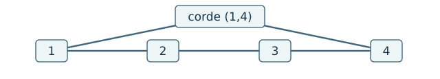
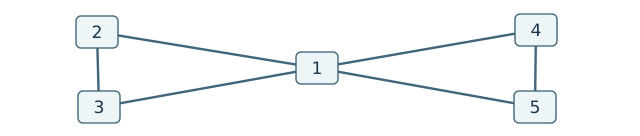
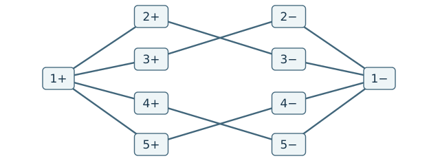

# ENS · MP-PC · Informatique 2008 — corrigé brut

*Corrigé rédigé par IA, non officiel. Signalez toute erreur.*

**Rédaction** · GPT-6.2 Astra Ultra · vitesse non renseignée · 25 novembre 2026

**Révision (tour 1)** · GPT-6.2 Astra Ultra · vitesse non renseignée · 26 novembre 2026

Le graphe est simple, connexe, non orienté et fourni par ses listes d’adjacence. Il a n sommets et m arêtes. Les cycles de la deuxième partie sont représentés par des ensembles d’arêtes et les calculs de parité ont lieu dans le corps à deux éléments.

## Partie 1. Arbres couvrants et cycles fondamentaux

### Question 1.1 · Finitude, existence et reconnaissance

**1(a).** Avant de revenir au premier sommet, un cycle élémentaire visite des sommets distincts. Sa description a donc longueur bornée par $n+1$ dans un alphabet fini. Il n’y a qu’un nombre fini de telles descriptions.

**1(b).** Partir d’un sommet. Tant que des sommets manquent, la connexité donne une arête entre un sommet atteint et un sommet extérieur. Ajouter cette arête et ce sommet. On maintient la connexité de la partie construite et l’arête ajoutée ne peut fermer un cycle. On obtient un arbre couvrant.

**2.** Toute composante connexe sans cycle à $n>1$ sommets possède une feuille, par exemple une extrémité d’un chemin simple maximal. Un voisin supplémentaire prolongerait ce chemin ou créerait un cycle. En retirant la feuille et son arête, on conserve un arbre. La récurrence depuis le sommet isolé donne $n-1$ arêtes.

**3.** La double somme des degrés vaut $2m$. Puisqu’un arbre couvrant existe avec $n-1$ arêtes, chaque arête supplémentaire ferme un cycle avec le chemin de l’arbre entre ses extrémités.

```text
SansCycleElem(Adj) :
    d ← 0
    pour chaque liste L de Adj :
        pour chaque voisin dans L : d ← d+1
    renvoyer (d = 2 × (longueur(Adj)−1))
```

Temps $O(n+m)$ et espace auxiliaire constant.

### Question 1.2 · Construire l’arbre

**1.** Prendre les arêtes $12,13,14,35$. Les listes de l’arbre aux sommets 1 à 5 sont respectivement $(2,3,4),(1),(1,5),(1),(3)$.

**2.** Commencer à 1 et marquer un sommet dès son entrée dans la file.

```text
ArbreCouvrant(Adj) :
    T ← n listes vides ; vus ← n booléens faux
    vus[1] ← vrai ; F ← file contenant 1
    tant que F est non vide :
        s ← défiler(F)
        pour t dans Adj[s] :
            si non vus[t] :
                vus[t] ← vrai ; enfiler(F,t)
                ajouter t en tête de T[s] et s en tête de T[t]
    renvoyer T
```

Chaque arête retenue introduit un sommet neuf, et tous les sommets sont atteints par connexité. On lit chaque liste une fois, soit $O(n+m)$ en temps et $O(n)$ en mémoire pour le résultat et la file.

### Question 1.3 · Produire tous les cycles fondamentaux

**1.** La connexité de $T$ fournit un chemin dont on efface les portions fermées pour le rendre simple. Deux chemins simples distincts entre les mêmes sommets divergeraient puis se rejoindraient, créant un cycle. Le chemin est donc unique.

**2(a).** Poser $N=m-n+1$. Les $N$ arêtes hors arbre donnent chacune un cycle d’au plus $n$ arêtes, donc $L_T\le nN\le n(n-1)(n-2)/2$.

**2(b).** Dans $K_n$, l’étoile donne uniquement des triangles, donc $L_T=3(n-1)(n-2)/2$. Dans le chemin $1,\ldots,n$, une corde d’écart $d\ge2$ donne un cycle de longueur $d+1$, et il y a $n-d$ telles cordes. Ainsi $L_T=\sum_{d=2}^{n-1}(n-d)(d+1)=(n-1)(n-2)(n+6)/6$. Les ordres sont quadratique et cubique.



**3(a–b).** Pendant la construction de $T$, garder le parent et la profondeur. Pour chaque arête hors arbre on remonte jusqu’au premier ancêtre commun. Les listes ci-dessous reçoivent leurs éléments en fin à coût amorti constant.

```text
pour s de 1 à n, pour t dans Adj[s] :
    si s < t et parent[s] ≠ t et parent[t] ≠ s :
        u ← s ; v ← t ; L ← [s] ; R ← [t]
        tant que prof[u] > prof[v] : u ← parent[u] ; ajouter u à L
        tant que prof[v] > prof[u] : v ← parent[v] ; ajouter v à R
        tant que u ≠ v :
            u ← parent[u] ; ajouter u à L
            v ← parent[v] ; ajouter v à R
        émettre L, puis R sans son dernier terme en ordre inverse, puis s
```

La corde est visitée une seule fois. Le cycle émis suit exactement le chemin de l’arbre et le referme par la corde. Le coût est $O(n+m+L_T)=O(1+m+L_T)$ par connexité.

## Partie 2. Bases de poids minimal

### Question 2.1 · Coordonnées en parité

**1(a–b).** Dans $\mathbb F_2$, $0e=\varnothing$, $1e=e$, $-e=e$ et $e+f=e\mathbin{\triangle} f$. Le produit scalaire est le cardinal de $e\cap f$ modulo 2, donc il vaut 1 pour une intersection impaire.

**2.** Choisir une corde $a\in S$. Le cycle fondamental $\varphi_a$ rencontre le support exactement en $a$.

**3.** Restreints aux cordes, les vecteurs $\varphi_a$ sont les colonnes de l’identité, d’où leur indépendance. Tout élément de l’espace des cycles a un degré pair en chaque sommet. En lui ajoutant les $\varphi_a$ des cordes qu’il contient, on annule toutes ses cordes. Le résultat est un sous-graphe pair de l’arbre, nécessairement vide car toute forêt non vide en arêtes a une feuille de degré 1. Les cycles fondamentaux engendrent donc tout l’espace, de dimension $N$.

### Question 2.2 · Échange dans une base minimale

**1.** Si $C_i$ appartenait à l’espace des cycles précédents, son produit scalaire avec $S_i$ serait nul par linéarité. Il vaut 1. Ainsi les $N$ vecteurs obtenus sont libres et forment une base.

**2.** Par récurrence, prendre une base minimale contenant $C_1,\ldots,C_{i-1}$. Décomposer $C_i$ dans cette base et prendre le produit avec $S_i$. Il existe un terme $B$ de coefficient 1 tel que $\langle B,S_i\rangle=1$. Il est extérieur au préfixe. Remplacer $B$ par $C_i$ conserve une base puisque sa coordonnée en $B$ est non nulle. De plus $w(C_i)\le w(B)$ par le choix de $C_i$. La nouvelle base est encore minimale et contient le préfixe prolongé. Si $C_i$ y figurait déjà on peut la garder. Toute base minimale initiale existe par finitude.

### Question 2.3 · Produire les supports orthogonaux

**1(a).** Former la matrice $H$ des $i-1$ lignes $C_k$ restreintes aux $N$ cordes. Le système homogène $Hz=0$ a une variable libre au moins car $i-1<N$.

```text
échelonner H sur le corps à deux éléments
choisir une colonne sans pivot ; fixer sa variable à 1
fixer toutes les autres variables libres à 0
déterminer les pivots en remontant les équations
renvoyer z suivi de m−N zéros
```

**1(b).** L’élimination demande $O(Ni^2)$ opérations et la préparation du vecteur de sortie $O(m)$. Avec un support initial unitaire, sommer sur $i$ donne $O(N^4+mN)=O(m^4)$.

**2(a–b).** Initialiser $R_j$ au vecteur unitaire de la corde $j$. À chaque étape, utiliser la projection ci-dessous en arithmétique binaire.

```text
pour i de 1 à N :
    S[i] ← R[i]
    C[i] ← cycle de poids minimal de produit 1 avec S[i]
    pour j de i+1 à N :
        si produit(C[i], R[j]) = 1 : R[j] ← R[j]+S[i]
```

Les vecteurs restants sont des combinaisons de l’ancienne famille orthogonale aux cycles précédents. Le produit avec $C_i$ devient nul car $\langle C_i,S_i\rangle=1$. Si une combinaison de ces nouveaux vecteurs est nulle, l’expression dans l’ancienne famille a les mêmes coefficients sur les $R_j$ d’indice $j>i$. L’ancienne indépendance force leur nullité. Les supports restent donc indépendants et non vides. Les $O(N^2)$ tests et sommes sur $N$ cordes coûtent $O(N^3+mN)=O(m^3)$ hors recherche des cycles.

### Question 2.4 · Trouver un cycle de parité impaire

**1.** Chaque arête incidente à 1 relie les sommets de même signe. Les deux autres relient les feuillets en croisant les signes. Toutes les arêtes des deux graphes ont poids nul.





**2(a).** Projeter la chaîne fermée dans $G$ et garder les arêtes utilisées un nombre impair de fois. Chaque sommet a degré pair dans cet ensemble $C$ car entrées et sorties se compensent modulo deux. Un sous-graphe pair se décompose en cycles élémentaires disjoints en arêtes : suivre des arêtes jusqu’à fermer un circuit, en extraire un cycle simple, le retirer et recommencer. Le nombre de changements de signe est impair, donc $\langle C,S_i\rangle=1$. Les poids non négatifs assurent $w(C)\le w(\sigma)$.

**2(b).** Les indices d’arêtes de la chaîne donnent directement les cases à modifier.

```text
VecteurCycle(chaine,m)
    C ← tableau de m bits nuls
    pour chaque indice k dans chaine :
        C[k] ← 1 − C[k]
    renvoyer C
```

Après chaque passage, le bit indique la parité du nombre d’occurrences déjà lues. Le coût est $O(m+\lambda)$.

**2(c).** Tout cycle de produit 1 admet une composante élémentaire de produit 1 et de poids au plus égal au sien, par la décomposition précédente. En suivant cette composante depuis un sommet $t$, son relèvement part de $t^+$ et termine en $t^-$. Ainsi $\min_t\delta(t^+,t^-)\le w(D)$ pour tout cycle admissible $D$. Avec l’inégalité de 2(a) pour la chaîne minimale, toutes les bornes sont atteintes.

**3(a).** La question 2.1.2 assure l’existence d’un cycle impair. Au moins une distance est donc finie.

```text
CycleImpairMinimum(G,S)
    meilleur ← infini
    pour chaque sommet s de G :
        (d, chaine) ← PlusCourteChaine(G,S,s)
        si d < meilleur :
            meilleur ← d
            temoin ← chaine
    renvoyer VecteurCycle(temoin,m)
```

**3(b).** Les $n$ appels coûtent $O(nm+n^2\log n)$, reconstruction comprise (on peut retenir une chaîne simple dans le graphe doublé). En répétant $N$ fois et en utilisant 2.3.2, le temps de BaseMinimale1 est $O(N(nm+n^2\log n)+N^3+mN)$, donc $O(m^3+mn^2\log n)$.

### Question 2.5 · Mises à jour par blocs

**1(a).** Découper la dimension commune $q$ en $\lceil q/p\rceil$ bandes de largeur $p$, en complétant la dernière par zéro. Multiplier les blocs correspondants et sommer les produits $p\times p$. Le coût est $O(qp^{\omega-1})$.

**1(b).** Pour une matrice triangulaire inférieure, la formule par blocs est
$$
\begin{pmatrix}A&0\\B&D\end{pmatrix}^{-1}
=\begin{pmatrix}A^{-1}&0\\-D^{-1}BA^{-1}&D^{-1}\end{pmatrix}.
$$
Inverser récursivement les deux blocs diagonaux de demi-taille, assembler par MulMat, puis multiplier $P^{-1}Q$. Une complétion par l’identité jusqu’à la puissance de deux suivante préserve le problème. Le coût d’inversion satisfait $T(p)\le2T(p/2)+O(p^\omega)$, soit $O(p^\omega)$ puisque $\omega\ge2$. Le cas triangulaire supérieur suit par transposition de l’inverse.

**2(a–b).** Écrire $U,V$ pour les deux matrices des supports en colonnes et $D$ pour la matrice de $q$ lignes $C_{p+1},\ldots,C_{p+q}$. Poser $P=DU$, $Q=DV$, donc $P_{h\ell}=\langle C_{p+h},U_\ell\rangle$ et de même pour $Q$ avec $V_\ell$. Les hypothèses rendent $P$ triangulaire inférieure à diagonale 1. Résoudre $PX=Q$ et renvoyer $W=V+UX$. Alors $DW=Q+PX=0$. Les $p$ premières contraintes restent satisfaites par linéarité. La colonne $W_\ell$ conserve le pivot 1 de $V_\ell$ en position $p+q+\ell$ et ses zéros plus bas, car toutes les colonnes de $U$ sont nulles après $p+q$. Cela conserve de vrais supports. Pour former $DU,DV,UX$, employer des bandes de taille $q$ sur la dimension $m$ (pour $UX$, empiler les blocs de lignes). Le coût est $O(mq^{\omega-1}+q^\omega)=O(mq^{\omega-1})$.

**3(a).** Initialiser les $N$ supports aux cordes unitaires. L’appel suivant traite un intervalle de $r$ supports déjà orthogonaux au préfixe de $p$ cycles.

```text
Traiter(p, r) :
    si r = 1 :
        C[p+1] ← meilleur cycle impair pour le support courant p+1
        revenir
    q ← r/2
    Traiter(p,q)
    U ← q supports pivots de la moitié gauche
    V ← q supports courants de la moitié droite
    remplacer V par MiseAJour(C[p+1..p+q], U, V)
    Traiter(p+q,q)
appeler Traiter(0,N)
```

**3(b).** Les opérations préservent le pivot de chaque colonne et tous les produits avec les cycles antérieurs. À la feuille, le support est non nul et le cycle a un produit 1 avec lui. Les blocs achevés vérifient donc toutes les hypothèses de 2(a), par induction sur leur taille. Le procédé effectue des choix autorisés par BaseMinimale1, donc l’argument d’échange de 2.2 prouve sa minimalité.

Pour une demi-taille $q$, il y a $N/(2q)$ mises à jour, coûtant ensemble $O(mNq^{\omega-2})$. Si $\omega>2$ la somme est $O(mN^{\omega-1})\subseteq O(m^\omega)$, et $m^\omega=O(m^2n)$ car $m\le n^2$ et $2(\omega-2)<1$. Si $\omega=2$, elle est $O(mN\log N)=O(m^2n)$. Ajouter les $N$ recherches coûtant $O(Nn(m+n\log n))$. On obtient bien $O(m^2n+mn^2\log n)$.
