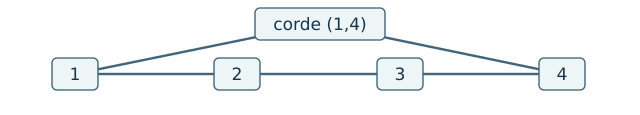
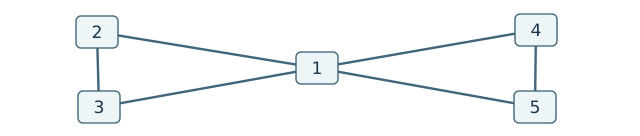
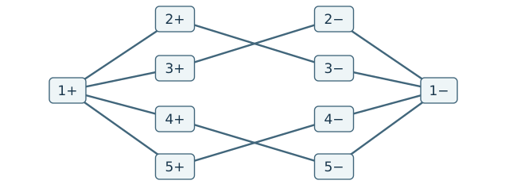

# ENS · MP-PC · Informatique 2008 — corrigé guidé

*Corrigé rédigé par IA, non officiel. Signalez toute erreur.*

**Rédaction** · GPT-6.2 Astra Ultra · vitesse non renseignée · 25 novembre 2026

**Révision (tour 1)** · GPT-6.2 Astra Ultra · vitesse non renseignée · 26 novembre 2026

La question centrale est de choisir des cycles indépendants dont le poids total est minimal. On construit d’abord des cycles autour d’un arbre. Une contrainte de parité transforme ensuite la recherche d’un cycle léger en recherche d’un plus court chemin.

## Partie 1. Arbres couvrants et cycles fondamentaux

### Question 1.1 · Finitude, existence et reconnaissance

**1(a–b).** Un cycle élémentaire ne peut épuiser les sommets puis en visiter un nouveau. On le code donc par une suite bornée de choix dans un ensemble fini. Pour obtenir un arbre, considérer le sous-graphe connexe couvrant avec le moins d’arêtes. S’il contenait un cycle, enlever une arête de ce cycle conserverait la connexité grâce au détour par le reste du cycle. Ce serait contraire à sa minimalité.

**2.** Enlever une feuille diminue le nombre de sommets et celui d’arêtes d’une unité. Il y a bien une feuille dès que $n>1$, car au bout d’une plus longue chaîne simple l’unique voisin possible est le précédent, tout autre voisin entraînant prolongement ou cycle. L’arbre réduit reste connexe et sans cycle. Revenir à un sommet sans arête prouve la formule $m=n-1$.

**3.** Ici le graphe fourni est connexe. Il est donc sans cycle exactement quand il n’a aucune arête en plus de son arbre couvrant. Comptons les entrées des listes plutôt que de reconstruire les arêtes.

```text
compteur ← 0
pour s de 1 à n :
    pour t dans Adj[s] : compteur ← compteur+1
renvoyer compteur = 2(n−1)
```

Chaque arête apparaît aux deux extrémités. La lecture coûte $O(n+m)$ et traite aussi $n=1$.

### Question 1.2 · Construire l’arbre

**1.** Les sommets 2, 3 et 4 sont voisins de 1. On peut ensuite rattacher 5 par 3. En écrivant les listes dans les deux sens on trouve $T[1]=(2,3,4)$, $T[2]=(1)$, $T[3]=(1,5)$, $T[4]=(1)$, $T[5]=(3)$.

**2.** Une pile peut remplacer la file. Ne conserver que l’arête qui fait découvrir une nouvelle case.

```text
initialiser T à n listes vides et marqué à faux
empiler 1 et marquer 1
tant que la pile contient un sommet :
    s ← dépiler
    pour chaque t de Adj[s] :
        si t n’est pas marqué :
            marquer t ; empiler t
            insérer t dans T[s] ; insérer s dans T[t]
renvoyer T
```

Marquer dès l’insertion évite de retenir deux parents pour le même sommet. La composante de 1 est parcourue en entier et égale le graphe. Les arêtes ajoutées attachent des feuilles à la construction, donc ne ferment aucun cycle. Le temps est $O(n+m)$ et les tableaux, la pile et l’arbre utilisent $O(n)$ places.

### Question 1.3 · Produire tous les cycles fondamentaux

**1.** Entre les extrémités de la corde il existe un chemin dans l’arbre, et le plus court en nombre d’arêtes est simple. S’il en existait un second, suivre le premier jusqu’à la première divergence puis jusqu’à une rencontre avec le second. Les deux tronçons formeraient un cycle dans $T$.

**2(a–b).** Chaque cycle fondamental s’identifie à son unique corde. Il y a $m-(n-1)$ cordes et leur longueur en circuit ne dépasse pas $n$. Le graphe étant simple, $m\le n(n-1)/2$, ce qui donne $L_T\le n(n-1)(n-2)/2$. Pour voir la dépendance en $T$, prendre le graphe complet. Avec un centre et $n-1$ feuilles, toute corde part d’une feuille pour gagner une autre feuille, donc le retour par le centre fait deux pas. La longueur totale vaut $3\binom{n-1}{2}$. Avec un arbre en ligne, un saut de $d$ positions ajoute un cycle de $d+1$ arêtes. Il y a $n-d$ sauts possibles. La somme pour $d=2,\ldots,n-1$ vaut $(n-1)(n-2)(n+6)/6$. On passe de $\Theta(n^2)$ à $\Theta(n^3)$.



**3(a–b).** Garder parent et profondeur lors du parcours de 1.2 (parent de la racine égal à zéro). Dans les listes d’adjacence, ne traiter que les voisins $t>s$, et ignorer les paires parent-enfant. Pour chaque autre paire, appliquer le pseudo-programme suivant.

```text
u ← s ; v ← t ; gauche ← [s] ; droite ← [t]
tant que u ≠ v :
    si prof[u] ≥ prof[v] :
        u ← parent[u] ; ajouter u en fin de gauche
    sinon :
        v ← parent[v] ; ajouter v en fin de droite
ôter la dernière case de droite
écrire gauche puis droite inversée puis s
```

Les deux sommets ne remontent jamais au-dessus du premier ancêtre commun avant leur rencontre, car on ne fait remonter que le plus profond ou l’un des deux en cas d’égalité. On a ainsi listé une fois tous les sommets du chemin, puis fermé par la corde. Le temps de remontée et de sortie est proportionnel à la longueur écrite, même pour un chemin très court. Avec le parcours initial cela donne $O(n+m+L_T)$, soit $O(m+L_T)$ hors du cas d’un sommet isolé.

## Partie 2. Bases de poids minimal

### Question 2.1 · Coordonnées en parité

**1(a–b).** Regarder chaque coordonnée comme un bit de présence. Le scalaire zéro efface tous les bits, le scalaire un les garde et prendre l’opposé les garde aussi. Dans une somme, seules restent les arêtes présentes une fois. Dans le produit scalaire, seules comptent les arêtes présentes deux fois, une dans chaque vecteur, et l’on calcule la parité de leur nombre.

**2–3.** La propriété déterminante d’un cycle fondamental est qu’il contient une seule arête hors arbre, sa propre corde. Pour tout support non vide, en prendre un élément $a$ donne ainsi $\langle S,\varphi_a\rangle=1$. De même, une combinaison nulle de cycles fondamentaux doit avoir un coefficient nul à chaque corde, donc tous ses coefficients sont nuls. Pour engendrer une combinaison de cycles quelconque, lui ajouter un cycle fondamental par corde présente. Les cordes disparaissent, tandis que la parité des degrés de chaque sommet reste paire. Si une arête survivait dans $T$, la forêt de ces arêtes aurait une feuille de degré impair. Il ne reste donc rien, ce qui fournit la décomposition cherchée et la dimension $m-n+1$.

### Question 2.2 · Échange dans une base minimale

**1.** La forme linéaire $C\mapsto\langle C,S_i\rangle$ sépare le nouveau cycle des anciens. Elle vaut zéro sur leur espace et un sur $C_i$. Les $N$ choix successifs forment donc une famille libre de la dimension voulue.

**2.** La comparaison des poids se fait par échange. Supposons déjà fixés les $i-1$ premiers choix dans une base de poids minimal. Pour écrire $C_i$ dans cette base, il faut faire intervenir une direction vue par $S_i$, car les directions invisibles ne pourraient donner un produit scalaire égal à 1. Choisir un tel vecteur $B$ dans cette écriture. Il est hors du préfixe et peut être échangé avec $C_i$, qui a une coordonnée non nulle en $B$. La règle de minimisation donne $w(C_i)\le w(B)$. Le poids total ne croît pas et reste minimal. On poursuit cet échange jusqu’au dernier choix.

### Question 2.3 · Produire les supports orthogonaux

**1(a–b).** Un support contient seulement des cordes et doit être non vide. Chercher ses $N$ bits comme une solution non nulle d’un système qui a moins de lignes que de colonnes.

```text
copier en lignes les N premiers bits de C[1], ..., C[i−1]
réduire la matrice par pivot de Gauss modulo 2
mettre 1 sur une variable libre et 0 sur les autres libres
remonter pour calculer les variables des colonnes pivots
compléter par des zéros sur les arêtes de l’arbre
```

Le bit libre choisi assure que le support est non nul. Une élimination sur $i-1$ lignes de longueur $N$ coûte $O(i^2N)$. Ajouter $O(m)$ pour restituer le vecteur entier. Répéter donne $O(N^4+mN)\subseteq O(m^4)$.

**2(a–b).** Pour éviter de résoudre le système depuis le début à chaque étape, conserver plusieurs solutions indépendantes. Les $N$ points de départ sont les cordes unitaires. À l’étape $i$, poser $S_i=R_i$, appeler la recherche de $C_i$ et appliquer à chaque $j>i$ l’instruction
$$
R_j\gets R_j+\langle C_i,R_j\rangle R_i .
$$
Cela élimine la dernière contrainte exactement comme un pivot de Gauss. Les anciennes contraintes restent satisfaites par linéarité. Dans une combinaison des nouvelles colonnes, chaque coefficient de l’ancienne colonne $R_j$ pour $j>i$ reste celui de la nouvelle colonne correspondante. Aucune combinaison non triviale ne peut donc s’annuler. On possède bien les familles demandées à tous les rangs. Il suffit d’une double boucle sur les paires $i<j$, avec $O(N)$ opérations binaires par paire. Le coût des supports devient $O(N^3+mN)=O(m^3)$.

### Question 2.4 · Trouver un cycle de parité impaire

**1.** Le support contient $23$ et $45$. Remplacer, par exemple, $23$ par les deux arêtes $2^+3^-$ et $2^-3^+$. Pour $12$, conserver au contraire les signes. Les figures donnent les six arêtes initiales et les douze arêtes après duplication. Leur poids est partout zéro.





**2(a–b).** Une chaîne reliant les deux copies du même sommet se projette en une marche fermée. Une arête parcourue deux fois ne compte plus modulo deux. Les arêtes qui restent forment un graphe à degrés pairs puisqu’en chaque sommet les entrées et sorties d’une marche fermée vont par paires. On peut en extraire des cycles simples l’un après l’autre jusqu’à épuisement, car enlever un cycle préserve la parité. Le support a été traversé un nombre impair de fois pour changer de feuillet. Après réduction, la parité reste impaire. Enlever des arêtes de poids positif ou nul n’augmente pas le poids. L’algorithme travaille directement sur les numéros fournis.

```text
C ← tableau de m bits nuls
pour chaque numéro k dans chaine :
    inverser le bit C[k]
renvoyer C
```

Le coût $O(m+\lambda)$ comprend l’initialisation.

**2(c).** Pour obtenir l’inégalité dans l’autre sens, partir d’un cycle $D$ impair pour le support. Parmi ses morceaux élémentaires au moins un, disons $D'$, est impair. Le relever depuis un de ses sommets $t$ donne une chaîne de $t^+$ à $t^-$ de poids $w(D')\le w(D)$. La distance minimale sur $t$ est donc au plus le poids de toute solution. La projection de la meilleure chaîne donne, par 2(a), une solution dont le poids est au plus cette distance. C’est le poids optimal.

**3(a–b).** Comparer toutes les sources, même si la première donne déjà une chaîne.

```text
meilleur ← infini
pour s de 1 à n :
    (d, chemin) ← PlusCourteChaine(G, S[i], s)
    si d < meilleur : (meilleur, témoin) ← (d, chemin)
renvoyer le vecteur de parité du témoin par la boucle de 2(b)
```

L’existence d’un cycle impair assure un minimum fini. Avec l’algorithme admis, le temps pour un cycle est $O(n(m+n\log n))$, y compris le dernier parcours du témoin. La recherche entière demande $N$ fois ce temps et $O(N^3+mN)$ pour les supports de 2.3. Puisque $N\le m$ et $n\le m+1$, la borne demandée est $O(m^3+mn^2\log n)$.

### Question 2.5 · Mises à jour par blocs

**1(a).** Un bloc $p\times p$ de la première matrice s’aligne sur un bloc $p\times p$ de la seconde. Compléter le dernier couple par des zéros. On additionne alors $\lceil q/p\rceil$ multiplications carrées. Les additions de blocs coûtent $O(p^2)$ chacune, absorbées par $O(p^\omega)$. La borne devient $O(qp^{\omega-1})$.

**1(b).** Calculer l’inverse triangulaire par moitiés avant de l’appliquer à $Q$. Pour un bloc inférieur $\bigl(\begin{smallmatrix}A&0\\B&D\end{smallmatrix}\bigr)$, les blocs diagonaux de l’inverse sont $A^{-1},D^{-1}$ et le bloc inférieur vaut $-D^{-1}BA^{-1}$ par multiplication de vérification. Le cas supérieur s’obtient par transposition. On a deux sous-inversions, quelques produits carrés et un inverse scalaire au cas de base. Avec un remplissage par un bloc identité si nécessaire, la somme des coûts par niveau est géométrique, de premier terme $O(p^\omega)$ et de raison $2^{1-\omega}<1$. La dernière multiplication par $Q$ conserve cette borne.

**2(a).** Pour rendre les $V$ orthogonaux aux $q$ cycles supplémentaires, chercher $W=V+UX$ avec une colonne par nouveau support. Les anciennes contraintes sont alors satisfaites automatiquement. En empilant les $q$ cycles supplémentaires dans une matrice $D$ de $q$ lignes, il reste $DW=0$, soit $(DU)X=DV$ sur le corps binaire. L’élément $(h,\ell)$ de $DU$ teste $C_{p+h}$ contre $U_\ell$. Il est nul pour $h<\ell$ et vaut un sur la diagonale. Le système a une solution unique. Les combinaisons de $U$ sont nulles sur les dernières lignes pivots de $V$, ce qui garantit que chaque $W_\ell$ garde son 1 propre en $p+q+\ell$ et reste un support.

**2(b).** Concrètement, former $P=DU$, $Q=DV$, résoudre $PX=Q$ avec 1(b), former $UX$ et ajouter $V$. Les deux premiers produits utilisent 1(a) avec la grande dimension $m$. Le dernier empile des produits de blocs de $q$ lignes à la fois. Les trois sont en $O(mq^{\omega-1})$. Le système en $O(q^\omega)$ et les $mq$ additions sont absorbés.

**3(a–b).** Diviser le tableau initial des cordes unitaires en deux moitiés. Résoudre d’abord la moitié gauche. Ses supports définitifs et leurs cycles donnent alors $U,D$. Appliquer la mise à jour à la moitié droite et la résoudre à son tour. À taille 1, le seul calcul est la recherche en 2.4 du cycle de poids minimal coupant le support en parité impaire. Une induction maintient le pivot propre, les zéros en dessous et l’orthogonalité aux cycles déjà fixés. Les supports et les cycles obtenus respectent donc exactement les conditions de l’algorithme dont 2.2 a prouvé la validité.

Pour compter la préparation, à l’échelle des moitiés de longueur $q$ on effectue $N/(2q)$ appels à MiseAJour, chacun en $O(mq^{\omega-1})$. Si $\omega>2$, sommer les puissances dyadiques de $q$ donne $O(mN^{\omega-1})\le O(m^\omega)$. Or $m^{\omega-2}\le n^{2(\omega-2)}\le n$ par la borne sur $\omega$. Si $\omega=2$, les niveaux coûtent chacun $O(mN)$ et il y en a $\log_2 N$ au plus, avec $\log_2 N=O(n)$. Dans les deux cas, la préparation tient en $O(m^2n)$. Les $N$ feuilles coûtent $O(Nnm+Nn^2\log n)$. L’ensemble est donc en $O(m^2n+mn^2\log n)$.
