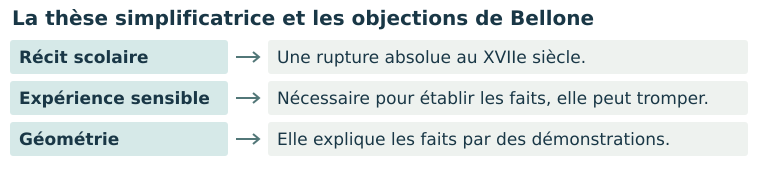
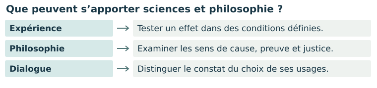

# ENS · MP-PC · Italien (LE2) 2008 — Corrigé guidé

*Corrigé rédigé par IA, non officiel. Signalez toute erreur.*

**Rédaction** · GPT-6.2 Astra Ultra · vitesse non renseignée

Le cahier commun aux ENS de Paris et de Cachan dure deux heures. Dictionnaire et calculatrice interdits pour l’italien. La question demande une réponse en italien de 100 mots. La garde prévoit 15 points pour la version et 5 pour la question.

## V. Version française

*Seicento* désigne le XVIIe siècle. Le conditionnel de *nascerebbe* présente avec distance une thèse qui sera contestée. *Sensate esperienze* renvoie aux sens, *certe dimostrazioni* à la certitude. La dernière opposition de Bellone concerne les rôles de philosophe de la nature et de technicien.

**Science, méthode et nature**

Il existe des opinions erronées qui deviennent facilement des vérités incontestées, transmises par l’enseignement scolaire et jusque dans les universités. En témoigne l’idée selon laquelle la science serait née en Europe, au XVIIe siècle, avec la découverte d’une méthode expérimentale. Une méthode qui aurait ruiné les connaissances des Anciens, lesquelles ne mériteraient pas le nom de science et constitueraient un legs métaphysique.

Ceux qui font l’éloge de cette méthode nouvelle soulignent qu’avec Galilée elle privilégie les « expériences sensibles » et les « démonstrations certaines », ce qui ferait d’elle une révolution. Galilée écrit en réalité que les « expériences sensibles », rendues possibles par les organes des sens, sont importantes mais peuvent nous tromper. Quant aux « démonstrations certaines », il précise en revanche qu’elles se fondent sur des vérités géométriques qui, elles, sont absolument « certaines ».

Pourtant, c’est bien Galilée lui-même qui répète que si Aristote revenait à la vie, il lui donnerait raison sur le terrain de l’expérience. Un geste rhétorique ? Nullement. Galilée savait fort bien ce qu’Aristote avait soutenu à propos de la connaissance des phénomènes naturels. Pour Aristote, qui souhaitait étudier l’univers devait accomplir deux opérations fondamentales, établir les faits par l’expérience puis utiliser la géométrie pour les expliquer.

[…]

En somme, nous devrions comprendre aujourd’hui que les « expériences sensibles » et les « démonstrations certaines » constituent les invariants de notre évolution culturelle. […]

De fait, Galilée n’a jamais écrit de livre sur la méthode, mais il a fait de la science. Il était philosophe de la nature, et non technicien.

## 1. Può la scienza fare a meno della filosofia?

*Fare a meno di* signifie « se passer de ». Un chercheur peut réaliser une mesure sans consulter un philosophe. L’interrogation sur ce qui constitue une preuve subsiste néanmoins dans son travail. Le cas d’une politique de santé montre comment articuler l’analyse des faits et celle des finalités.

Un ricercatore può misurare una temperatura senza consultare un trattato di filosofia. Tuttavia, quando sostiene che un dato costituisce una prova, adopera già concetti che meritano di essere chiariti. Distinguere una causa da una semplice coincidenza richiede esperimenti, ma anche una riflessione su che cosa ci autorizzi a concludere. Lo stesso vale quando una scoperta orienta una decisione pubblica. Uno studio può confrontare due cure; scegliere come distribuire risorse limitate richiede anche un giudizio di giustizia. La filosofia aiuta a formulare simili domande, mentre la pratica scientifica impedisce che le risposte ignorino i fatti. Il dialogo è fecondo per entrambe.

*100 mots.*

L’extrait provient d’Enrico Bellone, Le Scienze, février 2008. Les deux coupures du cahier sont conservées. La réponse italienne compte 100 mots. Le rapport de cette option n’a pas été retrouvé.

[Version et consignes](https://banques-ecoles.fr/cms/wp-content/data/filiere-pc/annales-de-la-banque-pc/session-2008/sujet-ecrit-2008_mp-pc_sujet_langue_etrangere_2.pdf#page=7)
